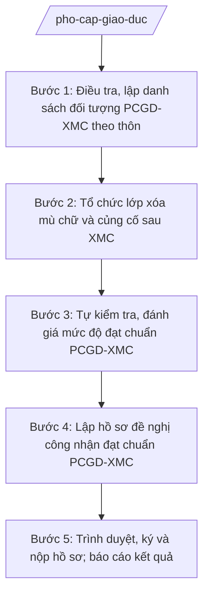

# Skill: Phổ cập giáo dục, xóa mù chữ

## 2. Khi nào dùng

- Hằng năm: điều tra, rà soát đối tượng phổ cập giáo dục (PCGD) mầm non cho trẻ 5 tuổi, PCGD tiểu học, PCGD THCS và xóa mù chữ (XMC) trên địa bàn xã.
- Tổ chức mở lớp xóa mù chữ, lớp củng cố sau xóa mù chữ cho người dân trong độ tuổi.
- Tự kiểm tra, đánh giá mức độ đạt chuẩn PCGD-XMC của xã; lập hồ sơ đề nghị cấp có thẩm quyền công nhận (hoặc công nhận lại) đạt chuẩn.
- Báo cáo kết quả PCGD-XMC định kỳ gửi Phòng VH-XH tổng hợp, Sở GD&ĐT tỉnh A.

## 3. Đầu vào (Input)

| Trường | Mô tả | Bắt buộc |
|--------|-------|----------|
| `nam_kiem_tra` | Năm/kỳ tự kiểm tra, đề nghị công nhận (vd: 2026) | Có |
| `doi_tuong_mn5t` | Danh sách trẻ 5 tuổi trên địa bàn (họ tên, ngày sinh, thôn, tình trạng đi học) | Có |
| `doi_tuong_th` | Danh sách trẻ 6–14 tuổi (tình trạng hoàn thành chương trình tiểu học) | Có |
| `doi_tuong_thcs` | Danh sách người 15–18 tuổi (tình trạng tốt nghiệp THCS) | Có |
| `doi_tuong_xmc` | Danh sách người 15–60 tuổi chưa biết chữ/cần củng cố (họ tên, thôn, trình độ) | Có |
| `ket_qua_lop_xmc` | Số lớp XMC đã mở trong năm, số học viên theo học, số người biết chữ sau khóa học | Không |
| `ban_chi_dao` | Thành viên Ban Chỉ đạo PCGD-XMC xã (Trưởng ban, Phó ban, thành viên) | Có |
| `thoi_han` | Thời hạn hoàn thành tự kiểm tra và nộp hồ sơ đề nghị công nhận | Có |

## 4. Quy trình

**Bước 1. Điều tra, lập danh sách đối tượng PCGD-XMC theo thôn**

- Làm gì: Tổ chức điều tra từng hộ gia đình trên địa bàn các thôn để lập danh sách đối tượng PCGD (trẻ 5 tuổi, trẻ 6–14 tuổi, người 15–18 tuổi) và đối tượng XMC (15–60 tuổi chưa biết chữ); đối chiếu với dữ liệu dân cư, dữ liệu trường học.
- Dùng input: `doi_tuong_mn5t`, `doi_tuong_th`, `doi_tuong_thcs`, `doi_tuong_xmc`, `ban_chi_dao`.
- Vai trò: Công chức VH-XH phụ trách giáo dục (ông Nguyễn Văn G) chủ trì, phối hợp trưởng thôn và cộng tác viên PCGD từng thôn đi điều tra thực tế. AI hỗ trợ: thiết kế phiếu điều tra theo độ tuổi, tổng hợp phiếu thành danh sách theo thôn, đối chiếu chéo để phát hiện trùng/sót đối tượng. ⏱ 7–10 ngày (ước tính) làm việc.
- Lưu ý nghiệp vụ: Danh sách phải có xác nhận của trưởng thôn; đối tượng phải phân đúng độ tuổi theo quy định PCGD-XMC, không gộp sai nhóm tuổi.
- → Kết quả bước: Danh sách đối tượng PCGD-XMC toàn xã phân theo thôn, có xác nhận của trưởng thôn.

**Bước 2. Tổ chức lớp xóa mù chữ và củng cố sau XMC**

- Làm gì: Căn cứ danh sách đối tượng XMC, lập kế hoạch mở lớp (địa điểm, thời gian, giáo viên); vận động học viên ra lớp; theo dõi sĩ số, kết quả học tập; tổ chức kiểm tra công nhận biết chữ.
- Dùng input: `doi_tuong_xmc`, `ket_qua_lop_xmc`.
- Vai trò: Công chức VH-XH phụ trách giáo dục phối hợp với các trường TH/THCS bố trí giáo viên, địa điểm lớp học. AI hỗ trợ: lập danh sách lớp học, thời khóa biểu, mẫu sổ theo dõi học viên, tổng hợp kết quả sau mỗi đợt. ⏱ ~theo tiến độ lớp học, thường 3–4 tháng/đợt (ước tính).
- Lưu ý nghiệp vụ: Ưu tiên mở lớp tại thôn có đông đối tượng; vận động cả gia đình tạo điều kiện cho học viên đi học đầy đủ; lưu hồ sơ kết quả từng học viên làm căn cứ công nhận.
- → Kết quả bước: Danh sách lớp XMC, sổ theo dõi học viên, kết quả công nhận biết chữ từng đợt.

**Bước 3. Tự kiểm tra, đánh giá mức độ đạt chuẩn PCGD-XMC**

- Làm gì: Ban Chỉ đạo PCGD-XMC xã tổ chức tự kiểm tra theo các tiêu chuẩn, tính tỷ lệ đạt chuẩn từng mức độ (PCGD mầm non 5 tuổi, PCGD tiểu học, PCGD THCS, XMC); lập biên bản tự kiểm tra.
- Dùng input: Kết quả bước 1–2; `ban_chi_dao`, `nam_kiem_tra`.
- Vai trò: Trưởng Ban Chỉ đạo PCGD-XMC xã (thường là Phó Chủ tịch UBND xã – bà Trần Thị B) chủ trì; công chức VH-XH phụ trách giáo dục chuẩn bị số liệu. AI hỗ trợ: tính toán tỷ lệ đạt chuẩn theo từng tiêu chí, lập bảng đánh giá đối chiếu chuẩn, soạn dự thảo biên bản tự kiểm tra. ⏱ 3–5 ngày (ước tính) làm việc.
- Lưu ý nghiệp vụ: Số liệu tự kiểm tra phải dựa trên danh sách đối tượng đã điều tra (bước 1) và hồ sơ lớp XMC (bước 2), không lấy số liệu ước đoán; biên bản phải có chữ ký các thành viên Ban Chỉ đạo.
- → Kết quả bước: Bảng đánh giá mức độ đạt chuẩn PCGD-XMC + biên bản tự kiểm tra của Ban Chỉ đạo xã.

**Bước 4. Lập hồ sơ đề nghị công nhận đạt chuẩn PCGD-XMC**

- Làm gì: Soạn thảo đầy đủ hồ sơ đề nghị công nhận đạt chuẩn gồm: tờ trình, báo cáo kết quả tự kiểm tra, biên bản kiểm tra, danh sách đối tượng và các minh chứng kèm theo, đúng thành phần hồ sơ theo quy định.
- Dùng input: Kết quả bước 1–3; `thoi_han`.
- Vai trò: Công chức VH-XH phụ trách giáo dục soạn hồ sơ. AI hỗ trợ: soạn dự thảo tờ trình và báo cáo tự kiểm tra theo thể thức NĐ 30/2020/NĐ-CP, lập danh mục thành phần hồ sơ (checklist) để đối chiếu không thiếu giấy tờ. ⏱ 2–3 ngày (ước tính) làm việc.
- Lưu ý nghiệp vụ: Hồ sơ gửi cấp có thẩm quyền công nhận; giữ 1 bộ hồ sơ gốc tại Phòng VH-XH để phục vụ kiểm tra, phúc tra sau này.
- → Kết quả bước: Bộ hồ sơ đề nghị công nhận đạt chuẩn PCGD-XMC hoàn chỉnh (tờ trình + báo cáo + biên bản + danh sách + minh chứng).

**Bước 5. Trình duyệt, ký và nộp hồ sơ; báo cáo kết quả**

- Làm gì: Trình hồ sơ qua các nấc kiểm duyệt, ký ban hành tờ trình/báo cáo; nộp hồ sơ đến cơ quan có thẩm quyền; tổng hợp báo cáo kết quả PCGD-XMC năm gửi cấp trên.
- Dùng input: Bộ hồ sơ ở bước 4.
- Vai trò: Công chức VH-XH phụ trách giáo dục trình; Trưởng phòng VH-XH (ông Vũ Văn E) kiểm tra toàn bộ hồ sơ; Chủ tịch UBND xã (ông Nguyễn Văn A) ký tờ trình, báo cáo. AI hỗ trợ: kiểm tra lần cuối tính đầy đủ thành phần hồ sơ, lập phiếu trình ký. ⏱ 1–2 ngày (ước tính) làm việc.
- Lưu ý nghiệp vụ: Nộp hồ sơ đúng thời hạn quy định; theo dõi tiến độ thẩm định, bổ sung hồ sơ khi cơ quan cấp trên yêu cầu.
- → Kết quả bước: Hồ sơ đã ký, nộp đúng hạn + báo cáo kết quả PCGD-XMC năm.

## Luồng quy trình (Workflow)

## 5. Đầu ra (Output)

### Sản phẩm

1. **Báo cáo kết quả phổ cập giáo dục – xóa mù chữ** (sản phẩm chính 1) — văn bản hành chính đúng thể thức.
2. **Hồ sơ đề nghị công nhận đạt chuẩn PCGD-XMC** (sản phẩm chính 2) gồm: tờ trình đề nghị công nhận; báo cáo kết quả tự kiểm tra; biên bản tự kiểm tra của Ban Chỉ đạo xã; danh sách đối tượng PCGD-XMC; minh chứng kết quả lớp XMC.
3. Danh sách đối tượng PCGD-XMC theo thôn (có xác nhận trưởng thôn).
4. Sổ theo dõi lớp xóa mù chữ.

### Cấu trúc output chuẩn (Báo cáo kết quả PCGD-XMC)

1. Quốc hiệu – Tiêu ngữ: CỘNG HÒA XÃ HỘI CHỦ NGHĨA VIỆT NAM / Độc lập – Tự do – Hạnh phúc. (đúng thể thức NĐ 30/2020/NĐ-CP)
2. Tên cơ quan ban hành: ỦY BAN NHÂN DÂN XÃ A.
3. Số, ký hiệu văn bản: số/BC-UBND.
4. Địa danh, ngày tháng năm ban hành: Xã A, ngày … tháng … năm ….
5. Tên loại và trích yếu nội dung: BÁO CÁO / Kết quả phổ cập giáo dục, xóa mù chữ năm … trên địa bàn xã A.
6. Căn cứ ban hành: Thông tư 15/2025/TT-BGDĐT; Thông tư 45/2026/TT-BGDĐT; kế hoạch PCGD-XMC của UBND xã A (ghi rõ số hiệu, ngày ban hành).
7. Nội dung chính:
   - I. Công tác chỉ đạo, điều hành (Ban Chỉ đạo, kế hoạch, điều tra đối tượng);
   - II. Kết quả thực hiện (số liệu PCGD mầm non 5 tuổi, PCGD tiểu học, PCGD THCS, XMC theo từng thôn; số lớp XMC đã mở, số người biết chữ);
   - III. Tự kiểm tra, đánh giá mức độ đạt chuẩn;
   - IV. Khó khăn, kiến nghị.
8. Nơi nhận (Sở GD&ĐT tỉnh A; Thường trực Đảng ủy, HĐND xã; Chủ tịch, các Phó Chủ tịch UBND xã; Ban Chỉ đạo PCGD-XMC xã; lưu VT, VH-XH).
9. Chữ ký, họ tên người ký: TM. ỦY BAN NHÂN DÂN / CHỦ TỊCH / (ký, đóng dấu, ghi rõ họ tên).

### Cấu trúc output chuẩn (Tờ trình đề nghị công nhận đạt chuẩn PCGD-XMC)

1. Quốc hiệu – Tiêu ngữ.
2. Tên cơ quan trình: ỦY BAN NHÂN DÂN XÃ A.
3. Số, ký hiệu: số/TTr-UBND.
4. Địa danh, ngày tháng năm.
5. Tên loại và trích yếu: TỜ TRÌNH / Về việc đề nghị công nhận xã A đạt chuẩn phổ cập giáo dục, xóa mù chữ năm ….
6. Kính gửi: cơ quan có thẩm quyền công nhận.
7. Căn cứ; nội dung: tóm tắt kết quả tự kiểm tra, mức độ đạt chuẩn đề nghị công nhận; danh mục hồ sơ kèm theo.
8. Nơi nhận; chữ ký Chủ tịch UBND xã (ký, đóng dấu, ghi rõ họ tên).

## 6. Checklist nghiệm thu

- [ ] Đủ 9 phần theo Cấu trúc output chuẩn mục 4 (cả báo cáo và tờ trình), đúng thể thức NĐ 30/2020/NĐ-CP.
- [ ] Danh sách đối tượng phân đúng 4 nhóm tuổi (MN 5 tuổi; TH 6–14; THCS 15–18; XMC 15–60), có xác nhận trưởng thôn.
- [ ] Số liệu PCGD-XMC khớp giữa báo cáo, biên bản tự kiểm tra và danh sách đối tượng.
- [ ] Hồ sơ đề nghị công nhận đủ thành phần: tờ trình, báo cáo tự kiểm tra, biên bản, danh sách, minh chứng lớp XMC.
- [ ] Căn cứ pháp lý ghi đúng số hiệu Thông tư 15/2025/TT-BGDĐT, Thông tư 45/2026/TT-BGDĐT.
- [ ] Tỷ lệ đạt chuẩn được tính đúng, có bảng đánh giá đối chiếu từng tiêu chí.
- [ ] Số/ký hiệu, ngày tháng, nơi nhận, chữ ký đầy đủ; không sai tên đơn vị/cá nhân.
- [ ] Đã qua đủ 3 nấc human gate: công chức soạn → Trưởng phòng kiểm tra → Chủ tịch ký duyệt.
- [ ] Lưu 1 bộ hồ sơ gốc tại Phòng VH-XH phục vụ kiểm tra, phúc tra.

## 7. Ví dụ mô phỏng

*Dữ liệu dưới đây là giả lập 100% phục vụ minh họa.*

**Input mẫu:**

| Trường | Giá trị mẫu |
|--------|-------------|
| nam_kiem_tra | 2026 |
| doi_tuong_mn5t | 200 trẻ 5 tuổi, 100% ra lớp mầm non |
| doi_tuong_th | 1.000 trẻ 6–14 tuổi, 998 hoàn thành chương trình TH |
| doi_tuong_thcs | 600 người 15–18 tuổi, 570 tốt nghiệp THCS |
| doi_tuong_xmc | 50 người 15–60 tuổi chưa biết chữ (thôn 1: 20, thôn 2: 15, thôn 3: 15) |
| ket_qua_lop_xmc | 3 lớp XMC, 50 học viên, 45 người biết chữ |
| ban_chi_dao | Trưởng ban: bà Trần Thị B (Phó Chủ tịch UBND xã); thành viên: ông Vũ Văn E, ông Nguyễn Văn G, trưởng 3 thôn |
| thoi_han | 30/10/2026 |

**Output mẫu (Báo cáo kết quả PCGD-XMC):**

CỘNG HÒA XÃ HỘI CHỦ NGHĨA VIỆT NAM
Độc lập – Tự do – Hạnh phúc
---------------

ỦY BAN NHÂN DÂN XÃ A

Số: 124/BC-UBND

Xã A, ngày 25 tháng 10 năm 2026

**BÁO CÁO**
**Kết quả phổ cập giáo dục, xóa mù chữ năm 2026 trên địa bàn xã A**

*Căn cứ* Thông tư số 15/2025/TT-BGDĐT ngày 24/7/2025 của Bộ Giáo dục và Đào tạo; Thông tư số 45/2026/TT-BGDĐT ngày 10/6/2026 sửa đổi, bổ sung Thông tư số 15/2025/TT-BGDĐT; Kế hoạch số 30/KH-UBND ngày 15/01/2026 của UBND xã A về phổ cập giáo dục, xóa mù chữ năm 2026;

UBND xã A báo cáo kết quả như sau:

**I. CÔNG TÁC CHỈ ĐẠO, ĐIỀU HÀNH**

UBND xã đã kiện toàn Ban Chỉ đạo PCGD-XMC xã do bà Trần Thị B – Phó Chủ tịch UBND xã làm Trưởng ban; tổ chức điều tra 100% hộ gia đình tại 3 thôn, lập danh sách đối tượng PCGD-XMC có xác nhận của trưởng thôn.

**II. KẾT QUẢ THỰC HIỆN**

1. PCGD mầm non cho trẻ 5 tuổi: 200/200 trẻ ra lớp, đạt 100%.
2. PCGD tiểu học: 998/1.000 trẻ 6–14 tuổi hoàn thành chương trình tiểu học.
3. PCGD THCS: 570/600 người 15–18 tuổi tốt nghiệp THCS.
4. Xóa mù chữ: mở 3 lớp với 50 học viên; 45 người được công nhận biết chữ.

**III. TỰ KIỂM TRA, ĐÁNH GIÁ MỨC ĐỘ ĐẠT CHUẨN**

Ban Chỉ đạo xã đã tổ chức tự kiểm tra ngày 20/10/2026 (có biên bản kèm theo), đánh giá xã A đạt chuẩn PCGD mầm non cho trẻ 5 tuổi, đạt chuẩn PCGD tiểu học, đạt chuẩn PCGD THCS và đạt chuẩn XMC.

**IV. KHÓ KHĂN, KIẾN NGHỊ**

Một số học viên XMC bỏ học giữa chừng do đi làm ăn xa; đề nghị các thôn tiếp tục vận động ra lớp trong năm 2027.

UBND xã A kính báo cáo và đề nghị công nhận xã A đạt chuẩn phổ cập giáo dục, xóa mù chữ năm 2026 (hồ sơ đề nghị kèm theo)./.

***Nơi nhận:***
- Sở GD&ĐT tỉnh A;
- Thường trực Đảng ủy xã (báo cáo);
- Thường trực HĐND xã;
- Chủ tịch, các Phó Chủ tịch UBND xã;
- Ban Chỉ đạo PCGD-XMC xã;
- Lưu: VT, VH-XH.

**TM. ỦY BAN NHÂN DÂN**
**CHỦ TỊCH**

*(Ký, đóng dấu)*

**Nguyễn Văn A**

## 8. Human gate (người kiểm duyệt)

- Công chức VH-XH phụ trách giáo dục (ông Nguyễn Văn G) soạn dự thảo, chịu trách nhiệm về danh sách đối tượng và số liệu.
- Trưởng phòng Văn hóa – Xã hội (ông Vũ Văn E) kiểm tra toàn bộ hồ sơ ở bước 4–5; trả lại bổ sung nếu thiếu thành phần.
- Chủ tịch UBND xã (ông Nguyễn Văn A) ký tờ trình, báo cáo ở bước 5. Hồ sơ chỉ được nộp sau khi Chủ tịch ký.

## 9. Giới hạn (guardrails)

- AI KHÔNG quyết định công nhận đạt chuẩn PCGD-XMC thay cơ quan có thẩm quyền; xã chỉ tự kiểm tra và đề nghị.
- AI không tự ký, đóng dấu, phát hành tờ trình/báo cáo dưới danh nghĩa UBND xã.
- AI không bịa danh sách đối tượng, số liệu tỷ lệ đạt chuẩn; mọi con số phải từ điều tra thực tế và biên bản tự kiểm tra.
- AI không bịa căn cứ pháp lý, số hiệu văn bản; không viện dẫn văn bản đã hết hiệu lực.
- AI không thay thế việc điều tra thực tế tại hộ gia đình; công tác điều tra phải do con người thực hiện.

## 10. Căn cứ & lưu ý

- Thông tư 15/2025/TT-BGDĐT ngày 24/7/2025 của Bộ GD&ĐT — hướng dẫn chức năng, nhiệm vụ của Phòng Văn hóa – Xã hội trong lĩnh vực GD&ĐT (trong đó có nhiệm vụ PCGD-XMC).
- Thông tư 45/2026/TT-BGDĐT ngày 10/6/2026 của Bộ GD&ĐT — sửa đổi, bổ sung TT 15/2025/TT-BGDĐT (cập nhật nhiệm vụ về PCGD-XMC, trường đạt chuẩn quốc gia).
- Nghị định 150/2025/NĐ-CP ngày 12/6/2025 (hiệu lực 16/6/2025) — tổ chức Phòng Văn hóa – Xã hội thuộc UBND cấp xã.
- Nghị định 370/2025/NĐ-CP ngày 31/12/2025 (hiệu lực 01/01/2026) — sửa đổi, bổ sung NĐ 150/2025/NĐ-CP.
- Nghị định 30/2020/NĐ-CP — thể thức văn bản hành chính.
- Lưu ý: việc công nhận đạt chuẩn PCGD-XMC do cấp có thẩm quyền quyết định trên cơ sở hồ sơ xã đề nghị; xã không tự công nhận.
