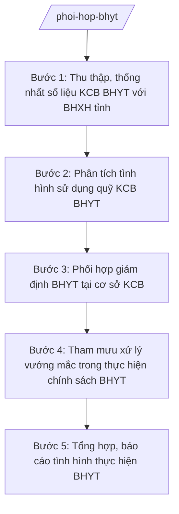

# Skill: Phối hợp thực hiện BHYT

## 2. Khi nào dùng

- Khi cần phối hợp với Bảo hiểm xã hội tỉnh rà soát, thống nhất số liệu khám chữa bệnh BHYT và sử dụng quỹ KCB BHYT trên địa bàn.
- Khi cần phối hợp tổ chức giám định BHYT tại các cơ sở khám bệnh, chữa bệnh (giám định chi phí, giám định chuyên môn).
- Khi cần theo dõi, phân tích tình hình sử dụng quỹ KCB BHYT của tỉnh (vượt/bội chi, tiết kiệm quỹ).
- Khi phát sinh vướng mắc trong thực hiện chính sách BHYT (thanh toán chi phí, danh mục kỹ thuật, thuốc, vật tư) và cần tham mưu xử lý.
- Khi cần tổng hợp báo cáo tình hình thực hiện BHYT gửi Bộ Y tế, UBND tỉnh và phối hợp tuyên truyền chính sách BHYT.

## 3. Đầu vào (Input)

| Trường | Mô tả | Bắt buộc |
|--------|-------|----------|
| `so_lieu_kcb_bhyt` | Số liệu KCB BHYT: lượt khám, chi phí, cơ cấu chi (thuốc, kỹ thuật, vật tư) theo cơ sở KCB | Có |
| `so_lieu_quy` | Số liệu quỹ KCB BHYT được giao và tình hình sử dụng (vượt/tiết kiệm) | Có |
| `ket_qua_giam_dinh` | Kết quả giám định BHYT: chi phí từ chối thanh toán, nguyên nhân (chỉ định chưa phù hợp, vượt định mức...) | Không |
| `vuong_mac` | Các vướng mắc phát sinh: thanh toán chi phí, danh mục, thủ tục giữa cơ sở KCB và cơ quan BHXH | Không |
| `ke_hoach_phoi_hop` | Kế hoạch phối hợp năm giữa Sở Y tế và BHXH tỉnh (nếu có) | Không |
| `van_ban_chi_dao` | Văn bản chỉ đạo của Bộ Y tế, BHXH Việt Nam, UBND tỉnh về BHYT (nếu có) | Không |

## 4. Quy trình

**Bước 1. Thu thập, thống nhất số liệu KCB BHYT với BHXH tỉnh**
- Làm gì: Tập hợp số liệu KCB BHYT từ các cơ sở KCB và từ Bảo hiểm xã hội tỉnh; đối chiếu, thống nhất số liệu (lượt khám, chi phí, cơ cấu chi theo nhóm thuốc/kỹ thuật/vật tư); xác định chênh lệch, nguyên nhân; lập bảng số liệu thống nhất làm cơ sở phối hợp.
- Dùng input: `so_lieu_kcb_bhyt`, `so_lieu_quy`.
- Vai trò: Chuyên viên phụ trách BHYT thuộc Sở Y tế tổng hợp, làm việc với phòng/ban của BHXH tỉnh; AI hỗ trợ lập bảng đối chiếu, tính chênh lệch, biểu đồ cơ cấu chi ⏱ ~2 ngày (ước tính).
- Lưu ý nghiệp vụ: Số liệu phải được hai bên thống nhất trước khi dùng cho báo cáo, tham mưu; làm rõ nguyên nhân chênh lệch (độ trễ dữ liệu, khác phương pháp tổng hợp); bảo mật thông tin người bệnh.
- → Kết quả bước: Bảng số liệu KCB BHYT và sử dụng quỹ đã thống nhất với BHXH tỉnh.

**Bước 2. Phân tích tình hình sử dụng quỹ KCB BHYT**
- Làm gì: Phân tích chi phí KCB BHYT so với quỹ được giao: cơ sở vượt quỹ, nguyên nhân (gia tăng lượt khám, chỉ định kỹ thuật cao, giá thuốc/vật tư); cơ sở tiết kiệm quỹ; đánh giá tính hợp lý của chi phí; đề xuất giải pháp quản lý, sử dụng hiệu quả quỹ.
- Dùng input: Bảng số liệu thống nhất bước 1, `ket_qua_giam_dinh`.
- Vai trò: Chuyên viên phụ trách BHYT phân tích, soạn đánh giá; Trưởng phòng kiểm tra; AI hỗ trợ phân tích, so sánh giữa các cơ sở, soạn nhận định ⏱ ~2 ngày (ước tính).
- Lưu ý nghiệp vụ: Phân tích khách quan, dựa trên số liệu đã thống nhất; phân biệt vượt quỹ do nhu cầu thực tế với vượt quỹ do chỉ định chưa hợp lý; đề xuất giải pháp phải bảo đảm quyền lợi người bệnh.
- → Kết quả bước: Báo cáo phân tích sử dụng quỹ KCB BHYT + đề xuất giải pháp.

**Bước 3. Phối hợp giám định BHYT tại cơ sở KCB**
- Làm gì: Phối hợp với BHXH tỉnh xây dựng kế hoạch giám định (định kỳ, đột xuất); cử cán bộ chuyên môn tham gia đoàn giám định chi phí và giám định chuyên môn tại cơ sở KCB; xem xét kết quả giám định, các khoản chi phí bị từ chối thanh toán; thống nhất hướng xử lý, hướng dẫn cơ sở khắc phục.
- Dùng input: `ke_hoach_phoi_hop`, `ket_qua_giam_dinh`, `vuong_mac`.
- Vai trò: Chuyên viên phụ trách BHYT tham gia đoàn giám định, tổng hợp kết quả; Trưởng phòng/Phó Giám đốc Sở (ông Đỗ Văn U) chỉ đạo; AI hỗ trợ soạn kế hoạch phối hợp, bảng tổng hợp kết quả giám định ⏱ ~2 ngày (ước tính).
- Lưu ý nghiệp vụ: Giám định phải đúng quy định, khách quan; tôn trọng kết luận chuyên môn của hội đồng giám định; hướng dẫn cơ sở khắc phục mang tính xây dựng, không gây khó khăn cho hoạt động KCB.
- → Kết quả bước: Kế hoạch phối hợp giám định + báo cáo kết quả giám định BHYT (kỳ …).

**Bước 4. Tham mưu xử lý vướng mắc trong thực hiện chính sách BHYT**
- Làm gì: Tổng hợp vướng mắc giữa cơ sở KCB và cơ quan BHXH (thanh toán chi phí, áp dụng danh mục kỹ thuật/thuốc/vật tư, thủ tục); tổ chức làm việc ba bên (Sở Y tế – BHXH tỉnh – cơ sở KCB) để thống nhất hướng xử lý; tham mưu văn bản chỉ đạo, hướng dẫn tháo gỡ; trường hợp vượt thẩm quyền thì báo cáo, kiến nghị Bộ Y tế, BHXH Việt Nam.
- Dùng input: `vuong_mac`, kết quả các bước 1–3.
- Vai trò: Chuyên viên tổng hợp vướng mắc, soạn dự thảo văn bản tháo gỡ; Trưởng phòng kiểm tra; Giám đốc Sở (ông Hoàng Văn S) ký văn bản hoặc chủ trì làm việc ba bên; AI hỗ trợ tổng hợp, soạn thảo ⏱ ~2 ngày (ước tính).
- Lưu ý nghiệp vụ: Xử lý vướng mắc phải bảo đảm quyền lợi người tham gia BHYT và hoạt động bình thường của cơ sở KCB; phân định rõ việc thuộc thẩm quyền tỉnh giải quyết và việc phải kiến nghị trung ương; có thời hạn xử lý cụ thể.
- → Kết quả bước: Văn bản tháo gỡ vướng mắc BHYT / biên bản làm việc ba bên + văn bản kiến nghị trung ương (nếu có).

**Bước 5. Tổng hợp, báo cáo tình hình thực hiện BHYT**
- Làm gì: Tổng hợp toàn bộ kết quả: số liệu KCB BHYT, sử dụng quỹ, giám định, xử lý vướng mắc, tuyên truyền chính sách; soạn báo cáo gửi Bộ Y tế, UBND tỉnh; phối hợp tuyên truyền, phổ biến chính sách BHYT trên địa bàn.
- Dùng input: Kết quả các bước 1–4, `van_ban_chi_dao`.
- Vai trò: Chuyên viên tổng hợp, soạn báo cáo; Trưởng phòng kiểm tra; Giám đốc Sở (ông Hoàng Văn S) ký báo cáo; AI hỗ trợ tổng hợp số liệu, soạn báo cáo theo thể thức NĐ 30/2020/NĐ-CP ⏱ ~2 ngày (ước tính).
- Lưu ý nghiệp vụ: Báo cáo phản ánh trung thực, số liệu đã thống nhất với BHXH tỉnh; kiến nghị rõ nội dung, đối tượng; phối hợp tuyên truyền để người dân hiểu và tham gia BHYT.
- → Kết quả bước: Báo cáo tình hình thực hiện BHYT tỉnh (kỳ …) gửi Bộ Y tế và UBND tỉnh.

## Luồng quy trình (Workflow)

## 5. Đầu ra (Output)

**Danh sách sản phẩm:**
1. Báo cáo tình hình thực hiện BHYT tỉnh (sản phẩm chính 1).
2. Báo cáo phân tích sử dụng quỹ KCB BHYT + đề xuất giải pháp (sản phẩm chính 2).
3. Kế hoạch phối hợp giám định BHYT + báo cáo kết quả giám định.
4. Văn bản tháo gỡ vướng mắc BHYT / biên bản làm việc ba bên.
5. Văn bản kiến nghị Bộ Y tế, BHXH Việt Nam (khi vượt thẩm quyền tỉnh).
6. Bảng số liệu KCB BHYT và sử dụng quỹ đã thống nhất với BHXH tỉnh (phụ lục).

**Cấu trúc output chuẩn — Báo cáo tình hình thực hiện BHYT:**
- Thể thức: tuân thủ Nghị định 30/2020/NĐ-CP về công tác văn thư.

1. Quốc hiệu "CỘNG HÒA XÃ HỘI CHỦ NGHĨA VIỆT NAM", Tiêu ngữ "Độc lập – Tự do – Hạnh phúc".
2. Số, ký hiệu văn bản: số/ký hiệu theo quy định (vd: 1234/BC-SYT).
3. Địa danh, ngày tháng năm ban hành: "Tỉnh A, ngày … tháng … năm …".
4. Tên loại và trích yếu: "BÁO CÁO — Tình hình thực hiện chính sách bảo hiểm y tế tỉnh A (kỳ …)".
5. Căn cứ: TT 20/2025/TT-BYT; TT 18/2025/TT-BYT; kế hoạch phối hợp giữa Sở Y tế và BHXH tỉnh (nếu có).
6. Nội dung: I. Kết quả KCB BHYT (bảng số liệu đã thống nhất); II. Tình hình sử dụng quỹ KCB BHYT; III. Công tác giám định BHYT; IV. Xử lý vướng mắc; V. Tuyên truyền chính sách; VI. Khó khăn, vướng mắc; VII. Kiến nghị.
7. Nơi nhận: Bộ Y tế, BHXH Việt Nam (qua BHXH tỉnh), UBND tỉnh, BHXH tỉnh A, lưu VP Sở.
8. Chữ ký: Giám đốc Sở Y tế ký, đóng dấu.

**Cấu trúc output chuẩn — Văn bản tháo gỡ vướng mắc BHYT:**

1. Quốc hiệu "CỘNG HÒA XÃ HỘI CHỦ NGHĨA VIỆT NAM", Tiêu ngữ "Độc lập – Tự do – Hạnh phúc".
2. Số, ký hiệu văn bản: số/ký hiệu theo quy định (vd: 1234/SYT-BHYT).
3. Địa danh, ngày tháng năm ban hành.
4. Tên loại và trích yếu: "V/v tháo gỡ vướng mắc trong thực hiện chính sách BHYT …".
5. Căn cứ: TT 20/2025/TT-BYT; kết quả làm việc với BHXH tỉnh, cơ sở KCB.
6. Nội dung: nêu vướng mắc; ý kiến thống nhất của các bên; hướng xử lý cụ thể (nội dung, đơn vị thực hiện, thời hạn); kiến nghị (nếu vượt thẩm quyền).
7. Nơi nhận: BHXH tỉnh A, cơ sở KCB liên quan, UBND tỉnh (báo cáo), lưu VP Sở.
8. Chữ ký: Giám đốc Sở Y tế ký, đóng dấu.

## 6. Checklist nghiệm thu

- [ ] Số liệu KCB BHYT và sử dụng quỹ đã được đối chiếu, thống nhất với BHXH tỉnh trước khi dùng cho báo cáo, tham mưu.
- [ ] Báo cáo phân tích sử dụng quỹ chỉ rõ cơ sở vượt/tiết kiệm quỹ, nguyên nhân, đề xuất giải pháp bảo đảm quyền lợi người bệnh.
- [ ] Kế hoạch phối hợp giám định có nội dung, đối tượng, thời gian; kết quả giám định được tổng hợp, có hướng dẫn cơ sở khắc phục.
- [ ] Vướng mắc được tổng hợp đầy đủ, xử lý có thời hạn; phân định rõ việc thuộc thẩm quyền tỉnh và việc kiến nghị trung ương.
- [ ] Báo cáo trung thực, số liệu khớp giữa các bảng và với số liệu đã thống nhất; đúng thể thức NĐ 30/2020/NĐ-CP.
- [ ] Thông tin cá nhân người bệnh được bảo mật; số liệu, tên cơ sở trong văn bản khớp đúng Input; không bịa số liệu, số hiệu văn bản, căn cứ pháp lý.
- [ ] Định vị đúng vai trò phối hợp của Sở Y tế (không phải cơ quan chủ quản của BHXH); không viết như nghiệp vụ thanh toán trực tiếp của cơ quan BHXH.
- [ ] Đã qua human gate: Trưởng phòng kiểm tra, Giám đốc Sở ký duyệt; văn bản liên quan BHXH tỉnh có sự thống nhất của hai bên.

## 7. Ví dụ mô phỏng

*Dữ liệu dưới đây là giả lập 100% phục vụ minh họa.*

**Input mẫu:**
- so_lieu_kcb_bhyt: 6 tháng đầu năm 2027 — 200.000 lượt KCB BHYT, tổng chi 150 tỷ đồng; cơ cấu: thuốc 40%, kỹ thuật 35%, vật tư 10%, còn lại 15%
- so_lieu_quy: quỹ KCB BHYT được giao 6 tháng: 140 tỷ đồng; sử dụng 150 tỷ đồng (vượt 10 tỷ, tương đương 7%); 3 cơ sở vượt quỹ, 5 cơ sở tiết kiệm quỹ
- ket_qua_giam_dinh: chi phí bị từ chối thanh toán 2 tỷ đồng; nguyên nhân chủ yếu: chỉ định kỹ thuật chưa phù hợp phác đồ (1,2 tỷ), trùng lặp xét nghiệm (0,8 tỷ)
- vuong_mac: Bệnh viện Đa khoa khu vực B phản ánh chậm thanh toán chi phí quý I; vướng mắc áp dụng danh mục vật tư mới
- ke_hoach_phoi_hop: kế hoạch phối hợp năm 2027 giữa Sở Y tế tỉnh A và BHXH tỉnh A (ký tháng 01/2027)

**Output mẫu — Báo cáo tình hình thực hiện BHYT (trích):**

> CỘNG HÒA XÃ HỘI CHỦ NGHĨA VIỆT NAM
> Độc lập – Tự do – Hạnh phúc
>
> Số: 1234/BC-SYT
>
> Tỉnh A, ngày 15 tháng 07 năm 2027
>
> **BÁO CÁO**
> **Tình hình thực hiện chính sách bảo hiểm y tế tỉnh A 6 tháng đầu năm 2027**
>
> Căn cứ Thông tư số 20/2025/TT-BYT ngày 23/6/2025 của Bộ Y tế hướng dẫn chức năng, nhiệm vụ, quyền hạn của cơ quan chuyên môn về y tế thuộc UBND cấp tỉnh;
> Căn cứ Kế hoạch phối hợp năm 2027 giữa Sở Y tế tỉnh A và Bảo hiểm xã hội tỉnh A;
>
> **I. KẾT QUẢ KHÁM CHỮA BỆNH BHYT** (số liệu đã thống nhất với BHXH tỉnh A)
> 1. Tổng lượt KCB BHYT: 200.000 lượt; tổng chi phí: 150 tỷ đồng.
> 2. Cơ cấu chi: thuốc 40%, kỹ thuật 35%, vật tư y tế 10%, còn lại 15%.
>
> **II. TÌNH HÌNH SỬ DỤNG QUỸ KCB BHYT**
> 1. Quỹ được giao 6 tháng: 140 tỷ đồng; thực sử dụng 150 tỷ đồng, vượt 10 tỷ đồng (7%).
> 2. Có 03 cơ sở vượt quỹ, 05 cơ sở tiết kiệm quỹ.
> 3. Nguyên nhân vượt quỹ: gia tăng lượt khám chữa bệnh; chỉ định kỹ thuật cao tăng.
>
> **III. CÔNG TÁC GIÁM ĐỊNH BHYT**
> 1. Chi phí bị từ chối thanh toán: 02 tỷ đồng; nguyên nhân: chỉ định kỹ thuật chưa phù hợp phác đồ (1,2 tỷ đồng), trùng lặp xét nghiệm (0,8 tỷ đồng).
> 2. Đã hướng dẫn các cơ sở khắc phục, chấn chỉnh chỉ định.
>
> **IV. XỬ LÝ VƯỚNG MẮC**
> 1. Đã làm việc ba bên về phản ánh chậm thanh toán chi phí quý I của Bệnh viện Đa khoa khu vực B; thống nhất thời hạn thanh toán trong quý III/2027.
> 2. Vướng mắc áp dụng danh mục vật tư mới: đã có văn bản hướng dẫn, đang theo dõi thực hiện.
>
> **V. KHÓ KHĂN, KIẾN NGHỊ**
> 1. Một số cơ sở còn chỉ định kỹ thuật, xét nghiệm chưa hợp lý, gây vượt quỹ.
> 2. Kiến nghị: tăng cường giám định chuyên môn; đào tạo sử dụng thuốc, chỉ định kỹ thuật hợp lý cho tuyến cơ sở.
>
> **Nơi nhận:** Bộ Y tế; UBND tỉnh A; BHXH tỉnh A; lưu VP Sở.
>
> **GIÁM ĐỐC**
> *(Ký, đóng dấu)*
> Hoàng Văn S

## 8. Human gate (người kiểm duyệt)

- Chuyên viên phụ trách BHYT thuộc Sở Y tế tổng hợp số liệu, soạn thảo báo cáo, văn bản; tham gia đoàn giám định.
- Trưởng phòng phụ trách BHYT kiểm tra nội dung, số liệu, thể thức.
- Phó Giám đốc Sở (ông Đỗ Văn U) chỉ đạo hoàn thiện; chủ trì hoặc tham gia làm việc ba bên với BHXH tỉnh.
- Giám đốc Sở (ông Hoàng Văn S) ký báo cáo gửi Bộ Y tế, văn bản tháo gỡ vướng mắc (sau khi thống nhất với BHXH tỉnh).
- Văn bản kiến nghị vượt thẩm quyền tỉnh: trình Chủ tịch UBND tỉnh (ông Phạm Văn P) ký gửi Bộ Y tế, BHXH Việt Nam.

## 9. Giới hạn (guardrails)

- AI KHÔNG ra quyết định hành chính thay người có thẩm quyền; không tự quyết định thanh toán, từ chối thanh toán chi phí BHYT.
- AI KHÔNG tự ký, đóng dấu hoặc phát hành văn bản dưới danh nghĩa Sở Y tế, BHXH hay lãnh đạo.
- AI KHÔNG bịa số liệu KCB BHYT, sử dụng quỹ, kết quả giám định, số hiệu văn bản, căn cứ pháp lý.
- AI KHÔNG tiết lộ thông tin cá nhân người bệnh; không hướng dẫn trục lợi quỹ BHYT.
- AI KHÔNG dùng văn bản đã hết hiệu lực; chỉ trích dẫn văn bản có trong tai-lieu-moi-nhat.md.

## 10. Căn cứ & lưu ý

- Thông tư số 20/2025/TT-BYT ngày 23/6/2025 của Bộ Y tế: hướng dẫn chức năng, nhiệm vụ, quyền hạn của Sở Y tế thuộc UBND cấp tỉnh (trong đó có nhiệm vụ phối hợp thực hiện chính sách BHYT).
- Thông tư số 18/2025/TT-BYT của Bộ Y tế: quy định phân định thẩm quyền chính quyền địa phương 2 cấp trong lĩnh vực khám bệnh, chữa bệnh.
- Nghị định số 147/2025/NĐ-CP ngày 12/6/2025: phân định thẩm quyền CQĐP 2 cấp trong lĩnh vực quản lý nhà nước của Bộ Y tế.
- Nghị định số 148/2025/NĐ-CP ngày 12/6/2025: phân quyền, phân cấp trong lĩnh vực y tế.
- Nghị định số 150/2025/NĐ-CP ngày 12/6/2025: tổ chức Sở Y tế thuộc UBND cấp tỉnh; sửa đổi bởi NĐ 370/2025/NĐ-CP.
- Nghị định số 30/2020/NĐ-CP của Chính phủ: thể thức văn bản hành chính.
- Lưu ý: Sở Y tế giữ vai trò phối hợp với BHXH tỉnh (thống nhất số liệu, phối hợp giám định, tham mưu tháo gỡ vướng mắc), không phải cơ quan quyết định thanh toán chi phí BHYT; định vị phối hợp liên ngành, không trùng với nghiệp vụ trực tiếp của cơ quan BHXH hay cấp xã.
