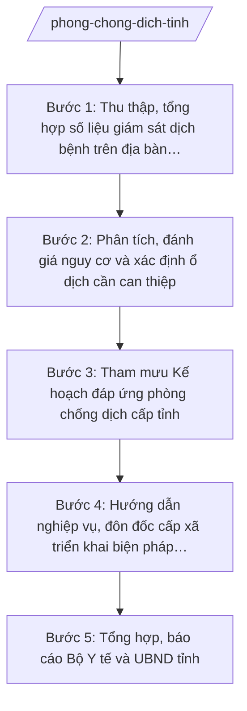

# Skill: Phòng chống dịch bệnh cấp tỉnh

## 2. Khi nào dùng

- Khi cần tổng hợp, phân tích số liệu giám sát dịch bệnh truyền nhiễm trên địa bàn tỉnh (từ hệ thống giám sát của Trung tâm Kiểm soát bệnh tật tỉnh, bệnh viện, trạm y tế xã).
- Khi phát hiện ổ dịch, chùm ca bệnh bất thường và cần tham mưu biện pháp điều tra, khoanh vùng, xử lý ổ dịch.
- Khi cần xây dựng hoặc điều chỉnh Kế hoạch đáp ứng phòng chống dịch bệnh cấp tỉnh (hằng năm, theo mùa dịch hoặc khi có tình huống mới).
- Khi cần hướng dẫn nghiệp vụ phòng chống dịch cho Phòng Văn hóa – Xã hội và Trạm Y tế các xã.
- Khi cần soạn báo cáo tình hình dịch bệnh gửi Bộ Y tế và UBND tỉnh theo chế độ định kỳ hoặc đột xuất.

## 3. Đầu vào (Input)

| Trường | Mô tả | Bắt buộc |
|--------|-------|----------|
| `so_lieu_giam_sat` | Số liệu giám sát dịch từ Trung tâm Kiểm soát bệnh tật tỉnh: ca mắc, ca tử vong theo bệnh/tuần/tháng, phân bố theo xã, nhóm tuổi | Có |
| `bao_cao_co_so` | Báo cáo của bệnh viện, trung tâm y tế xã về ca bệnh, ổ dịch nghi ngờ, khả năng đáp ứng | Có |
| `loai_dich_benh` | Tên bệnh truyền nhiễm cần phân tích/đáp ứng (sốt xuất huyết, tay chân miệng, sởi, cúm, COVID-19...) | Có |
| `pham_vi_dia_ly` | Phạm vi ảnh hưởng: xã, khu vực, toàn tỉnh | Có |
| `kha_nang_dap_ung` | Hiện trạng nguồn lực: nhân lực, thuốc, vắc xin, vật tư, giường bệnh cách ly | Không |
| `van_ban_chi_dao` | Văn bản chỉ đạo của Bộ Y tế, UBND tỉnh về phòng chống dịch (nếu có) | Không |
| `du_bao_thoi_tiet_mua_dich` | Thông tin mùa dịch, yếu tố thời tiết, tập quán sinh hoạt liên quan (nếu có) | Không |

## 4. Quy trình

**Bước 1. Thu thập, tổng hợp số liệu giám sát dịch bệnh trên địa bàn tỉnh**
- Làm gì: Tập hợp số liệu giám sát dịch từ Trung tâm Kiểm soát bệnh tật tỉnh, các bệnh viện tuyến tỉnh, trạm y tế xã; kiểm tra tính đầy đủ, thống nhất của số liệu (ca mắc, ca tử vong, phân bố theo xã/nhóm tuổi/thời gian); lập bảng tổng hợp theo bệnh, theo tuần/tháng.
- Dùng input: `so_lieu_giam_sat`, `bao_cao_co_so`, `loai_dich_benh`.
- Vai trò: Chuyên viên Phòng Nghiệp vụ Y thuộc Sở Y tế tổng hợp; AI hỗ trợ nhập liệu, lập bảng tổng hợp, kiểm tra số liệu không nhất quán ⏱ ~1 ngày (ước tính).
- Lưu ý nghiệp vụ: Số liệu phải từ nguồn chính thống (hệ thống giám sát, báo cáo chính thức); không dùng số liệu lan truyền chưa kiểm chứng; phân biệt ca mắc mới, ca tử vong, ca đang điều trị.
- → Kết quả bước: Bảng tổng hợp số liệu giám sát dịch bệnh cấp tỉnh (theo bệnh, địa bàn, thời gian).

**Bước 2. Phân tích, đánh giá nguy cơ và xác định ổ dịch cần can thiệp**
- Làm gì: So sánh số liệu với ngưỡng cảnh báo, cùng kỳ năm trước, trung bình nhiều năm; vẽ biểu đồ diễn biến ca mắc; xác định xã/khu vực có nguy cơ bùng phát; kết luận mức độ nguy cơ (ổn định/cảnh báo/bùng phát) và đề xuất biện pháp điều tra, khoanh vùng.
- Dùng input: Bảng tổng hợp bước 1, `pham_vi_dia_ly`, `du_bao_thoi_tiet_mua_dich`.
- Vai trò: Chuyên viên Phòng Nghiệp vụ Y phân tích, soạn đánh giá; Trưởng phòng Nghiệp vụ Y (ông Bùi Văn X) kiểm tra, góp ý; AI hỗ trợ vẽ biểu đồ, so sánh xu hướng, soạn nhận định ⏱ ~1 ngày (ước tính).
- Lưu ý nghiệp vụ: Đánh giá phải có căn cứ số liệu, không suy đoán; phân biệt ổ dịch đơn lẻ với dịch lan rộng; lưu ý yếu tố mùa vụ và tập quán địa phương khi nhận định nguy cơ.
- → Kết quả bước: Báo cáo đánh giá nguy cơ dịch bệnh + danh sách địa bàn cần can thiệp ưu tiên.

**Bước 3. Tham mưu Kế hoạch đáp ứng phòng chống dịch cấp tỉnh**
- Làm gì: Soạn thảo Kế hoạch đáp ứng phòng chống dịch: mục tiêu, tình huống giả định; biện pháp giám sát, điều tra, khoanh vùng, xử lý ổ dịch; phân công trách nhiệm (Sở Y tế, Trung tâm Kiểm soát bệnh tật tỉnh, bệnh viện, cấp xã); nhu cầu thuốc, vắc xin, vật tư, kinh phí; chế độ báo cáo, thông tin.
- Dùng input: Đánh giá bước 2, `kha_nang_dap_ung`, `van_ban_chi_dao`.
- Vai trò: Chuyên viên Phòng Nghiệp vụ Y soạn dự thảo; Trưởng phòng Nghiệp vụ Y (ông Bùi Văn X) kiểm tra; Phó Giám đốc Sở (ông Đỗ Văn U) chỉ đạo hoàn thiện; Giám đốc Sở (ông Hoàng Văn S) ký ban hành Kế hoạch (thuộc thẩm quyền Sở); AI hỗ trợ soạn thảo theo thể thức NĐ 30/2020/NĐ-CP ⏱ ~2 ngày (ước tính).
- Lưu ý nghiệp vụ: Kế hoạch phải phân công rõ việc cấp tỉnh làm và việc cấp xã làm (không viết như skill cấp xã — cấp tỉnh chỉ đạo, hướng dẫn, tổng hợp); nhu cầu nguồn lực phải khả thi, có phương án dự phòng; nếu vượt thẩm quyền Sở thì trình UBND tỉnh phê duyệt.
- → Kết quả bước: Dự thảo Kế hoạch đáp ứng phòng chống dịch cấp tỉnh (kèm phụ lục phân công, nhu cầu nguồn lực).

**Bước 4. Hướng dẫn nghiệp vụ, đôn đốc cấp xã triển khai biện pháp phòng chống dịch**
- Làm gì: Soạn văn bản hướng dẫn nghiệp vụ gửi Phòng Văn hóa – Xã hội và Trạm Y tế các xã: nội dung giám sát, phát hiện sớm ca bệnh; quy trình báo cáo ca bệnh/ổ dịch lên tuyến tỉnh; biện pháp xử lý ổ dịch tại cộng đồng; tuyên truyền cho người dân; lịch báo cáo định kỳ.
- Dùng input: Kế hoạch bước 3, `pham_vi_dia_ly`.
- Vai trò: Chuyên viên Phòng Nghiệp vụ Y soạn hướng dẫn; Trưởng phòng Nghiệp vụ Y (ông Bùi Văn X) duyệt nội dung; AI hỗ trợ biên tập hướng dẫn dễ áp dụng cho cấp xã ⏱ ~1 ngày (ước tính).
- Lưu ý nghiệp vụ: Hướng dẫn phải cụ thể, dễ thực hiện ở tuyến xã; nêu rõ đầu mối tiếp nhận báo cáo ở tuyến tỉnh (Trung tâm Kiểm soát bệnh tật tỉnh); không yêu cầu cấp xã làm việc vượt khả năng và thẩm quyền.
- → Kết quả bước: Văn bản hướng dẫn nghiệp vụ phòng chống dịch gửi cấp xã + lịch đôn đốc, kiểm tra.

**Bước 5. Tổng hợp, báo cáo Bộ Y tế và UBND tỉnh**
- Làm gì: Tổng hợp tình hình triển khai trên địa bàn: kết quả giám sát, ổ dịch đã xử lý, nguồn lực đã huy động, khó khăn, kiến nghị; soạn báo cáo định kỳ (tuần/tháng/quý) và báo cáo đột xuất khi có dịch bùng phát gửi Bộ Y tế (Cục Phòng bệnh) và UBND tỉnh.
- Dùng input: Kết quả các bước 1–4, `bao_cao_co_so` cập nhật.
- Vai trò: Chuyên viên Phòng Nghiệp vụ Y tổng hợp, soạn báo cáo; Trưởng phòng Nghiệp vụ Y (ông Bùi Văn X) kiểm tra; Giám đốc Sở (ông Hoàng Văn S) ký báo cáo gửi Bộ Y tế và UBND tỉnh; AI hỗ trợ tổng hợp số liệu, soạn báo cáo theo thể thức NĐ 30/2020/NĐ-CP ⏱ ~1 ngày (ước tính).
- Lưu ý nghiệp vụ: Báo cáo phải trung thực, số liệu khớp giữa các bảng; báo cáo đột xuất khi dịch bùng phát phải kịp thời, không chờ kỳ báo cáo; kiến nghị phải rõ đối tượng và nội dung đề xuất.
- → Kết quả bước: Báo cáo tình hình dịch bệnh (định kỳ/đột xuất) gửi Bộ Y tế và UBND tỉnh.

## Luồng quy trình (Workflow)

## 5. Đầu ra (Output)

**Danh sách sản phẩm:**
1. Kế hoạch đáp ứng phòng chống dịch bệnh cấp tỉnh (sản phẩm chính 1).
2. Báo cáo tình hình dịch bệnh gửi Bộ Y tế và UBND tỉnh (định kỳ/đột xuất) (sản phẩm chính 2).
3. Văn bản hướng dẫn nghiệp vụ phòng chống dịch cho cấp xã.
4. Báo cáo đánh giá nguy cơ dịch bệnh (phụ lục chuyên môn).
5. Bảng tổng hợp số liệu giám sát dịch theo bệnh, địa bàn, thời gian (phụ lục).
6. Danh sách địa bàn ưu tiên can thiệp (phụ lục).

**Cấu trúc output chuẩn — Kế hoạch đáp ứng phòng chống dịch cấp tỉnh:**
- Thể thức: tuân thủ Nghị định 30/2020/NĐ-CP về công tác văn thư.

1. Quốc hiệu "CỘNG HÒA XÃ HỘI CHỦ NGHĨA VIỆT NAM", Tiêu ngữ "Độc lập – Tự do – Hạnh phúc".
2. Số, ký hiệu văn bản: số/ký hiệu theo quy định (vd: 1234/KH-SYT).
3. Địa danh, ngày tháng năm ban hành: "Tỉnh A, ngày … tháng … năm …".
4. Tên loại và trích yếu: "KẾ HOẠCH — Đáp ứng phòng chống dịch bệnh tỉnh A (năm …/tình huống …)".
5. Căn cứ: TT 20/2025/TT-BYT; TT 19/2025/TT-BYT; văn bản chỉ đạo của Bộ Y tế, UBND tỉnh (nếu có).
6. Nội dung: I. Mục đích, yêu cầu; II. Tình hình, đánh giá nguy cơ dịch bệnh; III. Mục tiêu; IV. Các biện pháp đáp ứng (giám sát, điều tra, khoanh vùng, xử lý ổ dịch, truyền thông); V. Nhu cầu nguồn lực (nhân lực, thuốc, vắc xin, vật tư, kinh phí); VI. Phân công trách nhiệm (Sở Y tế, Trung tâm Kiểm soát bệnh tật tỉnh, bệnh viện, UBND cấp xã); VII. Chế độ báo cáo, thông tin; VIII. Tổ chức thực hiện.
7. Nơi nhận: Bộ Y tế, UBND tỉnh, các sở/ngành liên quan, UBND cấp xã, lưu VP Sở.
8. Chữ ký: Giám đốc Sở Y tế ký (hoặc trình Chủ tịch UBND tỉnh ký khi vượt thẩm quyền Sở), đóng dấu.

**Cấu trúc output chuẩn — Báo cáo tình hình dịch bệnh:**

1. Quốc hiệu "CỘNG HÒA XÃ HỘI CHỦ NGHĨA VIỆT NAM", Tiêu ngữ "Độc lập – Tự do – Hạnh phúc".
2. Số, ký hiệu văn bản: số/ký hiệu theo quy định (vd: 1234/BC-SYT).
3. Địa danh, ngày tháng năm ban hành.
4. Tên loại và trích yếu: "BÁO CÁO — Tình hình dịch bệnh tỉnh A (tuần/tháng/quý …; đột xuất …)".
5. Căn cứ: Kế hoạch số …/KH-SYT; TT 20/2025/TT-BYT; TT 19/2025/TT-BYT.
6. Nội dung: I. Tình hình dịch bệnh (bảng tổng hợp ca mắc, tử vong theo bệnh/địa bàn); II. Kết quả triển khai các biện pháp; III. Đánh giá nguy cơ; IV. Khó khăn, vướng mắc; V. Kiến nghị, đề xuất.
7. Nơi nhận: Bộ Y tế, UBND tỉnh, lưu VP Sở.
8. Chữ ký: Giám đốc Sở Y tế ký, đóng dấu.

**Cấu trúc output chuẩn — Văn bản hướng dẫn nghiệp vụ cho cấp xã:**

1. Quốc hiệu "CỘNG HÒA XÃ HỘI CHỦ NGHĨA VIỆT NAM", Tiêu ngữ "Độc lập – Tự do – Hạnh phúc".
2. Số, ký hiệu văn bản: số/ký hiệu theo quy định (vd: 1234/SYT-NVY).
3. Địa danh, ngày tháng năm ban hành.
4. Tên loại và trích yếu: "V/v hướng dẫn nghiệp vụ phòng chống dịch bệnh … cho cấp xã".
5. Căn cứ: Kế hoạch số …/KH-SYT; TT 20/2025/TT-BYT.
6. Nội dung: nội dung giám sát, phát hiện sớm; quy trình báo cáo ca bệnh/ổ dịch lên tuyến tỉnh (đầu mối, thời hạn, biểu mẫu); biện pháp xử lý ổ dịch tại cộng đồng; tuyên truyền; lịch báo cáo định kỳ.
7. Nơi nhận: UBND cấp xã (Phòng Văn hóa – Xã hội, Trạm Y tế), Trung tâm Kiểm soát bệnh tật tỉnh, lưu VP Sở.
8. Chữ ký: Giám đốc Sở (hoặc Phó Giám đốc được ủy quyền) ký, đóng dấu.

## 6. Checklist nghiệm thu

- [ ] Bảng tổng hợp số liệu giám sát đầy đủ theo bệnh, địa bàn, thời gian; nguồn số liệu chính thống, có kiểm tra tính nhất quán.
- [ ] Đánh giá nguy cơ có căn cứ số liệu (so sánh ngưỡng cảnh báo, cùng kỳ, trung bình nhiều năm), kết luận mức độ nguy cơ rõ ràng.
- [ ] Kế hoạch đáp ứng nêu rõ tình huống, biện pháp, nguồn lực, phân công trách nhiệm cấp tỉnh – cấp xã; đúng thể thức NĐ 30/2020/NĐ-CP.
- [ ] Văn bản hướng dẫn cho cấp xã cụ thể, dễ thực hiện; nêu rõ đầu mối báo cáo tuyến tỉnh và lịch báo cáo.
- [ ] Báo cáo gửi Bộ Y tế/UBND tỉnh trung thực, số liệu khớp giữa các bảng; báo cáo đột xuất kịp thời khi dịch bùng phát.
- [ ] Tên bệnh, địa danh, số liệu trong văn bản khớp đúng Input; không bịa số liệu dịch tễ.
- [ ] Không lẫn vai trò: cấp tỉnh tham mưu, chỉ đạo, hướng dẫn, tổng hợp — không viết như nghiệp vụ trực tiếp của cấp xã.
- [ ] Đã qua human gate: Trưởng phòng kiểm tra, Giám đốc Sở (hoặc Chủ tịch UBND tỉnh) ký duyệt theo thẩm quyền.

## 7. Ví dụ mô phỏng

*Dữ liệu dưới đây là giả lập 100% phục vụ minh họa.*

**Input mẫu:**
- so_lieu_giam_sat: sốt xuất huyết 8 tuần đầu năm 2027: 120 ca mắc (tăng 40% so với cùng kỳ 2026), 0 tử vong; tập trung tại xã A (45 ca), xã B (30 ca); nhóm tuổi 5–15 chiếm 60%
- bao_cao_co_so: Trung tâm Kiểm soát bệnh tật tỉnh báo cáo 3 ổ dịch đang hoạt động tại xã A; Trạm Y tế xã A báo thiếu hóa chất diệt muỗi
- loai_dich_benh: sốt xuất huyết
- pham_vi_dia_ly: xã A, xã B (nguy cơ lan sang 5 xã lân cận)
- kha_nang_dap_ung: còn 200 lít hóa chất diệt muỗi, 10 máy phun; cần bổ sung 300 lít, kinh phí 100 triệu đồng
- van_ban_chi_dao: Công văn của Bộ Y tế về tăng cường phòng chống sốt xuất huyết năm 2027

**Output mẫu — Kế hoạch đáp ứng phòng chống dịch (trích):**

> CỘNG HÒA XÃ HỘI CHỦ NGHĨA VIỆT NAM
> Độc lập – Tự do – Hạnh phúc
>
> Số: 1234/KH-SYT
>
> Tỉnh A, ngày 15 tháng 02 năm 2027
>
> **KẾ HOẠCH**
> **Đáp ứng phòng chống dịch sốt xuất huyết tỉnh A năm 2027**
>
> Căn cứ Thông tư số 20/2025/TT-BYT ngày 23/6/2025 của Bộ Y tế hướng dẫn chức năng, nhiệm vụ, quyền hạn của cơ quan chuyên môn về y tế thuộc UBND cấp tỉnh;
> Căn cứ Thông tư số 19/2025/TT-BYT của Bộ Y tế quy định phân định thẩm quyền trong lĩnh vực phòng bệnh;
>
> **I. MỤC ĐÍCH, YÊU CẦU**
> 1. Khống chế, không để dịch sốt xuất huyết bùng phát, lan rộng trên địa bàn tỉnh A trong năm 2027.
> 2. Giảm số ca mắc mới ít nhất 30% so với cùng kỳ năm 2026 tại các địa bàn trọng điểm.
>
> **II. TÌNH HÌNH, ĐÁNH GIÁ NGUY CƠ**
> 1. 8 tuần đầu năm 2027 ghi nhận 120 ca mắc sốt xuất huyết, tăng 40% so với cùng kỳ 2026, chưa ghi nhận tử vong.
> 2. Ca bệnh tập trung tại xã A (45 ca), xã B (30 ca); nhóm tuổi 5–15 chiếm 60%.
> 3. Đánh giá: nguy cơ bùng phát ở mức CẢNH BÁO; nguy cơ lan sang 5 xã lân cận.
>
> **III. CÁC BIỆN PHÁP ĐÁP ỨNG**
> 1. Giám sát: Trung tâm Kiểm soát bệnh tật tỉnh tăng cường giám sát ca bệnh, véc tơ tại xã A, xã B và 5 xã lân cận; báo cáo hằng tuần về Sở Y tế.
> 2. Xử lý ổ dịch: tổ chức phun hóa chất diệt muỗi tại 3 ổ dịch đang hoạt động ở xã A; cấp bổ sung 300 lít hóa chất.
> 3. Truyền thông: hướng dẫn UBND xã A, xã B tổ chức chiến dịch diệt lăng quăng, bọ gậy.
>
> **IV. NHU CẦU NGUỒN LỰC:** bổ sung 300 lít hóa chất diệt muỗi; kinh phí 100 triệu đồng từ nguồn dự phòng ngân sách y tế tỉnh.
>
> **V. PHÂN CÔNG TRÁCH NHIỆM**
> 1. Sở Y tế: chỉ đạo, điều phối chung; tổng hợp báo cáo.
> 2. Trung tâm Kiểm soát bệnh tật tỉnh: giám sát, điều tra, xử lý ổ dịch; hướng dẫn chuyên môn cho Trạm Y tế xã.
> 3. UBND xã A, xã B: tổ chức chiến dịch vệ sinh môi trường, diệt lăng quăng; báo cáo ca bệnh mới trong 24 giờ.
>
> **VI. CHẾ ĐỘ BÁO CÁO:** Trung tâm Kiểm soát bệnh tật tỉnh báo cáo hằng tuần; báo cáo đột xuất khi phát hiện ổ dịch mới.
>
> **Nơi nhận:** như trên; Bộ Y tế; UBND tỉnh A; lưu VP Sở.
>
> **GIÁM ĐỐC**
> *(Ký, đóng dấu)*
> Hoàng Văn S

## 8. Human gate (người kiểm duyệt)

- Chuyên viên Phòng Nghiệp vụ Y thuộc Sở Y tế soạn thảo, tổng hợp số liệu, dự thảo kế hoạch, báo cáo, văn bản hướng dẫn.
- Trưởng phòng Nghiệp vụ Y (ông Bùi Văn X) kiểm tra nội dung chuyên môn, số liệu, thể thức.
- Phó Giám đốc Sở (ông Đỗ Văn U) chỉ đạo hoàn thiện dự thảo kế hoạch, báo cáo.
- Giám đốc Sở (ông Hoàng Văn S) ký ban hành Kế hoạch đáp ứng, văn bản hướng dẫn và báo cáo gửi Bộ Y tế (thuộc thẩm quyền Sở).
- Trường hợp cần huy động nguồn lực lớn, ban bố biện pháp khẩn cấp vượt thẩm quyền Sở: trình Phó Chủ tịch UBND tỉnh (bà Lê Thị Q) / Chủ tịch UBND tỉnh (ông Phạm Văn P) quyết định.

## 9. Giới hạn (guardrails)

- AI KHÔNG ra quyết định hành chính thay người có thẩm quyền; không tự ban hành kế hoạch, không tự quyết định biện pháp khẩn cấp về dịch bệnh.
- AI KHÔNG tự ký, đóng dấu hoặc phát hành văn bản dưới danh nghĩa Sở Y tế hay lãnh đạo tỉnh.
- AI KHÔNG bịa số liệu dịch tễ, số ca mắc/tử vong, tên địa bàn, số hiệu văn bản, căn cứ pháp lý.
- AI KHÔNG dùng văn bản đã hết hiệu lực; chỉ trích dẫn văn bản có trong tai-lieu-moi-nhat.md.
- AI KHÔNG đưa ra khuyến cáo y tế điều trị cho cá nhân; chỉ hỗ trợ công tác quản lý nhà nước về phòng chống dịch.

## 10. Căn cứ & lưu ý

- Thông tư số 20/2025/TT-BYT ngày 23/6/2025 của Bộ Y tế: hướng dẫn chức năng, nhiệm vụ, quyền hạn của Sở Y tế thuộc UBND cấp tỉnh (trong đó có nhiệm vụ phòng bệnh).
- Thông tư số 19/2025/TT-BYT của Bộ Y tế: quy định phân định thẩm quyền chính quyền địa phương 2 cấp trong lĩnh vực phòng bệnh.
- Nghị định số 147/2025/NĐ-CP ngày 12/6/2025: phân định thẩm quyền CQĐP 2 cấp trong lĩnh vực quản lý nhà nước của Bộ Y tế.
- Nghị định số 148/2025/NĐ-CP ngày 12/6/2025: phân quyền, phân cấp trong lĩnh vực y tế.
- Nghị định số 150/2025/NĐ-CP ngày 12/6/2025: tổ chức Sở Y tế thuộc UBND cấp tỉnh; sửa đổi bởi NĐ 370/2025/NĐ-CP.
- Nghị định số 30/2020/NĐ-CP của Chính phủ: thể thức văn bản hành chính.
- Lưu ý: cấp tỉnh giữ vai trò tham mưu, chỉ đạo, hướng dẫn nghiệp vụ, tổng hợp báo cáo ngành; việc phát hiện ca bệnh, xử lý ổ dịch tại cộng đồng do cấp xã/Trạm Y tế xã trực tiếp thực hiện — không trùng với skill cấp xã.
