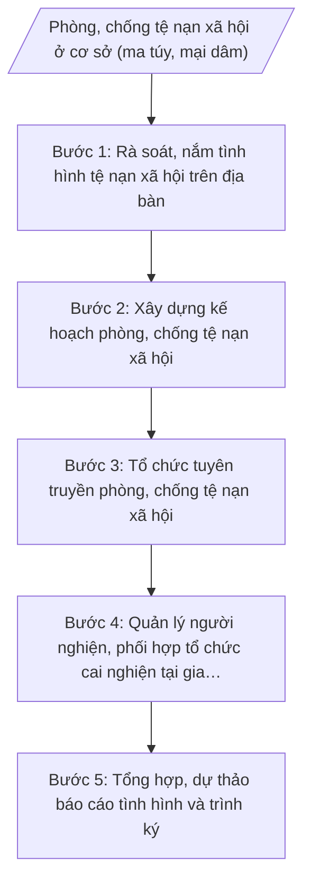

# Skill: Phòng, chống tệ nạn xã hội cơ sở

## 2. Khi nào dùng

- Lập kế hoạch phòng, chống tệ nạn xã hội hằng năm hoặc theo đợt của xã.
- Tổ chức tuyên truyền phòng, chống ma túy, mại dâm tại thôn, tổ dân phố, trường học.
- Rà soát, lập danh sách, quản lý người nghiện ma túy, người bán dâm hoàn lương tại cộng đồng.
- Phối hợp Công an xã tổ chức cai nghiện ma túy tại gia đình, cộng đồng; lập hồ sơ theo quy định.
- Lập báo cáo định kỳ (6 tháng, năm) tình hình tệ nạn xã hội gửi cấp trên.

## 3. Đầu vào (Input)

| Trường | Mô tả | Bắt buộc |
|--------|-------|----------|
| `nam_ke_hoach` | Năm lập kế hoạch / kỳ báo cáo | Có |
| `ds_nguoi_nghien` | Danh sách người nghiện ma túy trên địa bàn đang được quản lý (mã số quản lý, tình trạng: đang cai nghiện tại gia đình/cộng đồng, đã hoàn thành...) — chỉ dùng số liệu tổng hợp, không ghi chi tiết nhạy cảm vào văn bản công khai | Có |
| `ds_hoan_luong` | Số liệu người bán dâm hoàn lương đang được quản lý, hỗ trợ tại cộng đồng (dạng tổng hợp) | Không |
| `diem_nguy_co` | Các địa điểm có nguy cơ phát sinh tệ nạn (quán karaoke, nhà nghỉ, điểm tụ tập...) đã rà soát | Có |
| `ho_so_cai_nghien` | Hồ sơ cai nghiện tại gia đình, cộng đồng đang thực hiện (số lượng, tiến độ) | Không |
| `don_vi_phoi_hop` | Đơn vị phối hợp: Công an xã, Trạm Y tế xã, Đoàn Thanh niên, Hội Phụ nữ, Hội Cựu chiến binh xã... | Không |
| `so_lieu_ky_truoc` | Số liệu tình hình tệ nạn xã hội kỳ trước để đối chiếu | Không |

## 4. Quy trình

**Bước 1. Rà soát, nắm tình hình tệ nạn xã hội trên địa bàn**

- Làm gì: Phối hợp Công an xã, trưởng thôn/tổ dân phố rà soát: số người nghiện ma túy, người nghi nghiện; người bán dâm hoàn lương; địa điểm có nguy cơ phát sinh tệ nạn; cập nhật danh sách quản lý; phân loại mức độ (ổn định / có nguy cơ gia tăng / điểm nóng).
- Dùng input: `ds_nguoi_nghien`, `ds_hoan_luong`, `diem_nguy_co`, `so_lieu_ky_truoc`.
- Vai trò: Công chức văn hóa – xã hội phụ trách lĩnh vực phòng, chống tệ nạn xã hội phối hợp Công an xã rà soát, cập nhật danh sách. AI hỗ trợ: mẫu phiếu rà soát, bảng tổng hợp số liệu, so sánh biến động với kỳ trước, gợi ý phân loại mức độ. Thời gian ước tính: 2–3 ngày làm việc.
- Lưu ý nghiệp vụ: Danh sách người nghiện, người bán dâm hoàn lương là thông tin nhạy cảm — lưu trữ riêng, bảo mật, không đưa chi tiết cá nhân vào văn bản công khai; mọi số liệu phải có xác nhận của Công an xã; không tự ý kết luận ai là người nghiện khi chưa có căn cứ theo quy định.
- → Kết quả bước: Bảng tổng hợp tình hình tệ nạn xã hội trên địa bàn (số liệu tổng hợp + phân loại mức độ từng thôn/điểm).

**Bước 2. Xây dựng kế hoạch phòng, chống tệ nạn xã hội**

- Làm gì: Căn cứ kết quả rà soát, dự thảo Kế hoạch phòng, chống tệ nạn xã hội: mục đích, yêu cầu; mục tiêu, chỉ tiêu; nội dung (tuyên truyền phòng chống ma túy, mại dâm; quản lý người nghiện tại cộng đồng; tổ chức cai nghiện tại gia đình, cộng đồng; hỗ trợ người hoàn lương tái hòa nhập); phân công thực hiện; kinh phí; trình lãnh đạo UBND xã phê duyệt.
- Dùng input: Bảng tổng hợp ở Bước 1, `don_vi_phoi_hop`, `nam_ke_hoach`.
- Vai trò: Công chức văn hóa – xã hội phụ trách lĩnh vực dự thảo kế hoạch, thống nhất với Công an xã về nội dung phối hợp. AI hỗ trợ: dàn ý kế hoạch theo cấu trúc chuẩn, gợi ý chỉ tiêu phù hợp thực trạng, kiểm tra thể thức văn bản theo NĐ 30/2020/NĐ-CP. Thời gian ước tính: 0,5–1 ngày làm việc.
- Lưu ý nghiệp vụ: Kế hoạch phải gắn với thẩm quyền, nguồn lực thực tế của xã; nội dung cai nghiện phải đúng quy định về cai nghiện tại gia đình, cộng đồng; kinh phí phù hợp dự toán được giao.
- → Kết quả bước: Dự thảo Kế hoạch phòng, chống tệ nạn xã hội (sẵn sàng trình ký).

**Bước 3. Tổ chức tuyên truyền phòng, chống tệ nạn xã hội**

- Làm gì: Triển khai tuyên truyền theo kế hoạch: phát thanh trên đài truyền thanh xã về tác hại ma túy, mại dâm; tổ chức hội nghị tuyên truyền tại thôn, trường học (phối hợp Đoàn Thanh niên, Hội Phụ nữ); treo pa-nô, khẩu hiệu hưởng ứng Tháng hành động phòng, chống ma túy; tuyên truyền cá biệt đến gia đình có người nghiện.
- Dùng input: Kế hoạch đã phê duyệt ở Bước 2, `don_vi_phoi_hop`.
- Vai trò: Công chức văn hóa – xã hội phụ trách lĩnh vực đầu mối tổ chức, phối hợp các đoàn thể và thôn triển khai. AI hỗ trợ: soạn nội dung tuyên truyền, bài phát thanh, kịch bản hội nghị thôn; lập bảng theo dõi tiến độ từng hoạt động. ⏱ ~triển khai xuyên suốt năm theo kế hoạch (ước tính).
- Lưu ý nghiệp vụ: Nội dung tuyên truyền phải chính xác, phù hợp từng đối tượng (học sinh, thanh niên, gia đình có người nghiện); không kỳ thị người nghiện, người hoàn lương trong nội dung tuyên truyền; mọi hoạt động đều có biên bản, danh sách người tham gia làm căn cứ báo cáo.
- → Kết quả bước: Hồ sơ tuyên truyền (biên bản, danh sách, hình ảnh, số lượt người tham gia từng hoạt động).

**Bước 4. Quản lý người nghiện, phối hợp tổ chức cai nghiện tại gia đình, cộng đồng**

- Làm gì: Phối hợp Công an xã, Trạm Y tế xã quản lý người nghiện ma túy tại cộng đồng theo danh sách; hướng dẫn gia đình làm hồ sơ đăng ký cai nghiện tại gia đình, cộng đồng; theo dõi tiến độ cai nghiện, hỗ trợ người hoàn thành cai nghiện và người bán dâm hoàn lương tái hòa nhập cộng đồng (giới thiệu học nghề, việc làm); lập hồ sơ theo dõi từng trường hợp.
- Dùng input: `ds_nguoi_nghien`, `ho_so_cai_nghien`, `ds_hoan_luong`, `don_vi_phoi_hop`.
- Vai trò: Công chức văn hóa – xã hội phụ trách lĩnh vực phối hợp Công an xã, Trạm Y tế xã theo dõi, lập hồ sơ. AI hỗ trợ: mẫu hồ sơ theo dõi cai nghiện, checklist thủ tục đăng ký cai nghiện tại gia đình/cộng đồng, nhắc lịch tái kiểm tra, tổng hợp tiến độ. Thời gian ước tính: theo dõi thường xuyên; lập hồ sơ ban đầu 0,5–1 ngày/trường hợp.
- Lưu ý nghiệp vụ: Mọi biện pháp quản lý, cai nghiện phải đúng trình tự, thủ tục theo quy định pháp luật; hồ sơ cá nhân bảo mật tuyệt đối; ưu tiên vận động tự nguyện cai nghiện; hỗ trợ tái hòa nhập phải thiết thực (học nghề, việc làm) để phòng tái nghiện, tái phạm.
- → Kết quả bước: Hồ sơ quản lý, theo dõi cai nghiện tại gia đình, cộng đồng từng trường hợp + bảng tổng hợp tiến độ.

**Bước 5. Tổng hợp, dự thảo báo cáo tình hình và trình ký**

- Làm gì: Tổng hợp kết quả các bước 1–4 (số liệu rà soát, kết quả tuyên truyền, tiến độ cai nghiện, hỗ trợ tái hòa nhập); dự thảo Báo cáo tình hình phòng, chống tệ nạn xã hội trên địa bàn theo cấu trúc chuẩn (chỉ dùng số liệu tổng hợp); trình Trưởng phòng kiểm tra, lãnh đạo UBND xã ký ban hành; gửi cấp trên, lưu hồ sơ.
- Dùng input: Toàn bộ bán thành phẩm các bước 1–4, `nam_ke_hoach`, `so_lieu_ky_truoc`.
- Vai trò: Công chức văn hóa – xã hội phụ trách lĩnh vực dự thảo báo cáo. AI hỗ trợ: dàn ý báo cáo theo cấu trúc chuẩn, đối chiếu số liệu các phần, kiểm tra không để lọt thông tin cá nhân nhạy cảm, rà soát thể thức NĐ 30/2020/NĐ-CP. Thời gian ước tính: 1 ngày làm việc.
- Lưu ý nghiệp vụ: Báo cáo chỉ dùng số liệu tổng hợp, tuyệt đối không nêu tên người nghiện, người bán dâm hoàn lương; đánh giá trung thực, nêu rõ khó khăn (tái nghiện, thiếu kinh phí...), kiến nghị cụ thể với cấp trên.
- → Kết quả bước: Báo cáo tình hình phòng, chống tệ nạn xã hội trên địa bàn (bản dự thảo đã qua kiểm tra, sẵn sàng trình ký).

## Luồng quy trình (Workflow)

## 5. Đầu ra (Output)

**Sản phẩm:**
1. Kế hoạch phòng, chống tệ nạn xã hội (sản phẩm chính 1).
2. Báo cáo tình hình phòng, chống tệ nạn xã hội trên địa bàn (sản phẩm chính 2).
3. Bảng tổng hợp tình hình tệ nạn xã hội (số liệu tổng hợp — phụ lục).
4. Hồ sơ tuyên truyền và hồ sơ theo dõi cai nghiện (lưu riêng, bảo mật).

**Cấu trúc output chuẩn — Kế hoạch phòng, chống tệ nạn xã hội (thể thức theo NĐ 30/2020/NĐ-CP):**
1. Quốc hiệu "CỘNG HÒA XÃ HỘI CHỦ NGHĨA VIỆT NAM" – Tiêu ngữ "Độc lập – Tự do – Hạnh phúc".
2. Tên cơ quan ban hành: ỦY BAN NHÂN DÂN XÃ A.
3. Số, ký hiệu văn bản (Số: .../KH-UBND).
4. Địa danh, ngày, tháng, năm ban hành.
5. Tên loại và trích yếu nội dung: KẾ HOẠCH / Phòng, chống tệ nạn xã hội trên địa bàn xã A năm ...
6. Nội dung kế hoạch:
   - I. Mục đích, yêu cầu.
   - II. Mục tiêu, chỉ tiêu.
   - III. Nội dung thực hiện (tuyên truyền phòng chống ma túy, mại dâm; quản lý người nghiện tại cộng đồng; tổ chức cai nghiện tại gia đình, cộng đồng; hỗ trợ tái hòa nhập cộng đồng).
   - IV. Tổ chức thực hiện (Phòng Văn hóa – Xã hội chủ trì; Công an xã, Trạm Y tế xã và các đoàn thể phối hợp).
   - V. Kinh phí thực hiện.
7. Nơi nhận.
8. Chữ ký: TM. ỦY BAN NHÂN DÂN / KT. CHỦ TỊCH / PHÓ CHỦ TỊCH (hoặc CHỦ TỊCH) / (ký tên, đóng dấu) — bà Trần Thị B / ông Nguyễn Văn A.

**Cấu trúc output chuẩn — Báo cáo tình hình phòng, chống tệ nạn xã hội:**
1. Quốc hiệu "CỘNG HÒA XÃ HỘI CHỦ NGHĨA VIỆT NAM" – Tiêu ngữ "Độc lập – Tự do – Hạnh phúc".
2. Tên cơ quan ban hành: ỦY BAN NHÂN DÂN XÃ A.
3. Số, ký hiệu văn bản (Số: .../BC-UBND).
4. Địa danh, ngày, tháng, năm ban hành.
5. Tên loại và trích yếu nội dung: BÁO CÁO / Tình hình phòng, chống tệ nạn xã hội trên địa bàn xã A (kỳ .../năm ...).
6. Nội dung báo cáo:
   - I. Tình hình chung (số liệu tổng hợp: người nghiện đang quản lý, địa điểm nguy cơ, biến động trong kỳ).
   - II. Kết quả thực hiện (tuyên truyền; quản lý người nghiện tại cộng đồng; cai nghiện tại gia đình, cộng đồng; hỗ trợ tái hòa nhập).
   - III. Đánh giá chung (ưu điểm, tồn tại — tái nghiện, khó khăn trong quản lý — nguyên nhân).
   - IV. Nhiệm vụ, giải pháp thời gian tới.
   - V. Kiến nghị, đề xuất.
7. Nơi nhận.
8. Chữ ký: TM. ỦY BAN NHÂN DÂN / CHỦ TỊCH / (ký tên, đóng dấu) — ông Nguyễn Văn A.

## 6. Checklist nghiệm thu

- [ ] Kế hoạch và báo cáo có đủ thành phần theo cấu trúc chuẩn mục 4, đúng thể thức NĐ 30/2020/NĐ-CP.
- [ ] Số, ký hiệu văn bản đúng định dạng .../KH-UBND và .../BC-UBND, đánh số liên tục.
- [ ] Bảng tổng hợp tình hình có căn cứ rà soát (phiếu rà soát, xác nhận của Công an xã).
- [ ] Số liệu báo cáo khớp với hồ sơ tuyên truyền và hồ sơ theo dõi cai nghiện.
- [ ] Báo cáo chỉ dùng số liệu tổng hợp; không nêu tên, thông tin cá nhân người nghiện, người bán dâm hoàn lương.
- [ ] Hồ sơ quản lý, theo dõi cá nhân được lưu riêng, bảo mật, không đính kèm văn bản công khai.
- [ ] Nội dung cai nghiện tại gia đình, cộng đồng đúng trình tự, thủ tục theo quy định.
- [ ] Đánh giá trung thực (tái nghiện, khó khăn), kiến nghị cụ thể, không vượt thẩm quyền cấp xã.
- [ ] Không có số liệu, căn cứ pháp lý, số hiệu văn bản nào bị bịa đặt.
- [ ] Cả hai văn bản đã qua đủ 3 nấc human gate trước khi ban hành; hồ sơ lưu đầy đủ.

## 7. Ví dụ mô phỏng

*Dữ liệu dưới đây là giả lập 100% phục vụ minh họa.*

**Input mẫu:**
- nam_ke_hoach: 2026.
- ds_nguoi_nghien: 12 người nghiện đang được quản lý tại cộng đồng (08 đang cai nghiện tại gia đình, 04 đã hoàn thành chương trình cai nghiện, đang theo dõi sau cai).
- ds_hoan_luong: 03 người bán dâm hoàn lương đang được hỗ trợ tái hòa nhập (đã giới thiệu học nghề may).
- diem_nguy_co: 05 điểm (02 quán karaoke, 02 nhà nghỉ, 01 điểm tụ tập thanh niên tại thôn B) — đang theo dõi, chưa phát hiện vi phạm mới.
- ho_so_cai_nghien: 08 hồ sơ cai nghiện tại gia đình đang thực hiện, tiến độ đạt yêu cầu.
- don_vi_phoi_hop: Công an xã A, Trạm Y tế xã A, Đoàn Thanh niên xã A, Hội Phụ nữ xã A.
- so_lieu_ky_truoc: Năm 2025: 15 người nghiện được quản lý; 02 trường hợp tái nghiện.

**Output mẫu (Kế hoạch — trích cấu trúc chuẩn):**

> CỘNG HÒA XÃ HỘI CHỦ NGHĨA VIỆT NAM
> Độc lập – Tự do – Hạnh phúc
>
> ỦY BAN NHÂN DÂN XÃ A
> Số: 47/KH-UBND
>
> Xã A, ngày 10 tháng 01 năm 2026
>
> **KẾ HOẠCH**
> **Phòng, chống tệ nạn xã hội trên địa bàn xã A năm 2026**
>
> **I. Mục đích, yêu cầu**
>
> Kiềm chế, giảm tệ nạn ma túy, mại dâm; quản lý chặt người nghiện tại cộng đồng; hỗ trợ người hoàn lương tái hòa nhập. Triển khai đồng bộ, phối hợp chặt chẽ giữa các lực lượng, không kỳ thị người lầm lỗi.
>
> **II. Mục tiêu, chỉ tiêu**
>
> - 100% người nghiện trên địa bàn được rà soát, đưa vào quản lý; phấn đấu 06 người hoàn thành cai nghiện tại gia đình, cộng đồng.
> - 100% thôn, trường học được tuyên truyền phòng, chống ma túy, mại dâm.
> - Không để phát sinh điểm nóng, tụ điểm phức tạp mới về tệ nạn xã hội.
>
> **III. Nội dung thực hiện**
>
> 1. Tuyên truyền phòng, chống ma túy, mại dâm: 12 tin, bài phát thanh; 06 hội nghị tại thôn, trường học; hưởng ứng Tháng hành động phòng, chống ma túy.
> 2. Quản lý người nghiện ma túy tại cộng đồng; tổ chức cai nghiện tại gia đình, cộng đồng theo quy định (phối hợp Công an xã, Trạm Y tế xã).
> 3. Hỗ trợ người hoàn thành cai nghiện, người bán dâm hoàn lương tái hòa nhập: giới thiệu học nghề, việc làm.
> 4. Tăng cường kiểm tra các địa điểm có nguy cơ phát sinh tệ nạn.
>
> **IV. Tổ chức thực hiện**
>
> - Phòng Văn hóa – Xã hội chủ trì, phối hợp Công an xã, Trạm Y tế xã, các đoàn thể tổ chức thực hiện.
> - Trưởng các thôn nắm tình hình, báo cáo kịp thời vụ việc phát sinh.
>
> **V. Kinh phí thực hiện**
>
> 20 triệu đồng từ dự toán chi sự nghiệp của xã năm 2026.
>
> ***Nơi nhận:***
> - Sở Y tế tỉnh A (báo cáo);
> - Công an tỉnh A (phối hợp);
> - TT Đảng ủy, HĐND xã;
> - Chủ tịch, các Phó Chủ tịch UBND xã;
> - Công an xã A;
> - Lưu: VT, VH-XH.
>
> TM. ỦY BAN NHÂN DÂN
> KT. CHỦ TỊCH
> PHÓ CHỦ TỊCH
>
> Trần Thị B

## 8. Human gate

1. **Công chức văn hóa – xã hội phụ trách lĩnh vực phòng, chống tệ nạn xã hội**: soạn thảo kế hoạch, báo cáo; chịu trách nhiệm về số liệu và nội dung (Bước 1–5).
2. **Trưởng phòng Văn hóa – Xã hội (ông Vũ Văn E)**: kiểm tra kế hoạch, báo cáo; yêu cầu chỉnh sửa nếu chưa đạt; kiểm tra việc bảo mật thông tin cá nhân (trước khi trình lãnh đạo UBND xã).
3. **Phó Chủ tịch UBND xã (bà Trần Thị B)**: xem xét, cho ý kiến (nếu được phân công phụ trách lĩnh vực).
4. **Chủ tịch UBND xã (ông Nguyễn Văn A)**: ký duyệt, ban hành kế hoạch và báo cáo. Văn bản chỉ có hiệu lực sau khi Chủ tịch ký.

## 9. Giới hạn

- AI KHÔNG ra quyết định hành chính thay người có thẩm quyền (không quyết định áp dụng biện pháp cai nghiện, không quyết định xử lý vi phạm).
- AI không tự ký, không tự phát hành văn bản dưới danh nghĩa UBND xã hay bất kỳ cá nhân nào.
- AI không bịa số liệu người nghiện, kết quả cai nghiện; không bịa căn cứ pháp lý, số hiệu văn bản.
- AI không tiết lộ danh tính, thông tin cá nhân của người nghiện ma túy, người bán dâm hoàn lương dưới mọi hình thức.
- AI không tự ý kết luận một cá nhân là người nghiện khi chưa có căn cứ theo quy định.
- AI không sử dụng văn bản pháp luật đã hết hiệu lực để làm căn cứ.

## 10. Căn cứ & lưu ý

- TT 14/2025/TT-BYT của Bộ Y tế: quy định phân định thẩm quyền chính quyền địa phương 2 cấp trong lĩnh vực bảo trợ xã hội và phòng, chống tệ nạn xã hội.
- TT 20/2025/TT-BYT ngày 23/6/2025 của Bộ Y tế: hướng dẫn chức năng, nhiệm vụ, quyền hạn của cơ quan chuyên môn về y tế thuộc UBND cấp tỉnh và UBND cấp xã.
- TT 10/2025/TT-BNV ngày 19/6/2025 của Bộ Nội vụ: hướng dẫn lĩnh vực nội vụ của phòng chuyên môn thuộc UBND cấp xã (sửa đổi, bổ sung bởi TT 06/2026/TT-BNV ngày 29/4/2026, hiệu lực 15/6/2026).
- NĐ 150/2025/NĐ-CP ngày 12/6/2025 của Chính phủ: tổ chức Phòng Văn hóa – Xã hội thuộc UBND cấp xã (hiệu lực 16/6/2025); sửa đổi bởi NĐ 370/2025/NĐ-CP (hiệu lực 01/01/2026).
- NĐ 30/2020/NĐ-CP của Chính phủ: thể thức, kỹ thuật trình bày văn bản hành chính (áp dụng cho kế hoạch, báo cáo).
- Lưu ý: thông tin cá nhân của người nghiện ma túy, người bán dâm hoàn lương phải được bảo mật tuyệt đối; văn bản công khai chỉ dùng số liệu tổng hợp; công tác cai nghiện tại gia đình, cộng đồng phải đúng trình tự, thủ tục theo quy định.
