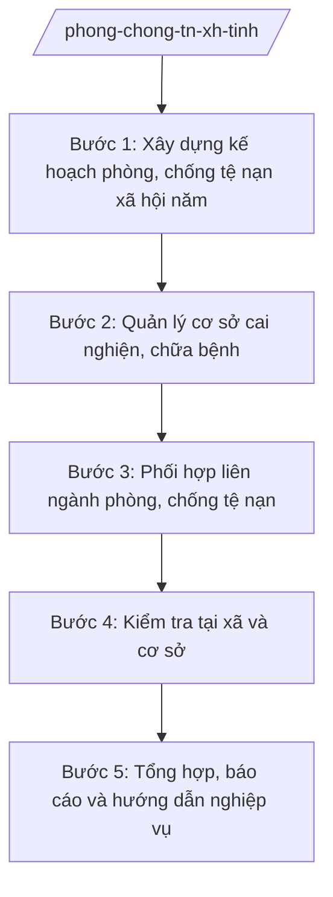

# Skill: Phòng, chống tệ nạn xã hội cấp tỉnh

## 2. Khi nào dùng
- Xây dựng kế hoạch phòng, chống tệ nạn xã hội hằng năm của tỉnh (ma túy, mại dâm và tệ nạn khác).
- Quản lý cơ sở cai nghiện ma túy, cơ sở chữa bệnh – giáo dục (tiếp nhận, cai nghiện, dạy nghề, tái hòa nhập).
- Phối hợp liên ngành (Công an, Y tế, LĐ-TB&XH) trong phòng, chống tệ nạn.
- Kiểm tra công tác phòng, chống tệ nạn tại cấp xã, cơ sở cai nghiện.
- Tổng hợp, báo cáo tình hình tệ nạn xã hội toàn tỉnh.

## 3. Đầu vào (Input)
| Trường | Mô tả | Bắt buộc |
|--------|-------|----------|
| `nam_ke_hoach` | Năm kế hoạch | Có |
| `so_lieu_te_nan` | Số liệu tệ nạn xã hội (người nghiện, cơ sở kinh doanh có điều kiện...) | Có |
| `so_lieu_co_so` | Số liệu cơ sở cai nghiện/chữa bệnh (sức chứa, học viên hiện có) | Có |
| `bao_cao_xa` | Báo cáo phòng, chống tệ nạn của các xã | Có |
| `van_ban_chi_dao` | Văn bản chỉ đạo của Trung ương, UBND tỉnh | Không |

## 4. Quy trình

**Bước 1. Xây dựng kế hoạch phòng, chống tệ nạn xã hội năm**
- Làm gì: Phân tích tình hình tệ nạn; soạn kế hoạch năm (mục tiêu giảm người nghiện, xóa điểm phức tạp; nhiệm vụ: tuyên truyền, cai nghiện, quản lý sau cai, kiểm tra cơ sở kinh doanh có điều kiện; kinh phí).
- Dùng input: `nam_ke_hoach`, `so_lieu_te_nan`, `van_ban_chi_dao`.
- Vai trò: Chuyên viên Phòng Phòng, chống tệ nạn xã hội (Sở Nội vụ tỉnh A) soạn; AI hỗ trợ phân tích số liệu, soạn dự thảo ⏱ ~3–5 ngày làm việc (ước tính).
- Lưu ý nghiệp vụ: Kế hoạch phải gắn với chương trình phòng, chống ma túy quốc gia; phân công rõ Công an – Y tế – Nội vụ – xã.
- → Kết quả bước: Dự thảo kế hoạch phòng, chống tệ nạn xã hội năm của tỉnh.

**Bước 2. Quản lý cơ sở cai nghiện, chữa bệnh**
- Làm gì: Thẩm định, trình thành lập/giải thể cơ sở; phê duyệt chỉ tiêu tiếp nhận; kiểm tra điều kiện cơ sở vật chất, đội ngũ; theo dõi cai nghiện, dạy nghề, tái hòa nhập cộng đồng cho học viên.
- Dùng input: `so_lieu_co_so`.
- Vai trò: Phòng Phòng, chống tệ nạn xã hội chủ trì, phối hợp cơ sở; AI hỗ trợ soạn hồ sơ thẩm định, biểu mẫu theo dõi học viên ⏱ thường xuyên trong năm (ước tính).
- Lưu ý nghiệp vụ: Đảm bảo quyền của người cai nghiện theo quy định; chống tái nghiện bằng dạy nghề, tạo việc làm sau cai; không để cơ sở quá tải mất an toàn.
- → Kết quả bước: Hồ sơ quản lý cơ sở; báo cáo tình hình cai nghiện.

**Bước 3. Phối hợp liên ngành phòng, chống tệ nạn**
- Làm gì: Ký quy chế phối hợp với Công an tỉnh (đấu tranh tội phạm ma túy, mại dâm), Sở Y tế (điều trị thay thế, HIV), chính quyền xã (quản lý người sau cai tại cộng đồng); tổ chức đợt cao điểm.
- Dùng input: `so_lieu_te_nan`, `bao_cao_xa`.
- Vai trò: Sở Nội vụ đầu mối phối hợp; AI hỗ trợ soạn quy chế phối hợp, kế hoạch đợt cao điểm ⏱ ~3–5 ngày làm việc/đợt (ước tính).
- Lưu ý nghiệp vụ: Phân định rõ trách nhiệm từng ngành, tránh chồng chéo, đùn đẩy; đợt cao điểm phải có mục tiêu, thời gian cụ thể.
- → Kết quả bước: Quy chế phối hợp liên ngành; kế hoạch đợt cao điểm.

**Bước 4. Kiểm tra tại xã và cơ sở**
- Làm gì: Kiểm tra công tác quản lý người nghiện, người bán dâm tại xã; kiểm tra cơ sở cai nghiện, cơ sở kinh doanh dịch vụ có điều kiện dễ phát sinh tệ nạn; kết luận, kiến nghị xử lý.
- Dùng input: `bao_cao_xa`, `so_lieu_co_so`.
- Vai trò: Đoàn kiểm tra liên ngành (Sở Nội vụ chủ trì) thực hiện; AI hỗ trợ soạn đề cương, tổng hợp kết quả ⏱ ~2–3 ngày/đợt (ước tính).
- Lưu ý nghiệp vụ: Kiểm tra đột xuất với cơ sở có dấu hiệu vi phạm; bảo đảm an toàn cho đoàn kiểm tra; xử lý nghiêm, đúng thẩm quyền.
- → Kết quả bước: Biên bản, kết luận kiểm tra; kiến nghị xử lý vi phạm.

**Bước 5. Tổng hợp, báo cáo và hướng dẫn nghiệp vụ**
- Làm gì: Tổng hợp số liệu tệ nạn, kết quả cai nghiện, kiểm tra; soạn báo cáo định kỳ gửi UBND tỉnh, Bộ Nội vụ, Bộ Công an (theo phân công); hướng dẫn nghiệp vụ cho xã.
- Dùng input: `bao_cao_xa`, kết quả các bước 2–4.
- Vai trò: Chuyên viên tổng hợp; AI hỗ trợ soạn báo cáo, văn bản hướng dẫn ⏱ ~3–5 ngày làm việc/đợt (ước tính).
- Lưu ý nghiệp vụ: Số liệu nhạy cảm phải tổng hợp đúng quy định bảo mật; báo cáo trung thực, không giấu số liệu phức tạp.
- → Kết quả bước: Báo cáo định kỳ + văn bản hướng dẫn nghiệp vụ.

## Luồng quy trình (Workflow)

## 5. Đầu ra (Output)

**Danh sách sản phẩm:**
1. Kế hoạch phòng, chống tệ nạn xã hội năm của tỉnh (trình Chủ tịch UBND tỉnh phê duyệt).
2. Hồ sơ quản lý cơ sở cai nghiện/chữa bệnh; báo cáo tình hình cai nghiện.
3. Quy chế phối hợp liên ngành; kế hoạch đợt cao điểm.
4. Biên bản, kết luận kiểm tra.
5. Báo cáo tình hình tệ nạn xã hội định kỳ.

**Cấu trúc output chuẩn** (Kế hoạch — thể thức văn bản hành chính theo NĐ 30/2020/NĐ-CP):
1. Quốc hiệu "CỘNG HÒA XÃ HỘI CHỦ NGHĨA VIỆT NAM", Tiêu ngữ "Độc lập – Tự do – Hạnh phúc".
2. Tên cơ quan: ỦY BAN NHÂN DÂN TỈNH A; số, ký hiệu; địa danh, ngày tháng năm.
3. Tên loại và trích yếu: "KẾ HOẠCH Phòng, chống tệ nạn xã hội năm ... trên địa bàn tỉnh A".
4. Căn cứ ban hành.
5. Nội dung: đánh giá tình hình; mục tiêu; nhiệm vụ (tuyên truyền, cai nghiện, quản lý sau cai, đấu tranh, kiểm tra cơ sở kinh doanh có điều kiện); kinh phí; phân công trách nhiệm (Sở Nội vụ, Công an tỉnh, Sở Y tế, UBND cấp xã...); tổ chức thực hiện.
6. Nơi nhận; chữ ký người có thẩm quyền.

## 6. Checklist nghiệm thu

- [ ] Kế hoạch gắn với chương trình quốc gia, phân công liên ngành rõ ràng
- [ ] Cơ sở cai nghiện được quản lý đúng quy định, không quá tải mất an toàn
- [ ] Phối hợp liên ngành có quy chế, tránh chồng chéo, đùn đẩy
- [ ] Kiểm tra có kết luận rõ, xử lý vi phạm đúng thẩm quyền
- [ ] Số liệu báo cáo trung thực, bảo mật đúng quy định với số liệu nhạy cảm
- [ ] Đủ thành phần thể thức văn bản hành chính theo NĐ 30/2020/NĐ-CP
- [ ] Căn cứ pháp lý đúng, còn hiệu lực, không bịa số hiệu văn bản
- [ ] Đã qua human gate: Trưởng phòng kiểm tra → Giám đốc Sở → Chủ tịch UBND tỉnh (với kế hoạch)
- [ ] Dữ liệu ví dụ (nếu có) 100% hư cấu theo quy ước

## 7. Ví dụ mô phỏng

*Dữ liệu dưới đây là giả lập 100% phục vụ minh họa.*

**Input mẫu:**
- `nam_ke_hoach`: 2026
- `so_lieu_te_nan`: 800 người nghiện có hồ sơ quản lý; 15 điểm phức tạp về ma túy (số liệu giả lập)
- `so_lieu_co_so`: 02 cơ sở cai nghiện, sức chứa 500 học viên, hiện có 420 học viên (giả lập)
- `bao_cao_xa`: 20/20 xã đã gửi báo cáo
- `van_ban_chi_dao`: không có văn bản mới

**Output mẫu (trích Kế hoạch):**

CỘNG HÒA XÃ HỘI CHỦ NGHĨA VIỆT NAM
Độc lập – Tự do – Hạnh phúc

ỦY BAN NHÂN DÂN TỈNH A
Số: 1238/QĐ-UBND
Tỉnh A, ngày 30 tháng 01 năm 2026

**KẾ HOẠCH**
**Phòng, chống tệ nạn xã hội năm 2026 trên địa bàn tỉnh A**

**I. Mục tiêu:** giảm 10% số người nghiện mới phát sinh; xóa 05 điểm phức tạp về ma túy (số liệu giả lập).

**II. Nhiệm vụ:**
1. Tuyên truyền phòng, chống ma túy tại 100% xã, trường THPT.
2. Cai nghiện cho 300 học viên; dạy nghề, tạo việc làm cho 70% học viên sau cai (giả lập).
3. Đợt cao điểm quý III/2026: kiểm tra 100% cơ sở kinh doanh dịch vụ có điều kiện.
4. Quản lý sau cai tại cộng đồng: 100% người sau cai có hồ sơ theo dõi tại xã.

**III. Kinh phí:** ngân sách tỉnh + lồng ghép chương trình quốc gia.

**IV. Tổ chức thực hiện:** Sở Nội vụ chủ trì; Công an tỉnh, Sở Y tế, UBND cấp xã phối hợp.

*Nơi nhận:* ... **CHỦ TỊCH** (ký tên, đóng dấu — phần ký do người có thẩm quyền thực hiện)

## 8. Human gate (người kiểm duyệt)

- Chuyên viên Phòng Phòng, chống tệ nạn xã hội soạn thảo → Trưởng phòng kiểm tra → Phó Giám đốc Sở (ông Đỗ Văn U) cho ý kiến → Giám đốc Sở Nội vụ (ông Hoàng Văn S) ký văn bản thuộc thẩm quyền Sở.
- Kế hoạch năm: Giám đốc Sở trình → Chủ tịch UBND tỉnh (ông Phạm Văn P) phê duyệt.
- Thành lập/giải thể cơ sở cai nghiện: trình Chủ tịch UBND tỉnh quyết định theo thẩm quyền.

## 9. Giới hạn (guardrails)

- AI KHÔNG quyết định biện pháp xử lý hành chính với cá nhân vi phạm thay người có thẩm quyền.
- AI KHÔNG tự ký, đóng dấu, phát hành văn bản hành chính.
- KHÔNG bịa số liệu tệ nạn, cai nghiện, kinh phí, số hiệu văn bản, căn cứ pháp lý.
- KHÔNG dùng văn bản đã hết hiệu lực; số liệu nhạy cảm (người nghiện, cơ sở) chỉ tổng hợp ở mức cần thiết, đúng quy định bảo mật.
- Phân định rõ cấp tỉnh (chính sách, quản lý cơ sở, phối hợp liên ngành) với cấp xã (quản lý đối tượng tại cộng đồng) — xem skill `phong-chong-te-nan`.
- KHÔNG tư vấn vượt thẩm quyền của Sở Nội vụ.

## 10. Căn cứ & lưu ý

- Thông tư 10/2025/TT-BNV ngày 19/6/2025; sửa đổi, bổ sung bởi TT 06/2026/TT-BNV: chức năng, nhiệm vụ của Sở Nội vụ (lĩnh vực phòng, chống tệ nạn xã hội ở địa phương).
- Thông tư 14/2025/TT-BYT: phân định thẩm quyền CQĐP 2 cấp trong lĩnh vực phòng, chống tệ nạn xã hội (thuộc chùm TT 14–19/2025/TT-BYT).
- Nghị định 150/2025/NĐ-CP; Nghị định 370/2025/NĐ-CP: tổ chức Sở Nội vụ.
- Nghị định 30/2020/NĐ-CP: thể thức văn bản hành chính.
- Lưu ý: cấp xã quản lý người nghiện, người sau cai tại cộng đồng và tuyên truyền cơ sở (xem skill `phong-chong-te-nan`); cấp tỉnh quản lý cơ sở cai nghiện, chính sách và phối hợp liên ngành.
