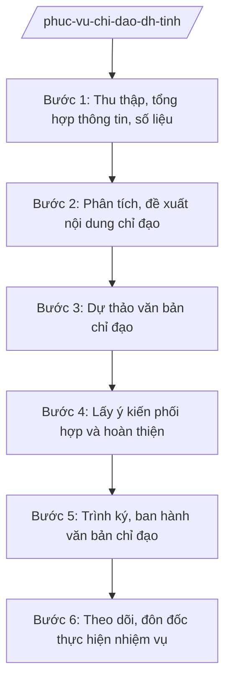

# Skill: Tham mưu tổng hợp phục vụ chỉ đạo, điều hành

## 2. Khi nào dùng

- Tổng hợp tình hình kinh tế - xã hội, quốc phòng - an ninh định kỳ (tuần, tháng, quý, năm) phục vụ phiên họp UBND tỉnh, giao ban của Chủ tịch, các Phó Chủ tịch UBND tỉnh.
- Dự thảo văn bản chỉ đạo, điều hành: công văn chỉ đạo, thông báo kết luận, chỉ thị của UBND tỉnh/Chủ tịch UBND tỉnh.
- Chuẩn bị nội dung phục vụ các cuộc họp, hội nghị, buổi làm việc của lãnh đạo UBND tỉnh với sở, ngành, UBND xã.
- Theo dõi, đôn đốc các sở, ban, ngành, UBND xã thực hiện nhiệm vụ do UBND tỉnh, Chủ tịch UBND tỉnh giao.
- Tổng hợp, báo cáo tiến độ thực hiện các kết luận, chỉ đạo của lãnh đạo UBND tỉnh.

## 3. Đầu vào (Input)

| Trường | Mô tả | Bắt buộc |
|--------|-------|----------|
| `bao_cao_cua_so_nganh_ubnd_xa` | Báo cáo tình hình, số liệu theo yêu cầu tổng hợp | Có |
| `chi_dao_cua_lanh_dao_ubnd_tinh` | Ý kiến chỉ đạo của Chủ tịch, Phó Chủ tịch UBND tỉnh (văn bản, kết luận họp) | Không |
| `nhiem_vu_da_giao` | Danh sách nhiệm vụ UBND tỉnh/Chủ tịch đã giao, thời hạn hoàn thành | Có |
| `tai_lieu_ky_hop_hoi_nghi` | Chương trình, tài liệu phục vụ phiên họp UBND tỉnh, hội nghị | Không |
| `so_lieu_thong_ke` | Số liệu KT-XH từ cơ quan thống kê, các sở, ngành | Không |
| `van_ban_chi_dao_cua_cap_tren` | Chỉ thị, công điện, văn bản của Chính phủ, Thủ tướng cần triển khai | Không |

## 4. Quy trình

**Bước 1. Thu thập, tổng hợp thông tin, số liệu**

- Làm gì: Gửi văn bản yêu cầu các sở, ban, ngành, UBND xã báo cáo tình hình theo đề cương; thu thập số liệu thống kê, văn bản chỉ đạo của cấp trên; kiểm tra tính đầy đủ, nhất quán của số liệu giữa các nguồn.
- Dùng input: `bao_cao_cua_so_nganh_ubnd_xa`; `so_lieu_thong_ke`; `van_ban_chi_dao_cua_cap_tren`.
- Vai trò: Chuyên viên Văn phòng UBND tỉnh tổng hợp AI hỗ trợ: đối chiếu số liệu giữa các báo cáo, phát hiện mâu thuẫn, lập bảng tổng hợp ⏱ ~3–5 ngày làm việc (ước tính).
- Lưu ý nghiệp vụ: Số liệu tổng hợp phải có nguồn rõ ràng, ghi chú đơn vị báo cáo; số liệu mâu thuẫn phải yêu cầu đơn vị giải trình, không tự ý chọn số liệu.
- → Kết quả bước: Bảng tổng hợp thông tin, số liệu phục vụ chỉ đạo, điều hành.

**Bước 2. Phân tích, đề xuất nội dung chỉ đạo**

- Làm gì: Phân tích tình hình, xác định vấn đề nổi cộm, nhiệm vụ chậm tiến độ, nguy cơ phát sinh; đề xuất nội dung cần chỉ đạo, điều hành của UBND tỉnh/Chủ tịch UBND tỉnh (vấn đề gì, giao ai, thời hạn nào).
- Dùng input: Bảng tổng hợp thông tin (bước 1), `nhiem_vu_da_giao`, `chi_dao_cua_lanh_dao_ubnd_tinh`.
- Vai trò: Chuyên viên phân tích AI hỗ trợ: so sánh tiến độ với kế hoạch, phát hiện nhiệm vụ chậm/trễ hạn, gợi ý vấn đề cần chỉ đạo; chuyên viên quyết định đề xuất cuối cùng; Trưởng phòng thẩm định ⏱ ~2 ngày làm việc (ước tính).
- Lưu ý nghiệp vụ: Đề xuất phải sát thực tế, khả thi, đúng thẩm quyền của UBND tỉnh/Chủ tịch; không đề xuất nội dung vượt thẩm quyền hoặc trùng với chỉ đạo đã ban hành.
- → Kết quả bước: Báo cáo phân tích tình hình kèm đề xuất nội dung chỉ đạo.

**Bước 3. Dự thảo văn bản chỉ đạo**

- Làm gì: Soạn dự thảo văn bản chỉ đạo phù hợp hình thức: công văn chỉ đạo, thông báo kết luận cuộc họp, chỉ thị của UBND tỉnh; nội dung rõ: việc gì, ai làm, thời hạn, yêu cầu báo cáo.
- Dùng input: Báo cáo phân tích, đề xuất (bước 2), `tai_lieu_ky_hop_hoi_nghi`.
- Vai trò: Chuyên viên soạn thảo AI hỗ trợ: dựng khung văn bản theo loại, rà soát thể thức theo NĐ 30/2020/NĐ-CP, kiểm tra tính cụ thể của nhiệm vụ giao; Trưởng phòng thẩm định ⏱ ~2 ngày làm việc (ước tính).
- Lưu ý nghiệp vụ: Mỗi nhiệm vụ giao phải có đầu mối chịu trách nhiệm và thời hạn cụ thể; văn bản chỉ đạo của Chủ tịch UBND tỉnh phải đúng thẩm quyền riêng của Chủ tịch theo quy định.
- → Kết quả bước: Dự thảo văn bản chỉ đạo, điều hành.

**Bước 4. Lấy ý kiến phối hợp và hoàn thiện**

- Làm gì: Gửi dự thảo lấy ý kiến các sở, ban, ngành liên quan (đặc biệt đơn vị được giao nhiệm vụ); tổng hợp, tiếp thu ý kiến; hoàn thiện dự thảo trình lãnh đạo.
- Dùng input: Dự thảo văn bản chỉ đạo (bước 3).
- Vai trò: Chuyên viên tổ chức lấy ý kiến AI hỗ trợ: tổng hợp ý kiến, soạn văn bản tiếp thu giải trình; Trưởng phòng duyệt trước khi trình Chánh Văn phòng ⏱ ~3 ngày làm việc (ước tính).
- Lưu ý nghiệp vụ: Đơn vị được giao nhiệm vụ phải có ý kiến về tính khả thi của thời hạn; ý kiến không tiếp thu phải giải trình rõ lý do trong hồ sơ trình.
- → Kết quả bước: Dự thảo văn bản chỉ đạo đã hoàn thiện kèm hồ sơ trình.

**Bước 5. Trình ký, ban hành văn bản chỉ đạo**

- Làm gì: Trình Chánh Văn phòng UBND tỉnh kiểm tra lần cuối, trình Chủ tịch/Phó Chủ tịch UBND tỉnh ký ban hành theo phân công; phát hành văn bản đến các cơ quan, đơn vị liên quan; cập nhật vào sổ theo dõi nhiệm vụ.
- Dùng input: Dự thảo đã hoàn thiện (bước 4).
- Vai trò: Chánh Văn phòng UBND tỉnh kiểm tra, trình ký AI hỗ trợ: rà soát thể thức, số hiệu, nơi nhận lần cuối; không thay người ký; Chủ tịch/Phó Chủ tịch UBND tỉnh ký ban hành ⏱ ~2 ngày làm việc (ước tính).
- Lưu ý nghiệp vụ: Văn bản chỉ đạo phải được ban hành kịp thời để đơn vị có đủ thời gian thực hiện; cập nhật ngay vào hệ thống theo dõi sau khi ban hành.
- → Kết quả bước: Văn bản chỉ đạo, điều hành đã ban hành.

**Bước 6. Theo dõi, đôn đốc thực hiện nhiệm vụ**

- Làm gì: Cập nhật nhiệm vụ đã giao vào sổ theo dõi; định kỳ (tuần/tháng) đôn đốc đơn vị báo cáo tiến độ; tổng hợp tình hình thực hiện: đúng hạn, chậm, chưa thực hiện; tham mưu văn bản đôn đốc, nhắc nhở hoặc báo cáo lãnh đạo xử lý.
- Dùng input: `nhiem_vu_da_giao`, văn bản chỉ đạo đã ban hành, báo cáo tiến độ của các đơn vị.
- Vai trò: Chuyên viên theo dõi AI hỗ trợ: nhắc lịch báo cáo, cảnh báo nhiệm vụ sắp quá hạn/quá hạn, tổng hợp số liệu tiến độ tự động; Trưởng phòng báo cáo Chánh Văn phòng, lãnh đạo UBND tỉnh. ⏱ ~thường xuyên (ước tính).
- Lưu ý nghiệp vụ: Nhiệm vụ quá hạn phải báo cáo ngay lãnh đạo UBND tỉnh để chỉ đạo; không để nhiệm vụ "treo" không có kết quả cuối cùng.
- → Kết quả bước: Báo cáo tình hình thực hiện nhiệm vụ được giao (định kỳ); văn bản đôn đốc.

## Luồng quy trình (Workflow)

## 5. Đầu ra (Output)

- Báo cáo tổng hợp tình hình phục vụ chỉ đạo, điều hành (định kỳ).
- Dự thảo văn bản chỉ đạo: công văn, thông báo kết luận, chỉ thị (sản phẩm chính).
- Sổ theo dõi nhiệm vụ do UBND tỉnh/Chủ tịch UBND tỉnh giao.
- Văn bản đôn đốc thực hiện nhiệm vụ.
- Báo cáo tình hình thực hiện nhiệm vụ được giao.

**Cấu trúc output chuẩn:**

**THÔNG BÁO KẾT LUẬN** (mẫu văn bản chỉ đạo điển hình) — các phần bắt buộc theo đúng thứ tự, đúng thể thức văn bản hành chính theo NĐ 30/2020/NĐ-CP:

1. Quốc hiệu "CỘNG HÒA XÃ HỘI CHỦ NGHĨA VIỆT NAM", Tiêu ngữ "Độc lập – Tự do – Hạnh phúc".
2. Tên cơ quan ban hành: VĂN PHÒNG ỦY BAN NHÂN DÂN TỈNH A. Số, ký hiệu văn bản; địa danh và thời gian ban hành.
3. Tên loại và trích yếu: THÔNG BÁO — Kết luận của Chủ tịch UBND tỉnh A tại cuộc họp/hội nghị/buổi làm việc ngày ...
4. Nội dung cuộc họp: thời gian, địa điểm, chủ trì, thành phần, nội dung thảo luận.
5. Kết luận, chỉ đạo: từng nội dung — đánh giá tình hình; nhiệm vụ giao (việc gì, đơn vị nào thực hiện, thời hạn hoàn thành, yêu cầu báo cáo).
6. Tổ chức thực hiện và theo dõi.
7. Nơi nhận; ký, đóng dấu (Chánh Văn phòng UBND tỉnh ký thừa lệnh/thừa ủy quyền).

## 6. Checklist nghiệm thu

1. Số liệu tổng hợp có nguồn rõ ràng, đã đối chiếu, xử lý mâu thuẫn giữa các báo cáo.
2. Đề xuất chỉ đạo sát thực tế, khả thi, đúng thẩm quyền của UBND tỉnh/Chủ tịch UBND tỉnh.
3. Mỗi nhiệm vụ giao trong văn bản chỉ đạo có đầu mối chịu trách nhiệm và thời hạn cụ thể.
4. Đã lấy ý kiến đơn vị được giao nhiệm vụ về tính khả thi trước khi trình ký.
5. Văn bản chỉ đạo được ký ban hành đúng thẩm quyền, đúng thể thức NĐ 30/2020/NĐ-CP.
6. 100% nhiệm vụ đã giao được cập nhật vào sổ theo dõi ngay sau khi ban hành văn bản.
7. Nhiệm vụ sắp quá hạn/quá hạn được đôn đốc, báo cáo lãnh đạo kịp thời.
8. Báo cáo tiến độ định kỳ trung thực, số liệu khớp với sổ theo dõi.

## 7. Ví dụ mô phỏng

*Dữ liệu dưới đây là giả lập 100% phục vụ minh họa.*

**Input mẫu:**

| Trường | Giá trị mẫu |
|--------|-------------|
| Báo cáo của sở, ngành, UBND xã | Báo cáo tháng 9/2027 của 10 sở và 5 UBND xã: tiến độ giải ngân vốn đầu tư công đạt 60% kế hoạch năm |
| Chỉ đạo của lãnh đạo UBND tỉnh | Chủ tịch UBND tỉnh yêu cầu đẩy nhanh giải ngân, hoàn thành 95% kế hoạch năm 2027 |
| Nhiệm vụ đã giao | 15 nhiệm vụ về đầu tư công đã giao từ đầu năm, 5 nhiệm vụ chậm tiến độ |
| Tài liệu kỳ họp, hội nghị | Biên bản họp giao ban tháng 9/2027 do Chủ tịch UBND tỉnh chủ trì |
| Số liệu thống kê | Số liệu giải ngân 9 tháng: 3.000/5.000 tỷ đồng |
| Văn bản chỉ đạo của cấp trên | Công điện của Thủ tướng về đẩy mạnh giải ngân vốn đầu tư công năm 2027 |

**Output mẫu (trích Thông báo kết luận):**

**VĂN PHÒNG ỦY BAN NHÂN DÂN TỈNH A**

Số: 1234/TB-VPUBND
Tỉnh A, ngày 05 tháng 10 năm 2027

**THÔNG BÁO**
**Kết luận của Chủ tịch UBND tỉnh A tại cuộc họp giao ban tháng 9/2027**

Ngày 02/10/2027, ông Phạm Văn P — Chủ tịch UBND tỉnh A chủ trì cuộc họp giao ban tháng 9/2027...

**KẾT LUẬN:**

1. Đánh giá: 9 tháng giải ngân đạt 60% kế hoạch (3.000/5.000 tỷ đồng), thấp hơn yêu cầu; 5 nhiệm vụ chậm tiến độ.
2. Giao nhiệm vụ:
   - Sở Tài chính tỉnh A: rà soát, tháo gỡ vướng mắc giải ngân, báo cáo trước 20/10/2027 (đầu mối: ông Bùi Văn X — Trưởng phòng).
   - Sở Xây dựng tỉnh A, các chủ đầu tư: đẩy nhanh tiến độ 10 dự án trọng điểm, hoàn thành giải ngân 95% kế hoạch năm 2027.
   - Văn phòng UBND tỉnh A: theo dõi, đôn đốc hằng tuần, báo cáo Chủ tịch UBND tỉnh.

*Nơi nhận:* ...
**CHÁNH VĂN PHÒNG**
(Ký, đóng dấu — bà Vũ Thị T)

## 8. Human gate (người kiểm duyệt)

- Chuyên viên tổng hợp, soạn thảo → Trưởng phòng thẩm định nội dung, đề xuất chỉ đạo → Chánh Văn phòng UBND tỉnh kiểm tra, trình ký → Chủ tịch/Phó Chủ tịch UBND tỉnh ký ban hành văn bản chỉ đạo.
- Nội dung phân tích, đề xuất chỉ đạo do con người quyết định; AI chỉ hỗ trợ tổng hợp, rà soát.

## 9. Giới hạn (guardrails)

- AI không quyết định nội dung chỉ đạo, không giao nhiệm vụ thay lãnh đạo UBND tỉnh.
- AI không tự ký, ban hành văn bản chỉ đạo; không phát hành văn bản khi chưa được ký duyệt.
- AI không bịa đặt số liệu báo cáo, không tự ý chọn số liệu khi các nguồn mâu thuẫn — phải yêu cầu đơn vị giải trình.
- AI không viện dẫn văn bản đã hết hiệu lực; văn bản chỉ đạo phải đúng thẩm quyền của người ký.

## 10. Căn cứ & lưu ý

- NĐ 150/2025/NĐ-CP: Văn phòng UBND là cơ quan chuyên môn thuộc UBND cấp tỉnh, có chức năng tham mưu tổng hợp phục vụ sự chỉ đạo, điều hành của UBND tỉnh, Chủ tịch UBND tỉnh.
- NĐ 30/2020/NĐ-CP: thể thức và kỹ thuật trình bày văn bản hành chính.
- Phân định thẩm quyền chung của UBND và thẩm quyền riêng của Chủ tịch UBND tỉnh thực hiện theo quy định hiện hành (tinh thần Kết luận 155-KL/TW: phân định rõ thẩm quyền chung của UBND và thẩm quyền riêng của Chủ tịch UBND).
