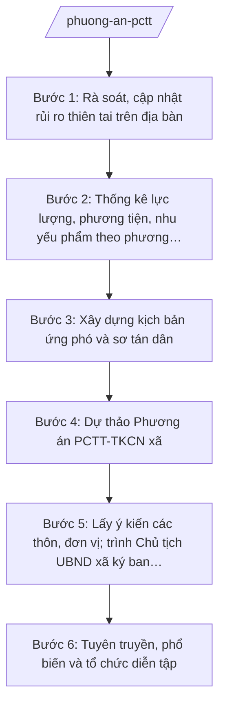

# Skill: Phương án PCTT-TKCN cấp xã

## 2. Khi nào dùng

- Khi Phòng Kinh tế xã được giao chủ trì tham mưu xây dựng Phương án PCTT-TKCN hằng năm (nhiệm vụ lĩnh vực nông nghiệp và môi trường cấp xã theo Thông tư 19/2025/TT-BNNMT).
- Khi cần rà soát, cập nhật rủi ro thiên tai (bão, ngập lụt, sạt lở) trên địa bàn, nhất là khi địa giới hành chính có biến động sau sắp xếp, sáp nhập đơn vị hành chính.
- Khi cần thống kê, huy động lực lượng, phương tiện, nhu yếu phẩm theo phương châm "4 tại chỗ" (chỉ huy tại chỗ, lực lượng tại chỗ, phương tiện và vật tư tại chỗ, hậu cần tại chỗ) và xây dựng kịch bản sơ tán dân.
- Khi cần tổ chức tuyên truyền, diễn tập PCTT-TKCN hoặc báo cáo cấp trên về công tác chuẩn bị trước mùa mưa bão.

## 3. Đầu vào (Input)

| Trường | Mô tả | Bắt buộc |
|--------|-------|----------|
| `nam_phuong_an` | Năm áp dụng của phương án (vd: 2026) | Có |
| `rui_ro_thien_tai` | Các loại hình thiên tai từng xảy ra hoặc có nguy cơ: bão, ngập lụt, sạt lở; vị trí, mức độ, thời điểm thường xảy ra | Có |
| `vung_nguy_co` | Các thôn, khu vực có nguy cơ cao (ngập sâu, sạt lở); số hộ dân, nhân khẩu trong vùng nguy cơ | Có |
| `luc_luong` | Lực lượng tại chỗ: dân quân, công an xã, đoàn viên, hội viên, tổ xung kích PCTT các thôn | Có |
| `phuong_tien` | Phương tiện hiện có: xuồng, áo phao, loa cầm tay, máy phát điện, xe ô tô, dụng cụ cứu hộ | Có |
| `nhu_yeu_pham` | Nhu yếu phẩm dự trữ: gạo, mì ăn liền, nước uống, thuốc men, chăn màn | Có |
| `diem_so_tan` | Điểm sơ tán (trường học, nhà văn hóa, trụ sở): sức chứa, tuyến đường sơ tán | Có |
| `ke_hoach_cap_tren` | Chỉ thị, kế hoạch PCTT của UBND tỉnh A, Sở Nông nghiệp và Môi trường tỉnh A trong năm áp dụng | Có |
| `phuong_an_nam_truoc` | Phương án năm trước và bài học rút ra (nếu có) | Không |

## 4. Quy trình

**Bước 1. Rà soát, cập nhật rủi ro thiên tai trên địa bàn**
- Làm gì: Thu thập, cập nhật danh mục rủi ro thiên tai từng thôn: loại hình (bão, ngập lụt, sạt lở), vị trí cụ thể, mức độ ảnh hưởng các năm trước, số hộ dân trong vùng nguy cơ; vẽ sơ đồ, lập bản đồ vùng nguy cơ ngập lụt, sạt lở của xã.
- Dùng input: `rui_ro_thien_tai`, `vung_nguy_co`, `phuong_an_nam_truoc`.
- Vai trò: Công chức Phòng Kinh tế (ông Nguyễn Văn G) chủ trì khảo sát, phối hợp trưởng các thôn; AI hỗ trợ tổng hợp số liệu thành bảng rủi ro theo thôn và gợi ý khung bản đồ vùng nguy cơ (⏱ ~2 ngày).
- Lưu ý nghiệp vụ: Phải cập nhật ngay khi địa bàn có biến động sau sáp nhập (thôn mới, địa hình mới); số liệu hộ dân trong vùng nguy cơ phải khớp với danh sách hộ của thôn, không ước đoán.
- → Kết quả bước: Bảng rủi ro thiên tai theo thôn + bản đồ vùng nguy cơ ngập lụt, sạt lở của xã.

**Bước 2. Thống kê lực lượng, phương tiện, nhu yếu phẩm theo phương châm "4 tại chỗ"**
- Làm gì: Lập danh sách lực lượng (dân quân, công an xã, tổ xung kích PCTT từng thôn), kiểm kê phương tiện, nhu yếu phẩm hiện có; xác định phần thiếu so với nhu cầu ứng phó và đề xuất bổ sung, mua sắm, sửa chữa.
- Dùng input: `luc_luong`, `phuong_tien`, `nhu_yeu_pham`, bảng rủi ro bước 1.
- Vai trò: Công chức Phòng Kinh tế (ông Nguyễn Văn G) kiểm kê, phối hợp Ban Chỉ huy Quân sự xã, công an xã; AI hỗ trợ lập bảng thống kê và bảng đối chiếu thiếu – đủ (⏱ ~1 ngày).
- Lưu ý nghiệp vụ: Phương châm "4 tại chỗ": chỉ huy tại chỗ, lực lượng tại chỗ, phương tiện và vật tư tại chỗ, hậu cần tại chỗ; phương tiện hỏng phải có kế hoạch sửa chữa trước mùa mưa bão.
- → Kết quả bước: Bảng thống kê lực lượng – phương tiện – nhu yếu phẩm theo "4 tại chỗ" + danh mục cần bổ sung.

**Bước 3. Xây dựng kịch bản ứng phó và sơ tán dân**
- Làm gì: Xây dựng kịch bản ứng phó theo từng loại hình, cấp độ rủi ro thiên tai (trước – trong – sau thiên tai); xác định điểm sơ tán, tuyến đường sơ tán, phương tiện vận chuyển, phân công lực lượng đưa đón, bảo đảm an ninh, hậu cần tại điểm sơ tán.
- Dùng input: `diem_so_tan`, bảng rủi ro bước 1, bảng lực lượng bước 2.
- Vai trò: Công chức Phòng Kinh tế (ông Nguyễn Văn G) dự thảo kịch bản; AI hỗ trợ soạn khung kịch bản theo từng tình huống (bão đổ bộ, ngập sâu, sạt lở) và bảng phân công nhiệm vụ (⏱ ~1 ngày).
- Lưu ý nghiệp vụ: Ưu tiên sơ tán người già, trẻ em, người khuyết tật, phụ nữ mang thai; điểm sơ tán phải bảo đảm an toàn (không ngập, không sạt lở), đủ nước sạch, vệ sinh.
- → Kết quả bước: Kịch bản ứng phó theo tình huống + kế hoạch sơ tán dân (điểm, tuyến, lực lượng, hậu cần).

**Bước 4. Dự thảo Phương án PCTT-TKCN xã**
- Làm gì: Tổng hợp kết quả các bước 1–3 thành dự thảo Phương án PCTT-TKCN xã năm áp dụng: đánh giá tình hình, mục tiêu, lực lượng – phương tiện – nhu yếu phẩm, kịch bản ứng phó, sơ tán dân, trực ban, thông tin liên lạc, tổ chức thực hiện; kèm phụ lục (bản đồ vùng nguy cơ, phân công trực ban).
- Dùng input: Toàn bộ kết quả các bước 1–3, `ke_hoach_cap_tren`, `nam_phuong_an`.
- Vai trò: Công chức Phòng Kinh tế (ông Nguyễn Văn G) soạn dự thảo; AI hỗ trợ soạn thảo theo đúng thể thức văn bản hành chính (NĐ 30/2020/NĐ-CP), kiểm tra tính đầy đủ các phần (⏱ ~2 ngày).
- Lưu ý nghiệp vụ: Phương án phải ban hành trước mùa mưa bão; căn cứ pháp lý chỉ dùng văn bản còn hiệu lực (TT 19/2025/TT-BNNMT, Luật Phòng, chống thiên tai); số liệu trong phương án phải khớp input, không bịa.
- → Kết quả bước: Dự thảo Phương án PCTT-TKCN xã năm áp dụng kèm phụ lục.

**Bước 5. Lấy ý kiến các thôn, đơn vị; trình Chủ tịch UBND xã ký ban hành**
- Làm gì: Gửi dự thảo lấy ý kiến các thôn, công an xã, Ban Chỉ huy Quân sự xã, các đoàn thể; tổng hợp, tiếp thu ý kiến; hoàn thiện dự thảo trình Trưởng phòng Kinh tế kiểm tra, trình Chủ tịch UBND xã (đồng thời là Trưởng Ban chỉ huy PCTT-TKCN xã) ký ban hành Quyết định.
- Dùng input: Dự thảo phương án bước 4.
- Vai trò: Trưởng phòng Kinh tế (bà Hoàng Thị D) kiểm tra nội dung, thể thức, tổng hợp ý kiến; AI hỗ trợ lập bảng tổng hợp ý kiến góp ý và tiếp thu (⏱ ~1 ngày); Chủ tịch UBND xã (ông Nguyễn Văn A) ký ban hành.
- Lưu ý nghiệp vụ: Ý kiến của thôn về điểm sơ tán, tuyến đường phải được tiếp thu đầy đủ vì liên quan trực tiếp đến tính mạng người dân; văn bản do Chủ tịch UBND xã ký với tư cách Trưởng Ban chỉ huy PCTT-TKCN xã.
- → Kết quả bước: Quyết định ban hành Phương án PCTT-TKCN xã năm áp dụng đã ký, đóng dấu.

**Bước 6. Tuyên truyền, phổ biến và tổ chức diễn tập**
- Làm gì: Phổ biến phương án đến các thôn, hộ dân vùng nguy cơ (niêm yết, loa truyền thanh, họp thôn); tổ chức diễn tập sơ tán dân, cứu hộ tại thôn xung yếu; rút kinh nghiệm, bổ sung phương án.
- Dùng input: Phương án đã ban hành bước 5.
- Vai trò: Công chức Phòng Kinh tế (ông Nguyễn Văn G) phối hợp trưởng các thôn, công an xã tổ chức; AI hỗ trợ soạn kế hoạch diễn tập, nội dung tuyên truyền ngắn gọn cho loa truyền thanh (⏱ ~1 ngày).
- Lưu ý nghiệp vụ: Diễn tập phải có phương án bảo đảm an toàn cho người tham gia; hộ dân vùng nguy cơ phải biết rõ điểm sơ tán và người phụ trách đưa đón của thôn mình.
- → Kết quả bước: Kế hoạch tuyên truyền, diễn tập đã thực hiện + biên bản rút kinh nghiệm.

## Luồng quy trình (Workflow)

## 5. Đầu ra (Output)

**Danh sách sản phẩm:**
1. Quyết định ban hành Phương án PCTT-TKCN xã năm … (sản phẩm chính 1).
2. Phương án PCTT-TKCN xã năm … kèm phụ lục (sản phẩm chính 2): bản đồ vùng nguy cơ ngập lụt, sạt lở; bảng lực lượng – phương tiện – nhu yếu phẩm theo phương châm "4 tại chỗ"; phân công trực ban; kịch bản sơ tán dân.
3. Biên bản lấy ý kiến các thôn, đơn vị (tài liệu kèm theo).
4. Kế hoạch tuyên truyền, diễn tập PCTT-TKCN (tài liệu kèm theo).

### Cấu trúc output chuẩn — Quyết định ban hành Phương án PCTT-TKCN xã

1. Quốc hiệu – tiêu ngữ: "CỘNG HÒA XÃ HỘI CHỦ NGHĨA VIỆT NAM / Độc lập – Tự do – Hạnh phúc". (đúng thể thức NĐ 30/2020/NĐ-CP)
2. Tên cơ quan ban hành: "ỦY BAN NHÂN DÂN XÃ A".
3. Số, ký hiệu văn bản: số/ký hiệu theo quy định (vd: 123/QĐ-UBND).
4. Địa danh, ngày tháng năm ban hành: "Xã A, ngày … tháng … năm …".
5. Tên loại và trích yếu: "QUYẾT ĐỊNH — Ban hành Phương án phòng, chống thiên tai và tìm kiếm cứu nạn xã A năm …".
6. Căn cứ: Luật Phòng, chống thiên tai; Thông tư số 19/2025/TT-BNNMT ngày 19/6/2025 của Bộ Nông nghiệp và Môi trường; Nghị định số 150/2025/NĐ-CP ngày 12/6/2025 của Chính phủ; chỉ thị, kế hoạch PCTT của UBND tỉnh A.
7. Nội dung: Điều 1 (ban hành Phương án PCTT-TKCN xã năm … kèm theo Quyết định); Điều 2 (phân công tổ chức thực hiện: Ban chỉ huy PCTT-TKCN xã, Phòng Kinh tế, các thôn); Điều 3 (hiệu lực thi hành).
8. Thẩm quyền – chức vụ – họ tên người ký: Chủ tịch UBND xã, Trưởng Ban chỉ huy PCTT-TKCN xã — Nguyễn Văn A; ký, đóng dấu UBND xã.
9. Nơi nhận: Thường trực Đảng ủy, HĐND xã; Sở Nông nghiệp và Môi trường tỉnh A; các thành viên Ban chỉ huy PCTT-TKCN xã; các thôn; lưu VP, Phòng Kinh tế.

### Cấu trúc output chuẩn — Phương án PCTT-TKCN xã (phụ lục kèm theo Quyết định)

1. Phần I. Đánh giá tình hình, đặc điểm địa bàn và rủi ro thiên tai.
2. Phần II. Mục tiêu, yêu cầu của công tác PCTT-TKCN năm ….
3. Phần III. Lực lượng, phương tiện, nhu yếu phẩm theo phương châm "4 tại chỗ".
4. Phần IV. Kịch bản ứng phó theo loại hình, cấp độ rủi ro thiên tai (trước – trong – sau thiên tai).
5. Phần V. Kế hoạch sơ tán dân (đối tượng, điểm sơ tán, tuyến đường, phương tiện, lực lượng đưa đón, hậu cần).
6. Phần VI. Trực ban, thông tin liên lạc, báo cáo.
7. Phần VII. Tổ chức thực hiện.
8. Phụ lục: (1) Bản đồ vùng nguy cơ ngập lụt, sạt lở; (2) Bảng phân công trực ban; (3) Danh sách điểm sơ tán và sức chứa; (4) Danh mục lực lượng, phương tiện, nhu yếu phẩm.

## 6. Checklist nghiệm thu

- [ ] Phương án được ban hành trước mùa mưa bão của năm áp dụng.
- [ ] Đủ các phần theo cấu trúc output chuẩn, kèm đầy đủ 4 phụ lục (bản đồ vùng nguy cơ, phân công trực ban, điểm sơ tán, lực lượng – phương tiện).
- [ ] Bảng lực lượng – phương tiện – nhu yếu phẩm thể hiện đúng phương châm "4 tại chỗ".
- [ ] Kịch bản sơ tán dân nêu rõ điểm sơ tán, tuyến đường, đối tượng ưu tiên, lực lượng đưa đón.
- [ ] Số liệu hộ dân vùng nguy cơ, lực lượng, phương tiện khớp đúng Input, không bịa số liệu.
- [ ] Căn cứ pháp lý đúng, còn hiệu lực (TT 19/2025/TT-BNNMT, Luật Phòng, chống thiên tai); không trích văn bản hết hiệu lực.
- [ ] Văn bản đúng thể thức NĐ 30/2020/NĐ-CP (quốc hiệu, số/ký hiệu, nơi nhận, chữ ký, con dấu).
- [ ] Đã qua human gate: công chức soạn → Trưởng phòng Kinh tế kiểm tra → Chủ tịch UBND xã (Trưởng Ban chỉ huy PCTT-TKCN xã) ký ban hành.

## 7. Ví dụ mô phỏng

*Dữ liệu dưới đây là giả lập 100% phục vụ minh họa.*

### Input mẫu

| Trường | Giá trị giả lập |
|--------|-----------------|
| nam_phuong_an | 2026 |
| rui_ro_thien_tai | Bão, áp thấp nhiệt đới (tháng 7–10); ngập lụt ven suối tại Thôn 2, Thôn 4; sạt lở ta-luy tại Thôn 5 |
| vung_nguy_co | Thôn 2 (30 hộ ven suối), Thôn 4 (40 hộ vùng trũng), Thôn 5 (30 hộ chân đồi có nguy cơ sạt lở) — tổng 100 hộ |
| luc_luong | 50 dân quân, 10 công an xã, 5 tổ xung kích PCTT (mỗi thôn 1 tổ, 10 người/tổ) |
| phuong_tien | 10 xuồng, 200 áo phao, 10 loa cầm tay, 2 máy phát điện, 5 xe ô tô huy động |
| nhu_yeu_pham | 500 kg gạo, 1.000 gói mì ăn liền, 2.000 chai nước uống, 10 cơ số thuốc, 200 chăn màn |
| diem_so_tan | Trường tiểu học xã A (sức chứa 300 người), nhà văn hóa Thôn 1 (100 người), nhà văn hóa Thôn 3 (100 người) |
| ke_hoach_cap_tren | Chỉ thị của UBND tỉnh A về công tác PCTT-TKCN năm 2026 |
| phuong_an_nam_truoc | Phương án năm 2025; bài học: cần bổ sung xuồng tại Thôn 4 |

### Output mẫu — Quyết định ban hành Phương án PCTT-TKCN xã A năm 2026 (trích)

> CỘNG HÒA XÃ HỘI CHỦ NGHĨA VIỆT NAM
> Độc lập – Tự do – Hạnh phúc
>
> ỦY BAN NHÂN DÂN XÃ A
>
> Số: 123/QĐ-UBND
>
> Xã A, ngày 15 tháng 4 năm 2026
>
> **QUYẾT ĐỊNH**
> **Ban hành Phương án phòng, chống thiên tai và tìm kiếm cứu nạn xã A năm 2026**
>
> CHỦ TỊCH ỦY BAN NHÂN DÂN XÃ A
>
> Căn cứ Luật Phòng, chống thiên tai;
> Căn cứ Thông tư số 19/2025/TT-BNNMT ngày 19/6/2025 của Bộ Nông nghiệp và Môi trường hướng dẫn chức năng, nhiệm vụ của cơ quan chuyên môn về nông nghiệp và môi trường thuộc UBND cấp xã;
> Căn cứ Nghị định số 150/2025/NĐ-CP ngày 12/6/2025 của Chính phủ quy định tổ chức các cơ quan chuyên môn thuộc UBND cấp tỉnh, cấp xã;
> Theo đề nghị của Trưởng phòng Kinh tế xã A,
>
> **QUYẾT ĐỊNH:**
>
> **Điều 1.** Ban hành kèm theo Quyết định này Phương án phòng, chống thiên tai và tìm kiếm cứu nạn xã A năm 2026 (gồm 7 phần và 4 phụ lục: bản đồ vùng nguy cơ ngập lụt, sạt lở; bảng phân công trực ban; danh sách điểm sơ tán; danh mục lực lượng, phương tiện, nhu yếu phẩm theo phương châm "4 tại chỗ").
>
> **Điều 2.** Giao Ban chỉ huy PCTT-TKCN xã, Phòng Kinh tế xã A, công an xã và trưởng các thôn tổ chức thực hiện Phương án; tổ chức tuyên truyền, diễn tập trước ngày 30/6/2026.
>
> **Điều 3.** Quyết định này có hiệu lực thi hành kể từ ngày ký.
>
> **Nơi nhận:**
> - Như Điều 2;
> - Sở Nông nghiệp và Môi trường tỉnh A (để báo cáo);
> - Lưu: VP, Phòng Kinh tế.
>
> **CHỦ TỊCH**
> **Trưởng Ban chỉ huy PCTT-TKCN xã**
>
> *(Ký, đóng dấu)*
> **Nguyễn Văn A**

## 8. Human gate (người kiểm duyệt)

- Công chức Phòng Kinh tế (ông Nguyễn Văn G) soạn dự thảo phương án, tổng hợp ý kiến góp ý.
- Trưởng phòng Kinh tế (bà Hoàng Thị D) kiểm tra nội dung, thể thức, tính đầy đủ của các phụ lục trước khi trình.
- Chủ tịch UBND xã (ông Nguyễn Văn A), đồng thời là Trưởng Ban chỉ huy PCTT-TKCN xã, ký ban hành Quyết định.
- Ban Chỉ huy PCTT-TKCN xã duyệt kịch bản diễn tập trước khi tổ chức diễn tập thực tế.

## 9. Giới hạn (guardrails)

- AI KHÔNG ra quyết định hành chính thay người có thẩm quyền; không tự phê duyệt hay ban hành phương án.
- AI KHÔNG tự ký, đóng dấu hoặc phát hành văn bản dưới danh nghĩa UBND xã, Ban chỉ huy PCTT-TKCN xã hay cá nhân lãnh đạo.
- AI KHÔNG bịa số liệu (hộ dân vùng nguy cơ, lực lượng, phương tiện), không bịa số hiệu văn bản, căn cứ pháp lý; chỉ dùng số liệu do con người cung cấp trong Input.
- AI KHÔNG dùng văn bản đã hết hiệu lực làm căn cứ; khi cần nhắc luật, chỉ nêu tên luật, không kèm số hiệu nếu không có trong danh sách cho phép.
- Quyết định huy động lực lượng, phương tiện, sơ tán dân trong tình huống khẩn cấp do người có thẩm quyền quyết định; AI chỉ hỗ trợ soạn thảo.

## 10. Căn cứ & lưu ý

- Thông tư số 19/2025/TT-BNNMT ngày 19/6/2025 của Bộ Nông nghiệp và Môi trường: hướng dẫn chức năng, nhiệm vụ, quyền hạn của cơ quan chuyên môn về nông nghiệp và môi trường thuộc UBND cấp xã (bao gồm lĩnh vực thủy lợi, phòng chống thiên tai, phát triển nông thôn).
- Luật Phòng, chống thiên tai (chỉ nêu tên luật).
- Nghị định số 150/2025/NĐ-CP ngày 12/6/2025 của Chính phủ (hiệu lực 16/6/2025): tổ chức cơ quan chuyên môn thuộc UBND cấp xã (Phòng Kinh tế); sửa đổi bởi Nghị định số 370/2025/NĐ-CP ngày 31/12/2025 (hiệu lực 01/01/2026).
- Nghị định số 30/2020/NĐ-CP của Chính phủ: thể thức văn bản hành chính.
- Lưu ý: phương án phải được ban hành trước mùa mưa bão; cập nhật ngay khi địa bàn có biến động sau sắp xếp, sáp nhập đơn vị hành chính; phương châm "4 tại chỗ" là yêu cầu xuyên suốt.
