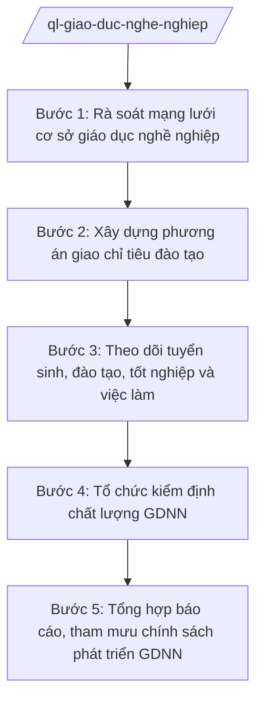

# Skill: Quản lý giáo dục nghề nghiệp

## 2. Khi nào dùng

- Rà soát, sắp xếp mạng lưới cơ sở giáo dục nghề nghiệp (trường cao đẳng, trường trung cấp, trung tâm GDNN, trung tâm GDNN-GDTX có đào tạo nghề) trên địa bàn tỉnh.
- Giao chỉ tiêu đào tạo hằng năm cho các cơ sở GDNN (lưu ý: lĩnh vực GDNN đã chuyển về Bộ GD&ĐT quản lý theo NĐ 37/2025/NĐ-CP).
- Theo dõi tình hình tuyển sinh, đào tạo, tốt nghiệp và việc làm sau tốt nghiệp của học sinh, sinh viên GDNN.
- Tổ chức kiểm định chất lượng GDNN; tổng hợp, báo cáo tình hình GDNN gửi UBND tỉnh và Bộ GD&ĐT; tham mưu chính sách phát triển GDNN của tỉnh.

## 3. Đầu vào (Input)

| Trường | Mô tả | Bắt buộc |
|--------|-------|----------|
| `nam_hoc` | Năm học/năm đào tạo lập kế hoạch, giao chỉ tiêu | Có |
| `danh_sach_cs_gdnn` | Danh sách cơ sở GDNN trên địa bàn: tên, loại hình, địa chỉ, ngành nghề đào tạo | Có |
| `nang_luc_dao_tao` | Sức chứa, đội ngũ giáo viên, thiết bị của từng cơ sở; ngành nghề có nhu cầu xã hội | Có |
| `chi_tieu_de_xuat` | Chỉ tiêu đào tạo các cơ sở đề xuất (trình độ cao đẳng, trung cấp, sơ cấp) | Không |
| `ket_qua_thuc_hien` | Kết quả tuyển sinh, tốt nghiệp năm trước; tỷ lệ có việc làm sau tốt nghiệp | Không |
| `ke_hoach_kiem_dinh` | Danh sách cơ sở đăng ký kiểm định chất lượng GDNN trong năm | Không |

## 4. Quy trình

**Bước 1. Rà soát mạng lưới cơ sở giáo dục nghề nghiệp**

- Làm gì: Thu thập, cập nhật danh mục cơ sở GDNN trên địa bàn (trường cao đẳng, trung cấp, trung tâm GDNN); rà soát ngành nghề đào tạo, năng lực thực tế (đội ngũ, thiết bị, cơ sở vật chất); đánh giá sự phù hợp với nhu cầu nhân lực của tỉnh.
- Dùng input: `nam_hoc`, `danh_sach_cs_gdnn`, `nang_luc_dao_tao`.
- Vai trò: Chuyên viên Phòng Giáo dục thường xuyên – Giáo dục nghề nghiệp tổng hợp. AI hỗ trợ: lập bảng danh mục cơ sở GDNN, đối chiếu ngành nghề đào tạo với nhu cầu nhân lực địa phương, phát hiện ngành trùng lặp/thiếu hụt. ⏱ ~5–7 ngày làm việc (ước tính).
- Lưu ý nghiệp vụ: Dữ liệu phải cập nhật đến thời điểm rà soát; phân biệt rõ cơ sở công lập/tư thục, cơ sở do trung ương quản lý đóng trên địa bàn (chỉ theo dõi, không giao chỉ tiêu trực tiếp nếu ngoài thẩm quyền).
- → Kết quả bước: Bảng tổng hợp mạng lưới cơ sở GDNN toàn tỉnh + đánh giá phù hợp với nhu cầu nhân lực.

**Bước 2. Xây dựng phương án giao chỉ tiêu đào tạo**

- Làm gì: Tổng hợp chỉ tiêu các cơ sở đề xuất; đối chiếu với năng lực thực tế và nhu cầu nhân lực của tỉnh; xây dựng phương án giao chỉ tiêu đào tạo năm … theo trình độ (cao đẳng, trung cấp, sơ cấp) và theo ngành nghề.
- Dùng input: Kết quả bước 1; `chi_tieu_de_xuat`.
- Vai trò: Trưởng phòng Giáo dục thường xuyên – Giáo dục nghề nghiệp (bà Đặng Thị Y) chủ trì xây dựng phương án. AI hỗ trợ: lập bảng chỉ tiêu chi tiết theo cơ sở/trình độ/ngành nghề, kiểm tra tổng chỉ tiêu khớp năng lực và nhu cầu, soạn dự thảo văn bản giao chỉ tiêu. ⏱ ~5–7 ngày làm việc (ước tính).
- Lưu ý nghiệp vụ: Chỉ tiêu giao không vượt năng lực thực tế của cơ sở; ưu tiên ngành nghề tỉnh có nhu cầu nhân lực cao, ngành gắn với doanh nghiệp đặt hàng đào tạo.
- → Kết quả bước: Dự thảo văn bản giao chỉ tiêu đào tạo GDNN năm … + bảng chỉ tiêu chi tiết.

**Bước 3. Theo dõi tuyển sinh, đào tạo, tốt nghiệp và việc làm**

- Làm gì: Thu thập báo cáo định kỳ của các cơ sở GDNN: kết quả tuyển sinh so với chỉ tiêu, tiến độ đào tạo, tỷ lệ tốt nghiệp, tỷ lệ học sinh/sinh viên có việc làm sau 6–12 tháng tốt nghiệp; phân tích, đánh giá hiệu quả đào tạo.
- Dùng input: `ket_qua_thuc_hien`; báo cáo định kỳ của các cơ sở.
- Vai trò: Chuyên viên Phòng Giáo dục thường xuyên – Giáo dục nghề nghiệp theo dõi, đôn đốc báo cáo. AI hỗ trợ: tổng hợp số liệu thành bảng biểu, tính tỷ lệ hoàn thành chỉ tiêu, tỷ lệ việc làm theo ngành nghề/trình độ, phát hiện cơ sở có kết quả thấp bất thường. ⏱ ~3–5 ngày làm việc/đợt tổng hợp (ước tính).
- Lưu ý nghiệp vụ: Số liệu việc làm phải có minh chứng (hợp đồng lao động, xác nhận của doanh nghiệp); không chấp nhận số liệu kê khai không kiểm chứng được.
- → Kết quả bước: Bảng tổng hợp kết quả tuyển sinh, tốt nghiệp, việc làm GDNN + phân tích đánh giá.

**Bước 4. Tổ chức kiểm định chất lượng GDNN**

- Làm gì: Hướng dẫn cơ sở GDNN tự đánh giá; thành lập đoàn đánh giá ngoài; tổ chức đánh giá, thẩm định và công nhận đạt kiểm định chất lượng GDNN theo quy định chuyên ngành.
- Dùng input: `ke_hoach_kiem_dinh`; báo cáo tự đánh giá của cơ sở.
- Vai trò: Trưởng phòng Giáo dục thường xuyên – Giáo dục nghề nghiệp (bà Đặng Thị Y) chủ trì; Giám đốc Sở (ông Hoàng Văn S) ký quyết định thành lập đoàn đánh giá, quyết định công nhận. AI hỗ trợ: lập kế hoạch kiểm định, biểu mẫu đánh giá, tổng hợp kết quả, soạn dự thảo quyết định công nhận đúng thể thức. ⏱ ~10–15 ngày làm việc/đợt (ước tính).
- Lưu ý nghiệp vụ: Quy trình kiểm định GDNN thực hiện theo quy định pháp luật chuyên ngành về giáo dục nghề nghiệp; thành viên đoàn đánh giá không có lợi ích liên quan với cơ sở được đánh giá.
- → Kết quả bước: Quyết định công nhận đạt kiểm định chất lượng GDNN + báo cáo kết quả kiểm định.

**Bước 5. Tổng hợp báo cáo, tham mưu chính sách phát triển GDNN**

- Làm gì: Tổng hợp toàn bộ kết quả quản lý GDNN trong năm (mạng lưới, chỉ tiêu, tuyển sinh, việc làm, kiểm định) thành báo cáo gửi UBND tỉnh và Bộ GD&ĐT; đề xuất chính sách thu hút, hỗ trợ phát triển GDNN của tỉnh (hỗ trợ học phí, gắn kết doanh nghiệp...).
- Dùng input: Kết quả các bước 1–4.
- Vai trò: Chuyên viên Phòng Giáo dục thường xuyên – Giáo dục nghề nghiệp soạn dự thảo; Trưởng phòng (bà Đặng Thị Y) kiểm tra; Phó Giám đốc Sở (ông Đỗ Văn U) xem xét; Giám đốc Sở (ông Hoàng Văn S) ký báo cáo, ký tờ trình chính sách. AI hỗ trợ: tổng hợp số liệu thành bảng biểu, soạn dự thảo báo cáo và tờ trình chính sách, kiểm tra tính khớp số liệu giữa các phần. ⏱ ~5–7 ngày làm việc (ước tính).
- Lưu ý nghiệp vụ: Kiến nghị chính sách phải có luận cứ từ số liệu thực tế (tỷ lệ việc làm, nhu cầu nhân lực); ghi rõ nguồn kinh phí, lộ trình thực hiện đề xuất.
- → Kết quả bước: Báo cáo tình hình GDNN năm … + Tờ trình chính sách phát triển GDNN (nếu có).

## Luồng quy trình (Workflow)

## 5. Đầu ra (Output)

### Sản phẩm

1. **Quyết định giao chỉ tiêu đào tạo giáo dục nghề nghiệp năm …** (sản phẩm chính) — Giám đốc Sở GD&ĐT ký ban hành.
2. Báo cáo tình hình giáo dục nghề nghiệp năm … (gửi UBND tỉnh, Bộ GD&ĐT).
3. Quyết định công nhận đạt kiểm định chất lượng GDNN (Giám đốc Sở ký).
4. Tờ trình chính sách phát triển GDNN của tỉnh (nếu có đề xuất).

**Cấu trúc output chuẩn (Quyết định giao chỉ tiêu đào tạo GDNN):**
- Thể thức: tuân thủ Nghị định 30/2020/NĐ-CP về công tác văn thư.

1. Quốc hiệu "CỘNG HÒA XÃ HỘI CHỦ NGHĨA VIỆT NAM", Tiêu ngữ "Độc lập – Tự do – Hạnh phúc": CỘNG HÒA XÃ HỘI CHỦ NGHĨA VIỆT NAM / Độc lập – Tự do – Hạnh phúc.
2. Tên cơ quan ban hành: SỞ GIÁO DỤC VÀ ĐÀO TẠO TỈNH A.
3. Số, ký hiệu văn bản: số/QĐ-SGDĐT.
4. Địa danh, ngày tháng năm ban hành: Tỉnh A, ngày … tháng … năm ….
5. Tên loại và trích yếu nội dung: QUYẾT ĐỊNH / Về việc giao chỉ tiêu đào tạo giáo dục nghề nghiệp năm … tỉnh A.
6. Căn cứ ban hành: Luật Giáo dục; Nghị định 37/2025/NĐ-CP (chức năng, nhiệm vụ của Bộ GD&ĐT, trong đó có lĩnh vực giáo dục nghề nghiệp); Thông tư 15/2025/TT-BGDĐT; văn bản chỉ đạo của UBND tỉnh A (ghi rõ số hiệu, ngày ban hành).
7. Nội dung quyết định theo từng điều:
   - Điều 1. Giao chỉ tiêu đào tạo năm … cho các cơ sở giáo dục nghề nghiệp trên địa bàn tỉnh (chi tiết theo cơ sở, trình độ đào tạo, ngành nghề tại Phụ lục kèm theo);
   - Điều 2. Hiệu lực thi hành;
   - Điều 3. Trách nhiệm thi hành (Phòng Giáo dục thường xuyên – Giáo dục nghề nghiệp, thủ trưởng các cơ sở GDNN, các đơn vị liên quan).
8. Nơi nhận (UBND tỉnh; Bộ GD&ĐT; các cơ sở GDNN được giao chỉ tiêu; lưu VT, GDTX-GDNN).
9. Chữ ký, họ tên người ký: GIÁM ĐỐC / (ký, đóng dấu, ghi rõ họ tên).

## 6. Checklist nghiệm thu

- [ ] Đủ 9 phần theo Cấu trúc output chuẩn mục 5, đúng thứ tự thể thức NĐ 30/2020/NĐ-CP.
- [ ] Danh mục cơ sở GDNN cập nhật đầy đủ, phân rõ công lập/tư thục, cơ sở trung ương đóng trên địa bàn.
- [ ] Chỉ tiêu giao không vượt năng lực thực tế của từng cơ sở; ưu tiên ngành nghề tỉnh có nhu cầu nhân lực.
- [ ] Số liệu tuyển sinh, tốt nghiệp, việc làm có minh chứng; tỷ lệ hoàn thành chỉ tiêu được tính đúng.
- [ ] Quy trình kiểm định GDNN tuân thủ quy định pháp luật chuyên ngành; thành viên đoàn đánh giá không có xung đột lợi ích.
- [ ] Căn cứ pháp lý ghi đúng số hiệu: NĐ 37/2025/NĐ-CP, TT 15/2025/TT-BGDĐT; nội dung chuyên ngành khác ghi "theo quy định pháp luật chuyên ngành", không bịa số hiệu.
- [ ] Báo cáo tổng hợp số liệu khớp giữa các bảng; kiến nghị chính sách có luận cứ, nguồn kinh phí rõ ràng.
- [ ] Đã qua đủ nấc human gate: chuyên viên → Trưởng phòng → Phó Giám đốc Sở → Giám đốc Sở ký ban hành.

## 7. Ví dụ mô phỏng

*Dữ liệu dưới đây là giả lập 100% phục vụ minh họa.*

**Input mẫu:**

| Trường | Giá trị mẫu |
|--------|-------------|
| nam_hoc | Năm 2027 |
| danh_sach_cs_gdnn | Trường Cao đẳng Kỹ thuật A; Trường Trung cấp Nghề B; Trung tâm GDNN xã B |
| nang_luc_dao_tao | 3.000 chỉ tiêu tối đa; ngành trọng điểm: cơ khí, điện, công nghệ thông tin |
| chi_tieu_de_xuat | 2.800 (cao đẳng 800, trung cấp 1.200, sơ cấp 800) |
| ket_qua_thuc_hien | Năm 2026: tuyển 2.500/2.600; tốt nghiệp 90%; có việc làm 85% |

**Output mẫu:**

CỘNG HÒA XÃ HỘI CHỦ NGHĨA VIỆT NAM
Độc lập – Tự do – Hạnh phúc
---------------

SỞ GIÁO DỤC VÀ ĐÀO TẠO TỈNH A

Số: 678/QĐ-SGDĐT

Tỉnh A, ngày 20 tháng 12 năm 2026

**QUYẾT ĐỊNH**
**Về việc giao chỉ tiêu đào tạo giáo dục nghề nghiệp năm 2027 tỉnh A**

*Căn cứ* Luật Giáo dục;
*Căn cứ* Nghị định số 37/2025/NĐ-CP ngày 26/02/2025 của Chính phủ quy định chức năng, nhiệm vụ, quyền hạn và cơ cấu tổ chức của Bộ Giáo dục và Đào tạo;
*Căn cứ* Thông tư số 15/2025/TT-BGDĐT ngày 24/7/2025 của Bộ Giáo dục và Đào tạo hướng dẫn chức năng, nhiệm vụ, quyền hạn của Sở Giáo dục và Đào tạo và Phòng Văn hóa – Xã hội trong lĩnh vực giáo dục và đào tạo;

**QUYẾT ĐỊNH:**

**Điều 1.** Giao chỉ tiêu đào tạo giáo dục nghề nghiệp năm 2027 cho các cơ sở giáo dục nghề nghiệp trên địa bàn tỉnh A với tổng số 2.800 chỉ tiêu, trong đó: trình độ cao đẳng 800, trình độ trung cấp 1.200, trình độ sơ cấp 800 (chi tiết theo cơ sở, ngành nghề tại Phụ lục kèm theo).

**Điều 2.** Quyết định này có hiệu lực thi hành kể từ ngày ký.

**Điều 3.** Trưởng phòng Giáo dục thường xuyên – Giáo dục nghề nghiệp, Thủ trưởng các cơ sở giáo dục nghề nghiệp được giao chỉ tiêu và các đơn vị liên quan chịu trách nhiệm thi hành Quyết định này./.

***Nơi nhận:***
- Như Điều 3;
- UBND tỉnh (báo cáo);
- Bộ GD&ĐT (báo cáo);
- Lưu: VT, GDTX-GDNN.

**GIÁM ĐỐC**

*(Ký, đóng dấu)*

**Hoàng Văn S**

## 8. Human gate (người kiểm duyệt)

- Chuyên viên Phòng Giáo dục thường xuyên – Giáo dục nghề nghiệp soạn số liệu, dự thảo văn bản; chịu trách nhiệm về tính chính xác của số liệu mạng lưới, chỉ tiêu, kết quả đào tạo.
- Trưởng phòng Giáo dục thường xuyên – Giáo dục nghề nghiệp (bà Đặng Thị Y) kiểm tra toàn bộ hồ sơ ở các bước 1–2 và 4–5; trả lại sửa nếu chưa đạt.
- Phó Giám đốc Sở (ông Đỗ Văn U) xem xét, cho ý kiến trước khi trình Giám đốc Sở.
- Giám đốc Sở (ông Hoàng Văn S) ký ban hành quyết định giao chỉ tiêu, quyết định công nhận kiểm định; ký báo cáo và tờ trình chính sách gửi UBND tỉnh, Bộ GD&ĐT.

## 9. Giới hạn (guardrails)

- AI KHÔNG ra quyết định hành chính thay người có thẩm quyền (không quyết định giao chỉ tiêu, công nhận kiểm định, phê duyệt chính sách hỗ trợ GDNN).
- AI không tự ký, đóng dấu, phát hành văn bản dưới danh nghĩa Sở GD&ĐT hay bất kỳ cá nhân nào.
- AI không bịa số liệu về cơ sở GDNN, chỉ tiêu, tỷ lệ tốt nghiệp, việc làm; mọi con số phải có nguồn từ báo cáo của cơ sở hoặc khảo sát thực tế.
- AI không bịa căn cứ pháp lý, số hiệu văn bản; không viện dẫn văn bản đã hết hiệu lực.
- AI không thay thế đoàn đánh giá kiểm định làm việc tại cơ sở; kết quả kiểm định phải từ đánh giá thực tế.

## 10. Căn cứ & lưu ý

- Nghị định 37/2025/NĐ-CP ngày 26/02/2025 của Chính phủ — quy định chức năng, nhiệm vụ, quyền hạn và cơ cấu tổ chức của Bộ GD&ĐT; lĩnh vực giáo dục nghề nghiệp chuyển về Bộ GD&ĐT quản lý.
- Thông tư 15/2025/TT-BGDĐT ngày 24/7/2025 của Bộ GD&ĐT (hiệu lực 24/7/2025) — chức năng, nhiệm vụ, quyền hạn của Sở GD&ĐT về giáo dục nghề nghiệp, giáo dục thường xuyên (thay thế TT 12/2020/TT-BGDĐT).
- Thông tư 45/2026/TT-BGDĐT ngày 10/6/2026 của Bộ GD&ĐT (hiệu lực 10/6/2026) — sửa đổi, bổ sung TT 15/2025/TT-BGDĐT.
- Nghị định 142/2025/NĐ-CP ngày 12/6/2025 — phân định thẩm quyền của chính quyền địa phương 02 cấp trong lĩnh vực quản lý nhà nước của Bộ GD&ĐT.
- Nghị định 30/2020/NĐ-CP — thể thức văn bản hành chính.
- Lưu ý: tiêu chuẩn kiểm định chất lượng GDNN, điều kiện thành lập cơ sở GDNN thực hiện theo quy định pháp luật chuyên ngành về giáo dục nghề nghiệp; số hiệu văn bản chuyên ngành không có trong danh mục được phép trích dẫn thì ghi "theo quy định pháp luật chuyên ngành", tuyệt đối không bịa số hiệu.
