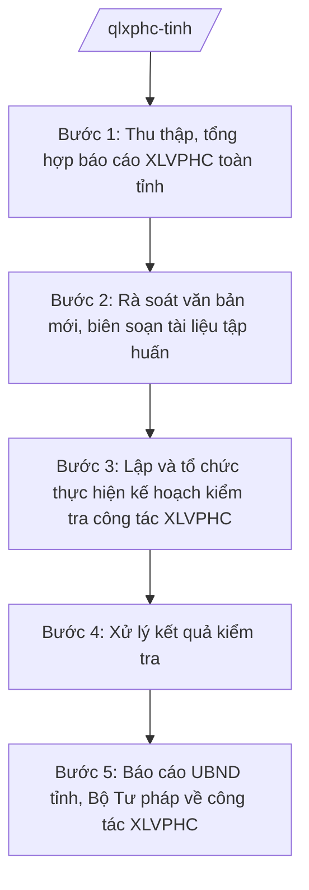

# Skill: Quản lý công tác xử lý VPHC

## 2. Khi nào dùng
- Cần thu thập, tổng hợp báo cáo công tác xử lý vi phạm hành chính (XLVPHC) của các sở, ngành, UBND cấp xã trên địa bàn tỉnh.
- Có văn bản mới về XLVPHC cần rà soát, biên soạn tài liệu tập huấn cho cán bộ làm công tác XLVPHC.
- Cần lập kế hoạch kiểm tra công tác XLVPHC tại sở, ngành, UBND cấp xã (định kỳ, theo chuyên đề).
- Sau kiểm tra cần xử lý kết quả: kiến nghị chấn chỉnh, khắc phục; kiến nghị xử lý vi phạm (nếu phát hiện).
- Cần báo cáo UBND tỉnh và Bộ Tư pháp về công tác XLVPHC trên địa bàn.

## 3. Đầu vào (Input)

| Trường | Mô tả | Bắt buộc |
|--------|-------|----------|
| `bao_cao_xlvphc` | Báo cáo công tác XLVPHC của các sở, ngành, UBND cấp xã (số vụ, hình thức xử phạt, biện pháp khắc phục) | Có |
| `van_ban_moi` | Văn bản mới về XLVPHC cần phổ biến, tập huấn | Không |
| `ke_hoach_kiem_tra` | Kế hoạch kiểm tra công tác XLVPHC trong năm | Không |
| `ket_qua_kiem_tra` | Biên bản, kết quả kiểm tra tại đơn vị, địa phương | Không |
| `tai_lieu_tap_huan` | Tài liệu tập huấn nghiệp vụ XLVPHC hiện có | Không |

## 4. Quy trình

**Bước 1. Thu thập, tổng hợp báo cáo XLVPHC toàn tỉnh**
- Làm gì: Ban hành văn bản đề nghị các sở, ngành, UBND cấp xã báo cáo công tác XLVPHC; thu thập, tổng hợp số liệu: số vụ vi phạm, thẩm quyền xử phạt, hình thức xử phạt chính, hình thức xử phạt bổ sung, biện pháp khắc phục hậu quả, số quyết định bị khiếu nại, khởi kiện.
- Dùng input: `bao_cao_xlvphc`.
- Vai trò: Chuyên viên Phòng Quản lý xử lý vi phạm hành chính (Sở Tư pháp tỉnh A) thu thập, tổng hợp. AI hỗ trợ tổng hợp số liệu từ báo cáo các đơn vị, lập bảng thống kê theo lĩnh vực, địa bàn, phát hiện số liệu bất thường cần làm rõ ⏱ ~05 ngày làm việc (ước tính).
- Lưu ý nghiệp vụ: Số liệu tổng hợp phải có đối chiếu, làm rõ khi chênh lệch lớn giữa các kỳ; phân biệt xử phạt vi phạm hành chính với áp dụng biện pháp xử lý hành chính khác.
- → Kết quả bước: Bảng tổng hợp số liệu XLVPHC toàn tỉnh theo lĩnh vực, địa bàn, kỳ báo cáo.

**Bước 2. Rà soát văn bản mới, biên soạn tài liệu tập huấn**
- Làm gì: Rà soát văn bản mới về XLVPHC; xác định nội dung tập huấn trọng tâm (thẩm quyền xử phạt, trình tự, thủ tục, mẫu biên bản, quyết định); biên soạn, cập nhật tài liệu tập huấn, bộ câu hỏi tình huống.
- Dùng input: `van_ban_moi`, `tai_lieu_tap_huan`, tồn tại phát hiện qua kiểm tra các năm trước.
- Vai trò: Trưởng phòng Quản lý XLVPHC biên soạn tài liệu. AI hỗ trợ soạn đề cương tập huấn, bộ câu hỏi tình huống từ các tồn tại thực tế, cập nhật tài liệu theo văn bản mới ⏱ ~05 ngày làm việc (ước tính).
- Lưu ý nghiệp vụ: Tài liệu bám sát văn bản còn hiệu lực; tình huống thực tế, gắn với lĩnh vực thường xảy ra vi phạm tại tỉnh (đất đai, xây dựng, giao thông, môi trường...); ngôn ngữ dễ hiểu với cán bộ cấp xã.
- → Kết quả bước: Tài liệu tập huấn nghiệp vụ XLVPHC đã cập nhật + bộ câu hỏi tình huống.

**Bước 3. Lập và tổ chức thực hiện kế hoạch kiểm tra công tác XLVPHC**
- Làm gì: Lập kế hoạch kiểm tra định kỳ, kiểm tra theo chuyên đề tại sở, ngành, UBND cấp xã; xác định đối tượng, nội dung (thẩm quyền ban hành quyết định, trình tự thủ tục, thời hiệu, thời hạn, việc chấp hành quyết định xử phạt); tổ chức đoàn kiểm tra.
- Dùng input: `ke_hoach_kiem_tra`, bảng tổng hợp số liệu Bước 1.
- Vai trò: Trưởng phòng Quản lý XLVPHC lập kế hoạch, làm trưởng đoàn kiểm tra; Phó Giám đốc Sở phê duyệt kế hoạch. AI hỗ trợ lập kế hoạch kiểm tra, mẫu phiếu kiểm tra hồ sơ xử phạt vi phạm hành chính ⏱ ~03 ngày làm việc (ước tính).
- Lưu ý nghiệp vụ: Lựa chọn đơn vị kiểm tra có trọng tâm (đơn vị có số vụ xử phạt lớn, có đơn khiếu nại, số liệu bất thường); kiểm tra hồ sơ thực tế, đối chiếu quyết định xử phạt với biên bản vi phạm.
- → Kết quả bước: Kế hoạch kiểm tra đã phê duyệt; biên bản kiểm tra tại từng đơn vị, địa phương.

**Bước 4. Xử lý kết quả kiểm tra**
- Làm gì: Ban hành kết luận kiểm tra: đánh giá ưu điểm, chỉ rõ tồn tại (sai thẩm quyền, sai trình tự, quá thời hiệu...); kiến nghị đơn vị chấn chỉnh, khắc phục, hủy bỏ/sửa đổi quyết định trái pháp luật; chuyển cơ quan có thẩm quyền xử lý vi phạm (nếu phát hiện vi phạm nghiêm trọng).
- Dùng input: `ket_qua_kiem_tra`.
- Vai trò: Trưởng phòng Quản lý XLVPHC dự thảo kết luận; Giám đốc Sở ký ban hành. AI hỗ trợ soạn dự thảo kết luận kiểm tra, phân loại tồn tại theo nhóm lỗi và kiến nghị biện pháp khắc phục tương ứng ⏱ ~05 ngày làm việc (ước tính).
- Lưu ý nghiệp vụ: Kết luận căn cứ hồ sơ, biên bản kiểm tra; kiến nghị cụ thể, có thời hạn khắc phục; theo dõi việc khắc phục sau kiểm tra; không thay cơ quan có thẩm quyền xử phạt quyết định xử lý vụ việc cụ thể.
- → Kết quả bước: Kết luận kiểm tra + văn bản kiến nghị chấn chỉnh, khắc phục (chuyển xử lý vi phạm nếu có); kế hoạch theo dõi khắc phục.

**Bước 5. Báo cáo UBND tỉnh, Bộ Tư pháp về công tác XLVPHC**
- Làm gì: Tổng hợp toàn diện công tác XLVPHC của tỉnh: tình hình vi phạm, kết quả xử phạt, công tác kiểm tra, tập huấn; đánh giá tồn tại, nguyên nhân; kiến nghị hoàn thiện pháp luật và nâng cao hiệu quả quản lý.
- Dùng input: kết quả các Bước 1–4.
- Vai trò: Chuyên viên Phòng Quản lý XLVPHC tổng hợp, soạn báo cáo; Giám đốc Sở ký. AI hỗ trợ tổng hợp số liệu, phân tích xu hướng vi phạm theo lĩnh vực và soạn dự thảo báo cáo ⏱ ~03 ngày làm việc (ước tính).
- Lưu ý nghiệp vụ: Báo cáo trung thực, số liệu minh chứng; nêu rõ các quyết định xử phạt bị khiếu nại, khởi kiện và kết quả giải quyết; kiến nghị cụ thể, khả thi.
- → Kết quả bước: Báo cáo công tác XLVPHC của tỉnh đã ký, gửi Bộ Tư pháp và UBND tỉnh đúng hạn.

## Luồng quy trình (Workflow)

## 5. Đầu ra (Output)

Sản phẩm:
- Bảng tổng hợp số liệu XLVPHC toàn tỉnh theo lĩnh vực, địa bàn — lưu hồ sơ
- Tài liệu tập huấn nghiệp vụ XLVPHC (đã cập nhật) + bộ câu hỏi tình huống — dùng cho các lớp tập huấn
- Kế hoạch kiểm tra công tác XLVPHC — lưu hồ sơ, gửi đơn vị được kiểm tra
- Biên bản, kết luận kiểm tra + văn bản kiến nghị chấn chỉnh, khắc phục — lưu hồ sơ
- Báo cáo công tác XLVPHC của tỉnh — gửi Bộ Tư pháp, UBND tỉnh

**Cấu trúc output chuẩn:**

Khung Báo cáo công tác xử lý vi phạm hành chính của tỉnh gồm các phần theo đúng thứ tự, đúng thể thức NĐ 30/2020/NĐ-CP:
1. Quốc hiệu "CỘNG HÒA XÃ HỘI CHỦ NGHĨA VIỆT NAM" — Tiêu ngữ "Độc lập – Tự do – Hạnh phúc"
2. Tên cơ quan: "SỞ TƯ PHÁP TỈNH A"; số, ký hiệu: số.../BC-STP; địa danh, ngày, tháng, năm
3. Tên văn bản: "BÁO CÁO" + tên gọi: "Công tác xử lý vi phạm hành chính tỉnh A năm ..."
4. Nội dung: I. Tình hình vi phạm hành chính (số vụ theo lĩnh vực); II. Kết quả xử phạt (hình thức xử phạt, biện pháp khắc phục hậu quả, thi hành quyết định); III. Công tác kiểm tra, tập huấn nghiệp vụ; IV. Khiếu nại, khởi kiện quyết định xử phạt và kết quả giải quyết; V. Tồn tại, khó khăn; VI. Phương hướng, kiến nghị
5. Nơi nhận: Bộ Tư pháp, UBND tỉnh A, lưu Sở
6. Chữ ký: "GIÁM ĐỐC" + chữ ký + họ tên Giám đốc Sở Tư pháp tỉnh A, đóng dấu Sở

> **Checklist thể thức văn bản theo NĐ 30/2020/NĐ-CP** — đối chiếu trước khi trình ký:
> 1. Quốc hiệu và Tiêu ngữ.
> 2. Tên cơ quan, tổ chức ban hành văn bản.
> 3. Số, ký hiệu của văn bản.
> 4. Địa danh và thời gian ban hành văn bản.
> 5. Tên loại và trích yếu nội dung văn bản.
> 6. Nội dung văn bản.
> 7. Chức vụ, họ tên và chữ ký của người có thẩm quyền.
> 8. Dấu, chữ ký số của cơ quan, tổ chức.
> 9. Nơi nhận (kèm Phụ lục nếu có).

## 6. Checklist nghiệm thu
- [ ] Đã thu thập đầy đủ báo cáo XLVPHC của sở, ngành, UBND cấp xã; số liệu được đối chiếu, làm rõ bất thường
- [ ] Tài liệu tập huấn bám sát văn bản còn hiệu lực; có tình huống thực tế theo lĩnh vực trọng điểm của tỉnh
- [ ] Kế hoạch kiểm tra có trọng tâm, được phê duyệt; kiểm tra hồ sơ xử phạt thực tế tại đơn vị
- [ ] Kết luận kiểm tra chỉ rõ tồn tại theo nhóm lỗi, kiến nghị khắc phục cụ thể, có thời hạn
- [ ] Đã theo dõi việc khắc phục tồn tại sau kiểm tra của đơn vị được kiểm tra
- [ ] Báo cáo công tác XLVPHC có số liệu minh chứng, nêu rõ khiếu nại, khởi kiện và kết quả giải quyết; gửi Bộ Tư pháp đúng hạn
- [ ] Thể thức văn bản đúng NĐ 30/2020/NĐ-CP
- [ ] Không có số liệu, căn cứ pháp lý nào do AI bịa ra
- [ ] Đã qua human gate: chuyên viên tổng hợp → Trưởng phòng kiểm tra → Phó Giám đốc Sở duyệt → Giám đốc Sở ký kết luận kiểm tra, báo cáo

## 7. Ví dụ mô phỏng

*Dữ liệu dưới đây là giả lập 100% phục vụ minh họa.*

### Input mẫu
- bao_cao_xlvphc: Các sở, ngành, UBND cấp xã tỉnh A báo cáo năm 2026 (giả lập): 2.000 vụ vi phạm hành chính; lĩnh vực nhiều nhất: giao thông (800), đất đai (400), môi trường (300); 15 quyết định xử phạt bị khiếu nại, 05 quyết định bị khởi kiện
- ket_qua_kiem_tra: Kiểm tra 10 đơn vị, phát hiện tồn tại chủ yếu: ghi biên bản vi phạm chưa đầy đủ tình tiết, chậm ban hành quyết định xử phạt (giả lập)

### Output mẫu (trích)

**BÁO CÁO CÔNG TÁC XỬ LÝ VI PHẠM HÀNH CHÍNH TỈNH A NĂM 2026**

CỘNG HÒA XÃ HỘI CHỦ NGHĨA VIỆT NAM
Độc lập – Tự do – Hạnh phúc

SỞ TƯ PHÁP TỈNH A

Số: 89/BC-STP

Tỉnh A, ngày 15 tháng 01 năm 2027

**BÁO CÁO**
**Công tác xử lý vi phạm hành chính tỉnh A năm 2026**

I. Tình hình vi phạm hành chính
Tổng số vụ vi phạm: 2.000 vụ, trong đó: giao thông 800 vụ; đất đai 400 vụ; môi trường 300 vụ; lĩnh vực khác 500 vụ.

II. Kết quả xử phạt
Đã ban hành 1.900 quyết định xử phạt; tổng số tiền phạt thu nộp ngân sách: 9.000.000.000 đồng; áp dụng 200 biện pháp khắc phục hậu quả.

III. Công tác kiểm tra, tập huấn nghiệp vụ
Kiểm tra công tác XLVPHC tại 10 đơn vị; tổ chức 03 lớp tập huấn cho 300 cán bộ làm công tác XLVPHC cấp tỉnh, cấp xã.

IV. Khiếu nại, khởi kiện quyết định xử phạt
15 quyết định bị khiếu nại (đã giải quyết 12, giữ nguyên 10, sửa 02); 05 quyết định bị khởi kiện (tòa án đã xét xử 03, giữ nguyên 03).

V. Tồn tại, khó khăn
Một số đơn vị ghi biên bản vi phạm chưa đầy đủ tình tiết; còn tình trạng chậm ban hành quyết định xử phạt.

VI. Phương hướng, kiến nghị
Tăng cường kiểm tra chuyên đề về trình tự, thủ tục xử phạt tại cấp xã; kiến nghị Bộ Tư pháp hướng dẫn thống nhất một số tình huống áp dụng.

Nơi nhận:
- Bộ Tư pháp;
- UBND tỉnh A;
- Lưu: Sở.

GIÁM ĐỐC
(ký, đóng dấu)
Hoàng Văn S

## 8. Human gate
Chuyên viên Phòng Quản lý XLVPHC tổng hợp, dự thảo → Trưởng phòng kiểm tra → Phó Giám đốc Sở phụ trách duyệt → Giám đốc Sở Tư pháp ký kết luận kiểm tra, ký báo cáo. AI chỉ hỗ trợ tổng hợp số liệu, soạn tài liệu, dự thảo văn bản; kết luận kiểm tra và quyết định xử lý do con người thực hiện.

## 9. Giới hạn
AI tuyệt đối KHÔNG: kết luận kiểm tra thay đoàn kiểm tra; quyết định xử phạt vi phạm hành chính thay người có thẩm quyền; tự ký văn bản; bịa số liệu vi phạm, kết quả kiểm tra; dùng văn bản hết hiệu lực làm căn cứ; can thiệp vào vụ việc xử phạt cụ thể.

## 10. Căn cứ & lưu ý
- TT 09/2025/TT-BTP (Sở Tư pháp tham mưu quản lý nhà nước về xử lý vi phạm hành chính; hiệu lực 01/7/2025)
- NĐ 121/2025/NĐ-CP (phân quyền, phân cấp trong lĩnh vực quản lý nhà nước của Bộ Tư pháp)
- NĐ 150/2025/NĐ-CP; NĐ 370/2025/NĐ-CP (tổ chức cơ quan chuyên môn thuộc UBND cấp tỉnh)
- NĐ 30/2020/NĐ-CP (thể thức văn bản hành chính)
- Lưu ý: công tác XLVPHC thực hiện theo quy định pháp luật chuyên ngành hiện hành về xử lý vi phạm hành chính; Sở Tư pháp quản lý nhà nước về công tác XLVPHC, không thay cơ quan có thẩm quyền xử phạt quyết định xử lý vụ việc cụ thể; kiểm tra có trọng tâm, không gây phiền hà.
