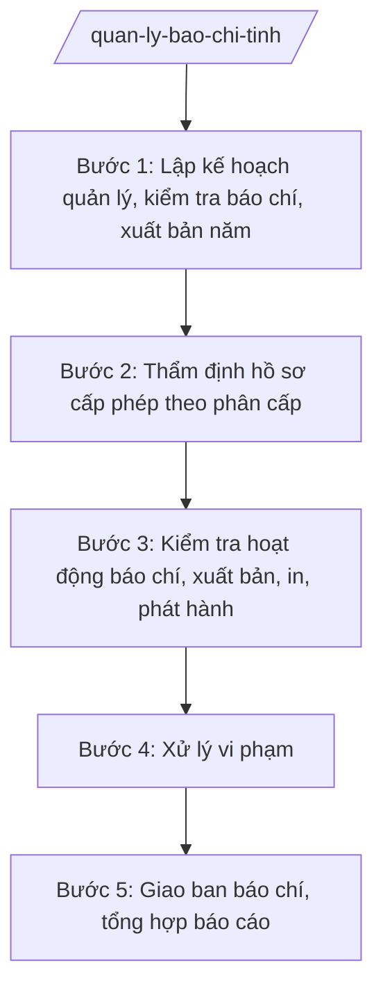

# Skill: Quản lý báo chí, xuất bản địa phương

## 2. Khi nào dùng
- Lập kế hoạch quản lý, kiểm tra hoạt động báo chí, xuất bản, in, phát hành trên địa bàn tỉnh.
- Tiếp nhận, thẩm định hồ sơ cấp, cấp lại giấy phép trong phạm vi phân cấp (bản tin, xuất bản phẩm...).
- Kiểm tra hoạt động của cơ quan báo chí địa phương, văn phòng đại diện, phóng viên thường trú.
- Kiểm tra hoạt động in, phát hành xuất bản phẩm.
- Xử lý vi phạm hành chính trong hoạt động báo chí, xuất bản.
- Tổ chức giao ban báo chí định kỳ; báo cáo công tác báo chí, xuất bản gửi Bộ KH&CN và UBND tỉnh.

## 3. Đầu vào (Input)
| Trường | Mô tả | Bắt buộc |
|--------|-------|----------|
| `doi_tuong_quan_ly` | Cơ quan báo chí địa phương, văn phòng đại diện, cơ sở in, cơ sở phát hành xuất bản phẩm | Có |
| `ke_hoach_kiem_tra` | Kế hoạch kiểm tra hoạt động báo chí, xuất bản đã phê duyệt | Không |
| `bien_ban_kiem_tra` | Biên bản kiểm tra thực tế | Không |
| `don_thu_phan_anh` | Đơn thư, phản ánh về hoạt động báo chí, xuất bản trên địa bàn | Không |
| `nguoi_ky` | Người có thẩm quyền ký (Giám đốc Sở; Chủ tịch UBND tỉnh tùy nội dung) | Có |

## 4. Quy trình

**Bước 1. Lập kế hoạch quản lý, kiểm tra báo chí, xuất bản năm**
- Làm gì: Rà soát đối tượng quản lý (báo, đài địa phương, trang thông tin điện tử, cơ sở in, phát hành); lập kế hoạch kiểm tra, quản lý năm.
- Dùng input: `doi_tuong_quan_ly`, `don_thu_phan_anh`
- Vai trò: Chuyên viên Phòng Báo chí – Xuất bản (hoặc phòng được giao) lập kế hoạch; Trưởng phòng kiểm tra; Giám đốc Sở phê duyệt; AI hỗ trợ lập danh sách đối tượng, phân lịch kiểm tra ⏱ ~5 ngày làm việc (ước tính)
- Lưu ý nghiệp vụ: Kế hoạch phải bao quát cả báo chí, xuất bản, in, phát hành; ưu tiên đối tượng có phản ánh, dấu hiệu vi phạm.
- → Kết quả bước: Kế hoạch quản lý, kiểm tra báo chí, xuất bản năm đã phê duyệt.

**Bước 2. Thẩm định hồ sơ cấp phép theo phân cấp**
- Làm gì: Tiếp nhận hồ sơ đề nghị cấp, cấp lại giấy phép (bản tin, giấy phép hoạt động in...); thẩm định điều kiện; trình cấp phép hoặc trả lời không đủ điều kiện.
- Dùng input: Hồ sơ đề nghị của tổ chức, cá nhân; `doi_tuong_quan_ly`
- Vai trò: Chuyên viên thẩm định hồ sơ; Trưởng phòng kiểm tra; Giám đốc Sở ký giấy phép (trong thẩm quyền phân cấp); AI hỗ trợ kiểm tra thành phần hồ sơ, soạn văn bản ⏱ ~3 ngày làm việc/hồ sơ (ước tính)
- Lưu ý nghiệp vụ: Chỉ cấp phép trong phạm vi thẩm quyền được phân cấp; hồ sơ không đủ điều kiện phải trả lời bằng văn bản, nêu rõ lý do.
- → Kết quả bước: Giấy phép đã cấp hoặc văn bản trả lời không đủ điều kiện.

**Bước 3. Kiểm tra hoạt động báo chí, xuất bản, in, phát hành**
- Làm gì: Kiểm tra việc chấp hành quy định về hoạt động báo chí, xuất bản, in, phát hành; kiểm tra nội dung thông tin; lập biên bản kiểm tra.
- Dùng input: `ke_hoach_kiem_tra`, `don_thu_phan_anh`
- Vai trò: Đoàn kiểm tra (Sở KH&CN chủ trì) thực hiện; chuyên viên lập biên bản; AI hỗ trợ soạn biên bản, tổng hợp kết quả kiểm tra ⏱ theo kế hoạch (ước tính)
- Lưu ý nghiệp vụ: Kiểm tra đúng nội dung quyết định kiểm tra; đánh giá khách quan; nội dung vi phạm phải có căn cứ, bằng chứng cụ thể.
- → Kết quả bước: Biên bản kiểm tra hoạt động báo chí, xuất bản.

**Bước 4. Xử lý vi phạm**
- Làm gì: Lập biên bản vi phạm hành chính; trình ban hành Quyết định xử phạt vi phạm hành chính; theo dõi chấp hành.
- Dùng input: `bien_ban_kiem_tra`
- Vai trò: Chuyên viên lập biên bản vi phạm; Trưởng phòng thẩm tra; người có thẩm quyền xử phạt ký Quyết định; AI hỗ trợ soạn thảo, đối chiếu khung phạt ⏱ ~3 ngày làm việc (ước tính)
- Lưu ý nghiệp vụ: Xác định đúng hành vi, đúng khung phạt, đúng thẩm quyền và thời hiệu; quyết định xử phạt đúng thể thức.
- → Kết quả bước: Quyết định xử phạt vi phạm hành chính (số 1234/QĐ-XPHC).

**Bước 5. Giao ban báo chí, tổng hợp báo cáo**
- Làm gì: Tổ chức giao ban báo chí định kỳ với các cơ quan báo chí; định hướng tuyên truyền; tổng hợp báo cáo công tác báo chí, xuất bản năm.
- Dùng input: Kết quả kiểm tra, xử lý các bước trên; định hướng tuyên truyền của tỉnh
- Vai trò: Phó Giám đốc Sở chủ trì giao ban; chuyên viên chuẩn bị nội dung, tổng hợp báo cáo; AI hỗ trợ soạn thông báo kết luận giao ban, báo cáo tổng kết ⏱ ~3 ngày làm việc (ước tính)
- Lưu ý nghiệp vụ: Giao ban phải định hướng rõ nội dung tuyên truyền trọng tâm; kết luận giao ban là căn cứ để cơ quan báo chí thực hiện.
- → Kết quả bước: Thông báo kết luận giao ban báo chí + báo cáo công tác báo chí, xuất bản năm.

## Luồng quy trình (Workflow)

## 5. Đầu ra (Output)
- Kế hoạch quản lý, kiểm tra báo chí, xuất bản năm.
- Giấy phép (trong thẩm quyền phân cấp) hoặc văn bản trả lời.
- Quyết định xử phạt vi phạm hành chính trong hoạt động báo chí, xuất bản.
- Thông báo kết luận giao ban báo chí; báo cáo công tác báo chí, xuất bản năm.

**Cấu trúc output chuẩn:**
Khung Quyết định xử phạt vi phạm hành chính trong hoạt động báo chí, xuất bản (theo NĐ 30/2020/NĐ-CP):
1. Quốc hiệu "CỘNG HÒA XÃ HỘI CHỦ NGHĨA VIỆT NAM", Tiêu ngữ "Độc lập – Tự do – Hạnh phúc".
2. Số, ký hiệu văn bản: số 1234/QĐ-XPHC.
3. Địa danh và ngày, tháng, năm: "Tỉnh A, ngày ... tháng ... năm ...".
4. Tên loại và trích yếu: "QUYẾT ĐỊNH / Xử phạt vi phạm hành chính trong hoạt động báo chí, xuất bản".
5. Căn cứ: TT 10/2025/TT-BKHCN; NĐ 132/2025/NĐ-CP; biên bản vi phạm hành chính số ...; quy định xử phạt vi phạm hành chính trong hoạt động báo chí, xuất bản.
6. Nội dung bắt buộc: Điều 1. Xử phạt đối với ...; hành vi vi phạm ...; mức phạt tiền ... đồng; biện pháp khắc phục hậu quả ...; Điều 2. Thời hạn chấp hành, nơi nộp phạt; Điều 3. Quyền khiếu nại, khởi kiện; Điều 4. Hiệu lực và tổ chức thi hành.
7. Nơi nhận: Tổ chức/cá nhân bị xử phạt; Kho bạc Nhà nước; đơn vị liên quan; lưu hồ sơ.
8. Chữ ký của người có thẩm quyền xử phạt + họ tên, đóng dấu.

> **Chuẩn tài liệu đầu ra** (thứ tự ưu tiên):
> 1. Chuẩn riêng của ngành/cơ quan chủ quản — mẫu, biểu mẫu, quy chuẩn tại văn bản quy phạm chuyên ngành (xem mục "Căn cứ & lưu ý").
> 2. Tài liệu không có quy chuẩn riêng — thể thức NĐ 30/2020/NĐ-CP: Quốc hiệu và Tiêu ngữ; tên cơ quan ban hành; số, ký hiệu; địa danh và thời gian; tên loại và trích yếu; nội dung; chức vụ, họ tên, chữ ký người có thẩm quyền; dấu, chữ ký số; nơi nhận (kèm Phụ lục nếu có).

## 6. Checklist nghiệm thu
- [ ] Kế hoạch kiểm tra bao quát báo chí, xuất bản, in, phát hành; ưu tiên đối tượng có dấu hiệu vi phạm.
- [ ] Cấp phép đúng thẩm quyền phân cấp; hồ sơ không đủ điều kiện được trả lời bằng văn bản.
- [ ] Biên bản kiểm tra đúng nội dung quyết định kiểm tra; vi phạm có căn cứ, bằng chứng.
- [ ] Quyết định xử phạt đúng hành vi, đúng khung phạt, đúng thẩm quyền và thời hiệu.
- [ ] Giao ban báo chí định kỳ, có thông báo kết luận định hướng tuyên truyền.
- [ ] Văn bản đúng thể thức NĐ 30/2020/NĐ-CP.
- [ ] Không bịa số liệu, không trích dẫn văn bản hết hiệu lực.
- [ ] Đã qua human gate: chuyên viên lập → Trưởng phòng thẩm tra → người có thẩm quyền ký.

## 7. Ví dụ mô phỏng
*Dữ liệu dưới đây là giả lập 100% phục vụ minh họa.*

### Input mẫu
- doi_tuong_quan_ly: Báo A (báo địa phương tỉnh A), 05 trang thông tin điện tử tổng hợp, 12 cơ sở in trên địa bàn
- ke_hoach_kiem_tra: Kiểm tra 05 trang thông tin điện tử tổng hợp và 06 cơ sở in trong quý III/2026
- bien_ban_kiem_tra: Trang thông tin điện tử X hoạt động không đúng nội dung giấy phép (đăng tin tức tổng hợp vượt phạm vi chuyên ngành được cấp)
- don_thu_phan_anh: Phản ánh của độc giả về tin bài thiếu kiểm chứng trên trang X
- nguoi_ky: Bà Vũ Thị T – Giám đốc Sở KH&CN tỉnh A

### Output mẫu
**QUYẾT ĐỊNH** số 1234/QĐ-XPHC
Xử phạt vi phạm hành chính trong hoạt động báo chí

CỘNG HÒA XÃ HỘI CHỦ NGHĨA VIỆT NAM
Độc lập – Tự do – Hạnh phúc

Tỉnh A, ngày 09 tháng 10 năm 2026

GIÁM ĐỐC SỞ KHOA HỌC VÀ CÔNG NGHỆ TỈNH A

Căn cứ Thông tư số 10/2025/TT-BKHCN ngày 27/6/2025 của Bộ Khoa học và Công nghệ;
Căn cứ Biên bản vi phạm hành chính số 57/BB-VPHC ngày 02/10/2026;
Xét đề nghị của Trưởng phòng Báo chí – Xuất bản,

QUYẾT ĐỊNH:

Điều 1. Xử phạt vi phạm hành chính đối với Công ty TNHH X, đơn vị chủ quản Trang thông tin điện tử tổng hợp X, địa chỉ xã A, tỉnh A.
a) Hành vi vi phạm: Cung cấp thông tin tổng hợp vượt quá phạm vi nội dung ghi trong giấy phép thiết lập trang thông tin điện tử tổng hợp.
b) Mức phạt tiền: 20.000.000 đồng (hai mươi triệu đồng).
c) Biện pháp khắc phục hậu quả: Buộc gỡ bỏ thông tin vi phạm; chấn chỉnh hoạt động đúng giấy phép.

Điều 2. Công ty TNHH X phải chấp hành trong thời hạn 10 ngày kể từ ngày nhận quyết định; nộp phạt tại Kho bạc Nhà nước khu vực.

Điều 3. Công ty TNHH X có quyền khiếu nại, khởi kiện theo quy định của pháp luật.

Điều 4. Quyết định có hiệu lực kể từ ngày ký.

Nơi nhận:
- Công ty TNHH X;
- Kho bạc Nhà nước khu vực;
- Lưu: hồ sơ.

GIÁM ĐỐC
Vũ Thị T

## 8. Human gate
Chuyên viên Phòng Báo chí – Xuất bản lập kế hoạch, biên bản → Trưởng phòng thẩm tra → người có thẩm quyền xử phạt ký Quyết định (Giám đốc Sở hoặc Chủ tịch UBND tỉnh tùy mức phạt). Nội dung định hướng tuyên truyền tại giao ban báo chí do Lãnh đạo Sở (hoặc UBND tỉnh) quyết định. AI chỉ hỗ trợ soạn thảo, tổng hợp — không thay con người đánh giá vi phạm nội dung báo chí.

## 9. Giới hạn
AI tuyệt đối KHÔNG: ra quyết định hành chính thay người có thẩm quyền; tự ký/phát hành văn bản; bịa số liệu, căn cứ pháp lý, trích dẫn; dùng văn bản hết hiệu lực. Đặc biệt: không tự kết luận nội dung báo chí vi phạm khi chưa có đánh giá của cơ quan có thẩm quyền, không cấp phép vượt thẩm quyền phân cấp.

## 10. Căn cứ & lưu ý
- TT 10/2025/TT-BKHCN (27/6/2025; hiệu lực 01/7/2025).
- NĐ 132/2025/NĐ-CP (12/6/2025) — phân định thẩm quyền CQĐP 2 cấp lĩnh vực quản lý nhà nước của Bộ KH&CN.
- NĐ 150/2025/NĐ-CP (12/6/2025; hiệu lực 16/6/2025); sửa đổi bởi NĐ 370/2025/NĐ-CP.
- NĐ 30/2020/NĐ-CP (thể thức văn bản hành chính).
- Luật Báo chí; Luật Xuất bản (chỉ nêu tên).
- Lưu ý: Sở KH&CN tiếp nhận lĩnh vực báo chí, xuất bản từ Sở Thông tin và Truyền thông cũ sau sáp nhập 2025; việc cấp phép chỉ thực hiện trong phạm vi thẩm quyền được phân cấp, các loại giấy phép thuộc thẩm quyền trung ương thì hướng dẫn, chuyển hồ sơ theo quy định.
