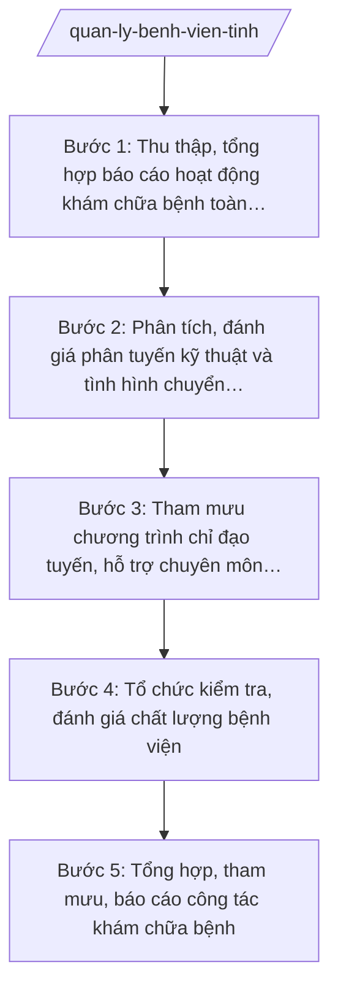

# Skill: Quản lý bệnh viện, cơ sở KCB

## 2. Khi nào dùng

- Khi cần tổng hợp, phân tích báo cáo hoạt động khám bệnh, chữa bệnh của các bệnh viện, cơ sở KCB trên địa bàn tỉnh (công lập và ngoài công lập).
- Khi cần tham mưu phân tuyến chuyên môn kỹ thuật, quy định chuyển tuyến giữa các cơ sở KCB trong tỉnh.
- Khi cần xây dựng chương trình, kế hoạch chỉ đạo tuyến (bệnh viện tuyến trên hỗ trợ chuyên môn cho tuyến dưới).
- Khi cần tổ chức kiểm tra, đánh giá chất lượng bệnh viện, chất lượng khám chữa bệnh theo bộ tiêu chí.
- Khi cần soạn báo cáo tổng hợp công tác khám chữa bệnh gửi Bộ Y tế và UBND tỉnh.

## 3. Đầu vào (Input)

| Trường | Mô tả | Bắt buộc |
|--------|-------|----------|
| `bao_cao_benh_vien` | Báo cáo hoạt động của các bệnh viện, cơ sở KCB: số lượt khám, điều trị nội/ngoại trú, công suất giường bệnh, tỷ lệ chuyển tuyến | Có |
| `danh_sach_cs_kcb` | Danh sách cơ sở KCB trên địa bàn: tên, hạng, loại hình (công lập/ngoài công lập), chuyên khoa | Có |
| `phan_tuyen_hien_hanh` | Phân tuyến chuyên môn kỹ thuật đang áp dụng; các vướng mắc chuyển tuyến | Có |
| `ket_qua_kiem_tra_truoc` | Kết quả kiểm tra, đánh giá chất lượng kỳ trước; tồn tại chưa khắc phục | Không |
| `chuong_trinh_chi_dao_tuyen` | Đề xuất nhu cầu hỗ trợ chuyên môn của tuyến dưới; khả năng hỗ trợ của tuyến trên | Không |
| `van_ban_chi_dao` | Văn bản chỉ đạo của Bộ Y tế, UBND tỉnh về công tác KCB (nếu có) | Không |

## 4. Quy trình

**Bước 1. Thu thập, tổng hợp báo cáo hoạt động khám chữa bệnh toàn tỉnh**
- Làm gì: Tập hợp báo cáo của các bệnh viện, cơ sở KCB: lượt khám, điều trị nội trú/ngoại trú, công suất sử dụng giường bệnh, tỷ lệ chuyển tuyến lên/xuống, tai biến/sự cố y khoa; kiểm tra tính đầy đủ, nhất quán; lập bảng tổng hợp toàn tỉnh.
- Dùng input: `bao_cao_benh_vien`, `danh_sach_cs_kcb`.
- Vai trò: Chuyên viên Phòng Nghiệp vụ Y thuộc Sở Y tế tổng hợp; AI hỗ trợ nhập liệu, lập bảng tổng hợp, tính các chỉ số ⏱ ~2 ngày (ước tính).
- Lưu ý nghiệp vụ: Số liệu từ báo cáo chính thức của cơ sở; phân biệt công lập/ngoài công lập khi tổng hợp; lưu ý các chỉ số bất thường (quá tải, chuyển tuyến tăng đột biến) để phân tích sâu.
- → Kết quả bước: Bảng tổng hợp hoạt động khám chữa bệnh toàn tỉnh (kỳ …).

**Bước 2. Phân tích, đánh giá phân tuyến kỹ thuật và tình hình chuyển tuyến**
- Làm gì: Đánh giá việc thực hiện phân tuyến chuyên môn kỹ thuật: danh mục kỹ thuật từng tuyến, tỷ lệ chuyển tuyến đúng tuyến/vượt tuyến; xác định nguyên nhân chuyển tuyến tăng (thiếu chuyên khoa, thiếu trang thiết bị, thiếu nhân lực); đề xuất điều chỉnh phân tuyến, bổ sung kỹ thuật cho tuyến dưới.
- Dùng input: Bảng tổng hợp bước 1, `phan_tuyen_hien_hanh`.
- Vai trò: Chuyên viên Phòng Nghiệp vụ Y phân tích, soạn đánh giá; Trưởng phòng Nghiệp vụ Y (ông Bùi Văn X) kiểm tra; AI hỗ trợ phân tích tỷ lệ, so sánh giữa các cơ sở, soạn nhận định ⏱ ~2 ngày (ước tính).
- Lưu ý nghiệp vụ: Đánh giá khách quan, có số liệu; phân biệt chuyển tuyến do vượt quá khả năng chuyên môn với chuyển tuyến do người bệnh yêu cầu; đề xuất phải phù hợp năng lực thực tế của tuyến dưới.
- → Kết quả bước: Báo cáo đánh giá phân tuyến kỹ thuật và chuyển tuyến + đề xuất điều chỉnh.

**Bước 3. Tham mưu chương trình chỉ đạo tuyến, hỗ trợ chuyên môn tuyến dưới**
- Làm gì: Xây dựng chương trình chỉ đạo tuyến: bệnh viện tuyến trên (tuyến tỉnh) hỗ trợ tuyến dưới (trung tâm y tế xã, trạm y tế) về đào tạo, chuyển giao kỹ thuật, hội chẩn từ xa, luân phiên cán bộ; xác định nội dung, thời gian, kinh phí, trách nhiệm từng bên.
- Dùng input: Đánh giá bước 2, `chuong_trinh_chi_dao_tuyen`, `van_ban_chi_dao`.
- Vai trò: Chuyên viên Phòng Nghiệp vụ Y soạn dự thảo; Trưởng phòng Nghiệp vụ Y (ông Bùi Văn X) kiểm tra; Phó Giám đốc Sở (ông Đỗ Văn U) chỉ đạo hoàn thiện; Giám đốc Sở (ông Hoàng Văn S) ký ban hành; AI hỗ trợ soạn thảo theo thể thức NĐ 30/2020/NĐ-CP ⏱ ~2 ngày (ước tính).
- Lưu ý nghiệp vụ: Nội dung hỗ trợ phải sát nhu cầu thực tế tuyến dưới; có cơ chế theo dõi, đánh giá kết quả chuyển giao kỹ thuật; phối hợp với bệnh viện tuyến trên, không áp đặt một chiều.
- → Kết quả bước: Dự thảo Chương trình chỉ đạo tuyến (năm …).

**Bước 4. Tổ chức kiểm tra, đánh giá chất lượng bệnh viện**
- Làm gì: Lập kế hoạch kiểm tra, đánh giá chất lượng bệnh viện theo bộ tiêu chí: thành phần đoàn kiểm tra; nội dung (chất lượng chuyên môn, an toàn người bệnh, sự hài lòng người bệnh, quản lý); tổ chức kiểm tra tại các bệnh viện; chấm điểm, xếp loại; yêu cầu khắc phục tồn tại.
- Dùng input: `danh_sach_cs_kcb`, `ket_qua_kiem_tra_truoc`.
- Vai trò: Chuyên viên Phòng Nghiệp vụ Y soạn kế hoạch, tổng hợp kết quả; đoàn kiểm tra do Phó Giám đốc Sở (ông Đỗ Văn U) hoặc Trưởng phòng Nghiệp vụ Y làm Trưởng đoàn; AI hỗ trợ soạn kế hoạch, mẫu phiếu đánh giá, tổng hợp điểm ⏱ ~2 ngày chuẩn bị (ước tính).
- Lưu ý nghiệp vụ: Kiểm tra khách quan theo đúng tiêu chí; kết quả đánh giá là cơ sở để chỉ đạo cải tiến chất lượng, không dùng để xử phạt tùy tiện; tồn tại kỳ trước chưa khắc phục phải được tái kiểm tra.
- → Kết quả bước: Kế hoạch kiểm tra + Báo cáo kết quả đánh giá chất lượng bệnh viện (kỳ …).

**Bước 5. Tổng hợp, tham mưu, báo cáo công tác khám chữa bệnh**
- Làm gì: Tổng hợp toàn bộ kết quả: hoạt động KCB, phân tuyến, chỉ đạo tuyến, chất lượng bệnh viện; soạn báo cáo gửi Bộ Y tế và UBND tỉnh; đề xuất, kiến nghị về đầu tư, nhân lực, trang thiết bị cho hệ thống KCB tỉnh.
- Dùng input: Kết quả các bước 1–4, `van_ban_chi_dao`.
- Vai trò: Chuyên viên Phòng Nghiệp vụ Y tổng hợp, soạn báo cáo; Trưởng phòng Nghiệp vụ Y (ông Bùi Văn X) kiểm tra; Giám đốc Sở (ông Hoàng Văn S) ký báo cáo; AI hỗ trợ tổng hợp, soạn báo cáo theo thể thức NĐ 30/2020/NĐ-CP ⏱ ~1 ngày (ước tính).
- Lưu ý nghiệp vụ: Báo cáo phản ánh đúng thực trạng, không tô hồng; kiến nghị đầu tư phải có căn cứ nhu cầu và khả năng ngân sách; số liệu khớp giữa các bảng.
- → Kết quả bước: Báo cáo tổng hợp công tác khám chữa bệnh tỉnh (kỳ …) gửi Bộ Y tế và UBND tỉnh.

## Luồng quy trình (Workflow)

## 5. Đầu ra (Output)

**Danh sách sản phẩm:**
1. Chương trình chỉ đạo tuyến của ngành y tế tỉnh (sản phẩm chính 1).
2. Báo cáo tổng hợp công tác khám chữa bệnh tỉnh (sản phẩm chính 2).
3. Kế hoạch kiểm tra, đánh giá chất lượng bệnh viện.
4. Báo cáo kết quả đánh giá chất lượng bệnh viện (kèm bảng điểm, xếp loại).
5. Báo cáo đánh giá phân tuyến kỹ thuật và chuyển tuyến (phụ lục chuyên môn).
6. Bảng tổng hợp hoạt động KCB toàn tỉnh (phụ lục số liệu).

**Cấu trúc output chuẩn — Chương trình chỉ đạo tuyến:**
- Thể thức: tuân thủ Nghị định 30/2020/NĐ-CP về công tác văn thư.

1. Quốc hiệu "CỘNG HÒA XÃ HỘI CHỦ NGHĨA VIỆT NAM", Tiêu ngữ "Độc lập – Tự do – Hạnh phúc".
2. Số, ký hiệu văn bản: số/ký hiệu theo quy định (vd: 1234/CTr-SYT).
3. Địa danh, ngày tháng năm ban hành: "Tỉnh A, ngày … tháng … năm …".
4. Tên loại và trích yếu: "CHƯƠNG TRÌNH — Chỉ đạo tuyến, hỗ trợ chuyên môn cho tuyến y tế cơ sở tỉnh A (năm …)".
5. Căn cứ: TT 20/2025/TT-BYT; TT 18/2025/TT-BYT; văn bản chỉ đạo của Bộ Y tế, UBND tỉnh (nếu có).
6. Nội dung: I. Mục đích, yêu cầu; II. Thực trạng tuyến y tế cơ sở (nhu cầu hỗ trợ); III. Nội dung chỉ đạo tuyến (đào tạo, chuyển giao kỹ thuật, hội chẩn từ xa, luân phiên cán bộ); IV. Phân công trách nhiệm (bệnh viện tuyến tỉnh, trung tâm y tế xã, trạm y tế); V. Kinh phí; VI. Theo dõi, đánh giá kết quả.
7. Nơi nhận: Bộ Y tế, UBND tỉnh, các bệnh viện, UBND cấp xã, lưu VP Sở.
8. Chữ ký: Giám đốc Sở Y tế ký, đóng dấu.

**Cấu trúc output chuẩn — Báo cáo tổng hợp công tác khám chữa bệnh:**

1. Quốc hiệu "CỘNG HÒA XÃ HỘI CHỦ NGHĨA VIỆT NAM", Tiêu ngữ "Độc lập – Tự do – Hạnh phúc".
2. Số, ký hiệu văn bản: số/ký hiệu theo quy định (vd: 1234/BC-SYT).
3. Địa danh, ngày tháng năm ban hành.
4. Tên loại và trích yếu: "BÁO CÁO — Tổng hợp công tác khám bệnh, chữa bệnh tỉnh A (kỳ …)".
5. Căn cứ: TT 20/2025/TT-BYT; TT 18/2025/TT-BYT.
6. Nội dung: I. Tình hình hoạt động KCB (bảng tổng hợp); II. Phân tuyến kỹ thuật và chuyển tuyến; III. Chỉ đạo tuyến; IV. Chất lượng bệnh viện; V. Khó khăn, vướng mắc; VI. Kiến nghị, đề xuất.
7. Nơi nhận: Bộ Y tế, UBND tỉnh, lưu VP Sở.
8. Chữ ký: Giám đốc Sở Y tế ký, đóng dấu.

## 6. Checklist nghiệm thu

- [ ] Bảng tổng hợp hoạt động KCB đầy đủ các cơ sở, phân biệt công lập/ngoài công lập; chỉ số tính đúng, nguồn số liệu rõ ràng.
- [ ] Đánh giá phân tuyến kỹ thuật có số liệu chuyển tuyến đúng/vượt tuyến, nêu rõ nguyên nhân và đề xuất điều chỉnh khả thi.
- [ ] Chương trình chỉ đạo tuyến nêu rõ nội dung hỗ trợ, phân công trách nhiệm, kinh phí, cơ chế theo dõi đánh giá; đúng thể thức NĐ 30/2020/NĐ-CP.
- [ ] Kế hoạch kiểm tra chất lượng bệnh viện có thành phần đoàn, nội dung, tiêu chí đánh giá; kết quả kiểm tra khách quan, có yêu cầu khắc phục tồn tại.
- [ ] Báo cáo tổng hợp phản ánh đúng thực trạng, số liệu khớp giữa các bảng, kiến nghị có căn cứ.
- [ ] Tên cơ sở, số liệu trong văn bản khớp đúng Input; không bịa số liệu hoạt động của bệnh viện.
- [ ] Định vị đúng cấp tỉnh: tham mưu, chỉ đạo, kiểm tra, tổng hợp — không viết như nghiệp vụ trực tiếp của cơ sở KCB hay cấp xã.
- [ ] Đã qua human gate: Trưởng phòng kiểm tra, Giám đốc Sở ký duyệt theo thẩm quyền.

## 7. Ví dụ mô phỏng

*Dữ liệu dưới đây là giả lập 100% phục vụ minh họa.*

**Input mẫu:**
- bao_cao_benh_vien: Bệnh viện Đa khoa tỉnh A: 50.000 lượt khám, 15.000 lượt điều trị nội trú, công suất giường 110%, tỷ lệ chuyển tuyến lên tuyến trung ương 8%; Bệnh viện Đa khoa khu vực B: công suất 95%, chuyển tuyến lên tỉnh 12%
- danh_sach_cs_kcb: 1 bệnh viện đa khoa tỉnh (hạng II), 2 bệnh viện đa khoa khu vực, 10 trung tâm y tế xã có giường bệnh, 15 phòng khám ngoài công lập
- phan_tuyen_hien_hanh: danh mục kỹ thuật tuyến tỉnh/tuyến xã; vướng mắc: tuyến xã thiếu bác sĩ chuyên khoa sản, nhi
- chuong_trinh_chi_dao_tuyen: trung tâm y tế 3 xã đề nghị hỗ trợ đào tạo cấp cứu sản khoa; Bệnh viện Đa khoa tỉnh A cam kết cử 2 bác sĩ luân phiên

**Output mẫu — Chương trình chỉ đạo tuyến (trích):**

> CỘNG HÒA XÃ HỘI CHỦ NGHĨA VIỆT NAM
> Độc lập – Tự do – Hạnh phúc
>
> Số: 1234/CTr-SYT
>
> Tỉnh A, ngày 10 tháng 01 năm 2027
>
> **CHƯƠNG TRÌNH**
> **Chỉ đạo tuyến, hỗ trợ chuyên môn cho tuyến y tế cơ sở tỉnh A năm 2027**
>
> Căn cứ Thông tư số 20/2025/TT-BYT ngày 23/6/2025 của Bộ Y tế hướng dẫn chức năng, nhiệm vụ, quyền hạn của cơ quan chuyên môn về y tế thuộc UBND cấp tỉnh;
> Căn cứ Thông tư số 18/2025/TT-BYT của Bộ Y tế quy định phân định thẩm quyền trong lĩnh vực khám bệnh, chữa bệnh;
>
> **I. MỤC ĐÍCH, YÊU CẦU**
> 1. Nâng cao năng lực chuyên môn cho tuyến y tế cơ sở, giảm tỷ lệ chuyển tuyến vượt tuyến không cần thiết.
> 2. Bảo đảm 100% trung tâm y tế xã được hỗ trợ ít nhất 01 nội dung chuyên môn trong năm 2027.
>
> **II. THỰC TRẠNG**
> 1. Tuyến xã còn thiếu bác sĩ chuyên khoa sản, nhi; tỷ lệ chuyển tuyến từ tuyến xã lên tuyến tỉnh là 12%.
> 2. Bệnh viện Đa khoa tỉnh A quá tải (công suất giường 110%).
>
> **III. NỘI DUNG CHỈ ĐẠO TUYẾN NĂM 2027**
> 1. Đào tạo: Bệnh viện Đa khoa tỉnh A tổ chức 02 lớp đào tạo cấp cứu sản khoa cho 30 cán bộ trung tâm y tế xã (quý II/2027).
> 2. Luân phiên cán bộ: cử 02 bác sĩ của Bệnh viện Đa khoa tỉnh A luân phiên hỗ trợ 03 trung tâm y tế xã, mỗi đợt 03 tháng.
> 3. Hội chẩn từ xa: duy trì lịch hội chẩn trực tuyến hằng tuần giữa bệnh viện tỉnh và tuyến xã.
>
> **IV. PHÂN CÔNG TRÁCH NHIỆM**
> 1. Sở Y tế: chỉ đạo, điều phối, tổng hợp đánh giá kết quả.
> 2. Bệnh viện Đa khoa tỉnh A: xây dựng kế hoạch chi tiết, cử cán bộ, báo cáo kết quả.
> 3. UBND cấp xã: tạo điều kiện cho cán bộ tham gia đào tạo, tiếp nhận hỗ trợ.
>
> **V. KINH PHÍ:** 200 triệu đồng từ ngân sách sự nghiệp y tế tỉnh.
>
> **VI. THEO DÕI, ĐÁNH GIÁ:** Sở Y tế kiểm tra 6 tháng/lần; đánh giá kết quả chuyển giao kỹ thuật cuối năm.
>
> **Nơi nhận:** như trên; Bộ Y tế; UBND tỉnh A; lưu VP Sở.
>
> **GIÁM ĐỐC**
> *(Ký, đóng dấu)*
> Hoàng Văn S

## 8. Human gate (người kiểm duyệt)

- Chuyên viên Phòng Nghiệp vụ Y thuộc Sở Y tế soạn thảo, tổng hợp số liệu, dự thảo chương trình, kế hoạch, báo cáo.
- Trưởng phòng Nghiệp vụ Y (ông Bùi Văn X) kiểm tra nội dung chuyên môn, số liệu, thể thức.
- Phó Giám đốc Sở (ông Đỗ Văn U) chỉ đạo hoàn thiện; làm Trưởng đoàn kiểm tra chất lượng bệnh viện (hoặc ủy quyền Trưởng phòng).
- Giám đốc Sở (ông Hoàng Văn S) ký ban hành Chương trình chỉ đạo tuyến, kế hoạch kiểm tra và báo cáo gửi Bộ Y tế (thuộc thẩm quyền Sở).
- Trường hợp đề xuất đầu tư lớn, điều chỉnh tổ chức bộ máy vượt thẩm quyền Sở: trình Chủ tịch UBND tỉnh (ông Phạm Văn P) quyết định.

## 9. Giới hạn (guardrails)

- AI KHÔNG ra quyết định hành chính thay người có thẩm quyền; không tự ban hành chương trình, không tự quyết định xếp loại chất lượng bệnh viện.
- AI KHÔNG tự ký, đóng dấu hoặc phát hành văn bản dưới danh nghĩa Sở Y tế hay lãnh đạo tỉnh.
- AI KHÔNG bịa số liệu hoạt động của bệnh viện, kết quả đánh giá chất lượng, số hiệu văn bản, căn cứ pháp lý.
- AI KHÔNG dùng văn bản đã hết hiệu lực; chỉ trích dẫn văn bản có trong tai-lieu-moi-nhat.md.
- AI KHÔNG can thiệp chuyên môn điều trị của cơ sở KCB; chỉ hỗ trợ công tác quản lý nhà nước.

## 10. Căn cứ & lưu ý

- Thông tư số 20/2025/TT-BYT ngày 23/6/2025 của Bộ Y tế: hướng dẫn chức năng, nhiệm vụ, quyền hạn của Sở Y tế thuộc UBND cấp tỉnh (trong đó có nhiệm vụ quản lý khám bệnh, chữa bệnh).
- Thông tư số 18/2025/TT-BYT của Bộ Y tế: quy định phân định thẩm quyền chính quyền địa phương 2 cấp trong lĩnh vực khám bệnh, chữa bệnh.
- Nghị định số 147/2025/NĐ-CP ngày 12/6/2025: phân định thẩm quyền CQĐP 2 cấp trong lĩnh vực quản lý nhà nước của Bộ Y tế.
- Nghị định số 148/2025/NĐ-CP ngày 12/6/2025: phân quyền, phân cấp trong lĩnh vực y tế.
- Nghị định số 150/2025/NĐ-CP ngày 12/6/2025: tổ chức Sở Y tế thuộc UBND cấp tỉnh; sửa đổi bởi NĐ 370/2025/NĐ-CP.
- Nghị định số 30/2020/NĐ-CP của Chính phủ: thể thức văn bản hành chính.
- Lưu ý: cấp tỉnh quản lý nhà nước về KCB trên địa bàn (chỉ đạo tuyến, kiểm tra chất lượng, phân tuyến kỹ thuật, tổng hợp báo cáo ngành); hoạt động khám chữa bệnh trực tiếp do các cơ sở KCB thực hiện — không trùng với skill cấp xã.
