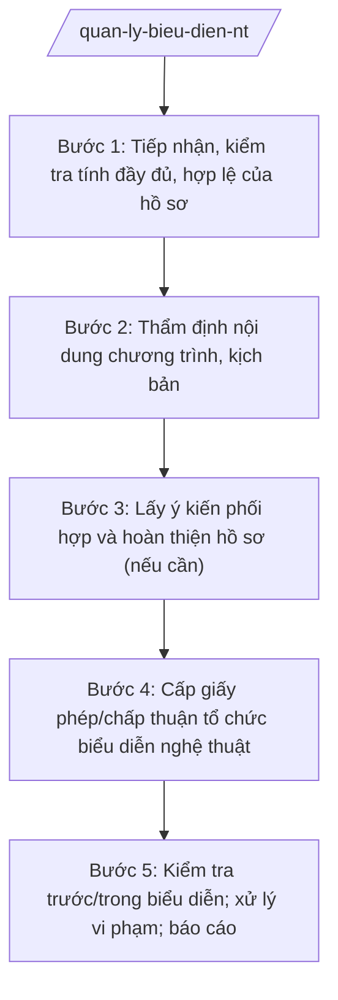

# Skill: Quản lý biểu diễn nghệ thuật

## 2. Khi nào dùng

- Tiếp nhận hồ sơ đề nghị tổ chức biểu diễn nghệ thuật của tổ chức, cá nhân trong nước (chương trình ca nhạc, sân khấu, xiếc, tạp kỹ...).
- Thẩm định nội dung chương trình, kịch bản, lời bài hát: đúng thuần phong mỹ tục, không vi phạm các điều cấm.
- Cấp giấy phép/chấp thuận tổ chức biểu diễn nghệ thuật thuộc thẩm quyền Sở VHTTDL; tham mưu cấp có thẩm quyền đối với trường hợp vượt thẩm quyền.
- Quản lý hoạt động của các đoàn nghệ thuật, nhà hát, đơn vị tổ chức biểu diễn trên địa bàn tỉnh.
- Kiểm tra trước và trong buổi biểu diễn; xử lý vi phạm (biểu diễn không phép, sai nội dung được duyệt, vi phạm thuần phong mỹ tục).

## 3. Đầu vào (Input)

| Trường | Mô tả | Bắt buộc |
|--------|-------|----------|
| `ho_so_de_nghi` | Đơn đề nghị + thông tin đơn vị tổ chức, tên chương trình, thời gian, địa điểm, nghệ sĩ/người biểu diễn tham gia, giá vé (nếu có) | Có |
| `kich_ban` | Kịch bản chương trình, lời bài hát/tiết mục, danh mục tác phẩm biểu diễn | Có |
| `giay_to_lien_quan` | Giấy tờ pháp lý của đơn vị tổ chức, hợp đồng thuê địa điểm, văn bản đồng ý của chủ sở hữu địa điểm | Không |
| `phan_anh_vi_pham` | Phản ánh về biểu diễn không phép, sai nội dung, vi phạm thuần phong mỹ tục | Không |
| `thoi_han` | Thời hạn giải quyết thủ tục hành chính theo quy định | Có |

## 4. Quy trình

**Bước 1. Tiếp nhận, kiểm tra tính đầy đủ, hợp lệ của hồ sơ**

- Làm gì: Tiếp nhận hồ sơ đề nghị tổ chức biểu diễn nghệ thuật qua bộ phận một cửa Sở hoặc trực tuyến; kiểm tra tính đầy đủ, hợp lệ (đơn đề nghị, kịch bản, giấy tờ pháp lý); hướng dẫn bổ sung một lần nếu thiếu.
- Dùng input: `ho_so_de_nghi`, `kich_ban`, `giay_to_lien_quan`, `thoi_han`.
- Vai trò: Công chức bộ phận một cửa Sở tiếp nhận, kiểm tra hình thức. AI hỗ trợ: lập checklist hồ sơ đề nghị tổ chức biểu diễn, soạn văn bản hướng dẫn bổ sung, theo dõi thời hạn giải quyết. ⏱ ~1–2 ngày làm việc (ước tính).
- Lưu ý nghiệp vụ: Thực hiện đúng cơ chế một cửa theo NĐ 118/2025/NĐ-CP; ghi phiếu tiếp nhận, hẹn ngày trả kết quả; không yêu cầu giấy tờ ngoài quy định.
- → Kết quả bước: Hồ sơ đầy đủ, hợp lệ được chuyển Phòng Nghệ thuật thụ lý.

**Bước 2. Thẩm định nội dung chương trình, kịch bản**

- Làm gì: Thẩm định toàn bộ kịch bản, lời bài hát, tiết mục: không vi phạm các điều cấm theo quy định pháp luật chuyên ngành về nghệ thuật biểu diễn; phù hợp thuần phong mỹ tục, không kích động bạo lực, không dung tục; kiểm tra tư cách nghệ sĩ tham gia (không thuộc trường hợp bị cấm biểu diễn).
- Dùng input: `kich_ban`, `ho_so_de_nghi`.
- Vai trò: Chuyên viên Phòng Nghệ thuật (bà Phạm Thị O) chủ trì thẩm định; Trưởng phòng (ông Trần Văn W) kiểm tra; trường hợp nội dung phức tạp thì xin ý kiến Hội đồng thẩm định. AI hỗ trợ: lập bảng tiêu chí thẩm định nội dung, soạn báo cáo thẩm định (đạt/yêu cầu chỉnh sửa/không đạt + lý do cụ thể từng tiết mục). ⏱ ~5–7 ngày làm việc (ước tính).
- Lưu ý nghiệp vụ: Thẩm định phải cụ thể đến từng tiết mục, không đánh giá chung chung; yêu cầu chỉnh sửa phải nêu rõ nội dung cần sửa và lý do; tuyệt đối không để lọt nội dung vi phạm điều cấm.
- → Kết quả bước: Báo cáo thẩm định nội dung chương trình (đề xuất cấp phép/yêu cầu chỉnh sửa/từ chối).

**Bước 3. Lấy ý kiến phối hợp và hoàn thiện hồ sơ (nếu cần)**

- Làm gì: Đối với chương trình quy mô lớn, có yếu tố nhạy cảm: lấy ý kiến Công an tỉnh (an ninh, PCCC tại địa điểm), UBND xã nơi tổ chức; yêu cầu đơn vị tổ chức chỉnh sửa kịch bản theo kết luận thẩm định; kiểm tra lại nội dung đã chỉnh sửa.
- Dùng input: Kết quả bước 2.
- Vai trò: Chuyên viên Phòng Nghệ thuật soạn văn bản lấy ý kiến, đôn đốc; Trưởng phòng (ông Trần Văn W) ký văn bản. AI hỗ trợ: soạn văn bản lấy ý kiến, văn bản yêu cầu chỉnh sửa kịch bản, bảng đối chiếu nội dung trước/sau chỉnh sửa. ⏱ ~3–5 ngày làm việc (ước tính).
- Lưu ý nghiệp vụ: Chỉ lấy ý kiến khi thật sự cần thiết, tránh kéo dài thời hạn; nội dung sau chỉnh sửa phải được thẩm định lại trước khi cấp phép.
- → Kết quả bước: Hồ sơ hoàn chỉnh, đủ điều kiện trình cấp phép.

**Bước 4. Cấp giấy phép/chấp thuận tổ chức biểu diễn nghệ thuật**

- Làm gì: Dự thảo giấy phép tổ chức biểu diễn nghệ thuật (tên chương trình, đơn vị tổ chức, thời gian, địa điểm, nội dung được duyệt, trách nhiệm của đơn vị tổ chức) hoặc văn bản từ chối có nêu rõ lý do; trình ký, cấp phép; gửi cơ quan phối hợp để theo dõi.
- Dùng input: Kết quả bước 2–3.
- Vai trò: Chuyên viên soạn dự thảo giấy phép; Trưởng phòng (ông Trần Văn W) kiểm tra; Phó Giám đốc Sở (ông Đỗ Văn U) cho ý kiến; Giám đốc Sở (ông Hoàng Văn S) ký cấp giấy phép. Trường hợp vượt thẩm quyền Sở thì Giám đốc Sở ký tờ trình tham mưu cấp có thẩm quyền. AI hỗ trợ: điền mẫu giấy phép từ hồ sơ đã thẩm định, rà soát thông tin, lập danh sách nơi nhận. ⏱ ~3–5 ngày làm việc (ước tính).
- Lưu ý nghiệp vụ: Giấy phép ghi rõ nội dung được duyệt; đơn vị tổ chức chỉ được biểu diễn đúng nội dung đã cấp phép; văn bản từ chối phải nêu rõ lý do, căn cứ.
- → Kết quả bước: Giấy phép tổ chức biểu diễn nghệ thuật đã ký (hoặc văn bản từ chối có lý do), gửi đúng nơi nhận.

**Bước 5. Kiểm tra trước/trong biểu diễn; xử lý vi phạm; báo cáo**

- Làm gì: Kiểm tra điều kiện địa điểm trước giờ biểu diễn; cử cán bộ giám sát trong buổi biểu diễn (đối chiếu nội dung thực tế với giấy phép); lập biên bản, yêu cầu dừng ngay khi phát hiện vi phạm (sai nội dung, vi phạm thuần phong mỹ tục); xử phạt vi phạm hành chính theo thẩm quyền; tổng hợp báo cáo định kỳ.
- Dùng input: Giấy phép đã cấp ở bước 4; `phan_anh_vi_pham`.
- Vai trò: Đoàn kiểm tra của Phòng Nghệ thuật phối hợp Thanh tra Sở và Công an địa phương; Chánh Thanh tra Sở tham mưu xử phạt. AI hỗ trợ: lập kế hoạch kiểm tra, soạn biên bản kiểm tra/giám sát, dự thảo quyết định xử phạt, soạn báo cáo định kỳ. ⏱ ~trong thời gian biểu diễn + 3 ngày tổng hợp (ước tính).
- Lưu ý nghiệp vụ: Kiên quyết dừng buổi biểu diễn khi có nội dung vi phạm nghiêm trọng; xử phạt đúng hành vi, đúng thẩm quyền; theo dõi việc chấp hành quyết định xử phạt.
- → Kết quả bước: Biên bản kiểm tra/giám sát + quyết định xử phạt (nếu có) + báo cáo công tác quản lý biểu diễn nghệ thuật.

## Luồng quy trình (Workflow)

## 5. Đầu ra (Output)

### Sản phẩm

1. **Giấy phép tổ chức biểu diễn nghệ thuật** (sản phẩm chính) — hoặc văn bản từ chối có nêu rõ lý do.
2. Báo cáo thẩm định nội dung chương trình, kịch bản.
3. Biên bản kiểm tra/giám sát buổi biểu diễn.
4. Quyết định xử phạt vi phạm hành chính (nếu có).
5. Báo cáo định kỳ công tác quản lý biểu diễn nghệ thuật.

**Cấu trúc output chuẩn (Giấy phép tổ chức biểu diễn nghệ thuật):**
- Thể thức: tuân thủ Nghị định 30/2020/NĐ-CP về công tác văn thư.

1. Quốc hiệu "CỘNG HÒA XÃ HỘI CHỦ NGHĨA VIỆT NAM", Tiêu ngữ "Độc lập – Tự do – Hạnh phúc": CỘNG HÒA XÃ HỘI CHỦ NGHĨA VIỆT NAM / Độc lập – Tự do – Hạnh phúc.
2. Tên cơ quan cấp phép: SỞ VĂN HÓA, THỂ THAO VÀ DU LỊCH TỈNH A.
3. Tên loại: GIẤY PHÉP TỔ CHỨC BIỂU DIỄN NGHỆ THUẬT; số giấy phép.
4. Thông tin đơn vị tổ chức: tên đơn vị/cá nhân, địa chỉ, người đại diện.
5. Nội dung được phép: tên chương trình, thời gian, địa điểm biểu diễn, danh mục tiết mục/tác phẩm đã thẩm định.
6. Trách nhiệm của đơn vị tổ chức: chỉ được biểu diễn đúng nội dung đã cấp phép; bảo đảm an ninh, an toàn, PCCC tại địa điểm; chịu trách nhiệm trước pháp luật về nội dung biểu diễn.
7. Địa danh, ngày tháng năm cấp phép: Tỉnh A, ngày … tháng … năm ….
8. Chữ ký, họ tên người ký: GIÁM ĐỐC / (ký, đóng dấu, ghi rõ họ tên).
9. Ghi chú: giấy phép lập theo mẫu quy định của pháp luật chuyên ngành về nghệ thuật biểu diễn.
- Nơi nhận: liệt kê các cơ quan, đơn vị nhận để biết/thực hiện; kết thúc bằng "- Lưu: VT, [mã đơn vị]".

> **Chuẩn tài liệu đầu ra** (thứ tự ưu tiên):
> 1. Chuẩn riêng của ngành/cơ quan chủ quản — mẫu, biểu mẫu, quy chuẩn tại văn bản quy phạm chuyên ngành (xem mục "Căn cứ & lưu ý").
> 2. Tài liệu không có quy chuẩn riêng — thể thức NĐ 30/2020/NĐ-CP: Quốc hiệu và Tiêu ngữ; tên cơ quan ban hành; số, ký hiệu; địa danh và thời gian; tên loại và trích yếu; nội dung; chức vụ, họ tên, chữ ký người có thẩm quyền; dấu, chữ ký số; nơi nhận (kèm Phụ lục nếu có).

## 6. Checklist nghiệm thu

- [ ] Đủ 9 phần theo Cấu trúc output chuẩn mục 5, đúng mẫu pháp luật chuyên ngành về nghệ thuật biểu diễn.
- [ ] Hồ sơ có đủ: đơn đề nghị, kịch bản đầy đủ, giấy tờ pháp lý của đơn vị tổ chức.
- [ ] Nội dung từng tiết mục đã được thẩm định: không vi phạm điều cấm, phù hợp thuần phong mỹ tục.
- [ ] Nghệ sĩ tham gia không thuộc trường hợp bị cấm biểu diễn theo quy định.
- [ ] Giấy phép ghi rõ tên chương trình, thời gian, địa điểm, nội dung được duyệt.
- [ ] Trường hợp từ chối: văn bản nêu rõ lý do, căn cứ.
- [ ] Có kiểm tra/giám sát thực tế buổi biểu diễn; vi phạm được lập biên bản, xử lý kịp thời.
- [ ] Thời hạn giải quyết đúng quy định.
- [ ] Đã qua đủ human gate: chuyên viên thẩm định → Trưởng phòng kiểm tra → Phó Giám đốc Sở → Giám đốc Sở ký cấp phép.

## 7. Ví dụ mô phỏng

*Dữ liệu dưới đây là giả lập 100% phục vụ minh họa.*

**Input mẫu:**

| Trường | Giá trị mẫu |
|--------|-------------|
| ho_so_de_nghi | Công ty TNHH Tổ chức sự kiện Sao Mai (địa chỉ: Số 456 đường C, xã B, tỉnh A; điện thoại 0900 000 022) đề nghị tổ chức chương trình ca nhạc "Giai điệu quê hương": 20h ngày 15/8/2027 tại Nhà thi đấu tỉnh A, 12 tiết mục, bán vé |
| kich_ban | 12 tiết mục: đơn ca, song ca, tốp ca với chủ đề ca ngợi quê hương, đất nước; danh sách 08 ca sĩ; lời bài hát kèm theo |
| giay_to_lien_quan | Giấy chứng nhận đăng ký doanh nghiệp; hợp đồng thuê Nhà thi đấu tỉnh A |
| thoi_han | 10 ngày làm việc trước ngày biểu diễn |

**Output mẫu:**

CỘNG HÒA XÃ HỘI CHỦ NGHĨA VIỆT NAM
Độc lập – Tự do – Hạnh phúc
---------------

SỞ VĂN HÓA, THỂ THAO VÀ DU LỊCH TỈNH A

**GIẤY PHÉP TỔ CHỨC BIỂU DIỄN NGHỆ THUẬT**

Số: 34/GP-SVHTTDL

1. Đơn vị tổ chức: Công ty TNHH Tổ chức sự kiện Sao Mai; địa chỉ: Số 456 đường C, xã B, tỉnh A.
2. Nội dung được phép: chương trình ca nhạc "Giai điệu quê hương" gồm 12 tiết mục đã thẩm định (danh mục kèm theo).
3. Thời gian, địa điểm: 20h00 ngày 15/8/2027 tại Nhà thi đấu tỉnh A.
4. Đơn vị tổ chức chỉ được biểu diễn đúng nội dung đã được cấp phép; bảo đảm an ninh, an toàn, phòng cháy chữa cháy tại địa điểm biểu diễn; chịu trách nhiệm trước pháp luật về nội dung biểu diễn.

Tỉnh A, ngày 01 tháng 8 năm 2027

**GIÁM ĐỐC**

*(Ký, đóng dấu)*

**Hoàng Văn S**

*Ghi chú: Giấy phép lập theo mẫu quy định của pháp luật chuyên ngành về nghệ thuật biểu diễn.*

## 8. Human gate (người kiểm duyệt)

- Chuyên viên Phòng Nghệ thuật (bà Phạm Thị O) thẩm định kịch bản, soạn dự thảo giấy phép, chịu trách nhiệm về đánh giá nội dung từng tiết mục.
- Trưởng phòng Nghệ thuật (ông Trần Văn W) kiểm tra kết quả thẩm định và dự thảo giấy phép ở bước 2–4.
- Phó Giám đốc Sở (ông Đỗ Văn U) cho ý kiến trước khi trình Giám đốc Sở.
- Giám đốc Sở (ông Hoàng Văn S) ký cấp giấy phép tổ chức biểu diễn nghệ thuật. Trường hợp vượt thẩm quyền: Giám đốc Sở ký tờ trình tham mưu cấp có thẩm quyền quyết định.

## 9. Giới hạn (guardrails)

- AI KHÔNG quyết định cấp/từ chối giấy phép thay Giám đốc Sở; không tự ký, phát hành.
- AI không bịa kết quả thẩm định nội dung, ý kiến phối hợp.
- AI không bịa căn cứ pháp lý, số hiệu văn bản; không viện dẫn văn bản đã hết hiệu lực.
- AI không bỏ qua bước thẩm định nội dung; không đề xuất cấp phép khi kịch bản còn nội dung vi phạm điều cấm.
- AI không thẩm định thay Hội đồng thẩm định đối với trường hợp pháp luật yêu cầu hội đồng.

## 10. Căn cứ & lưu ý

- Thông tư 10/2025/TT-BVHTTDL ngày 19/6/2025 (hiệu lực 01/7/2025) của Bộ VHTTDL — hướng dẫn chức năng, nhiệm vụ của Sở Văn hóa, Thể thao và Du lịch (thay thế TT 08/2021/TT-BVHTTDL).
- Nghị định 137/2025/NĐ-CP ngày 12/6/2025 — phân định thẩm quyền của chính quyền địa phương 02 cấp trong lĩnh vực văn hóa, thể thao và du lịch.
- Nghị định 138/2025/NĐ-CP ngày 12/6/2025 — phân quyền, phân cấp trong lĩnh vực văn hóa, thể thao và du lịch.
- Nghị định 118/2025/NĐ-CP ngày 09/6/2025 — cơ chế một cửa, một cửa liên thông trong giải quyết thủ tục hành chính.
- Điều kiện, trình tự cấp phép tổ chức biểu diễn nghệ thuật và các hành vi bị cấm thực hiện theo quy định pháp luật chuyên ngành về nghệ thuật biểu diễn.
- Nghị định 30/2020/NĐ-CP — thể thức văn bản hành chính.
- Lưu ý: phân biệt thẩm quyền cấp phép của Sở với các trường hợp thuộc thẩm quyền trung ương (theo quy định pháp luật chuyên ngành).
