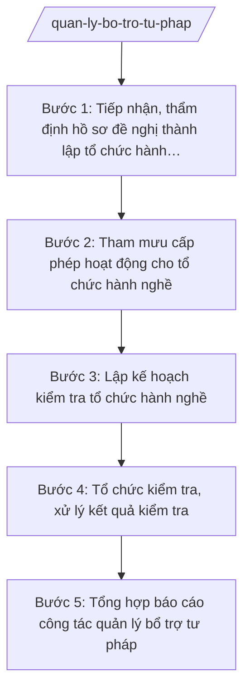

# Skill: Quản lý công chứng, đấu giá, luật sư

## 2. Khi nào dùng
- Có hồ sơ đề nghị thành lập Văn phòng công chứng, tổ chức đấu giá tài sản, tổ chức hành nghề luật sư (văn phòng luật sư, công ty luật) trên địa bàn tỉnh.
- Cần tham mưu cấp Giấy phép thành lập / Giấy đăng ký hoạt động cho tổ chức hành nghề bổ trợ tư pháp.
- Cần lập kế hoạch kiểm tra định kỳ, đột xuất đối với tổ chức hành nghề công chứng, đấu giá, luật sư.
- Sau kiểm tra cần xử lý kết quả: kiến nghị chấn chỉnh, chuyển cơ quan có thẩm quyền xử lý vi phạm.
- Cần tổng hợp, báo cáo công tác quản lý nhà nước về bổ trợ tư pháp định kỳ.

## 3. Đầu vào (Input)

| Trường | Mô tả | Bắt buộc |
|--------|-------|----------|
| `ho_so_de_nghi` | Hồ sơ đề nghị thành lập tổ chức hành nghề (đề án, nhân sự, trụ sở, điều kiện hành nghề) | Không |
| `loai_hinh` | Loại hình tổ chức: công chứng / đấu giá tài sản / luật sư | Có |
| `ke_hoach_kiem_tra` | Kế hoạch kiểm tra tổ chức hành nghề trong năm | Không |
| `ket_qua_kiem_tra` | Biên bản, kết quả kiểm tra tại tổ chức hành nghề | Không |
| `danh_sach_to_chuc` | Danh sách tổ chức hành nghề đang hoạt động trên địa bàn tỉnh | Không |

## 4. Quy trình

**Bước 1. Tiếp nhận, thẩm định hồ sơ đề nghị thành lập tổ chức hành nghề**
- Làm gì: Tiếp nhận hồ sơ đề nghị thành lập Văn phòng công chứng / tổ chức đấu giá tài sản / tổ chức hành nghề luật sư; thẩm định điều kiện về nhân sự (công chứng viên, đấu giá viên, luật sư), trụ sở, tên gọi, phạm vi hoạt động theo quy định pháp luật chuyên ngành hiện hành.
- Dùng input: `ho_so_de_nghi`, `loai_hinh`
- Vai trò: Chuyên viên Phòng Bổ trợ tư pháp (Sở Tư pháp tỉnh A) thẩm định hồ sơ. AI hỗ trợ lập checklist điều kiện thành lập theo từng loại hình, đối chiếu hồ sơ với điều kiện quy định ⏱ ~05 ngày làm việc (ước tính).
- Lưu ý nghiệp vụ: Thẩm định đúng loại hình, đúng điều kiện pháp luật chuyên ngành; không đặt thêm điều kiện ngoài quy định; hồ sơ thiếu phải hướng dẫn bổ sung một lần bằng văn bản.
- → Kết quả bước: Kết quả thẩm định hồ sơ (đủ điều kiện/chưa đủ điều kiện, nội dung cần bổ sung).

**Bước 2. Tham mưu cấp phép hoạt động cho tổ chức hành nghề**
- Làm gì: Đối với hồ sơ đủ điều kiện: dự thảo quyết định cho phép thành lập / giấy phép hoạt động; trình cấp có thẩm quyền ký; cập nhật danh sách tổ chức hành nghề; công khai thông tin tổ chức được cấp phép.
- Dùng input: kết quả thẩm định Bước 1, `loai_hinh`
- Vai trò: Trưởng phòng Bổ trợ tư pháp kiểm tra hồ sơ trình; Giám đốc Sở Tư pháp ký văn bản trình UBND tỉnh (đối với trường hợp thuộc thẩm quyền Chủ tịch UBND tỉnh). AI hỗ trợ soạn dự thảo giấy phép/quyết định đúng mẫu, đúng thể thức ⏱ ~03 ngày làm việc (ước tính).
- Lưu ý nghiệp vụ: Cấp phép đúng thẩm quyền, đúng thời hạn; công khai danh sách tổ chức hành nghề được cấp phép trên Cổng thông tin điện tử tỉnh để tổ chức, cá nhân tra cứu.
- → Kết quả bước: Giấy phép thành lập / Giấy đăng ký hoạt động đã ký; danh sách tổ chức hành nghề được cập nhật, công khai.

**Bước 3. Lập kế hoạch kiểm tra tổ chức hành nghề**
- Làm gì: Lập kế hoạch kiểm tra định kỳ hằng năm và kiểm tra đột xuất (khi có dấu hiệu vi phạm, đơn phản ánh); xác định đối tượng, nội dung, thời gian kiểm tra đối với tổ chức hành nghề công chứng, đấu giá, luật sư.
- Dùng input: `danh_sach_to_chuc`, `ke_hoach_kiem_tra`, đơn phản ánh (nếu có)
- Vai trò: Trưởng phòng Bổ trợ tư pháp lập kế hoạch; Phó Giám đốc Sở phụ trách phê duyệt. AI hỗ trợ lập kế hoạch kiểm tra, mẫu phiếu kiểm tra theo từng loại hình ⏱ ~02 ngày làm việc (ước tính).
- Lưu ý nghiệp vụ: Kiểm tra có trọng tâm, không kiểm tra tràn lan gây phiền hà; nội dung kiểm tra: việc tuân thủ pháp luật về tổ chức, hoạt động hành nghề, chế độ báo cáo, niêm yết, lưu trữ hồ sơ.
- → Kết quả bước: Kế hoạch kiểm tra tổ chức hành nghề bổ trợ tư pháp đã phê duyệt.

**Bước 4. Tổ chức kiểm tra, xử lý kết quả kiểm tra**
- Làm gì: Tổ chức đoàn kiểm tra theo kế hoạch; lập biên bản kiểm tra; ban hành kết luận kiểm tra; kiến nghị tổ chức chấn chỉnh tồn tại; chuyển cơ quan có thẩm quyền xử lý vi phạm (nếu phát hiện vi phạm).
- Dùng input: `ket_qua_kiem_tra`
- Vai trò: Trưởng phòng Bổ trợ tư pháp làm trưởng đoàn kiểm tra. AI hỗ trợ soạn biên bản, dự thảo kết luận kiểm tra và văn bản kiến nghị chấn chỉnh ⏱ ~05 ngày làm việc/đợt kiểm tra (ước tính).
- Lưu ý nghiệp vụ: Kết luận kiểm tra phải căn cứ biên bản và hồ sơ thực tế; phân biệt tồn tại cần chấn chỉnh với hành vi vi phạm phải xử lý; theo dõi việc khắc phục sau kiểm tra.
- → Kết quả bước: Biên bản, kết luận kiểm tra; văn bản kiến nghị chấn chỉnh / văn bản chuyển xử lý vi phạm (nếu có).

**Bước 5. Tổng hợp báo cáo công tác quản lý bổ trợ tư pháp**
- Làm gì: Tổng hợp tình hình tổ chức, hoạt động của các tổ chức hành nghề công chứng, đấu giá, luật sư trên địa bàn; kết quả cấp phép, kiểm tra, xử lý vi phạm; đánh giá khó khăn, kiến nghị.
- Dùng input: `danh_sach_to_chuc`, kết quả cấp phép, `ket_qua_kiem_tra`
- Vai trò: Chuyên viên Phòng Bổ trợ tư pháp tổng hợp, soạn báo cáo; Giám đốc Sở ký. AI hỗ trợ tổng hợp số liệu theo loại hình, phân tích xu hướng và soạn dự thảo báo cáo ⏱ ~03 ngày làm việc (ước tính).
- Lưu ý nghiệp vụ: Số liệu đầy đủ theo từng loại hình; nêu rõ vi phạm điển hình (nếu có) và biện pháp chấn chỉnh; kiến nghị hoàn thiện cơ chế quản lý.
- → Kết quả bước: Báo cáo công tác quản lý nhà nước về bổ trợ tư pháp của tỉnh đã ký, gửi Bộ Tư pháp và UBND tỉnh.

## Luồng quy trình (Workflow)

## 5. Đầu ra (Output)

Sản phẩm:
- Giấy phép thành lập / Giấy đăng ký hoạt động của tổ chức hành nghề (đã ký) — trả tổ chức, lưu hồ sơ
- Danh sách tổ chức hành nghề công chứng, đấu giá, luật sư trên địa bàn (đã cập nhật, công khai)
- Kế hoạch kiểm tra tổ chức hành nghề — lưu hồ sơ, gửi đơn vị được kiểm tra
- Biên bản, kết luận kiểm tra + văn bản kiến nghị chấn chỉnh/chuyển xử lý vi phạm — lưu hồ sơ
- Báo cáo công tác quản lý nhà nước về bổ trợ tư pháp — gửi Bộ Tư pháp, UBND tỉnh

**Cấu trúc output chuẩn:**

Khung Kết luận kiểm tra tổ chức hành nghề bổ trợ tư pháp gồm các phần theo đúng thứ tự, đúng thể thức NĐ 30/2020/NĐ-CP:
1. Quốc hiệu "CỘNG HÒA XÃ HỘI CHỦ NGHĨA VIỆT NAM" — Tiêu ngữ "Độc lập – Tự do – Hạnh phúc"
2. Tên cơ quan: "SỞ TƯ PHÁP TỈNH A"; số, ký hiệu: số.../KL-STP; địa danh, ngày, tháng, năm
3. Tên văn bản: "KẾT LUẬN" + tên gọi: "Kiểm tra hoạt động của ... (tên tổ chức hành nghề)"
4. Nội dung: I. Căn cứ, đối tượng, thời gian kiểm tra; II. Kết quả kiểm tra (tổ chức, hoạt động hành nghề, chấp hành pháp luật); III. Nhận xét, đánh giá (ưu điểm, tồn tại); IV. Kiến nghị (chấn chỉnh; chuyển xử lý vi phạm nếu có; thời hạn khắc phục)
5. Nơi nhận: tổ chức được kiểm tra, lưu Sở
6. Chữ ký: "GIÁM ĐỐC" + chữ ký + họ tên Giám đốc Sở Tư pháp tỉnh A, đóng dấu Sở

## 6. Checklist nghiệm thu
- [ ] Hồ sơ đề nghị thành lập được thẩm định đúng điều kiện của từng loại hình theo quy định pháp luật chuyên ngành
- [ ] Cấp phép đúng thẩm quyền, đúng thời hạn; danh sách tổ chức hành nghề được công khai
- [ ] Kế hoạch kiểm tra có trọng tâm, được phê duyệt; không kiểm tra tràn lan
- [ ] Biên bản, kết luận kiểm tra căn cứ hồ sơ thực tế; phân biệt tồn tại chấn chỉnh và vi phạm xử lý
- [ ] Đã theo dõi việc khắc phục tồn tại sau kiểm tra của tổ chức được kiểm tra
- [ ] Báo cáo quản lý bổ trợ tư pháp đầy đủ số liệu theo từng loại hình; gửi Bộ Tư pháp đúng hạn
- [ ] Thể thức văn bản đúng NĐ 30/2020/NĐ-CP
- [ ] Không có số liệu, căn cứ pháp lý nào do AI bịa ra
- [ ] Đã qua human gate: chuyên viên thẩm định → Trưởng phòng kiểm tra → Phó Giám đốc Sở duyệt → Giám đốc Sở ký cấp phép/kết luận kiểm tra (trình UBND tỉnh đối với trường hợp thuộc thẩm quyền Chủ tịch UBND tỉnh)

## 7. Ví dụ mô phỏng

*Dữ liệu dưới đây là giả lập 100% phục vụ minh họa.*

### Input mẫu
- ho_so_de_nghi: Đề nghị thành lập Văn phòng công chứng B (giả lập) tại tỉnh A: 02 công chứng viên (giả lập), trụ sở tại số 123 đường B, xã A, tỉnh A
- loai_hinh: công chứng
- danh_sach_to_chuc: 15 tổ chức hành nghề công chứng, 05 tổ chức đấu giá tài sản, 30 tổ chức hành nghề luật sư đang hoạt động tại tỉnh A (giả lập)
- ket_qua_kiem_tra: Kiểm tra 05 tổ chức trong năm, phát hiện 02 tổ chức chậm nộp báo cáo định kỳ (giả lập)

### Output mẫu (trích)

**KẾT LUẬN KIỂM TRA HOẠT ĐỘNG CỦA VĂN PHÒNG CÔNG CHỨNG B**

CỘNG HÒA XÃ HỘI CHỦ NGHĨA VIỆT NAM
Độc lập – Tự do – Hạnh phúc

SỞ TƯ PHÁP TỈNH A

Số: 67/KL-STP

Tỉnh A, ngày 25 tháng 09 năm 2026

**KẾT LUẬN**
**Kiểm tra hoạt động của Văn phòng công chứng B**

I. Căn cứ, đối tượng, thời gian kiểm tra
Thực hiện Kế hoạch kiểm tra tổ chức hành nghề bổ trợ tư pháp năm 2026; Đoàn kiểm tra của Sở Tư pháp tỉnh A tiến hành kiểm tra Văn phòng công chứng B từ ngày 15 đến ngày 17 tháng 9 năm 2026.

II. Kết quả kiểm tra
Văn phòng có 02 công chứng viên, trụ sở ổn định; thực hiện niêm yết thủ tục, phí công chứng; lưu trữ hồ sơ công chứng cơ bản đầy đủ. Tồn tại: chậm nộp báo cáo định kỳ 6 tháng đầu năm 2026.

III. Nhận xét, đánh giá
Văn phòng chấp hành cơ bản quy định pháp luật về tổ chức và hoạt động công chứng; tồn tại nêu trên chưa đến mức xử lý vi phạm.

IV. Kiến nghị
Yêu cầu Văn phòng công chứng B chấn chỉnh, nộp báo cáo định kỳ đúng hạn; báo cáo kết quả khắc phục về Sở Tư pháp tỉnh A trong 15 ngày.

Nơi nhận:
- Văn phòng công chứng B;
- Lưu: Sở.

GIÁM ĐỐC
(ký, đóng dấu)
Hoàng Văn S

## 8. Human gate
Chuyên viên Phòng Bổ trợ tư pháp thẩm định hồ sơ → Trưởng phòng kiểm tra → Phó Giám đốc Sở phụ trách duyệt → Giám đốc Sở Tư pháp ký giấy phép, kết luận kiểm tra (trình Chủ tịch UBND tỉnh đối với trường hợp thuộc thẩm quyền). AI chỉ hỗ trợ thẩm định, soạn dự thảo, tổng hợp; quyết định cấp phép và kết luận kiểm tra do con người thực hiện.

## 9. Giới hạn
AI tuyệt đối KHÔNG: quyết định cấp phép thành lập thay người có thẩm quyền; kết luận kiểm tra thay đoàn kiểm tra; tự ký văn bản; bịa điều kiện cấp phép, số liệu kiểm tra; dùng văn bản hết hiệu lực làm căn cứ.

## 10. Căn cứ & lưu ý
- TT 09/2025/TT-BTP (Sở Tư pháp tham mưu quản lý nhà nước về bổ trợ tư pháp; hiệu lực 01/7/2025)
- NĐ 121/2025/NĐ-CP (phân quyền, phân cấp trong lĩnh vực quản lý nhà nước của Bộ Tư pháp)
- NĐ 150/2025/NĐ-CP; NĐ 370/2025/NĐ-CP (tổ chức cơ quan chuyên môn thuộc UBND cấp tỉnh)
- NĐ 30/2020/NĐ-CP (thể thức văn bản hành chính)
- Lưu ý: điều kiện thành lập, hoạt động của từng loại hình tổ chức hành nghề thực hiện theo quy định pháp luật chuyên ngành hiện hành (công chứng, đấu giá tài sản, luật sư); kiểm tra có trọng tâm, không gây phiền hà cho tổ chức hành nghề.
