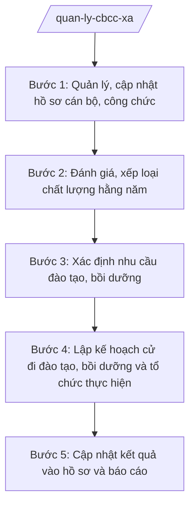

# Skill: Quản lý, đào tạo bồi dưỡng CBCC cấp xã

## 2. Khi nào dùng
- Cập nhật, bổ sung hồ sơ cán bộ, công chức xã (sơ yếu lý lịch, quá trình công tác, văn bằng).
- Đánh giá, xếp loại chất lượng cán bộ, công chức hằng năm.
- Xác định nhu cầu và lập kế hoạch cử cán bộ, công chức đi đào tạo, bồi dưỡng.
- Báo cáo công tác quản lý CBCC gửi cấp trên theo định kỳ hoặc đột xuất.

## 3. Đầu vào (Input)
| Trường | Mô tả | Bắt buộc |
|--------|-------|----------|
| `danh_sach_cbcc` | Danh sách cán bộ, công chức xã (họ tên, chức vụ/chức danh, đơn vị) | Có |
| `ho_so_ca_nhan` | Sơ yếu lý lịch, quá trình công tác, văn bằng chứng chỉ của từng người | Có |
| `ket_qua_danh_gia` | Kết quả đánh giá, xếp loại chất lượng năm trước | Không |
| `nhu_cau_dao_tao` | Nhu cầu đào tạo, bồi dưỡng (nội dung, đối tượng, thời gian dự kiến) | Có |
| `tieu_chuan_cbcc` | Tiêu chuẩn chức danh cán bộ, công chức cấp xã theo quy định | Không |
| `can_bo_phu_trach` | Công chức Văn phòng phụ trách công tác cán bộ | Có |

## 4. Quy trình

**Bước 1. Quản lý, cập nhật hồ sơ cán bộ, công chức**
- Làm gì: Cập nhật sơ yếu lý lịch, quá trình công tác, văn bằng chứng chỉ, khen thưởng/kỷ luật vào hồ sơ từng CBCC; rà soát hồ sơ thiếu, chưa cập nhật.
- Dùng input: `danh_sach_cbcc`, `ho_so_ca_nhan`, `can_bo_phu_trach`.
- Vai trò: Công chức Văn phòng phụ trách công tác cán bộ thực hiện; AI hỗ trợ lập danh mục hồ sơ, nhắc các mục chưa cập nhật ⏱ 2 ngày (ước tính) làm việc
- Lưu ý nghiệp vụ: Hồ sơ cán bộ là tài liệu mật, bảo quản trong tủ khóa, không sao chụp khi chưa được phép; mọi thay đổi phải có căn cứ (quyết định, văn bằng).
- → Kết quả bước: Sổ quản lý CBCC cập nhật đầy đủ, danh mục hồ sơ thiếu cần bổ sung.

**Bước 2. Đánh giá, xếp loại chất lượng hằng năm**
- Làm gì: Tổ chức đánh giá, xếp loại chất lượng CBCC theo quy định (tự đánh giá, lấy ý kiến, tập thể đánh giá); tổng hợp kết quả xếp loại.
- Dùng input: `danh_sach_cbcc`, `ket_qua_danh_gia`, `tieu_chuan_cbcc`.
- Vai trò: Tập thể lãnh đạo UBND xã đánh giá; công chức phụ trách tổng hợp; AI hỗ trợ lập phiếu đánh giá, bảng tổng hợp kết quả ⏱ 3 ngày (ước tính) làm việc
- Lưu ý nghiệp vụ: Đánh giá phải công tâm, khách quan, đúng tiêu chí; kết quả xếp loại là căn cứ bố trí, đào tạo và chính sách cán bộ.
- → Kết quả bước: Bảng tổng hợp kết quả đánh giá, xếp loại chất lượng CBCC năm.

**Bước 3. Xác định nhu cầu đào tạo, bồi dưỡng**
- Làm gì: Đối chiếu tiêu chuẩn chức danh với trình độ hiện có của từng CBCC; tổng hợp nhu cầu đào tạo, bồi dưỡng (lý luận chính trị, chuyên môn, kỹ năng).
- Dùng input: `ho_so_ca_nhan`, `tieu_chuan_cbcc`, `nhu_cau_dao_tao`, `ket_qua_danh_gia`.
- Vai trò: Công chức phụ trách công tác cán bộ đề xuất; AI hỗ trợ đối chiếu khoảng trống năng lực, lập bảng nhu cầu ⏱ 1 ngày (ước tính) làm việc
- Lưu ý nghiệp vụ: Ưu tiên người chưa đạt chuẩn chức danh, người trong quy hoạch; nhu cầu phải cụ thể (ai học gì, ở đâu, khi nào).
- → Kết quả bước: Bảng tổng hợp nhu cầu đào tạo, bồi dưỡng CBCC.

**Bước 4. Lập kế hoạch cử đi đào tạo, bồi dưỡng và tổ chức thực hiện**
- Làm gì: Lập kế hoạch cử CBCC đi đào tạo, bồi dưỡng trong năm (danh sách, nội dung, thời gian, kinh phí); trình Chủ tịch UBND xã phê duyệt; làm thủ tục cử đi học.
- Dùng input: Bảng nhu cầu ở Bước 3, `can_bo_phu_trach`.
- Vai trò: Chánh Văn phòng HĐND và UBND kiểm tra; Chủ tịch UBND xã phê duyệt kế hoạch; AI hỗ trợ soạn kế hoạch, quyết định cử đi học ⏱ 1 ngày (ước tính) làm việc
- Lưu ý nghiệp vụ: Bảo đảm công việc của đơn vị không bị gián đoạn khi cử người đi học; kinh phí đào tạo theo quy định hiện hành.
- → Kết quả bước: Kế hoạch đào tạo, bồi dưỡng CBCC năm đã phê duyệt + quyết định cử đi học.

**Bước 5. Cập nhật kết quả vào hồ sơ và báo cáo**
- Làm gì: Cập nhật kết quả đào tạo, bồi dưỡng (văn bằng, chứng chỉ mới) vào hồ sơ từng CBCC; tổng hợp báo cáo công tác quản lý CBCC gửi cấp trên.
- Dùng input: Kết quả đào tạo, `ho_so_ca_nhan`, `danh_sach_cbcc`.
- Vai trò: Công chức phụ trách công tác cán bộ cập nhật; AI hỗ trợ cập nhật sổ quản lý, soạn báo cáo ⏱ 1 ngày (ước tính) làm việc
- Lưu ý nghiệp vụ: Chỉ cập nhật khi có văn bằng, chứng chỉ hợp lệ; báo cáo đúng thời hạn cấp trên quy định; tiếp tục bảo mật hồ sơ.
- → Kết quả bước: Hồ sơ CBCC đã cập nhật; báo cáo công tác quản lý CBCC.

## Luồng quy trình (Workflow)

## 5. Đầu ra (Output)
- Sổ quản lý cán bộ, công chức xã (cập nhật).
- Bảng tổng hợp kết quả đánh giá, xếp loại chất lượng CBCC hằng năm.
- Kế hoạch đào tạo, bồi dưỡng CBCC năm.
- Báo cáo công tác quản lý cán bộ, công chức.

### Cấu trúc output chuẩn
Khung kế hoạch đào tạo, bồi dưỡng của UBND xã (theo NĐ 30/2020/NĐ-CP):
1. Quốc hiệu – tiêu ngữ: "CỘNG HÒA XÃ HỘI CHỦ NGHĨA VIỆT NAM / Độc lập – Tự do – Hạnh phúc".
2. Số, ký hiệu văn bản: số .../KH-UBND.
3. Địa danh và ngày, tháng, năm: "Xã A, ngày ... tháng ... năm ...".
4. Tên loại và trích yếu: "KẾ HOẠCH / Đào tạo, bồi dưỡng cán bộ, công chức xã A năm ...".
5. Nội dung bắt buộc: I. Mục đích, yêu cầu; II. Thực trạng đội ngũ và nhu cầu đào tạo (số lượng CBCC, trình độ hiện có, khoảng trống so với tiêu chuẩn); III. Kế hoạch cụ thể (danh sách người học, nội dung, thời gian, địa điểm, kinh phí); IV. Tổ chức thực hiện.
6. Nơi nhận: Phòng Nội vụ/Sở Nội vụ tỉnh A; Thường trực HĐND xã; lưu VP (không gửi danh sách chi tiết kèm hồ sơ cá nhân).
7. Chữ ký: "TM. ỦY BAN NHÂN DÂN / CHỦ TỊCH" + họ tên Nguyễn Văn A, đóng dấu.

## 6. Checklist nghiệm thu
- [ ] Sổ quản lý CBCC cập nhật đầy đủ: lý lịch, quá trình công tác, văn bằng, khen thưởng/kỷ luật.
- [ ] Kết quả đánh giá, xếp loại hằng năm có đủ quy trình: tự đánh giá, lấy ý kiến, tập thể kết luận.
- [ ] Nhu cầu đào tạo được đối chiếu với tiêu chuẩn chức danh, ưu tiên đúng đối tượng.
- [ ] Kế hoạch đào tạo cụ thể: ai học gì, ở đâu, khi nào, kinh phí bao nhiêu.
- [ ] Hồ sơ cán bộ được bảo mật: lưu tủ khóa, không sao chụp trái phép, không đưa thông tin cá nhân vào báo cáo gửi đi.
- [ ] Văn bản đúng thể thức NĐ 30/2020/NĐ-CP; báo cáo gửi cấp trên đúng hạn.
- [ ] Không bịa thông tin lý lịch, văn bằng; mọi cập nhật có căn cứ.
- [ ] Đã qua human gate: công chức soạn → Chánh Văn phòng kiểm tra → Chủ tịch UBND xã phê duyệt.

## 7. Ví dụ mô phỏng
*Dữ liệu dưới đây là giả lập 100% phục vụ minh họa.*

### Input mẫu
- danh_sach_cbcc: 12 người (ông Phạm Văn C – Chánh Văn phòng; bà Trần Thị H; ông Nguyễn Văn G...)
- ho_so_ca_nhan: 12 bộ hồ sơ; 02 người chưa đạt chuẩn trình độ chuyên môn chức danh
- ket_qua_danh_gia: Năm 2026: 10 hoàn thành tốt nhiệm vụ, 02 hoàn thành nhiệm vụ
- nhu_cau_dao_tao: 02 người cần bồi dưỡng chuyên môn; 05 người bồi dưỡng kỹ năng chuyển đổi số
- tieu_chuan_cbcc: Tiêu chuẩn CBCC cấp xã theo quy định hiện hành
- can_bo_phu_trach: Ông Nguyễn Văn G

### Output mẫu
**KẾ HOẠCH** số 123/KH-UBND
Đào tạo, bồi dưỡng cán bộ, công chức xã A năm 2027

CỘNG HÒA XÃ HỘI CHỦ NGHĨA VIỆT NAM
Độc lập – Tự do – Hạnh phúc

Xã A, ngày 09 tháng 10 năm 2026

I. MỤC ĐÍCH, YÊU CẦU
Chuẩn hóa đội ngũ cán bộ, công chức xã đáp ứng tiêu chuẩn chức danh; nâng cao kỹ năng chuyển đổi số.

II. THỰC TRẠNG VÀ NHU CẦU
Xã có 12 cán bộ, công chức; 02 người chưa đạt chuẩn trình độ chuyên môn; 05 người cần bồi dưỡng kỹ năng chuyển đổi số.

III. KẾ HOẠCH CỤ THỂ NĂM 2027
1. Bồi dưỡng chuyên môn cho 02 công chức chưa đạt chuẩn (quý I–II/2027).
2. Bồi dưỡng kỹ năng chuyển đổi số cho 05 công chức (quý III/2027).
Kinh phí: theo quy định hiện hành, từ nguồn ngân sách xã.

IV. TỔ CHỨC THỰC HIỆN
Văn phòng HĐND và UBND xã chủ trì; bảo đảm công việc không gián đoạn; cập nhật kết quả vào hồ sơ cán bộ.

Nơi nhận:
- Phòng Nội vụ tỉnh A;
- Thường trực HĐND xã A;
- Lưu: VP.

TM. ỦY BAN NHÂN DÂN
CHỦ TỊCH
Nguyễn Văn A

## 8. Human gate
Công chức phụ trách công tác cán bộ soạn sổ quản lý, kế hoạch, báo cáo → Chánh Văn phòng HĐND và UBND kiểm tra → Chủ tịch UBND xã phê duyệt kế hoạch đào tạo, ký báo cáo. Kết quả đánh giá, xếp loại do tập thể lãnh đạo quyết định. AI không được tiết lộ, sao chép thông tin hồ sơ cán bộ.

## 9. Giới hạn
AI tuyệt đối KHÔNG: ra quyết định hành chính thay người có thẩm quyền; tự ký/phát hành văn bản; bịa số liệu, căn cứ pháp lý, trích dẫn; dùng văn bản hết hiệu lực; tư vấn vượt thẩm quyền cấp xã. Đặc biệt: không tiết lộ thông tin hồ sơ cán bộ cho người không có thẩm quyền; không tự "xếp loại" cán bộ, công chức.

## 10. Căn cứ & lưu ý
- TT 10/2025/TT-BNV (19/6/2025; sửa đổi bởi TT 06/2026/TT-BNV).
- TT 06/2026/TT-BNV (29/4/2026; hiệu lực 15/6/2026).
- NĐ 30/2020/NĐ-CP (thể thức văn bản hành chính).
- Luật Tổ chức chính quyền địa phương 72/2025/QH15.
- Lưu ý: hồ sơ cán bộ, công chức là tài liệu phải bảo mật; tiêu chuẩn CBCC cấp xã áp dụng theo quy định hiện hành, khi có thay đổi phải đối chiếu văn bản mới, không áp dụng máy móc.
