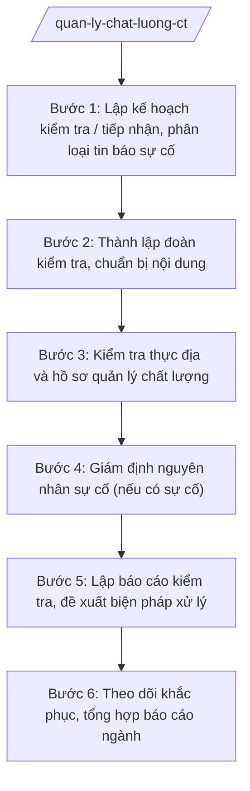

# Skill: Quản lý chất lượng công trình xây dựng

## 2. Khi nào dùng

- Sở Xây dựng tỉnh A xây dựng kế hoạch kiểm tra chất lượng công trình xây dựng định kỳ hoặc đột xuất trên địa bàn tỉnh;
- Tiếp nhận tin báo về sự cố công trình xây dựng (sập, nứt, lún, nghiêng...) cần tổ chức giám định nguyên nhân, tham mưu xử lý;
- Cần kiểm tra việc tuân thủ quy định quản lý chất lượng của chủ đầu tư, nhà thầu, tổ chức tư vấn trong quá trình thi công, nghiệm thu;
- Cần tổng hợp tình hình chất lượng công trình, báo cáo UBND tỉnh và Bộ Xây dựng; hướng dẫn nghiệp vụ cho cấp xã.

## 3. Đầu vào (Input)

| Trường | Mô tả | Bắt buộc |
|--------|-------|----------|
| `ke_hoach_kiem_tra` | Kế hoạch kiểm tra chất lượng năm/đợt (đối tượng, phạm vi, thời gian). Lưu ý: kiểm tra theo kế hoạch.| Có |
| `tin_bao_su_co` | Tin báo sự cố công trình: tên công trình, địa điểm, thời gian, mức độ. Lưu ý: xử lý sự cố.| Có |
| `danh_sach_cong_trinh` | Danh sách công trình thuộc diện kiểm tra (tên, chủ đầu tư, địa điểm, giai đoạn) | Có |
| `ho_so_phap_ly_ct` | Hồ sơ pháp lý công trình: giấy phép, hồ sơ thiết kế, nhật ký thi công, biên bản nghiệm thu | Không |
| `ket_qua_giam_dinh` | Kết quả giám định nguyên nhân sự cố của tổ chức giám định (nếu đã có) | Không |
| `bao_cao_chu_dau_tu` | Báo cáo của chủ đầu tư về tình hình chất lượng, biện pháp khắc phục | Không |

## 4. Quy trình

**Bước 1. Lập kế hoạch kiểm tra / tiếp nhận, phân loại tin báo sự cố**
- Làm gì: Xây dựng kế hoạch kiểm tra chất lượng công trình (đối tượng ưu tiên: công trình cấp II trở lên, công trình có dấu hiệu mất an toàn); tiếp nhận tin báo sự cố, phân loại mức độ (nghiêm trọng/không nghiêm trọng), đề xuất thành lập đoàn kiểm tra hoặc tổ giám định.
- Dùng input: `ke_hoach_kiem_tra`, `tin_bao_su_co`, `danh_sach_cong_trinh`.
- Vai trò: Chuyên viên Phòng Quản lý chất lượng công trình lập kế hoạch/tiếp nhận tin báo, AI hỗ trợ lập danh sách công trình ưu tiên theo tiêu chí rủi ro, soạn phiếu tiếp nhận tin báo sự cố; ⏱ ~2–3 ngày làm việc (ước tính).
- Lưu ý nghiệp vụ: Sự cố nghiêm trọng (sập đổ, thiệt hại người) phải báo cáo ngay lãnh đạo Sở và UBND tỉnh; không chậm trễ trong việc tổ chức kiểm tra hiện trường.
- → Kết quả bước: Kế hoạch kiểm tra đã phê duyệt / phiếu tiếp nhận và phân loại tin báo sự cố.

**Bước 2. Thành lập đoàn kiểm tra, chuẩn bị nội dung**
- Làm gì: Tham mưu quyết định thành lập đoàn kiểm tra (trưởng đoàn, thành viên, chuyên gia); xây dựng đề cương kiểm tra (nội dung: hồ sơ pháp lý, hồ sơ quản lý chất lượng, hiện trường thi công); thông báo cho chủ đầu tư, nhà thầu.
- Dùng input: Kết quả Bước 1, `ho_so_phap_ly_ct`.
- Vai trò: Trưởng phòng Quản lý chất lượng công trình chuẩn bị, AI hỗ trợ soạn dự thảo quyết định thành lập đoàn, đề cương kiểm tra, thông báo kiểm tra; ⏱ ~3–5 ngày làm việc (ước tính).
- Lưu ý nghiệp vụ: Đoàn kiểm tra phải có thành viên am hiểu chuyên môn phù hợp loại công trình; thông báo kiểm tra đúng thời hạn để đơn vị chuẩn bị hồ sơ.
- → Kết quả bước: Quyết định thành lập đoàn kiểm tra + đề cương, thông báo kiểm tra.

**Bước 3. Kiểm tra thực địa và hồ sơ quản lý chất lượng**
- Làm gì: Đoàn kiểm tra làm việc tại công trình: kiểm tra hồ sơ pháp lý, hồ sơ quản lý chất lượng (biện pháp thi công, thí nghiệm vật liệu, nhật ký, biên bản nghiệm thu công việc); kiểm tra hiện trường về an toàn, chất lượng thi công; lập biên bản kiểm tra có chữ ký các bên.
- Dùng input: `ho_so_phap_ly_ct`, `bao_cao_chu_dau_tu`, kết quả Bước 2.
- Vai trò: Đoàn kiểm tra thực hiện, AI hỗ trợ soạn biên bản kiểm tra theo mẫu, tổng hợp các tồn tại, vi phạm thành bảng phân loại (nghiêm trọng/cần khắc phục); ⏱ ~3–7 ngày làm việc tùy quy mô (ước tính).
- Lưu ý nghiệp vụ: Biên bản phải ghi đầy đủ, trung thực hiện trạng; các bên liên quan ký xác nhận; trường hợp phát hiện nguy cơ mất an toàn phải yêu cầu dừng thi công phần việc nguy hiểm ngay.
- → Kết quả bước: Biên bản kiểm tra chất lượng công trình + bảng tổng hợp tồn tại, vi phạm.

**Bước 4. Giám định nguyên nhân sự cố (nếu có sự cố)**
- Làm gì: Đối với sự cố công trình: tổ chức bảo vệ hiện trường; chỉ định/thuê tổ chức giám định độc lập xác định nguyên nhân; theo dõi quá trình giám định; tiếp nhận kết luận giám định.
- Dùng input: `tin_bao_su_co`, `ket_qua_giam_dinh`.
- Vai trò: Lãnh đạo Sở chỉ đạo, đoàn công tác phối hợp tổ chức giám định, AI hỗ trợ soạn văn bản chỉ định giám định, tổng hợp kết luận giám định thành báo cáo; ⏱ ~10–15 ngày làm việc (ước tính).
- Lưu ý nghiệp vụ: Hiện trường sự cố phải được bảo vệ nguyên trạng phục vụ giám định; kết luận giám định là căn cứ xác định trách nhiệm các bên.
- → Kết quả bước: Kết luận giám định nguyên nhân sự cố công trình.

**Bước 5. Lập báo cáo kiểm tra, đề xuất biện pháp xử lý**
- Làm gì: Tổng hợp kết quả kiểm tra/giám định thành báo cáo: đánh giá tình hình chất lượng, xác định vi phạm và trách nhiệm; đề xuất biện pháp xử lý (yêu cầu khắc phục, xử phạt vi phạm hành chính, chuyển cơ quan điều tra nếu có dấu hiệu hình sự); soạn văn bản chỉ đạo của Sở/UBND tỉnh.
- Dùng input: Kết quả Bước 3–4.
- Vai trò: Trưởng phòng Quản lý chất lượng công trình soạn báo cáo, AI hỗ trợ soạn báo cáo kiểm tra theo khung chuẩn, dự thảo văn bản xử lý, rà soát căn cứ xử phạt; ⏱ ~3–5 ngày làm việc (ước tính).
- Lưu ý nghiệp vụ: Biện pháp xử lý phải tương xứng mức độ vi phạm, đúng thẩm quyền; trường hợp vượt thẩm quyền của Sở phải trình UBND tỉnh hoặc chuyển cơ quan có thẩm quyền.
- → Kết quả bước: Báo cáo kiểm tra chất lượng + văn bản yêu cầu khắc phục/xử lý vi phạm.

**Bước 6. Theo dõi khắc phục, tổng hợp báo cáo ngành**
- Làm gì: Theo dõi, đôn đốc chủ đầu tư, nhà thầu khắc phục tồn tại; kiểm tra lại (nếu cần); tổng hợp tình hình chất lượng công trình toàn tỉnh, báo cáo UBND tỉnh và Bộ Xây dựng theo định kỳ; hướng dẫn nghiệp vụ quản lý chất lượng cho cấp xã.
- Dùng input: Kết quả Bước 5, báo cáo khắc phục của chủ đầu tư.
- Vai trò: Chuyên viên Phòng Quản lý chất lượng công trình theo dõi, AI hỗ trợ lập bảng theo dõi khắc phục, soạn báo cáo tổng hợp ngành, soạn văn bản hướng dẫn nghiệp vụ gửi UBND xã; ⏱ ~3–5 ngày làm việc (ước tính).
- Lưu ý nghiệp vụ: Đóng hồ sơ kiểm tra khi các tồn tại đã được khắc phục triệt để, có biên bản xác nhận; báo cáo ngành phải trung thực, đúng số liệu.
- → Kết quả bước: Báo cáo tổng hợp chất lượng công trình toàn tỉnh + văn bản hướng dẫn nghiệp vụ cho cấp xã.

## Luồng quy trình (Workflow)

## 5. Đầu ra (Output)

- Kế hoạch kiểm tra chất lượng công trình;
- Quyết định thành lập đoàn kiểm tra;
- Biên bản kiểm tra chất lượng công trình;
- Kết luận giám định nguyên nhân sự cố (nếu có);
- Báo cáo kiểm tra chất lượng công trình;
- Văn bản yêu cầu khắc phục tồn tại / quyết định xử phạt vi phạm hành chính (theo thẩm quyền);
- Báo cáo tổng hợp tình hình chất lượng công trình toàn tỉnh;
- Văn bản hướng dẫn nghiệp vụ quản lý chất lượng gửi cấp xã.

**Cấu trúc output chuẩn (Báo cáo kiểm tra chất lượng):**
- Thể thức: tuân thủ Nghị định 30/2020/NĐ-CP về công tác văn thư.

1. Quốc hiệu "CỘNG HÒA XÃ HỘI CHỦ NGHĨA VIỆT NAM", Tiêu ngữ "Độc lập – Tự do – Hạnh phúc";
2. Tên cơ quan: SỞ XÂY DỰNG TỈNH A (hoặc ĐOÀN KIỂM TRA theo quyết định số...); số, ký hiệu văn bản; địa danh và ngày, tháng, năm;
3. Tên loại và trích yếu: BÁO CÁO — Về kết quả kiểm tra chất lượng công trình...;
4. Phần "Kính gửi": Giám đốc Sở Xây dựng / UBND tỉnh A;
5. Căn cứ (Luật Xây dựng; văn bản về phân định thẩm quyền, phân quyền, phân cấp lĩnh vực xây dựng; kế hoạch kiểm tra; quyết định thành lập đoàn kiểm tra...);
6. Nội dung: đối tượng, thời gian, phạm vi kiểm tra; kết quả kiểm tra hồ sơ và hiện trường; tồn tại, vi phạm và nguyên nhân; đánh giá trách nhiệm các bên; kiến nghị biện pháp xử lý;
7. Nơi nhận;
8. Thẩm quyền, chức vụ, họ tên người ký: TRƯỞNG ĐOÀN KIỂM TRA (hoặc TM. SỞ XÂY DỰNG — GIÁM ĐỐC) — (chữ ký, họ tên), dấu của cơ quan.

## 6. Checklist nghiệm thu

- [ ] Kế hoạch kiểm tra/tin báo sự cố được tiếp nhận, phân loại kịp thời;
- [ ] Đoàn kiểm tra thành lập đúng thẩm quyền, đủ thành phần chuyên môn;
- [ ] Biên bản kiểm tra ghi đầy đủ hiện trạng, có chữ ký các bên liên quan;
- [ ] Sự cố công trình được bảo vệ hiện trường, tổ chức giám định nguyên nhân;
- [ ] Báo cáo kiểm tra đánh giá đúng tồn tại, xác định rõ trách nhiệm;
- [ ] Biện pháp xử lý tương xứng mức độ vi phạm, đúng thẩm quyền;
- [ ] Đã theo dõi, đôn đốc khắc phục đến khi hoàn thành, có biên bản xác nhận;
- [ ] Báo cáo tổng hợp ngành trung thực, đúng số liệu; đã hướng dẫn nghiệp vụ cho cấp xã.

## 7. Ví dụ mô phỏng

*Dữ liệu dưới đây là giả lập 100% phục vụ minh họa.*

### Input mẫu

| Trường | Giá trị giả lập |
|--------|-----------------|
| tin_bao_su_co | Sập giàn giáo tại công trình Trung tâm thương mại A, xã A, lúc 09h00 ngày 05/4/2027; 02 công nhân bị thương |
| danh_sach_cong_trinh | Trung tâm thương mại A — chủ đầu tư: Công ty Cổ phần Thương mại A; đang thi công phần thân |
| ho_so_phap_ly_ct | Giấy phép xây dựng số 1234/GPXD; hồ sơ thiết kế; nhật ký thi công |

### Output mẫu (Báo cáo kiểm tra — trích)

> **CỘNG HÒA XÃ HỘI CHỦ NGHĨA VIỆT NAM**
> **Độc lập – Tự do – Hạnh phúc**
>
> Số: 123/BC-SXD
> *Tỉnh A, ngày 25 tháng 4 năm 2027*
>
> **BÁO CÁO**
> **Về kết quả kiểm tra chất lượng công trình Trung tâm thương mại A, xã A**
>
> Kính gửi: Ủy ban nhân dân tỉnh A.
>
> Căn cứ Luật Xây dựng; văn bản quy định về phân định thẩm quyền, phân quyền, phân cấp trong lĩnh vực quản lý nhà nước của Bộ Xây dựng; Thông tư 10/2025/TT-BXD ngày 14/6/2025 của Bộ Xây dựng; Quyết định thành lập Đoàn kiểm tra số 1234/QĐ-SXD...
>
> Sở Xây dựng tỉnh A báo cáo như sau:
>
> 1. Ngày 05/4/2027, tại công trình Trung tâm thương mại A (xã A) xảy ra sự cố sập giàn giáo làm 02 công nhân bị thương. Sở đã tổ chức bảo vệ hiện trường và chỉ định tổ chức giám định độc lập xác định nguyên nhân.
> 2. Kết luận giám định: giàn giáo không đảm bảo khả năng chịu lực do nhà thầu thi công không đúng biện pháp đã duyệt; chủ đầu tư thiếu kiểm tra, giám sát.
> 3. Kiến nghị: yêu cầu chủ đầu tư, nhà thầu khắc phục, rà soát toàn bộ hệ thống giàn giáo; xử phạt vi phạm hành chính đối với các hành vi vi phạm; báo cáo UBND tỉnh xem xét trách nhiệm...
>
> *Nơi nhận:* ...
>
> **TM. SỞ XÂY DỰNG**
> **GIÁM ĐỐC**
> *(Chữ ký, dấu)*
> **Hoàng Văn S**

## 8. Human gate

- Chuyên viên Phòng Quản lý chất lượng công trình lập kế hoạch, tiếp nhận tin báo;
- Trưởng phòng Quản lý chất lượng công trình chủ trì đoàn kiểm tra, soạn báo cáo;
- Phó Giám đốc/Giám đốc Sở chỉ đạo xử lý sự cố, ký báo cáo, văn bản xử lý;
- Chủ tịch UBND tỉnh A xem xét, chỉ đạo đối với sự cố nghiêm trọng (AI không thay người ký, không ra quyết định xử lý).

## 9. Giới hạn

- AI KHÔNG ra quyết định xử lý vi phạm, không ký báo cáo kiểm tra hay văn bản xử lý thay người có thẩm quyền;
- Không bịa kết luận giám định, số liệu hiện trường; mọi đánh giá phải dựa trên biên bản, kết luận của con người;
- Không dùng văn bản đã hết hiệu lực; chỉ viện dẫn văn bản có thật trong `tai-lieu-moi-nhat.md`;
- Kết luận về nguyên nhân sự cố thuộc tổ chức giám định và hội đồng chuyên môn — AI chỉ tổng hợp.

## 10. Căn cứ & lưu ý

- NĐ 140/2025/NĐ-CP ngày 12/6/2025 — phân định thẩm quyền CQĐP 2 cấp trong lĩnh vực quản lý nhà nước của Bộ Xây dựng;
- NĐ 144/2025/NĐ-CP ngày 12/6/2025 — phân quyền, phân cấp trong lĩnh vực quản lý nhà nước của Bộ Xây dựng;
- TT 10/2025/TT-BXD ngày 14/6/2025 — hướng dẫn chức năng, nhiệm vụ, quyền hạn của Sở Xây dựng, Sở Quy hoạch – Kiến trúc và lĩnh vực xây dựng cấp xã;
- NĐ 150/2025/NĐ-CP (hiệu lực 16/6/2025); NĐ 370/2025/NĐ-CP sửa đổi, bổ sung;
- NĐ 30/2020/NĐ-CP — thể thức, kỹ thuật trình bày văn bản hành chính;
- Luật Xây dựng: chỉ nêu tên, không bịa số hiệu.
