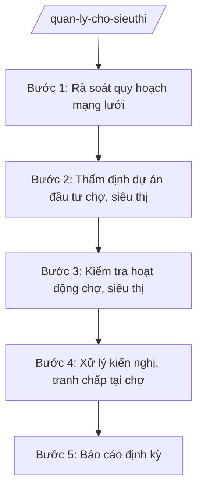

# Skill: Quản lý chợ, siêu thị, trung tâm thương mại

## 2. Khi nào dùng

- Khi tham mưu quy hoạch, kế hoạch phát triển mạng lưới chợ, siêu thị, trung tâm thương mại.
- Khi thẩm định, cấp phép đầu tư xây dựng chợ đầu mối, siêu thị (theo phân cấp).
- Khi kiểm tra hoạt động chợ: ATTP, PCCC, đo lường, giá cả, vệ sinh môi trường.
- Khi xử lý kiến nghị về quản lý chợ của UBND cấp xã, tiểu thương.

## 3. Đầu vào (Input)

| Trường | Mô tả | Bắt buộc |
|--------|-------|----------|
| `loai_viec` | quy hoạch / thẩm định dự án / kiểm tra / xử lý kiến nghị / báo cáo | Có |
| `dia_diem` | Vị trí chợ/siêu thị/dự án | Không |
| `noi_dung` | Mô tả dự án hoặc vụ việc | Không |
| `don_vi_quan_ly` | Ban quản lý chợ / doanh nghiệp kinh doanh | Không |

## 4. Quy trình

**Bước 1. Rà soát quy hoạch mạng lưới**
- Làm gì: Rà soát hiện trạng mạng lưới chợ, siêu thị; đối chiếu quy hoạch tỉnh, nhu cầu dân cư từng khu vực.
- Dùng input: `loai_viec`, `dia_diem`.
- Vai trò: Chuyên viên Phòng Quản lý thương mại tổng hợp; AI hỗ trợ lập bản đồ hiện trạng, phân tích độ phủ — ⏱ 5 ngày.
- Lưu ý nghiệp vụ: Bảo đảm mỗi khu vực dân cư có chợ/siêu thị phục vụ trong bán kính hợp lý; giữ chợ truyền thống gắn với văn hóa địa phương.
- → Kết quả bước: Báo cáo hiện trạng mạng lưới chợ, siêu thị.

**Bước 2. Thẩm định dự án đầu tư chợ, siêu thị**
- Làm gì: Thẩm định hồ sơ dự án: quy mô, PCCC, ATTP, giao thông, môi trường; lấy ý kiến Sở Xây dựng, UBND cấp xã.
- Dùng input: `noi_dung`, `dia_diem`, `don_vi_quan_ly`.
- Vai trò: Trưởng phòng chủ trì thẩm định; AI hỗ trợ checklist hồ sơ, soạn báo cáo thẩm định — ⏱ 7 ngày.
- Lưu ý nghiệp vụ: Chợ đầu mối, siêu thị lớn phải có đánh giá tác động giao thông; phương án PCCC được cơ quan công an thẩm duyệt.
- → Kết quả bước: Báo cáo thẩm định + văn bản chấp thuận/tham mưu UBND tỉnh.

**Bước 3. Kiểm tra hoạt động chợ, siêu thị**
- Làm gì: Kiểm tra: niêm yết giá, cân đo, ATTP (nguồn gốc thực phẩm), vệ sinh môi trường, PCCC, an ninh trật tự.
- Dùng input: `dia_diem`, `don_vi_quan_ly`.
- Vai trò: Đoàn kiểm tra liên ngành (Sở Công Thương, Sở Y tế, Công an PCCC, UBND cấp xã); AI hỗ trợ lập biên bản — ⏱ theo kế hoạch/đột xuất.
- Lưu ý nghiệp vụ: Chợ là nơi tập trung đông người — kiểm tra PCCC, thoát hiểm là trọng tâm; xử lý nghiêm kinh doanh thực phẩm không rõ nguồn gốc.
- → Kết quả bước: Biên bản kiểm tra + kiến nghị xử lý.

**Bước 4. Xử lý kiến nghị, tranh chấp tại chợ**
- Làm gì: Tiếp nhận kiến nghị của tiểu thương, UBND cấp xã về phí chợ, sắp xếp ngành hàng, an ninh; tham mưu giải quyết.
- Dùng input: `noi_dung`.
- Vai trò: Chuyên viên xử lý; AI hỗ trợ phân loại, dự thảo văn bản trả lời — ⏱ 5 ngày.
- Lưu ý nghiệp vụ: Phí, giá dịch vụ tại chợ phải niêm yết công khai; không để "bảo kê", ép giá quầy sạp.
- → Kết quả bước: Văn bản trả lời/giải quyết kiến nghị.

**Bước 5. Báo cáo định kỳ**
- Làm gì: Tổng hợp tình hình quản lý chợ, siêu thị; báo cáo UBND tỉnh, Bộ Công Thương.
- Dùng input: `loai_viec` (báo cáo).
- Vai trò: Chuyên viên tổng hợp; AI hỗ trợ lập bảng số liệu — ⏱ 3 ngày.
- Lưu ý nghiệp vụ: Nêu rõ chợ không hoạt động hiệu quả, đề xuất chuyển đổi công năng.
- → Kết quả bước: Báo cáo quản lý chợ, siêu thị định kỳ.

## Luồng quy trình (Workflow)

## 5. Đầu ra (Output)

- Báo cáo hiện trạng mạng lưới chợ, siêu thị.
- Báo cáo thẩm định dự án đầu tư chợ, siêu thị.
- Biên bản kiểm tra hoạt động chợ, siêu thị.
- Văn bản giải quyết kiến nghị; báo cáo định kỳ.

**Cấu trúc output chuẩn (Báo cáo thẩm định dự án chợ/siêu thị):**
- Thể thức: tuân thủ Nghị định 30/2020/NĐ-CP về công tác văn thư.

1. Quốc hiệu "CỘNG HÒA XÃ HỘI CHỦ NGHĨA VIỆT NAM", Tiêu ngữ "Độc lập – Tự do – Hạnh phúc"; tên cơ quan (Sở Công Thương tỉnh A); số, ký hiệu.
2. Tên loại: **BÁO CÁO** — kết quả thẩm định dự án [tên dự án] tại [địa điểm].
3. Căn cứ pháp lý; hồ sơ dự án.
4. Nội dung thẩm định: sự phù hợp quy hoạch; quy mô; PCCC; ATTP; giao thông; môi trường; năng lực chủ đầu tư.
5. Ý kiến các sở, UBND cấp xã.
6. Kết luận: đủ/không đủ điều kiện; kiến nghị.
7. Nơi nhận; chữ ký Giám đốc Sở.

## 6. Checklist nghiệm thu

- [ ] Dự án phù hợp quy hoạch mạng lưới chợ, siêu thị của tỉnh.
- [ ] Có ý kiến PCCC (công an), ATTP, giao thông trước khi chấp thuận.
- [ ] Kiểm tra chợ có biên bản, xử lý dứt điểm vi phạm ATTP, PCCC.
- [ ] Phí chợ niêm yết công khai; không có phản ánh tiêu cực kéo dài.
- [ ] Báo cáo nêu rõ chợ hoạt động kém hiệu quả và đề xuất xử lý.
- [ ] Văn bản đúng thể thức NĐ 30/2020/NĐ-CP.

## 7. Ví dụ mô phỏng

*Dữ liệu dưới đây là giả lập 100% phục vụ minh họa.*

**Input mẫu:** loai_viec = "kiểm tra"; dia_diem = "Chợ trung tâm xã A"; noi_dung = "Kiểm tra ATTP, PCCC dịp cao điểm".

**Output mẫu (trích Biên bản):**

> **ĐOÀN KIỂM TRA LIÊN NGÀNH TỈNH A**
>
> **BIÊN BẢN KIỂM TRA**
> Hoạt động chợ trung tâm xã A
>
> Thành phần: Sở Công Thương (Trưởng đoàn: ông Bùi Văn X); Sở Y tế; Phòng Cảnh sát PCCC; UBND xã A; Ban quản lý chợ.
> Nội dung kiểm tra: ATTP (nguồn gốc thịt, rau), PCCC (lối thoát hiểm, bình chữa cháy), niêm yết giá.
> Kết quả: 02 quầy kinh doanh thịt không xuất trình được giấy kiểm dịch; 01 lối thoát hiểm bị lấn chiếm.
> Kiến nghị: xử phạt 02 quầy theo quy định; yêu cầu Ban quản lý chợ giải tỏa lối thoát hiểm trong 03 ngày; tái kiểm tra sau 07 ngày./.
>
> *Đại diện các bên ký tên*

## 8. Human gate

- Chuyên viên soạn → Trưởng phòng kiểm tra → Phó Giám đốc Sở duyệt → Giám đốc Sở ký.
- Thẩm định dự án lớn: báo cáo Giám đốc Sở → **UBND tỉnh quyết định** theo phân cấp đầu tư.

## 9. Giới hạn

- AI không tự kết luận vi phạm, không tự áp mức xử phạt.
- Không bịa kết quả kiểm tra, ý kiến của ngành phối hợp.
- Không dùng văn bản hết hiệu lực làm căn cứ.

## 10. Căn cứ & lưu ý

- Thông tư 37/2025/TT-BCT của Bộ Công Thương hướng dẫn chức năng, nhiệm vụ của cơ quan chuyên môn về công thương.
- Nghị định 150/2025/NĐ-CP về tổ chức cơ quan chuyên môn thuộc UBND cấp tỉnh.
- Nghị định 30/2020/NĐ-CP về công tác văn thư (thể thức văn bản).
- Lưu ý: quản lý chợ gắn với ATTP (phối hợp Sở Y tế, Sở NN&MT), PCCC (Công an), UBND cấp xã là đầu mối trực tiếp.
