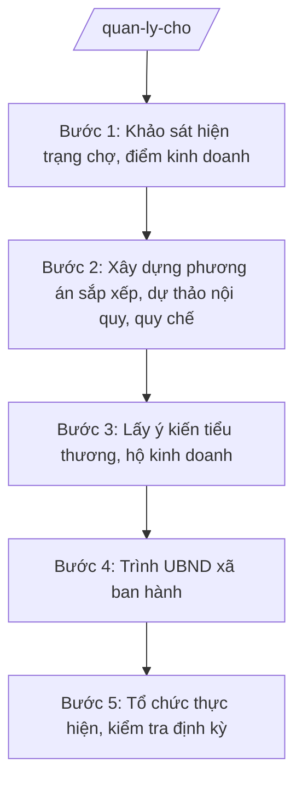

# Skill: Quản lý chợ, điểm kinh doanh

## 2. Khi nào dùng

- Xây dựng mới, quy hoạch lại chợ, điểm kinh doanh trên địa bàn xã.
- Ban hành mới hoặc sửa đổi, bổ sung nội quy, quy chế quản lý chợ.
- Sắp xếp lại ngành hàng, lô sạp; điều chỉnh mức thu phí, lệ phí tại chợ.
- Kiểm tra định kỳ vệ sinh môi trường, PCCC, an toàn thực phẩm tại chợ, điểm kinh doanh.
- Giải quyết phản ánh, kiến nghị của tiểu thương, hộ kinh doanh về hoạt động của chợ.

## 3. Đầu vào (Input)

| Trường | Mô tả | Bắt buộc |
|--------|-------|----------|
| `ten_cho` | Tên chợ / điểm kinh doanh | Có |
| `dia_chi` | Địa chỉ chợ, điểm kinh doanh (thôn, xã) | Có |
| `dien_tich` | Diện tích khu vực chợ (m²) | Có |
| `so_ho_kinh_doanh` | Số lượng hộ kinh doanh, tiểu thương hiện tại | Có |
| `hien_trang_sap_xep` | Hiện trạng sắp xếp ngành hàng, lô sạp | Có |
| `van_de_ton_tai` | Các vấn đề tồn tại (lấn chiếm lối đi, vệ sinh, PCCC, ATTP...) | Có |
| `y_kien_tieu_thuong` | Ý kiến, kiến nghị của tiểu thương, hộ kinh doanh (nếu đã thu thập) | Không |
| `don_vi_quan_ly` | Đơn vị trực tiếp quản lý, khai thác chợ (nếu có) | Không |

## 4. Quy trình

**Bước 1. Khảo sát hiện trạng chợ, điểm kinh doanh**

- Làm gì: Công chức Phòng Kinh tế xã A khảo sát thực tế: diện tích, số hộ kinh doanh, cách sắp xếp ngành hàng, lô sạp; tình hình vệ sinh môi trường, PCCC, ATTP; việc thu phí; các vi phạm, tồn tại; chụp ảnh, lập biên bản khảo sát.
- Dùng input: `ten_cho`, `dia_chi`, `dien_tich`, `so_ho_kinh_doanh`, `hien_trang_sap_xep`, `van_de_ton_tai`.
- Vai trò: Công chức Phòng Kinh tế xã A (phối hợp trưởng thôn, đơn vị quản lý chợ nếu có) khảo sát thực tế; AI hỗ trợ soạn phiếu khảo sát, tổng hợp kết quả thành báo cáo hiện trạng ⏱ ~1 ngày (ước tính).
- Lưu ý nghiệp vụ: Khảo sát phải bao quát cả khu vực trong chợ và khu vực kinh doanh tự phát xung quanh (nếu có); ghi nhận trung thực tồn tại, không bỏ sót vấn đề về PCCC, ATTP.
- → Kết quả bước: Báo cáo khảo sát hiện trạng chợ + biên bản khảo sát, hình ảnh.

**Bước 2. Xây dựng phương án sắp xếp, dự thảo nội quy, quy chế**

- Làm gì: Xây dựng phương án sắp xếp ngành hàng, lô sạp (vị trí, diện tích từng khu vực kinh doanh); dự thảo nội quy, quy chế quản lý chợ gồm: tổ chức quản lý; quyền, nghĩa vụ hộ kinh doanh; thu phí; vệ sinh môi trường; PCCC; ATTP; khen thưởng, xử lý vi phạm.
- Dùng input: kết quả Bước 1 + `so_ho_kinh_doanh`, `dien_tich`.
- Vai trò: Công chức Phòng Kinh tế xã A xây dựng phương án, dự thảo (AI hỗ trợ soạn thảo, gợi ý bố trí ngành hàng, rà soát tính đầy đủ các nội dung bắt buộc của quy chế); Trưởng phòng Kinh tế – Bà Hoàng Thị D góp ý ⏱ ~2–3 ngày (ước tính).
- Lưu ý nghiệp vụ: Phương án sắp xếp phải bảo đảm lối đi, lối thoát hiểm, khu vực PCCC theo quy định; quy chế phải quy định rõ trách nhiệm của đơn vị quản lý chợ và của từng hộ kinh doanh về vệ sinh môi trường, PCCC, ATTP.
- → Kết quả bước: Dự thảo phương án sắp xếp ngành hàng, lô sạp + dự thảo nội quy, quy chế quản lý chợ.

**Bước 3. Lấy ý kiến tiểu thương, hộ kinh doanh**

- Làm gì: Tổ chức lấy ý kiến tiểu thương, hộ kinh doanh về dự thảo phương án, quy chế (họp lấy ý kiến hoặc lấy ý kiến bằng văn bản); tổng hợp, tiếp thu, giải trình các ý kiến; hoàn thiện dự thảo.
- Dùng input: dự thảo phương án, quy chế (từ Bước 2) + `y_kien_tieu_thuong`.
- Vai trò: Công chức Phòng Kinh tế phối hợp trưởng thôn, đơn vị quản lý chợ tổ chức lấy ý kiến; AI hỗ trợ soạn phiếu lấy ý kiến, tổng hợp và phân loại ý kiến ⏱ ~1–2 ngày (chưa tính thời gian lấy ý kiến) (ước tính).
- Lưu ý nghiệp vụ: Mọi ý kiến phải được tổng hợp đầy đủ, tiếp thu hoặc giải trình rõ lý do không tiếp thu trong báo cáo tổng hợp; không ban hành quy chế khi chưa lấy ý kiến các hộ kinh doanh chịu tác động trực tiếp.
- → Kết quả bước: Báo cáo tổng hợp ý kiến + dự thảo phương án, quy chế đã hoàn thiện.

**Bước 4. Trình UBND xã ban hành**

- Làm gì: Lập tờ trình đề nghị ban hành phương án, quy chế quản lý chợ (kèm dự thảo quyết định ban hành, dự thảo quy chế, báo cáo tổng hợp ý kiến); Trưởng phòng Kinh tế kiểm tra; trình Chủ tịch UBND xã A xem xét, ký ban hành; niêm yết công khai quy chế tại chợ.
- Dùng input: dự thảo phương án, quy chế hoàn thiện + báo cáo tổng hợp ý kiến (từ Bước 3).
- Vai trò: Công chức Phòng Kinh tế lập tờ trình (AI hỗ trợ soạn); Trưởng phòng Kinh tế – Bà Hoàng Thị D kiểm tra, ký nháy; Chủ tịch UBND xã – Ông Nguyễn Văn A ký ban hành quyết định ⏱ ~1 ngày (chưa tính thời gian chờ lãnh đạo) (ước tính).
- Lưu ý nghiệp vụ: Quyết định ban hành phải kèm đầy đủ phương án, quy chế; sau ban hành phải niêm yết công khai tại chợ và thông báo đến từng hộ kinh doanh.
- → Kết quả bước: Quyết định ban hành phương án, quy chế quản lý chợ đã ký, đóng dấu, niêm yết công khai.

**Bước 5. Tổ chức thực hiện, kiểm tra định kỳ**

- Làm gì: Triển khai thực hiện phương án sắp xếp (bố trí lại lô sạp theo phương án); tổ chức thực hiện thu phí; kiểm tra định kỳ việc chấp hành nội quy, quy chế (vệ sinh môi trường, PCCC, ATTP); xử lý hoặc kiến nghị xử lý vi phạm; báo cáo định kỳ về UBND xã.
- Dùng input: quyết định ban hành, phương án, quy chế (từ Bước 4) + `ten_cho`, `so_ho_kinh_doanh`.
- Vai trò: Đơn vị quản lý chợ (nếu có) / công chức Phòng Kinh tế tổ chức thực hiện, kiểm tra; AI hỗ trợ lập kế hoạch kiểm tra định kỳ, mẫu biên bản kiểm tra, tổng hợp báo cáo ⏱ ~kiểm tra định kỳ hằng quý hoặc đột xuất (ước tính).
- Lưu ý nghiệp vụ: Kiểm tra phải có biên bản, ghi rõ nội dung kiểm tra và kết quả; vi phạm về ATTP, PCCC phải xử lý kịp thời, kiên quyết; định kỳ báo cáo UBND xã về tình hình quản lý chợ.
- → Kết quả bước: Chợ hoạt động theo phương án, quy chế đã ban hành; biên bản kiểm tra định kỳ; báo cáo tình hình quản lý chợ.

## Luồng quy trình (Workflow)

## 5. Đầu ra (Output)

- Quyết định ban hành phương án, quy chế quản lý chợ (Chủ tịch UBND xã ký).
- Phương án sắp xếp ngành hàng, lô sạp.
- Nội quy, quy chế quản lý chợ (tổ chức quản lý; thu phí; vệ sinh môi trường; PCCC; ATTP; quyền, nghĩa vụ hộ kinh doanh; khen thưởng, xử lý vi phạm).
- Kế hoạch kiểm tra định kỳ hoạt động chợ.

### Cấu trúc output chuẩn

Khung cố định của Quyết định ban hành kèm Quy chế quản lý chợ, các phần bắt buộc theo đúng thứ tự, đúng thể thức NĐ 30/2020/NĐ-CP:

**A. Quyết định ban hành:**
1. **Quốc hiệu – tiêu ngữ** (canh giữa): CỘNG HÒA XÃ HỘI CHỦ NGHĨA VIỆT NAM / Độc lập – Tự do – Hạnh phúc
2. **Tên cơ quan ban hành** (canh trái): ỦY BAN NHÂN DÂN XÃ A
3. **Số, ký hiệu văn bản** (dưới tên cơ quan): Số: .../QĐ-UBND
4. **Địa danh, ngày tháng năm ban hành** (canh phải): Xã A, ngày ... tháng ... năm ...
5. **Tên loại và trích yếu** (canh giữa): QUYẾT ĐỊNH — Về việc ban hành Quy chế quản lý chợ ...
6. **Căn cứ**: TT 37/2025/TT-BCT; tờ trình của Phòng Kinh tế xã A.
7. **Nội dung** (phần QUYẾT ĐỊNH): Điều 1. Ban hành kèm theo Quyết định này Quy chế quản lý chợ ...; Điều 2. Trách nhiệm tổ chức thực hiện của Phòng Kinh tế, đơn vị quản lý chợ, các hộ kinh doanh; Điều 3. Hiệu lực thi hành.
8. **Nơi nhận**; 9. **Chữ ký**: "TM. ỦY BAN NHÂN DÂN" / CHỦ TỊCH / họ tên người ký; đóng dấu UBND xã.

**B. Quy chế quản lý chợ (ban hành kèm theo):**
- Chương I. Quy định chung (phạm vi, đối tượng áp dụng).
- Chương II. Tổ chức quản lý chợ (đơn vị quản lý, nhiệm vụ).
- Chương III. Sắp xếp ngành hàng, lô sạp.
- Chương IV. Thu phí, lệ phí.
- Chương V. Vệ sinh môi trường.
- Chương VI. Phòng cháy, chữa cháy.
- Chương VII. An toàn thực phẩm.
- Chương VIII. Quyền và nghĩa vụ của hộ kinh doanh, tiểu thương.
- Chương IX. Khen thưởng và xử lý vi phạm.
- Chương X. Tổ chức thực hiện.

## 6. Checklist nghiệm thu

1. Quyết định ban hành có đủ thành phần thể thức; kèm đầy đủ phương án, quy chế.
2. Quy chế có đủ 10 chương theo cấu trúc mục 5, không thiếu nội dung bắt buộc (nội quy, sắp xếp ngành hàng–lô sạp, thu phí, vệ sinh môi trường, PCCC, ATTP).
3. Phương án sắp xếp ngành hàng, lô sạp cụ thể (vị trí, diện tích từng khu vực); bảo đảm lối đi, lối thoát hiểm, khu vực PCCC.
4. Đã khảo sát hiện trạng thực tế; báo cáo khảo sát phản ánh trung thực tồn tại.
5. Đã lấy ý kiến tiểu thương, hộ kinh doanh; có báo cáo tổng hợp ý kiến (tiếp thu/giải trình rõ ràng).
6. Người ký quyết định là Chủ tịch UBND xã; có đóng dấu; số quyết định đúng định dạng, không trùng số.
7. Quy chế được niêm yết công khai tại chợ và thông báo đến từng hộ kinh doanh sau ban hành.
8. Có kế hoạch kiểm tra định kỳ việc chấp hành quy chế.
9. Không bịa số liệu, căn cứ pháp lý; số liệu về diện tích, số hộ kinh doanh khớp với khảo sát thực tế.
10. Đã qua human gate: công chức Phòng Kinh tế xây dựng phương án, dự thảo → Trưởng phòng Kinh tế kiểm tra → Chủ tịch UBND xã ký ban hành.

## 7. Ví dụ mô phỏng

*Dữ liệu dưới đây là giả lập 100% phục vụ minh họa.*

### Input mẫu

| Trường | Giá trị |
|--------|---------|
| ten_cho | Chợ A |
| dia_chi | Thôn 1, xã A |
| dien_tich | 2.000 m² |
| so_ho_kinh_doanh | 100 hộ |
| hien_trang_sap_xep | Ngành hàng sắp xếp tự phát, một số hộ lấn chiếm lối đi |
| van_de_ton_tai | Vệ sinh môi trường chưa bảo đảm; thiếu bình chữa cháy tại khu vực kinh doanh ăn uống; một số hộ kinh doanh thực phẩm chưa có giấy tờ về ATTP |
| y_kien_tieu_thuong | Đề nghị sắp xếp lại lô sạp theo ngành hàng; đề nghị giảm phí vệ sinh |
| don_vi_quan_ly | Ban quản lý chợ A xã A |

### Output mẫu

CỘNG HÒA XÃ HỘI CHỦ NGHĨA VIỆT NAM
Độc lập – Tự do – Hạnh phúc

ỦY BAN NHÂN DÂN XÃ A			Số: 123/QĐ-UBND

						Xã A, ngày 09 tháng 10 năm 2026

QUYẾT ĐỊNH
Về việc ban hành Quy chế quản lý chợ A, xã A

Căn cứ Thông tư số 37/2025/TT-BCT ngày 14/6/2025 của Bộ Công Thương hướng dẫn chức năng, nhiệm vụ, quyền hạn của cơ quan chuyên môn về công thương thuộc Ủy ban nhân dân cấp tỉnh, cấp xã;
Xét Tờ trình số 55/TTr-KT ngày 08/10/2026 của Trưởng phòng Kinh tế xã A,

QUYẾT ĐỊNH:

Điều 1. Ban hành kèm theo Quyết định này Quy chế quản lý chợ A, xã A (gồm 10 chương) và Phương án sắp xếp ngành hàng, lô sạp chợ A.

Điều 2. Phòng Kinh tế xã A, Ban quản lý chợ A xã A, các hộ kinh doanh, tiểu thương tại chợ A chịu trách nhiệm thi hành Quyết định này. Phòng Kinh tế xã A chủ trì niêm yết công khai Quy chế tại chợ A và tổ chức kiểm tra định kỳ việc chấp hành.

Điều 3. Quyết định này có hiệu lực kể từ ngày ký.

Nơi nhận:
- Phòng Kinh tế xã A;
- Ban quản lý chợ A xã A;
- Các hộ kinh doanh tại chợ A (niêm yết);
- Lưu: VT, KT (2b).

TM. ỦY BAN NHÂN DÂN
CHỦ TỊCH

Nguyễn Văn A

QUY CHẾ QUẢN LÝ CHỢ A, XÃ A
(Ban hành kèm theo Quyết định số 123/QĐ-UBND ngày 09/10/2026 của UBND xã A)

Chương I. Quy định chung: quy chế áp dụng đối với Ban quản lý chợ A, các hộ kinh doanh, tiểu thương và người đến mua bán tại chợ A, thôn 1, xã A.

Chương II. Tổ chức quản lý chợ: Ban quản lý chợ A chịu trách nhiệm quản lý, khai thác chợ; phối hợp với Phòng Kinh tế xã A trong quản lý nhà nước về thương mại trên địa bàn.

Chương III. Sắp xếp ngành hàng, lô sạp: chợ bố trí 04 khu vực (thực phẩm tươi sống, hàng khô, ăn uống, hàng gia dụng); mỗi hộ kinh doanh 01 lô sạp diện tích 04 m²; nghiêm cấm lấn chiếm lối đi chung (rộng tối thiểu 02 m).

Chương IV. Thu phí, lệ phí: thu phí sử dụng lô sạp, phí vệ sinh theo mức UBND xã A quy định, niêm yết công khai tại chợ.

Chương V. Vệ sinh môi trường: hộ kinh doanh có trách nhiệm giữ vệ sinh khu vực lô sạp của mình; rác thải thu gom đúng nơi quy định; Ban quản lý tổ chức vệ sinh chung hằng ngày sau giờ họp chợ.

Chương VI. Phòng cháy, chữa cháy: trang bị bình chữa cháy tại khu vực kinh doanh ăn uống và khu vực tập kết hàng hóa; nghiêm cấm đun nấu bằng bếp than, củi trong khu vực chợ; bảo đảm lối thoát hiểm thông thoáng.

Chương VII. An toàn thực phẩm: hộ kinh doanh thực phẩm phải có giấy tờ về ATTP theo quy định; không kinh doanh thực phẩm không rõ nguồn gốc, hết hạn sử dụng.

Chương VIII. Quyền và nghĩa vụ của hộ kinh doanh, tiểu thương: được bố trí lô sạp theo phương án; có quyền kiến nghị với Ban quản lý; nghĩa vụ chấp hành nội quy, nộp phí đầy đủ, đúng hạn.

Chương IX. Khen thưởng và xử lý vi phạm: hộ kinh doanh chấp hành tốt được biểu dương; vi phạm nội quy bị nhắc nhở, tạm đình chỉ kinh doanh hoặc xử lý theo quy định pháp luật tùy mức độ.

Chương X. Tổ chức thực hiện: Phòng Kinh tế xã A hướng dẫn, kiểm tra việc thực hiện quy chế; định kỳ hằng quý báo cáo UBND xã A.

## 8. Human gate

- **Công chức Phòng Kinh tế xã A** → khảo sát hiện trạng, xây dựng phương án, dự thảo quy chế; chịu trách nhiệm về tính chính xác của số liệu khảo sát.
- **Trưởng phòng Kinh tế xã A (Bà Hoàng Thị D)** → kiểm tra phương án, dự thảo quy chế, tờ trình; ký nháy trước khi trình.
- **Chủ tịch UBND xã A (Ông Nguyễn Văn A)** → xem xét, ký ban hành quyết định kèm quy chế quản lý chợ.
- Không ban hành khi chưa lấy ý kiến tiểu thương, hộ kinh doanh và chưa có chữ ký của Chủ tịch UBND xã.

## 9. Giới hạn

- AI KHÔNG ra quyết định hành chính thay người có thẩm quyền; chỉ hỗ trợ khảo sát, soạn thảo dự thảo.
- AI KHÔNG tự ban hành, tự ký quy chế quản lý chợ dưới bất kỳ hình thức nào.
- AI KHÔNG bịa số liệu diện tích, số hộ kinh doanh, mức thu phí; mọi số liệu phải từ khảo sát thực tế và quy định hiện hành.
- AI KHÔNG tự áp đặt mức thu phí, lệ phí thay cơ quan có thẩm quyền quyết định.
- AI KHÔNG viện dẫn văn bản đã hết hiệu lực.

## 10. Căn cứ & lưu ý

- TT 37/2025/TT-BCT: hướng dẫn chức năng, nhiệm vụ, quyền hạn của cơ quan chuyên môn về công thương thuộc UBND cấp tỉnh, cấp xã — căn cứ xác định nhiệm vụ quản lý chợ, thương mại của Phòng Kinh tế xã A.
- NĐ 150/2025/NĐ-CP: Phòng Kinh tế tham mưu lĩnh vực công thương ở cấp xã.
- NĐ 30/2020/NĐ-CP: thể thức, kỹ thuật trình bày quyết định hành chính và văn bản kèm theo.
- Lưu ý: khi xã tổ chức khác khung chuẩn (NĐ 370/2025/NĐ-CP cho phép xã tự quyết định thành lập phòng), đối chiếu bảng mapping lĩnh vực → đầu mối trong khung-phong-ban-cap-xa.md; nội dung về PCCC, ATTP trong quy chế phải phù hợp quy định chuyên ngành hiện hành.
