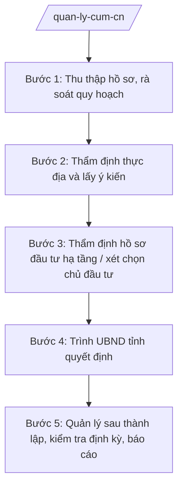

# Skill: Quản lý cụm công nghiệp

## 2. Khi nào dùng

- Khi Sở Công Thương tham mưu UBND tỉnh quy hoạch, thành lập, mở rộng cụm công nghiệp (CCN).
- Khi thẩm định hồ sơ đầu tư hạ tầng kỹ thuật CCN, xét chọn chủ đầu tư kinh doanh hạ tầng.
- Khi kiểm tra, đánh giá hoạt động của các CCN, xử lý vi phạm trong CCN.
- Khi tổng hợp báo cáo tình hình CCN định kỳ gửi Bộ Công Thương, UBND tỉnh.

## 3. Đầu vào (Input)

| Trường | Mô tả | Bắt buộc |
|--------|-------|----------|
| `ten_ccn` | Tên cụm công nghiệp | Có |
| `dia_diem` | Vị trí (xã/phường, diện tích dự kiến ha) | Có |
| `loai_ho_so` | Loại việc: quy hoạch / thành lập / mở rộng / kiểm tra / báo cáo | Có |
| `chu_dau_tu` | Tổ chức đề xuất làm chủ đầu tư hạ tầng (nếu có) | Không |
| `hien_trang` | Hiện trạng sử dụng đất, hạ tầng (nếu có) | Không |
| `thoi_han` | Thời hạn yêu cầu hoàn thành | Không |

## 4. Quy trình

**Bước 1. Thu thập hồ sơ, rà soát quy hoạch**
- Làm gì: Tiếp nhận hồ sơ đề xuất; đối chiếu với quy hoạch tỉnh, quy hoạch sử dụng đất, quy hoạch ngành công nghiệp.
- Dùng input: `ten_ccn`, `dia_diem`, `hien_trang`.
- Vai trò: Chuyên viên Phòng Quản lý công nghiệp tiếp nhận, lập phiếu kiểm tra tính đầy đủ; AI hỗ trợ đối chiếu nhanh các chỉ tiêu quy hoạch, trích xuất thông tin hồ sơ — ⏱ 0,5 ngày.
- Lưu ý nghiệp vụ: Diện tích CCN, khoảng cách an toàn môi trường, không chồng lấn đất quốc phòng/an ninh, đất rừng đặc dụng.
- → Kết quả bước: Phiếu kiểm tra hồ sơ + bảng đối chiếu quy hoạch.

**Bước 2. Thẩm định thực địa và lấy ý kiến**
- Làm gì: Tổ chức kiểm tra thực địa; lấy ý kiến Sở Nông nghiệp và Môi trường (đất đai, môi trường), Sở Xây dựng (quy hoạch xây dựng), UBND cấp xã nơi đặt CCN.
- Dùng input: `ten_ccn`, `dia_diem`, `loai_ho_so`.
- Vai trò: Trưởng phòng Quản lý công nghiệp chủ trì đoàn kiểm tra; AI hỗ trợ soạn biên bản kiểm tra, tổng hợp ý kiến các đơn vị — ⏱ 3–5 ngày.
- Lưu ý nghiệp vụ: Ghi nhận đầy đủ hiện trạng, ý kiến người dân bị ảnh hưởng; biên bản có chữ ký các bên.
- → Kết quả bước: Biên bản kiểm tra thực địa + văn bản ý kiến các sở, UBND cấp xã.

**Bước 3. Thẩm định hồ sơ đầu tư hạ tầng / xét chọn chủ đầu tư**
- Làm gì: Thẩm định năng lực tài chính, kinh nghiệm của tổ chức đề xuất; đánh giá phương án đầu tư hạ tầng kỹ thuật, bảo vệ môi trường, PCCC.
- Dùng input: `chu_dau_tu`, `loai_ho_so`.
- Vai trò: Phó Giám đốc Sở phụ trách chủ trì hội đồng thẩm định; AI hỗ trợ chấm điểm theo bộ tiêu chí, soạn báo cáo thẩm định — ⏱ 5–7 ngày.
- Lưu ý nghiệp vụ: Không để "chủ đầu tư ma"; kiểm tra nợ thuế, vi phạm pháp luật của tổ chức đề xuất qua phối hợp cơ quan thuế.
- → Kết quả bước: Báo cáo thẩm định + biên bản họp hội đồng.

**Bước 4. Trình UBND tỉnh quyết định**
- Làm gì: Hoàn thiện tờ trình + dự thảo quyết định thành lập/mở rộng CCN (hoặc văn bản chấp thuận chủ trương) trình UBND tỉnh.
- Dùng input: Toàn bộ kết quả các bước trên.
- Vai trò: Giám đốc Sở ký tờ trình; AI hỗ trợ soạn thảo đúng thể thức NĐ 30/2020/NĐ-CP — ⏱ 2 ngày.
- Lưu ý nghiệp vụ: Hồ sơ trình phải đầy đủ: tờ trình, dự thảo quyết định, báo cáo thẩm định, ý kiến các sở, bản đồ ranh giới CCN.
- → Kết quả bước: Hồ sơ trình UBND tỉnh hoàn chỉnh.

**Bước 5. Quản lý sau thành lập, kiểm tra định kỳ, báo cáo**
- Làm gì: Theo dõi tiến độ đầu tư hạ tầng, tỷ lệ lấp đầy; kiểm tra việc chấp hành pháp luật về đất đai, môi trường, PCCC của các doanh nghiệp trong CCN; tổng hợp báo cáo định kỳ.
- Dùng input: `ten_ccn`, `loai_ho_so` (kiểm tra/báo cáo).
- Vai trò: Chi cục/Phòng chuyên môn phối hợp Thanh tra Sở kiểm tra; AI hỗ trợ lập kế hoạch kiểm tra, tổng hợp số liệu báo cáo — ⏱ theo kế hoạch năm.
- Lưu ý nghiệp vụ: CCN chậm tiến độ quá thời hạn phải báo cáo UBND tỉnh xem xét thu hồi chủ trương; xử lý nghiêm vi phạm môi trường.
- → Kết quả bước: Biên bản kiểm tra + báo cáo tình hình CCN định kỳ.

## Luồng quy trình (Workflow)

## 5. Đầu ra (Output)

- Tờ trình UBND tỉnh + dự thảo quyết định thành lập/mở rộng CCN.
- Báo cáo thẩm định hồ sơ đầu tư hạ tầng CCN.
- Biên bản kiểm tra hoạt động CCN.
- Báo cáo tình hình cụm công nghiệp định kỳ.

**Cấu trúc output chuẩn (Tờ trình thành lập/mở rộng CCN):**
- Thể thức: tuân thủ Nghị định 30/2020/NĐ-CP về công tác văn thư.

1. Quốc hiệu "CỘNG HÒA XÃ HỘI CHỦ NGHĨA VIỆT NAM", Tiêu ngữ "Độc lập – Tự do – Hạnh phúc"; tên cơ quan (Sở Công Thương tỉnh A); số, ký hiệu văn bản.
2. Tên loại: **TỜ TRÌNH** — về việc thành lập/mở rộng cụm công nghiệp [tên].
3. Kính gửi: Ủy ban nhân dân tỉnh A.
4. Căn cứ pháp lý (liệt kê văn bản).
5. Sự cần thiết, mục tiêu thành lập/mở rộng.
6. Nội dung đề xuất: tên, địa điểm, diện tích, chủ đầu tư hạ tầng, tiến độ, tổng mức đầu tư.
7. Đánh giá sự phù hợp quy hoạch; ý kiến các sở, ngành, địa phương.
8. Kiến nghị UBND tỉnh xem xét, quyết định.
9. Nơi nhận; chữ ký Giám đốc Sở.

> **Checklist thể thức văn bản theo NĐ 30/2020/NĐ-CP** — đối chiếu trước khi trình ký:
> 1. Quốc hiệu và Tiêu ngữ.
> 2. Tên cơ quan, tổ chức ban hành văn bản.
> 3. Số, ký hiệu của văn bản.
> 4. Địa danh và thời gian ban hành văn bản.
> 5. Tên loại và trích yếu nội dung văn bản.
> 6. Nội dung văn bản.
> 7. Chức vụ, họ tên và chữ ký của người có thẩm quyền.
> 8. Dấu, chữ ký số của cơ quan, tổ chức.
> 9. Nơi nhận (kèm Phụ lục nếu có).

## 6. Checklist nghiệm thu

- [ ] Hồ sơ đối chiếu đầy đủ với quy hoạch tỉnh, quy hoạch sử dụng đất.
- [ ] Có biên bản kiểm tra thực địa và ý kiến của Sở NN&MT, Sở Xây dựng, UBND cấp xã.
- [ ] Chủ đầu tư được thẩm định năng lực tài chính, pháp lý rõ ràng.
- [ ] Tờ trình + dự thảo quyết định đúng thể thức NĐ 30/2020/NĐ-CP.
- [ ] Bản đồ ranh giới CCN kèm theo hồ sơ trình.
- [ ] Báo cáo kiểm tra định kỳ nêu rõ tỷ lệ lấp đầy, vi phạm (nếu có) và kiến nghị xử lý.

## 7. Ví dụ mô phỏng

*Dữ liệu dưới đây là giả lập 100% phục vụ minh họa.*

**Input mẫu:** ten_ccn = "Cụm công nghiệp An Bình"; dia_diem = "Xã A, tỉnh A; 50 ha"; loai_ho_so = "thành lập"; chu_dau_tu = "Công ty TNHH Hạ tầng AB"; hien_trang = "Đất nông nghiệp, chưa có hạ tầng".

**Output mẫu (trích Tờ trình):**

> **SỞ CÔNG THƯƠNG TỈNH A**
> Số: 1234/TTr-SCT
>
> **TỜ TRÌNH**
> Về việc thành lập Cụm công nghiệp An Bình, xã A
>
> *Kính gửi:* Ủy ban nhân dân tỉnh A.
>
> *Căn cứ* Nghị định 150/2025/NĐ-CP; Thông tư 37/2025/TT-BCT; Quy hoạch tỉnh A thời kỳ 2021–2030...
>
> Sở Công Thương kính trình UBND tỉnh xem xét, quyết định thành lập Cụm công nghiệp An Bình với các nội dung chính:
> 1. Tên cụm công nghiệp: Cụm công nghiệp An Bình.
> 2. Địa điểm: xã A, tỉnh A; diện tích 50 ha.
> 3. Chủ đầu tư xây dựng hạ tầng kỹ thuật: Công ty TNHH Hạ tầng AB.
> 4. Tiến độ: hoàn thành hạ tầng trong 24 tháng kể từ ngày quyết định có hiệu lực.
>
> Sở Công Thương đã thẩm định hồ sơ, lấy ý kiến Sở Nông nghiệp và Môi trường, Sở Xây dựng, UBND xã A; hồ sơ phù hợp quy hoạch tỉnh.
> Kính trình UBND tỉnh xem xét, quyết định./.
>
> *Nơi nhận:* ... — **GIÁM ĐỐC** *(ký, đóng dấu)* — Hoàng Văn S

## 8. Human gate

- Chuyên viên soạn → Trưởng phòng Quản lý công nghiệp kiểm tra → Phó Giám đốc Sở phụ trách duyệt → Giám đốc Sở ký tờ trình → **UBND tỉnh quyết định** (đối với thành lập/mở rộng CCN).
- Báo cáo kiểm tra định kỳ: Trưởng phòng duyệt, Giám đốc Sở ký ban hành.

## 9. Giới hạn

- AI không thay hội đồng thẩm định đánh giá năng lực chủ đầu tư; không tự ban hành quyết định thành lập CCN.
- Không bịa số liệu quy hoạch, diện tích, ý kiến của sở ngành khác.
- Không dùng văn bản hết hiệu lực để làm căn cứ trình.

## 10. Căn cứ & lưu ý

- Thông tư 37/2025/TT-BCT của Bộ Công Thương hướng dẫn chức năng, nhiệm vụ của cơ quan chuyên môn về công thương thuộc UBND cấp tỉnh, cấp xã.
- Nghị định 150/2025/NĐ-CP về tổ chức cơ quan chuyên môn thuộc UBND cấp tỉnh, cấp xã.
- Nghị định 30/2020/NĐ-CP về công tác văn thư (thể thức văn bản).
- Lưu ý: phối hợp chặt với Sở Nông nghiệp và Môi trường (đất đai, ĐTM) và Sở Xây dựng (quy hoạch xây dựng) trong mọi hồ sơ CCN.
