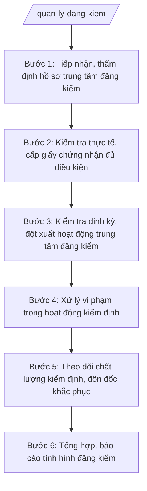

# Skill: Quản lý đăng kiểm phương tiện

## 2. Khi nào dùng

- Tổ chức đề nghị thành lập, cấp giấy chứng nhận đủ điều kiện hoạt động kiểm định xe cơ giới (trung tâm đăng kiểm) trên địa bàn tỉnh A;
- Cần kiểm tra định kỳ/đột xuất hoạt động của các trung tâm đăng kiểm (điều kiện cơ sở vật chất, thiết bị, đăng kiểm viên, quy trình kiểm định);
- Tiếp nhận phản ánh về vi phạm trong kiểm định (cấp giấy chứng nhận không đúng quy trình, thu phí sai quy định, phương tiện không đạt vẫn được cấp tem);
- Cần tổng hợp tình hình đăng kiểm phương tiện, báo cáo UBND tỉnh và Bộ Xây dựng; hướng dẫn nghiệp vụ cho cấp xã (tuyên truyền về đăng kiểm).

## 3. Đầu vào (Input)

| Trường | Mô tả | Bắt buộc |
|--------|-------|----------|
| `ho_so_trung_tam` | Hồ sơ đề nghị cấp giấy chứng nhận đủ điều kiện hoạt động kiểm định (mặt bằng, thiết bị, nhân sự). Lưu ý: cấp mới.| Có |
| `danh_sach_ttdk` | Danh sách trung tâm đăng kiểm đang hoạt động trên địa bàn (tên, địa chỉ, hạng) | Có |
| `bao_cao_ttdk` | Báo cáo hoạt động của trung tâm đăng kiểm (số lượt kiểm định, tỷ lệ đạt/không đạt) | Không |
| `phan_anh_vi_pham_dk` | Phản ánh vi phạm trong hoạt động kiểm định (trung tâm, hành vi). Lưu ý: xử lý.| Có |
| `ket_qua_kiem_tra_dk` | Kết quả kiểm tra thực tế tại trung tâm đăng kiểm | Không |
| `so_lieu_phuong_tien` | Số liệu phương tiện đến hạn kiểm định trên địa bàn | Không |

## 4. Quy trình

**Bước 1. Tiếp nhận, thẩm định hồ sơ trung tâm đăng kiểm**
- Làm gì: Tiếp nhận hồ sơ đề nghị cấp giấy chứng nhận đủ điều kiện hoạt động kiểm định xe cơ giới; kiểm tra tính đầy đủ, hợp lệ (mặt bằng, dây chuyền kiểm định, thiết bị đo, đăng kiểm viên có chứng chỉ); lập phiếu thẩm định.
- Dùng input: `ho_so_trung_tam`.
- Vai trò: Chuyên viên Phòng Quản lý vận tải — đăng kiểm tiếp nhận, AI hỗ trợ đối chiếu hồ sơ theo checklist điều kiện, lập phiếu thẩm định; ⏱ ~5–7 ngày làm việc (ước tính).
- Lưu ý nghiệp vụ: Mọi điều kiện về cơ sở vật chất, thiết bị, nhân sự phải được kiểm chứng thực tế trước khi cấp giấy chứng nhận; hồ sơ thiếu hướng dẫn bổ sung một lần.
- → Kết quả bước: Phiếu thẩm định hồ sơ trung tâm đăng kiểm (đủ điều kiện / cần bổ sung).

**Bước 2. Kiểm tra thực tế, cấp giấy chứng nhận đủ điều kiện**
- Làm gì: Tổ chức kiểm tra thực tế mặt bằng, dây chuyền, thiết bị kiểm định, hồ sơ đăng kiểm viên; lập biên bản kiểm tra; soạn quyết định/giấy chứng nhận đủ điều kiện hoạt động kiểm định trình ký.
- Dùng input: Kết quả Bước 1.
- Vai trò: Đoàn kiểm tra của Sở thực hiện kiểm tra thực tế, AI hỗ trợ soạn biên bản kiểm tra, dự thảo giấy chứng nhận; ⏱ ~5–7 ngày làm việc (ước tính).
- Lưu ý nghiệp vụ: Biên bản kiểm tra có chữ ký các bên; chỉ cấp giấy chứng nhận khi tất cả điều kiện đạt yêu cầu.
- → Kết quả bước: Biên bản kiểm tra thực tế + giấy chứng nhận đủ điều kiện hoạt động kiểm định (lãnh đạo Sở ký).

**Bước 3. Kiểm tra định kỳ, đột xuất hoạt động trung tâm đăng kiểm**
- Làm gì: Lập kế hoạch kiểm tra định kỳ/đột xuất các trung tâm đăng kiểm: quy trình kiểm định, việc sử dụng thiết bị, chứng chỉ đăng kiểm viên, việc cấp giấy chứng nhận, tem kiểm định, thu phí; đối chiếu số liệu kiểm định với báo cáo; lập biên bản.
- Dùng input: `danh_sach_ttdk`, `bao_cao_ttdk`, `phan_anh_vi_pham_dk`.
- Vai trò: Đoàn kiểm tra của Sở thực hiện, AI hỗ trợ soạn kế hoạch, biên bản kiểm tra, đối chiếu số liệu, tổng hợp vi phạm; ⏱ ~5–7 ngày làm việc/đợt (ước tính).
- Lưu ý nghiệp vụ: Chú trọng kiểm tra việc tuân thủ quy trình kiểm định, chống tiêu cực (cấp tem cho xe không đạt); kiểm tra đột xuất khi có phản ánh.
- → Kết quả bước: Biên bản kiểm tra + bảng tổng hợp vi phạm trong hoạt động kiểm định.

**Bước 4. Xử lý vi phạm trong hoạt động kiểm định**
- Làm gì: Trên cơ sở kết quả kiểm tra, phản ánh: yêu cầu chấm dứt vi phạm; lập biên bản vi phạm hành chính; tham mưu xử phạt theo thẩm quyền, đình chỉ hoạt động kiểm định hoặc thu hồi giấy chứng nhận đối với vi phạm nghiêm trọng, tái phạm; chuyển cơ quan điều tra nếu có dấu hiệu hình sự.
- Dùng input: Kết quả Bước 3, `phan_anh_vi_pham_dk`.
- Vai trò: Thanh tra Sở/chuyên viên tham mưu xử lý, AI hỗ trợ soạn biên bản vi phạm, dự thảo quyết định xử phạt, rà soát căn cứ; ⏱ ~5–7 ngày làm việc (ước tính).
- Lưu ý nghiệp vụ: Xử lý đúng hành vi, đúng thẩm quyền, đúng trình tự; bảo đảm quyền lợi của chủ phương tiện đã kiểm định hợp lệ khi đình chỉ trung tâm.
- → Kết quả bước: Quyết định xử phạt vi phạm hành chính / quyết định đình chỉ, thu hồi giấy chứng nhận.

**Bước 5. Theo dõi chất lượng kiểm định, đôn đốc khắc phục**
- Làm gì: Theo dõi việc khắc phục vi phạm của trung tâm đăng kiểm; giám sát tỷ lệ phương tiện đạt/không đạt bất thường (dấu hiệu nới lỏng kiểm định); đôn đốc trung tâm nâng cao chất lượng kiểm định; kiểm tra lại sau thời hạn khắc phục.
- Dùng input: Kết quả Bước 3–4, `bao_cao_ttdk`.
- Vai trò: Chuyên viên Phòng Quản lý vận tải — đăng kiểm theo dõi, AI hỗ trợ lập bảng theo dõi, cảnh báo tỷ lệ đạt bất thường; ⏱ ~3–5 ngày làm việc/đợt (ước tính).
- Lưu ý nghiệp vụ: Trung tâm không khắc phục triệt để thì xem xét đình chỉ, thu hồi giấy chứng nhận; số liệu theo dõi phải liên tục, nhất quán.
- → Kết quả bước: Báo cáo theo dõi khắc phục + kết quả kiểm tra lại.

**Bước 6. Tổng hợp, báo cáo tình hình đăng kiểm**
- Làm gì: Tổng hợp tình hình hoạt động các trung tâm đăng kiểm, kết quả kiểm tra, xử lý vi phạm, số liệu phương tiện kiểm định; báo cáo UBND tỉnh và Bộ Xây dựng theo định kỳ; phối hợp tuyên truyền để chủ phương tiện kiểm định đúng hạn.
- Dùng input: Kết quả Bước 1–5, `so_lieu_phuong_tien`.
- Vai trò: Trưởng phòng Quản lý vận tải — đăng kiểm tổng hợp, AI hỗ trợ soạn báo cáo định kỳ, lập biểu số liệu; ⏱ ~3–5 ngày làm việc (ước tính).
- Lưu ý nghiệp vụ: Báo cáo trung thực, số liệu thống nhất giữa các kỳ; phối hợp cấp xã trong tuyên truyền kiểm định phương tiện.
- → Kết quả bước: Báo cáo tình hình đăng kiểm phương tiện của tỉnh (định kỳ).

## Luồng quy trình (Workflow)

## 5. Đầu ra (Output)

- Phiếu thẩm định hồ sơ trung tâm đăng kiểm;
- Biên bản kiểm tra thực tế điều kiện hoạt động kiểm định;
- Giấy chứng nhận đủ điều kiện hoạt động kiểm định xe cơ giới;
- Biên bản kiểm tra định kỳ/đột xuất trung tâm đăng kiểm;
- Quyết định xử phạt vi phạm hành chính / quyết định đình chỉ, thu hồi giấy chứng nhận;
- Báo cáo theo dõi khắc phục vi phạm;
- Báo cáo tình hình đăng kiểm phương tiện của tỉnh (định kỳ).

**Cấu trúc output chuẩn (Giấy chứng nhận đủ điều kiện hoạt động kiểm định):**
- Thể thức: tuân thủ Nghị định 30/2020/NĐ-CP về công tác văn thư.

1. Quốc hiệu "CỘNG HÒA XÃ HỘI CHỦ NGHĨA VIỆT NAM", Tiêu ngữ "Độc lập – Tự do – Hạnh phúc";
2. Tên cơ quan: SỞ XÂY DỰNG TỈNH A; số giấy chứng nhận, ký hiệu; địa danh và ngày, tháng, năm cấp;
3. Tên loại: GIẤY CHỨNG NHẬN ĐỦ ĐIỀU KIỆN HOẠT ĐỘNG KIỂM ĐỊNH XE CƠ GIỚI;
4. Căn cứ (văn bản về phân định thẩm quyền, phân quyền, phân cấp lĩnh vực xây dựng; Thông tư 10/2025/TT-BXD; hồ sơ đề nghị; biên bản kiểm tra thực tế...);
5. Nội dung: tên tổ chức, địa chỉ trung tâm đăng kiểm; phạm vi kiểm định được phép (loại phương tiện); thời hạn hiệu lực; nghĩa vụ của trung tâm trong hoạt động kiểm định;
6. Thẩm quyền, chức vụ, họ tên người ký: GIÁM ĐỐC — (chữ ký, họ tên), dấu của cơ quan.
- Nơi nhận: liệt kê các cơ quan, đơn vị nhận để biết/thực hiện; kết thúc bằng "- Lưu: VT, [mã đơn vị]".

> **Chuẩn tài liệu đầu ra** (thứ tự ưu tiên):
> 1. Chuẩn riêng của ngành/cơ quan chủ quản — mẫu, biểu mẫu, quy chuẩn tại văn bản quy phạm chuyên ngành (xem mục "Căn cứ & lưu ý").
> 2. Tài liệu không có quy chuẩn riêng — thể thức NĐ 30/2020/NĐ-CP: Quốc hiệu và Tiêu ngữ; tên cơ quan ban hành; số, ký hiệu; địa danh và thời gian; tên loại và trích yếu; nội dung; chức vụ, họ tên, chữ ký người có thẩm quyền; dấu, chữ ký số; nơi nhận (kèm Phụ lục nếu có).

## 6. Checklist nghiệm thu

- [ ] Hồ sơ trung tâm đăng kiểm đầy đủ, đã kiểm tra thực tế trước khi cấp giấy chứng nhận;
- [ ] Giấy chứng nhận đúng thẩm quyền, ghi rõ phạm vi, thời hạn;
- [ ] Kiểm tra định kỳ/đột xuất có kế hoạch, biên bản đầy đủ;
- [ ] Vi phạm trong kiểm định (cấp tem sai quy trình, thu phí sai) được xử lý kịp thời, đúng thẩm quyền;
- [ ] Đã theo dõi, kiểm tra lại việc khắc phục vi phạm;
- [ ] Tỷ lệ kiểm định bất thường được giám sát, cảnh báo;
- [ ] Báo cáo định kỳ đúng hạn, số liệu thống nhất giữa các kỳ.

## 7. Ví dụ mô phỏng

*Dữ liệu dưới đây là giả lập 100% phục vụ minh họa.*

### Input mẫu

| Trường | Giá trị giả lập |
|--------|-----------------|
| ho_so_trung_tam | Công ty Cổ phần Đăng kiểm A đề nghị cấp giấy chứng nhận cho Trung tâm đăng kiểm xe cơ giới tại xã A: mặt bằng 5.000 m², 02 dây chuyền kiểm định, 06 đăng kiểm viên có chứng chỉ |
| phan_anh_vi_pham_dk | Phản ánh Trung tâm đăng kiểm B cấp tem kiểm định cho xe tải không đạt tiêu chuẩn khí thải |
| bao_cao_ttdk | Trung tâm B: 5.000 lượt kiểm định/quý, tỷ lệ đạt 99% (bất thường so với mặt bằng 90%) |

### Output mẫu (Biên bản kiểm tra — trích)

> **CỘNG HÒA XÃ HỘI CHỦ NGHĨA VIỆT NAM**
> **Độc lập – Tự do – Hạnh phúc**
>
> *Tỉnh A, ngày 18 tháng 6 năm 2027*
>
> **BIÊN BẢN KIỂM TRA**
> **Hoạt động kiểm định tại Trung tâm đăng kiểm xe cơ giới B**
>
> Căn cứ Quyết định thành lập Đoàn kiểm tra số 1234/QĐ-SXD ngày 10/6/2027 của Giám đốc Sở Xây dựng tỉnh A;
>
> Đoàn kiểm tra tiến hành kiểm tra đột xuất hoạt động kiểm định tại Trung tâm đăng kiểm xe cơ giới B, xã A. Kết quả:
>
> 1. Qua kiểm tra hồ sơ và giám sát quy trình: phát hiện 03 trường hợp cấp giấy chứng nhận, tem kiểm định cho xe tải không đạt tiêu chuẩn khí thải theo quy trình...
> 2. Tỷ lệ phương tiện đạt kiểm định của Trung tâm (99%) cao bất thường so với mặt bằng chung...
> 3. Đoàn kiểm tra yêu cầu Trung tâm dừng ngay hành vi vi phạm, báo cáo giải trình...
>
> Biên bản lập thành 02 bản, các bên cùng ký xác nhận.
>
> **TRƯỞNG ĐOÀN KIỂM TRA**
> *(Chữ ký, họ tên)*
> **Bùi Văn X**

## 8. Human gate

- Chuyên viên Phòng Quản lý vận tải — đăng kiểm tiếp nhận, thẩm định hồ sơ;
- Trưởng đoàn kiểm tra/Trưởng phòng kiểm tra, lập biên bản;
- Phó Giám đốc/Giám đốc Sở ký giấy chứng nhận, quyết định xử phạt, đình chỉ;
- Chủ tịch UBND tỉnh A xem xét đối với vụ việc phức tạp, vượt thẩm quyền của Sở (AI không thay người ký).

## 9. Giới hạn

- AI KHÔNG cấp giấy chứng nhận, không ký quyết định xử phạt hay đình chỉ thay người có thẩm quyền;
- Không bịa kết quả kiểm tra, số liệu kiểm định, căn cứ pháp lý;
- Không dùng văn bản đã hết hiệu lực; chỉ viện dẫn văn bản có thật trong `tai-lieu-moi-nhat.md`;
- Kết luận vi phạm dựa trên biên bản kiểm tra của con người — AI chỉ hỗ trợ tổng hợp, soạn thảo.

## 10. Căn cứ & lưu ý

- NĐ 140/2025/NĐ-CP ngày 12/6/2025 — phân định thẩm quyền CQĐP 2 cấp trong lĩnh vực quản lý nhà nước của Bộ Xây dựng;
- NĐ 144/2025/NĐ-CP ngày 12/6/2025 — phân quyền, phân cấp trong lĩnh vực quản lý nhà nước của Bộ Xây dựng;
- TT 10/2025/TT-BXD ngày 14/6/2025 — hướng dẫn chức năng, nhiệm vụ, quyền hạn của Sở Xây dựng, Sở Quy hoạch – Kiến trúc và lĩnh vực xây dựng cấp xã;
- NĐ 150/2025/NĐ-CP (hiệu lực 16/6/2025); NĐ 370/2025/NĐ-CP sửa đổi, bổ sung;
- NĐ 30/2020/NĐ-CP — thể thức, kỹ thuật trình bày văn bản hành chính.
