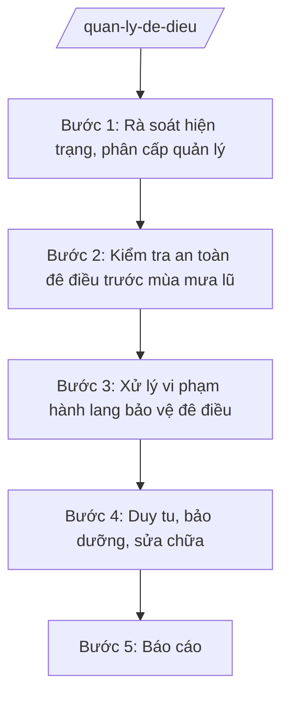

# Skill: Quản lý đê điều, thủy lợi

## 2. Khi nào dùng

- Khi tham mưu phân cấp quản lý đê điều, công trình thủy lợi trên địa bàn.
- Khi kiểm tra an toàn đê điều trước, trong mùa mưa lũ.
- Khi xử lý vi phạm hành lang bảo vệ đê điều (xây dựng, khai thác cát, trồng cây...).
- Khi lập kế hoạch duy tu, bảo dưỡng, sửa chữa đê điều, hồ đập.

## 3. Đầu vào (Input)

| Trường | Mô tả | Bắt buộc |
|--------|-------|----------|
| `loai_viec` | phân cấp quản lý / kiểm tra an toàn / xử lý vi phạm / duy tu bảo dưỡng / báo cáo | Có |
| `tuyen_de` | Tên tuyến đê, công trình (sông, cấp đê) | Không |
| `dia_ban` | Xã/phường có đê đi qua | Không |
| `noi_dung_vp` | Mô tả vi phạm hành lang đê (nếu có) | Không |

## 4. Quy trình

**Bước 1. Rà soát hiện trạng, phân cấp quản lý**
- Làm gì: Thống kê hệ thống đê, kè, cống, hồ đập; tham mưu phân cấp quản lý (tỉnh quản lý đê cấp I–III, xã quản lý đê cấp IV–V theo quy định).
- Dùng input: `loai_viec`, `tuyen_de`.
- Vai trò: Chuyên viên Phòng/Chi cục Thủy lợi tổng hợp; AI hỗ trợ lập bản đồ, bảng phân cấp — ⏱ 7 ngày.
- Lưu ý nghiệp vụ: Phân cấp phải rõ đầu mối quản lý từng tuyến, tránh chồng chéo, bỏ trống.
- → Kết quả bước: Phương án phân cấp quản lý đê điều, thủy lợi.

**Bước 2. Kiểm tra an toàn đê điều trước mùa mưa lũ**
- Làm gì: Tổ chức kiểm tra toàn tuyến: thân đê, kè, cống qua đê, bãi sông; đánh giá trọng điểm xung yếu.
- Dùng input: `tuyen_de`, `dia_ban`.
- Vai trò: Đoàn kiểm tra (Sở NN&MT, UBND cấp xã, hạt quản lý đê); AI hỗ trợ lập biên bản, bản đồ điểm xung yếu — ⏱ 10–15 ngày/đợt.
- Lưu ý nghiệp vụ: Kiểm tra trước mùa mưa lũ hằng năm bắt buộc; điểm xung yếu phải có phương án xử lý giờ đầu.
- → Kết quả bước: Biên bản kiểm tra + danh sách điểm xung yếu + phương án xử lý.

**Bước 3. Xử lý vi phạm hành lang bảo vệ đê điều**
- Làm gì: Phát hiện, lập biên bản vi phạm (xây dựng trái phép, khai thác cát sỏi lòng sông, trồng cây, chăn thả...); xử phạt, buộc khôi phục hiện trạng.
- Dùng input: `noi_dung_vp`, `dia_ban`.
- Vai trò: Hạt quản lý đê/Thanh tra Sở lập biên bản; người có thẩm quyền xử phạt; AI hỗ trợ tra cứu khung phạt — ⏱ kịp thời.
- Lưu ý nghiệp vụ: Vi phạm đe dọa an toàn đê phải xử lý ngay, cưỡng chế nếu không tự khắc phục; khai thác cát sỏi trái phép phối hợp Công an.
- → Kết quả bước: Biên bản VPHC + quyết định xử phạt / cưỡng chế.

**Bước 4. Duy tu, bảo dưỡng, sửa chữa**
- Làm gì: Lập kế hoạch duy tu hằng năm; sửa chữa đột xuất điểm sạt lở; quản lý vật tư dự trữ phòng chống lụt bão.
- Dùng input: `tuyen_de`.
- Vai trò: Đơn vị quản lý đê đề xuất; AI hỗ trợ lập dự toán, theo dõi tiến độ — ⏱ theo kế hoạch.
- Lưu ý nghiệp vụ: Ưu tiên điểm xung yếu; vật tư dự trữ (bao tải, đá hộc, cọc tre...) phải đủ định mức trước mùa mưa lũ.
- → Kết quả bước: Kế hoạch duy tu + biên bản nghiệm thu sửa chữa.

**Bước 5. Báo cáo**
- Làm gì: Báo cáo hiện trạng an toàn đê điều, kết quả xử lý vi phạm gửi UBND tỉnh, Bộ NN&MT.
- Dùng input: `loai_viec` (báo cáo).
- Vai trò: Chuyên viên tổng hợp; AI hỗ trợ lập bảng số liệu — ⏱ 3 ngày.
- Lưu ý nghiệp vụ: Báo cáo trước mùa mưa lũ và sau mỗi đợt lũ lớn.
- → Kết quả bước: Báo cáo an toàn đê điều định kỳ.

## Luồng quy trình (Workflow)

## 5. Đầu ra (Output)

- Phương án phân cấp quản lý đê điều, thủy lợi.
- Biên bản kiểm tra an toàn đê + danh sách điểm xung yếu.
- Quyết định xử phạt/cưỡng chế vi phạm hành lang đê.
- Kế hoạch duy tu, bảo dưỡng; báo cáo định kỳ.

**Cấu trúc output chuẩn (Biên bản kiểm tra an toàn đê điều):**
- Thể thức: tuân thủ Nghị định 30/2020/NĐ-CP về công tác văn thư.

1. Quốc hiệu "CỘNG HÒA XÃ HỘI CHỦ NGHĨA VIỆT NAM", Tiêu ngữ "Độc lập – Tự do – Hạnh phúc"; tên cơ quan (Sở NN&MT tỉnh A); số, ký hiệu.
2. Tên loại: **BIÊN BẢN KIỂM TRA** — an toàn đê điều [tên tuyến] trước mùa mưa lũ năm [năm].
3. Thành phần đoàn kiểm tra; thời gian, tuyến kiểm tra.
4. Kết quả từng đoạn: hiện trạng thân đê, kè, cống; điểm xung yếu (vị trí, mức độ).
5. Kiến nghị xử lý từng điểm; phân công thực hiện, thời hạn.
6. Chữ ký các thành viên đoàn.
- Nơi nhận: liệt kê các cơ quan, đơn vị nhận để biết/thực hiện; kết thúc bằng "- Lưu: VT, [mã đơn vị]".
## 6. Checklist nghiệm thu

- [ ] Phân cấp quản lý rõ đầu mối từng tuyến đê, không bỏ trống.
- [ ] Kiểm tra trước mùa mưa lũ đầy đủ 100% tuyến đê cấp I–III.
- [ ] Điểm xung yếu có phương án xử lý giờ đầu.
- [ ] Vi phạm hành lang đê được xử lý dứt điểm, cưỡng chế khi cần.
- [ ] Vật tư dự trữ đủ định mức trước mùa mưa lũ.
- [ ] Văn bản đúng thể thức NĐ 30/2020/NĐ-CP.

## 7. Ví dụ mô phỏng

*Dữ liệu dưới đây là giả lập 100% phục vụ minh họa.*

**Input mẫu:** loai_viec = "kiểm tra an toàn"; tuyen_de = "Đê tả sông A, cấp III"; dia_ban = "Xã A, xã B".

**Output mẫu (trích Biên bản):**

> **SỞ NÔNG NGHIỆP VÀ MÔI TRƯỜNG TỈNH A**
>
> **BIÊN BẢN KIỂM TRA**
> An toàn đê điều tuyến đê tả sông A trước mùa mưa lũ năm 2026
>
> Thành phần: ông Bùi Văn X – Trưởng phòng (Trưởng đoàn); Hạt quản lý đê số 1; UBND xã A, xã B.
> Kết quả: tuyến đê cơ bản an toàn; phát hiện 02 điểm sạt lở mái đê tại Km3+200 (xã A) và 01 cống qua đê bị hư van tại Km7+500 (xã B).
> Kiến nghị: Hạt quản lý đê xử lý sạt lở trong 20 ngày; sửa van cống trong 10 ngày; UBND xã A, B tăng cường tuần tra khi có lũ./.
>
> *Các thành viên ký tên*

## 8. Human gate

- Chuyên viên soạn → Trưởng phòng/Chi cục trưởng kiểm tra → Phó Giám đốc Sở duyệt → Giám đốc Sở ký.
- Phương án phân cấp quản lý: Giám đốc Sở ký tờ trình → **UBND tỉnh quyết định**.

## 9. Giới hạn

- AI không tự kết luận mức độ an toàn đê, không tự quyết định cưỡng chế.
- Không bịa số liệu kiểm tra, hiện trạng công trình.
- Không dùng văn bản hết hiệu lực làm căn cứ.

## 10. Căn cứ & lưu ý

- Thông tư 19/2025/TT-BNNMT của Bộ Nông nghiệp và Môi trường hướng dẫn chức năng, nhiệm vụ của cơ quan chuyên môn về nông nghiệp và môi trường.
- Luật Đê điều và các văn bản hướng dẫn (dẫn tên, áp dụng bản hiện hành).
- Nghị định 150/2025/NĐ-CP về tổ chức cơ quan chuyên môn thuộc UBND cấp tỉnh.
- Nghị định 30/2020/NĐ-CP về công tác văn thư (thể thức văn bản).
- Lưu ý: phối hợp Ban Chỉ huy PCTT-TKCN tỉnh trong mùa mưa lũ; đê điều liên quan an toàn tính mạng — kiểm tra không được hình thức.
