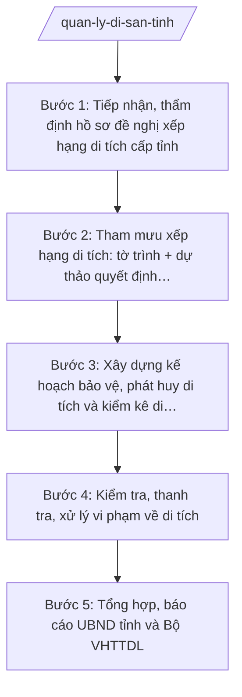

# Skill: Quản lý di sản văn hóa cấp tỉnh

## 2. Khi nào dùng

- Tiếp nhận, thẩm định hồ sơ đề nghị xếp hạng di tích lịch sử – văn hóa cấp tỉnh; tham mưu Chủ tịch UBND tỉnh ký quyết định xếp hạng.
- Lập kế hoạch bảo vệ, tu bổ, chống xuống cấp và phát huy giá trị di tích đã xếp hạng trên địa bàn tỉnh.
- Tổ chức kiểm kê, lập danh mục di sản văn hóa phi vật thể; lập hồ sơ đề nghị đưa vào danh mục quốc gia (trình Bộ VHTTDL).
- Kiểm tra, thanh tra, xử lý vi phạm về bảo vệ di tích (xâm hại, tu bổ sai quy định, lấn chiếm khu vực bảo vệ).
- Tổng hợp báo cáo công tác quản lý di sản gửi UBND tỉnh và Bộ Văn hóa, Thể thao và Du lịch.

## 3. Đầu vào (Input)

| Trường | Mô tả | Bắt buộc |
|--------|-------|----------|
| `de_xuat_xep_hang` | Tờ trình + hồ sơ khoa học di tích đề nghị xếp hạng cấp tỉnh (lý lịch di tích, ảnh, bản đồ khoanh vùng bảo vệ, ý kiến UBND xã nơi có di tích) | Không (có khi phát sinh đề nghị) |
| `danh_muc_di_tich` | Danh sách di tích đã xếp hạng trên địa bàn tỉnh: tên, loại hình, cấp xếp hạng (quốc gia đặc biệt/quốc gia/cấp tỉnh), địa chỉ, tình trạng hiện tại | Có |
| `ke_hoach_bao_ve` | Đề xuất tu bổ, chống xuống cấp, phát huy giá trị di tích trong năm; nguồn kinh phí (ngân sách, xã hội hóa) | Không |
| `kiem_ke_dsvhpvt` | Danh mục di sản văn hóa phi vật thể cần kiểm kê: loại hình, địa bàn phân bố, nghệ nhân/người nắm giữ | Không |
| `phan_anh_vi_pham` | Phản ánh, kiến nghị của tổ chức, cá nhân về hành vi xâm hại di tích | Không |
| `nam_ke_hoach` | Năm lập kế hoạch | Có |
| `thoi_han` | Thời hạn hoàn thành tham mưu/trình duyệt | Có |

## 4. Quy trình

**Bước 1. Tiếp nhận, thẩm định hồ sơ đề nghị xếp hạng di tích cấp tỉnh**

- Làm gì: Tiếp nhận hồ sơ đề nghị xếp hạng di tích cấp tỉnh (qua bộ phận một cửa Sở hoặc UBND xã trình lên); kiểm tra tính đầy đủ, hợp lệ của hồ sơ khoa học (lý lịch di tích, giá trị lịch sử – văn hóa – khoa học, bản đồ khoanh vùng bảo vệ); tổ chức khảo sát thực tế, lấy ý kiến Hội đồng tư vấn (nếu cần).
- Dùng input: `de_xuat_xep_hang`, `danh_muc_di_tich` (đối chiếu tránh trùng lặp).
- Vai trò: Chuyên viên Phòng Quản lý di sản văn hóa (bà Trần Thị M) chủ trì tiếp nhận, thẩm định; Trưởng phòng (ông Bùi Văn X) kiểm tra kết quả thẩm định. AI hỗ trợ: lập checklist hồ sơ xếp hạng, soạn biên bản khảo sát thực tế, tổng hợp phiếu đánh giá giá trị di tích. ⏱ ~7–10 ngày làm việc (ước tính).
- Lưu ý nghiệp vụ: Hồ sơ phải chứng minh được giá trị tiêu biểu của di tích đối với địa phương; khu vực bảo vệ I, II phải được xác định rõ trên bản đồ; không tham mưu xếp hạng di tích không đủ điều kiện, hồ sơ thiếu căn cứ khoa học.
- → Kết quả bước: Báo cáo kết quả thẩm định hồ sơ đề nghị xếp hạng (đạt/không đạt + lý do).

**Bước 2. Tham mưu xếp hạng di tích: tờ trình + dự thảo quyết định trình Chủ tịch UBND tỉnh**

- Làm gì: Trên cơ sở hồ sơ đạt thẩm định, dự thảo Tờ trình của Sở VHTTDL và dự thảo Quyết định xếp hạng di tích cấp tỉnh (tên di tích, địa chỉ, loại hình, phạm vi khu vực bảo vệ; trách nhiệm của Sở, UBND xã nơi có di tích trong quản lý, bảo vệ, phát huy); trình qua các nấc kiểm duyệt của Sở.
- Dùng input: Kết quả bước 1; `de_xuat_xep_hang`.
- Vai trò: Chuyên viên Phòng Quản lý di sản văn hóa soạn dự thảo; Trưởng phòng (ông Bùi Văn X) kiểm tra; Phó Giám đốc Sở (ông Đỗ Văn U) cho ý kiến; Giám đốc Sở (ông Hoàng Văn S) ký tờ trình trình UBND tỉnh. AI hỗ trợ: soạn dự thảo tờ trình và quyết định đúng thể thức NĐ 30/2020/NĐ-CP, rà soát căn cứ pháp lý, lập phiếu trình ký. ⏱ ~5–7 ngày làm việc (ước tính).
- Lưu ý nghiệp vụ: Quyết định xếp hạng di tích cấp tỉnh thuộc thẩm quyền Chủ tịch UBND tỉnh; di tích đề nghị xếp hạng cấp quốc gia/quốc gia đặc biệt thì Sở chỉ lập hồ sơ trình Bộ VHTTDL theo quy định pháp luật chuyên ngành về di sản văn hóa, không tham mưu tỉnh quyết định.
- → Kết quả bước: Tờ trình + dự thảo Quyết định xếp hạng di tích cấp tỉnh đã qua kiểm duyệt nội bộ Sở, sẵn sàng trình UBND tỉnh.

**Bước 3. Xây dựng kế hoạch bảo vệ, phát huy di tích và kiểm kê di sản văn hóa phi vật thể**

- Làm gì: Dự thảo Kế hoạch quản lý, bảo vệ và phát huy giá trị di tích năm: danh mục di tích ưu tiên tu bổ, chống xuống cấp; nhiệm vụ tuyên truyền, phát huy giá trị gắn với du lịch; kế hoạch kiểm kê di sản văn hóa phi vật thể (lập danh mục kiểm kê, điều tra nghệ nhân); dự toán kinh phí.
- Dùng input: `nam_ke_hoach`, `danh_muc_di_tich`, `ke_hoach_bao_ve`, `kiem_ke_dsvhpvt`.
- Vai trò: Chuyên viên Phòng Quản lý di sản văn hóa soạn dự thảo, phối hợp Phòng Kế hoạch – Tài chính Sở về dự toán; Trưởng phòng (ông Bùi Văn X) kiểm tra; Phó Giám đốc Sở (ông Đỗ Văn U) cho ý kiến trước khi Giám đốc Sở phê duyệt kế hoạch ngành. AI hỗ trợ: soạn dự thảo kế hoạch, lập bảng danh mục ưu tiên tu bổ theo mức độ xuống cấp, lập dự toán từ số liệu đầu vào. ⏱ ~7–10 ngày làm việc (ước tính).
- Lưu ý nghiệp vụ: Tu bổ di tích đã xếp hạng phải tuân thủ quy định pháp luật chuyên ngành về di sản văn hóa, không làm thay đổi yếu tố gốc; kinh phí tu bổ từ ngân sách phải phù hợp khả năng cân đối, ưu tiên di tích xuống cấp nghiêm trọng.
- → Kết quả bước: Dự thảo Kế hoạch quản lý, bảo vệ và phát huy giá trị di tích + kiểm kê di sản văn hóa phi vật thể năm.

**Bước 4. Kiểm tra, thanh tra, xử lý vi phạm về di tích**

- Làm gì: Tổ chức kiểm tra định kỳ, đột xuất công tác bảo vệ di tích tại các địa phương; khi phát hiện vi phạm (xâm hại, lấn chiếm khu vực bảo vệ, tu bổ sai quy định) thì lập biên bản, tham mưu xử lý vi phạm hành chính theo thẩm quyền hoặc chuyển cơ quan có thẩm quyền; theo dõi việc khắc phục hậu quả.
- Dùng input: `phan_anh_vi_pham`, kết quả bước 3, `danh_muc_di_tich`.
- Vai trò: Thanh tra Sở chủ trì đoàn kiểm tra, phối hợp Phòng Quản lý di sản văn hóa và UBND xã nơi có di tích; Chánh Thanh tra Sở ký biên bản, tham mưu quyết định xử phạt. AI hỗ trợ: lập kế hoạch kiểm tra, soạn biên bản kiểm tra, dự thảo quyết định xử phạt vi phạm hành chính, lập sổ theo dõi vi phạm. ⏱ ~5–7 ngày làm việc/đợt (ước tính).
- Lưu ý nghiệp vụ: Mọi hành vi xâm hại di tích đã xếp hạng phải được lập biên bản kịp thời; xử phạt đúng thẩm quyền, đúng hành vi; trường hợp vượt thẩm quyền thì chuyển hồ sơ, không tự ý quyết định.
- → Kết quả bước: Biên bản kiểm tra + quyết định xử lý vi phạm (nếu có) + sổ theo dõi vi phạm di tích.

**Bước 5. Tổng hợp, báo cáo UBND tỉnh và Bộ VHTTDL**

- Làm gì: Tổng hợp kết quả thực hiện cả năm (xếp hạng mới, tu bổ, kiểm kê di sản phi vật thể, xử lý vi phạm); soạn Báo cáo công tác quản lý di sản văn hóa năm gửi UBND tỉnh và Bộ VHTTDL; cập nhật cơ sở dữ liệu di sản của tỉnh.
- Dùng input: Kết quả các bước 1–4.
- Vai trò: Chuyên viên Phòng Quản lý di sản văn hóa tổng hợp; Trưởng phòng (ông Bùi Văn X) kiểm tra; Giám đốc Sở (ông Hoàng Văn S) ký báo cáo. AI hỗ trợ: đối chiếu số liệu các bước, soạn dự thảo báo cáo, lập bảng tổng hợp đính kèm. ⏱ ~3–5 ngày làm việc (ước tính).
- Lưu ý nghiệp vụ: Số liệu báo cáo phải khớp với hồ sơ các bước trước; nêu rõ tồn tại, kiến nghị (di tích cần trung ương hỗ trợ, vướng mắc pháp lý).
- → Kết quả bước: Báo cáo công tác quản lý di sản văn hóa năm đã ký, gửi đúng nơi nhận.

## Luồng quy trình (Workflow)

## 5. Đầu ra (Output)

### Sản phẩm

1. **Tờ trình + dự thảo Quyết định xếp hạng di tích cấp tỉnh** (sản phẩm chính) — trình Chủ tịch UBND tỉnh ký ban hành.
2. Kế hoạch quản lý, bảo vệ và phát huy giá trị di tích + kiểm kê di sản văn hóa phi vật thể năm.
3. Báo cáo kết quả thẩm định hồ sơ đề nghị xếp hạng.
4. Biên bản kiểm tra, quyết định xử lý vi phạm về di tích; sổ theo dõi vi phạm.
5. Báo cáo công tác quản lý di sản văn hóa năm gửi UBND tỉnh, Bộ VHTTDL.

**Cấu trúc output chuẩn (Quyết định xếp hạng di tích cấp tỉnh):**
- Thể thức: tuân thủ Nghị định 30/2020/NĐ-CP về công tác văn thư.

1. Quốc hiệu "CỘNG HÒA XÃ HỘI CHỦ NGHĨA VIỆT NAM", Tiêu ngữ "Độc lập – Tự do – Hạnh phúc": CỘNG HÒA XÃ HỘI CHỦ NGHĨA VIỆT NAM / Độc lập – Tự do – Hạnh phúc.
2. Tên cơ quan ban hành: ỦY BAN NHÂN DÂN TỈNH A.
3. Số, ký hiệu văn bản: số/QĐ-UBND.
4. Địa danh, ngày tháng năm ban hành: Tỉnh A, ngày … tháng … năm ….
5. Tên loại và trích yếu nội dung: QUYẾT ĐỊNH / Về việc xếp hạng di tích lịch sử – văn hóa cấp tỉnh …
6. Căn cứ ban hành: Luật Di sản văn hóa (nêu tên); Nghị định số 137/2025/NĐ-CP ngày 12/6/2025; Nghị định số 138/2025/NĐ-CP ngày 12/6/2025; Thông tư số 10/2025/TT-BVHTTDL ngày 19/6/2025 của Bộ Văn hóa, Thể thao và Du lịch.
7. Xét đề nghị của Giám đốc Sở Văn hóa, Thể thao và Du lịch tại Tờ trình số …; QUYẾT ĐỊNH:
   - Điều 1. Xếp hạng di tích cấp tỉnh đối với: (tên di tích, loại hình, địa chỉ, phạm vi khu vực bảo vệ I, II);
   - Điều 2. Giao Sở Văn hóa, Thể thao và Du lịch chủ trì, phối hợp UBND xã … tổ chức quản lý, bảo vệ và phát huy giá trị di tích; nghiêm cấm mọi hoạt động xâm hại di tích và khu vực bảo vệ;
   - Điều 3. Chánh Văn phòng UBND tỉnh, Giám đốc Sở Văn hóa, Thể thao và Du lịch, Chủ tịch UBND xã … và các tổ chức, cá nhân liên quan chịu trách nhiệm thi hành Quyết định này.
8. Nơi nhận (Bộ VHTTDL (báo cáo); Thường trực Tỉnh ủy; Thường trực HĐND tỉnh; Chủ tịch, các Phó Chủ tịch UBND tỉnh; Sở VHTTDL; UBND xã nơi có di tích; lưu VT, VX).
9. Chữ ký, họ tên người ký: TM. ỦY BAN NHÂN DÂN / CHỦ TỊCH / (ký, đóng dấu, ghi rõ họ tên).

## 6. Checklist nghiệm thu

- [ ] Đủ 9 phần theo Cấu trúc output chuẩn mục 5, đúng thứ tự thể thức NĐ 30/2020/NĐ-CP.
- [ ] Hồ sơ khoa học di tích đầy đủ (lý lịch, giá trị, bản đồ khoanh vùng bảo vệ) trước khi tham mưu xếp hạng.
- [ ] Tên, địa chỉ, loại hình di tích trong quyết định khớp 100% với hồ sơ thẩm định.
- [ ] Căn cứ pháp lý ghi đúng: Luật Di sản văn hóa (nêu tên, không bịa số hiệu); số hiệu, ngày ban hành của NĐ 137/2025, NĐ 138/2025, TT 10/2025/TT-BVHTTDL.
- [ ] Phân công trách nhiệm quản lý, bảo vệ di tích sau xếp hạng rõ ràng (Sở, UBND xã).
- [ ] Kế hoạch năm có danh mục ưu tiên tu bổ theo mức độ xuống cấp và dự toán kinh phí cụ thể.
- [ ] Vi phạm về di tích được lập biên bản, xử lý đúng thẩm quyền, có theo dõi khắc phục.
- [ ] Đã qua đủ human gate: chuyên viên soạn → Trưởng phòng kiểm tra → Phó Giám đốc Sở → Giám đốc Sở ký tờ trình → Chủ tịch UBND tỉnh ký quyết định.

## 7. Ví dụ mô phỏng

*Dữ liệu dưới đây là giả lập 100% phục vụ minh họa.*

**Input mẫu:**

| Trường | Giá trị mẫu |
|--------|-------------|
| de_xuat_xep_hang | Tờ trình của UBND xã A đề nghị xếp hạng di tích cấp tỉnh đối với Đình làng Hạ (thôn 2, xã A): đình có niên đại khoảng 200 năm, còn giữ nguyên kiến trúc gỗ, gắn với lễ hội truyền thống hằng năm |
| danh_muc_di_tich | 12 di tích đã xếp hạng (02 quốc gia, 10 cấp tỉnh), trong đó Chùa Phúc An (xã A) là di tích cấp tỉnh |
| nam_ke_hoach | 2027 |
| thoi_han | 30/6/2027 |

**Output mẫu (dự thảo Quyết định):**

CỘNG HÒA XÃ HỘI CHỦ NGHĨA VIỆT NAM
Độc lập – Tự do – Hạnh phúc
---------------

ỦY BAN NHÂN DÂN TỈNH A

Số: 1234/QĐ-UBND

Tỉnh A, ngày 20 tháng 6 năm 2027

**QUYẾT ĐỊNH**
**Về việc xếp hạng di tích lịch sử – văn hóa cấp tỉnh đối với Đình làng Hạ, xã A**

*Căn cứ* Luật Di sản văn hóa; Nghị định số 137/2025/NĐ-CP ngày 12/6/2025 của Chính phủ về phân định thẩm quyền của chính quyền địa phương 02 cấp trong lĩnh vực văn hóa, thể thao và du lịch; Nghị định số 138/2025/NĐ-CP ngày 12/6/2025 của Chính phủ về phân quyền, phân cấp trong lĩnh vực văn hóa, thể thao và du lịch; Thông tư số 10/2025/TT-BVHTTDL ngày 19/6/2025 của Bộ Văn hóa, Thể thao và Du lịch hướng dẫn chức năng, nhiệm vụ, quyền hạn của Sở Văn hóa, Thể thao và Du lịch;

*Xét* đề nghị của Giám đốc Sở Văn hóa, Thể thao và Du lịch tại Tờ trình số 456/TTr-SVHTTDL ngày 05/6/2027,

**QUYẾT ĐỊNH:**

**Điều 1.** Xếp hạng di tích lịch sử – văn hóa cấp tỉnh đối với Đình làng Hạ, thôn 2, xã A, tỉnh A (loại hình: di tích kiến trúc nghệ thuật; khu vực bảo vệ I: khuôn viên đình 2.000 m²; khu vực bảo vệ II: vành đai 20 m quanh khu vực I).

**Điều 2.** Giao Sở Văn hóa, Thể thao và Du lịch chủ trì, phối hợp UBND xã A tổ chức quản lý, bảo vệ và phát huy giá trị di tích theo quy định pháp luật về di sản văn hóa; nghiêm cấm mọi hoạt động xâm hại di tích và khu vực bảo vệ.

**Điều 3.** Chánh Văn phòng UBND tỉnh, Giám đốc Sở Văn hóa, Thể thao và Du lịch, Chủ tịch UBND xã A và các tổ chức, cá nhân liên quan chịu trách nhiệm thi hành Quyết định này./.

***Nơi nhận:***
- Bộ Văn hóa, Thể thao và Du lịch (báo cáo);
- Thường trực Tỉnh ủy; Thường trực HĐND tỉnh;
- Chủ tịch, các Phó Chủ tịch UBND tỉnh;
- Sở Văn hóa, Thể thao và Du lịch;
- UBND xã A;
- Lưu: VT, VX.

**TM. ỦY BAN NHÂN DÂN**
**CHỦ TỊCH**

*(Ký, đóng dấu)*

**Phạm Văn P**

## 8. Human gate (người kiểm duyệt)

- Chuyên viên Phòng Quản lý di sản văn hóa (bà Trần Thị M) soạn hồ sơ thẩm định, dự thảo tờ trình/quyết định, chịu trách nhiệm về tính chính xác của hồ sơ khoa học di tích.
- Trưởng phòng Quản lý di sản văn hóa (ông Bùi Văn X) kiểm tra nội dung, thể thức ở bước 1–3; trả lại sửa nếu hồ sơ chưa đủ điều kiện.
- Phó Giám đốc Sở (ông Đỗ Văn U) cho ý kiến trước khi trình Giám đốc Sở.
- Giám đốc Sở (ông Hoàng Văn S) ký tờ trình trình UBND tỉnh.
- Chủ tịch UBND tỉnh (ông Phạm Văn P) ký ban hành Quyết định xếp hạng di tích cấp tỉnh. Quyết định chỉ có hiệu lực sau khi Chủ tịch ký.

## 9. Giới hạn (guardrails)

- AI KHÔNG quyết định xếp hạng di tích thay Chủ tịch UBND tỉnh; không tự ký, đóng dấu, phát hành quyết định.
- AI không bịa hồ sơ khoa học, giá trị lịch sử, niên đại của di tích; không tham mưu xếp hạng khi hồ sơ chưa đủ điều kiện.
- AI không bịa căn cứ pháp lý, số hiệu văn bản; không viện dẫn văn bản đã hết hiệu lực (không dùng TT 08/2021/TT-BVHTTDL đã bị TT 10/2025/TT-BVHTTDL thay thế).
- AI không đề xuất tu bổ làm thay đổi yếu tố gốc của di tích đã xếp hạng.
- Việc xếp hạng di tích cấp quốc gia/quốc gia đặc biệt thuộc thẩm quyền trung ương — AI không tham mưu tỉnh quyết định những việc vượt thẩm quyền.

## 10. Căn cứ & lưu ý

- Thông tư 10/2025/TT-BVHTTDL ngày 19/6/2025 (hiệu lực 01/7/2025) của Bộ VHTTDL — hướng dẫn chức năng, nhiệm vụ của Sở Văn hóa, Thể thao và Du lịch (thay thế TT 08/2021/TT-BVHTTDL).
- Nghị định 137/2025/NĐ-CP ngày 12/6/2025 — phân định thẩm quyền của chính quyền địa phương 02 cấp trong lĩnh vực văn hóa, thể thao và du lịch.
- Nghị định 138/2025/NĐ-CP ngày 12/6/2025 — phân quyền, phân cấp trong lĩnh vực văn hóa, thể thao và du lịch.
- Luật Di sản văn hóa (chỉ nêu tên, không kèm số hiệu); các quy định chi tiết về hồ sơ, trình tự xếp hạng di tích thực hiện theo quy định pháp luật chuyên ngành về di sản văn hóa.
- Nghị định 150/2025/NĐ-CP ngày 12/6/2025 (hiệu lực 16/6/2025) — tổ chức Sở Văn hóa, Thể thao và Du lịch thuộc UBND cấp tỉnh.
- Nghị định 30/2020/NĐ-CP — thể thức văn bản hành chính.
- Lưu ý: xếp hạng di tích cấp tỉnh thuộc thẩm quyền Chủ tịch UBND tỉnh; xếp hạng cấp quốc gia trở lên thuộc thẩm quyền trung ương, Sở chỉ lập hồ sơ trình Bộ VHTTDL.
