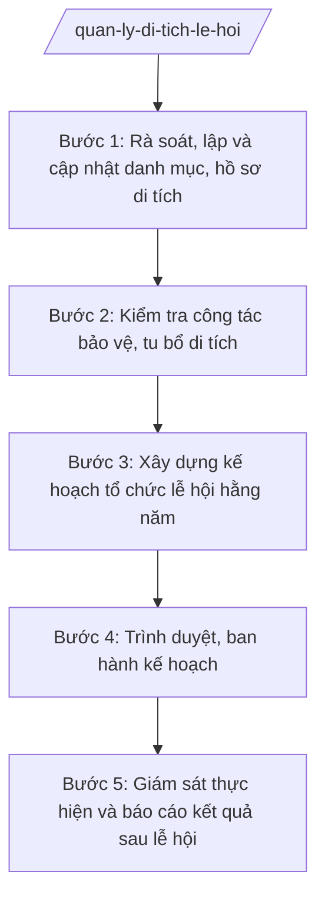

# Skill: Quản lý di tích, lễ hội

## 2. Khi nào dùng

- Lập, cập nhật danh mục và hồ sơ di tích lịch sử – văn hóa trên địa bàn xã (đình, đền, chùa, nhà thờ họ, di tích cách mạng...).
- Kiểm tra định kỳ công tác bảo vệ, giữ gìn, tu bổ di tích; phát hiện, ngăn chặn hành vi xâm hại di tích.
- Xây dựng kế hoạch tổ chức lễ hội truyền thống hằng năm: nội dung lễ và hội, an ninh trật tự, vệ sinh môi trường, phòng cháy chữa cháy, quản lý thu chi tiền công đức.
- Báo cáo tình hình quản lý di tích, lễ hội gửi Sở VHTTDL tỉnh A và UBND xã.

## 3. Đầu vào (Input)

| Trường | Mô tả | Bắt buộc |
|--------|-------|----------|
| `nam_ke_hoach` | Năm lập kế hoạch (vd: 2027) | Có |
| `danh_muc_di_tich` | Danh sách di tích: tên, loại (đình/đền/chùa/di tích cách mạng...), cấp xếp hạng (quốc gia/tỉnh/chưa xếp hạng), địa chỉ thôn, tình trạng hiện tại | Có |
| `ho_so_di_tich` | Hồ sơ hiện có của từng di tích (lý lịch, ảnh, bản đồ khoanh vùng bảo vệ — nếu có) | Không |
| `danh_muc_le_hoi` | Danh sách lễ hội: tên lễ hội, di tích gắn với lễ hội, thời gian tổ chức, quy mô, đơn vị chủ trì | Có |
| `ke_hoach_tu_bo` | Hạng mục tu bổ, tôn tạo di tích dự kiến trong năm; nguồn kinh phí (ngân sách, xã hội hóa, công đức) | Không |
| `du_toan_thu_chi` | Dự toán thu (công đức, tài trợ) và chi tổ chức lễ hội | Không |
| `thoi_han` | Thời hạn ban hành kế hoạch năm | Có |

## 4. Quy trình

**Bước 1. Rà soát, lập và cập nhật danh mục, hồ sơ di tích**

- Làm gì: Rà soát toàn bộ di tích trên địa bàn; lập/cập nhật danh mục (tên, loại, cấp xếp hạng, hiện trạng); bổ sung, hoàn thiện hồ sơ di tích còn thiếu (lý lịch, ảnh chụp, sơ đồ vị trí).
- Dùng input: `danh_muc_di_tich`, `ho_so_di_tich`.
- Vai trò: Công chức VH-XH phụ trách văn hóa (bà Trần Thị H) chủ trì rà soát thực địa, phối hợp người trông coi di tích và trưởng thôn. AI hỗ trợ: thiết kế biểu mẫu lý lịch di tích chuẩn, tổng hợp thành bảng danh mục, soạn dự thảo lý lịch di tích từ thông tin thu thập được. ⏱ 5–7 ngày (ước tính) làm việc.
- Lưu ý nghiệp vụ: Ghi đúng cấp xếp hạng di tích (cấp quốc gia/tỉnh do cấp có thẩm quyền xếp hạng; xã chỉ quản lý, bảo vệ); di tích chưa xếp hạng vẫn phải đưa vào danh mục theo dõi của xã.
- → Kết quả bước: Bảng danh mục di tích toàn xã + hồ sơ (lý lịch) từng di tích.

**Bước 2. Kiểm tra công tác bảo vệ, tu bổ di tích**

- Làm gì: Kiểm tra thực tế tình trạng di tích (kết cấu, hiện vật, cảnh quan, vệ sinh); ghi nhận hạng mục xuống cấp cần tu bổ; kiểm tra việc chấp hành quy định bảo vệ di tích của tổ chức, cá nhân được giao quản lý; lập biên bản kiểm tra.
- Dùng input: Kết quả bước 1; `ke_hoach_tu_bo`.
- Vai trò: Công chức VH-XH phụ trách văn hóa chủ trì, Trưởng phòng VH-XH (ông Vũ Văn E) tham gia kiểm tra các di tích xếp hạng. AI hỗ trợ: lập checklist kiểm tra bảo vệ di tích, tổng hợp hạng mục cần tu bổ thành danh mục ưu tiên, soạn dự thảo biên bản kiểm tra. ⏱ 3–5 ngày (ước tính) làm việc.
- Lưu ý nghiệp vụ: Mọi hoạt động tu bổ di tích xếp hạng phải tuân thủ quy định pháp luật về di sản, có ý kiến của cơ quan chuyên môn cấp tỉnh trước khi thực hiện; không tự ý sửa chữa làm thay đổi yếu tố gốc của di tích.
- → Kết quả bước: Biên bản kiểm tra di tích + danh mục hạng mục cần tu bổ (có thứ tự ưu tiên).

**Bước 3. Xây dựng kế hoạch tổ chức lễ hội hằng năm**

- Làm gì: Dự thảo Kế hoạch quản lý, bảo vệ di tích và tổ chức lễ hội năm: nội dung phần lễ, phần hội; phương án bảo đảm an ninh trật tự, vệ sinh môi trường, phòng cháy chữa cháy, an toàn thực phẩm; quy chế quản lý, sử dụng tiền công đức, tài trợ; phân công nhiệm vụ các lực lượng (Công an xã, y tế, đoàn thể, thôn).
- Dùng input: `nam_ke_hoach`, `danh_muc_le_hoi`, `du_toan_thu_chi`, kết quả bước 1–2, `thoi_han`.
- Vai trò: Công chức VH-XH phụ trách văn hóa soạn dự thảo, phối hợp Công an xã về phương án ANTT. AI hỗ trợ: soạn dự thảo kế hoạch theo thể thức NĐ 30/2020/NĐ-CP, lập bảng phân công nhiệm vụ theo đầu mối/thời gian, lập bảng dự toán thu chi từ số liệu đầu vào. ⏱ 3–4 ngày (ước tính) làm việc.
- Lưu ý nghiệp vụ: Kế hoạch phải nêu rõ cơ chế quản lý thu chi công đức công khai, minh bạch; các hoạt động mê tín dị đoan, cờ bạc, chèo kéo du khách trong lễ hội phải có biện pháp ngăn chặn cụ thể; không tổ chức lễ hội vượt quy mô khi chưa được cấp có thẩm quyền cho phép.
- → Kết quả bước: Dự thảo Kế hoạch quản lý, bảo vệ di tích và tổ chức lễ hội năm + phụ lục (danh mục di tích, lịch lễ hội, dự toán, phân công).

**Bước 4. Trình duyệt, ban hành kế hoạch**

- Làm gì: Trình dự thảo kế hoạch qua các nấc kiểm duyệt; ký ban hành; gửi kế hoạch đến các đơn vị phối hợp và niêm yết công khai tại di tích/trụ sở UBND xã.
- Dùng input: Dự thảo kế hoạch ở bước 3.
- Vai trò: Công chức VH-XH phụ trách văn hóa trình; Trưởng phòng VH-XH (ông Vũ Văn E) kiểm tra nội dung, thể thức; Chủ tịch UBND xã (ông Nguyễn Văn A) ký duyệt, ban hành. AI hỗ trợ: rà soát thể thức lần cuối, lập danh sách nơi nhận, lập phiếu trình ký. ⏱ 1–2 ngày (ước tính) làm việc.
- Lưu ý nghiệp vụ: Kế hoạch tổ chức lễ hội lớn cần gửi Sở VHTTDL tỉnh A và Công an xã để phối hợp trước ngày tổ chức ít nhất 15 ngày; kế hoạch chỉ có hiệu lực sau khi Chủ tịch ký.
- → Kết quả bước: Kế hoạch đã ký ban hành, gửi đúng nơi nhận, niêm yết công khai.

**Bước 5. Giám sát thực hiện và báo cáo kết quả sau lễ hội**

- Làm gì: Theo dõi việc thực hiện kế hoạch trong mùa lễ hội (ANTT, VSMT, thu chi công đức); tổng hợp báo cáo kết quả tổ chức lễ hội và công tác quản lý di tích năm, công khai quyết toán thu chi.
- Dùng input: Kế hoạch đã ban hành; số liệu thực tế thu chi, tình hình ANTT/VSMT trong lễ hội.
- Vai trò: Công chức VH-XH phụ trách văn hóa tổng hợp, Trưởng phòng VH-XH kiểm tra trước khi trình Chủ tịch ký báo cáo. AI hỗ trợ: đối chiếu thu chi thực tế với dự toán, soạn dự thảo báo cáo kết quả, lập bảng công khai quyết toán. ⏱ 3–5 ngày (ước tính) làm việc sau mỗi lễ hội lớn / cuối năm.
- Lưu ý nghiệp vụ: Quyết toán thu chi công đức phải công khai tại di tích và trụ sở UBND xã; mọi khoản thu chi phải có chứng từ hợp lệ.
- → Kết quả bước: Báo cáo kết quả tổ chức lễ hội và quản lý di tích năm + bảng công khai quyết toán thu chi.

## Luồng quy trình (Workflow)

## 5. Đầu ra (Output)

### Sản phẩm

1. **Kế hoạch quản lý, bảo vệ di tích và tổ chức lễ hội hằng năm** (sản phẩm chính) — văn bản hành chính đúng thể thức, kèm phụ lục: danh mục di tích; lịch tổ chức lễ hội; dự toán thu chi; bảng phân công nhiệm vụ.
2. Bảng danh mục và hồ sơ (lý lịch) di tích trên địa bàn xã.
3. Biên bản kiểm tra công tác bảo vệ, tu bổ di tích.
4. Báo cáo kết quả tổ chức lễ hội và quản lý di tích năm + công khai quyết toán thu chi công đức.

### Cấu trúc output chuẩn (Kế hoạch quản lý, bảo vệ di tích và tổ chức lễ hội năm)

1. Quốc hiệu – Tiêu ngữ: CỘNG HÒA XÃ HỘI CHỦ NGHĨA VIỆT NAM / Độc lập – Tự do – Hạnh phúc. (đúng thể thức NĐ 30/2020/NĐ-CP)
2. Tên cơ quan ban hành: ỦY BAN NHÂN DÂN XÃ A.
3. Số, ký hiệu văn bản: số/KH-UBND.
4. Địa danh, ngày tháng năm ban hành: Xã A, ngày … tháng … năm ….
5. Tên loại và trích yếu nội dung: KẾ HOẠCH / Quản lý, bảo vệ di tích và tổ chức lễ hội năm … trên địa bàn xã A.
6. Căn cứ ban hành: Thông tư 10/2025/TT-BVHTTDL; Nghị định 137/2025/NĐ-CP; Nghị định 138/2025/NĐ-CP (ghi rõ số hiệu, ngày ban hành).
7. Nội dung chính:
   - I. Mục đích, yêu cầu;
   - II. Quản lý, bảo vệ di tích (danh mục di tích; nhiệm vụ bảo vệ, tu bổ; phân công trông coi);
   - III. Tổ chức lễ hội (danh mục lễ hội, thời gian, quy mô; nội dung phần lễ, phần hội; phương án ANTT, VSMT, PCCC, ATTP);
   - IV. Quản lý thu chi tiền công đức, tài trợ (nguyên tắc công khai, minh bạch; trách nhiệm quản lý);
   - V. Kinh phí thực hiện;
   - VI. Tổ chức thực hiện (phân công nhiệm vụ cụ thể theo đầu mối, thời gian).
8. Nơi nhận (Sở VHTTDL tỉnh A; Thường trực Đảng ủy, HĐND xã; Chủ tịch, các Phó Chủ tịch UBND xã; Công an xã; các thôn có di tích, lễ hội; lưu VT, VH-XH).
9. Chữ ký, họ tên người ký: TM. ỦY BAN NHÂN DÂN / CHỦ TỊCH / (ký, đóng dấu, ghi rõ họ tên).

## 6. Checklist nghiệm thu

- [ ] Đủ 9 phần theo Cấu trúc output chuẩn mục 4, đúng thứ tự thể thức NĐ 30/2020/NĐ-CP.
- [ ] Danh mục di tích đầy đủ (tên, loại, cấp xếp hạng, địa chỉ), không bỏ sót di tích đã biết trên địa bàn.
- [ ] Kế hoạch có đủ phương án ANTT, VSMT, PCCC, ATTP cho từng lễ hội.
- [ ] Quy định quản lý thu chi công đức rõ ràng, bảo đảm công khai, minh bạch.
- [ ] Có biện pháp ngăn chặn mê tín dị đoan, cờ bạc, chèo kéo trong lễ hội.
- [ ] Căn cứ pháp lý ghi đúng số hiệu Thông tư 10/2025/TT-BVHTTDL, NĐ 137/2025/NĐ-CP, NĐ 138/2025/NĐ-CP.
- [ ] Phân công nhiệm vụ cụ thể đến từng đầu mối, có thời gian thực hiện.
- [ ] Số/ký hiệu, ngày tháng, nơi nhận, chữ ký đầy đủ; không sai tên đơn vị/cá nhân.
- [ ] Đã qua đủ 3 nấc human gate: công chức soạn → Trưởng phòng kiểm tra → Chủ tịch ký duyệt.

## 7. Ví dụ mô phỏng

*Dữ liệu dưới đây là giả lập 100% phục vụ minh họa.*

**Input mẫu:**

| Trường | Giá trị mẫu |
|--------|-------------|
| nam_ke_hoach | 2027 |
| danh_muc_di_tich | Đình làng Đông (chưa xếp hạng, thôn 1); Chùa Phúc An (cấp tỉnh, thôn 2); Nhà bia tưởng niệm liệt sĩ (thôn 3) |
| danh_muc_le_hoi | Lễ hội đình làng Đông (rằm tháng Giêng, ~2.000 người); Lễ Phật đản chùa Phúc An (tháng 4 âm lịch, ~1.500 người) |
| ke_hoach_tu_bo | Tu bổ mái đình làng Đông; sơn lại nhà bia tưởng niệm |
| du_toan_thu_chi | Thu công đức, tài trợ: 300 triệu đồng; chi tổ chức: 280 triệu đồng |
| thoi_han | 15/12/2026 |

**Output mẫu:**

CỘNG HÒA XÃ HỘI CHỦ NGHĨA VIỆT NAM
Độc lập – Tự do – Hạnh phúc
---------------

ỦY BAN NHÂN DÂN XÃ A

Số: 45/KH-UBND

Xã A, ngày 10 tháng 12 năm 2026

**KẾ HOẠCH**
**Quản lý, bảo vệ di tích và tổ chức lễ hội năm 2027 trên địa bàn xã A**

*Căn cứ* Thông tư số 10/2025/TT-BVHTTDL ngày 19/6/2025 của Bộ Văn hóa, Thể thao và Du lịch hướng dẫn chức năng, nhiệm vụ, quyền hạn của Sở Văn hóa, Thể thao và Du lịch và Phòng Văn hóa – Xã hội; Nghị định số 137/2025/NĐ-CP ngày 12/6/2025 về phân định thẩm quyền của chính quyền địa phương 02 cấp trong lĩnh vực văn hóa, thể thao và du lịch; Nghị định số 138/2025/NĐ-CP ngày 12/6/2025 về phân quyền, phân cấp trong lĩnh vực văn hóa, thể thao và du lịch;

UBND xã A ban hành Kế hoạch quản lý, bảo vệ di tích và tổ chức lễ hội năm 2027 như sau:

**I. MỤC ĐÍCH, YÊU CẦU**

Bảo vệ, phát huy giá trị các di tích trên địa bàn; tổ chức lễ hội truyền thống an toàn, lành mạnh, đúng quy định pháp luật.

**II. QUẢN LÝ, BẢO VỆ DI TÍCH**

1. Danh mục di tích trên địa bàn xã (03 di tích): Đình làng Đông (thôn 1, chưa xếp hạng); Chùa Phúc An (thôn 2, di tích cấp tỉnh); Nhà bia tưởng niệm liệt sĩ (thôn 3).
2. Nhiệm vụ năm 2027: tu bổ mái Đình làng Đông; sơn lại Nhà bia tưởng niệm liệt sĩ; việc tu bổ di tích cấp tỉnh (Chùa Phúc An) thực hiện khi có ý kiến của Sở VHTTDL tỉnh A.
3. Phân công: trưởng các thôn phối hợp người trông coi di tích chịu trách nhiệm bảo vệ hằng ngày; Phòng VH-XH kiểm tra định kỳ mỗi quý 01 lần.

**III. TỔ CHỨC LỄ HỘI**

1. Lễ hội đình làng Đông: rằm tháng Giêng, quy mô khoảng 2.000 người; Lễ Phật đản chùa Phúc An: tháng 4 âm lịch, quy mô khoảng 1.500 người.
2. Phương án bảo đảm: Công an xã chủ trì ANTT, phân luồng giao thông; thôn đăng cai bố trí vệ sinh môi trường, thu gom rác; trạm y tế xã trực sơ cứu; nghiêm cấm mê tín dị đoan, cờ bạc, chèo kéo du khách.

**IV. QUẢN LÝ THU CHI TIỀN CÔNG ĐỨC, TÀI TRỢ**

Mọi khoản thu công đức, tài trợ phải ghi chép đầy đủ, có chứng từ; công khai thu chi tại di tích và trụ sở UBND xã trong 07 ngày sau lễ hội; Ban quản lý di tích chịu trách nhiệm trước UBND xã.

**V. KINH PHÍ THỰC HIỆN**

Dự toán thu 300 triệu đồng, chi 280 triệu đồng (chi tiết tại phụ lục kèm theo); phần chênh lệch bổ sung quỹ tu bổ di tích xã.

**VI. TỔ CHỨC THỰC HIỆN**

Phòng Văn hóa – Xã hội chủ trì, phối hợp Công an xã, các thôn và Ban quản lý di tích triển khai kế hoạch; báo cáo UBND xã kết quả sau mỗi lễ hội./.

***Nơi nhận:***
- Sở VHTTDL tỉnh A;
- Thường trực Đảng ủy xã;
- Thường trực HĐND xã;
- Chủ tịch, các Phó Chủ tịch UBND xã;
- Công an xã; Trạm Y tế xã;
- Trưởng các thôn 1, 2, 3;
- Lưu: VT, VH-XH.

**TM. ỦY BAN NHÂN DÂN**
**CHỦ TỊCH**

*(Ký, đóng dấu)*

**Nguyễn Văn A**

## 8. Human gate (người kiểm duyệt)

- Công chức VH-XH phụ trách văn hóa (bà Trần Thị H) soạn dự thảo kế hoạch, chịu trách nhiệm về danh mục di tích, lễ hội.
- Trưởng phòng Văn hóa – Xã hội (ông Vũ Văn E) kiểm tra nội dung, thể thức ở bước 4; trả lại sửa nếu chưa đạt.
- Chủ tịch UBND xã (ông Nguyễn Văn A) ký duyệt, ban hành kế hoạch ở bước 4. Kế hoạch chỉ có hiệu lực sau khi Chủ tịch ký.

## 9. Giới hạn (guardrails)

- AI KHÔNG quyết định xếp hạng di tích, phê duyệt tu bổ di tích xếp hạng thay cơ quan có thẩm quyền.
- AI không tự ký, đóng dấu, phát hành kế hoạch dưới danh nghĩa UBND xã.
- AI không bịa danh mục di tích, số liệu thu chi công đức, cấp xếp hạng di tích.
- AI không bịa căn cứ pháp lý, số hiệu văn bản; không viện dẫn văn bản đã hết hiệu lực (không dùng TT 08/2021/TT-BVHTTDL đã bị TT 10/2025/TT-BVHTTDL thay thế).
- AI không đề xuất nội dung lễ hội trái thuần phong mỹ tục, mê tín dị đoan.

## 10. Căn cứ & lưu ý

- Thông tư 10/2025/TT-BVHTTDL ngày 19/6/2025 (hiệu lực 01/7/2025) của Bộ VHTTDL — hướng dẫn chức năng, nhiệm vụ của Phòng Văn hóa – Xã hội trong các lĩnh vực thuộc phạm vi quản lý của Bộ (thay thế TT 08/2021/TT-BVHTTDL); chính quyền cấp xã được giao 15 nhiệm vụ ngành VHTTDL.
- Nghị định 137/2025/NĐ-CP ngày 12/6/2025 — phân định thẩm quyền của chính quyền địa phương 02 cấp trong lĩnh vực văn hóa, thể thao và du lịch.
- Nghị định 138/2025/NĐ-CP ngày 12/6/2025 — phân quyền, phân cấp trong lĩnh vực văn hóa, thể thao và du lịch.
- Nghị định 150/2025/NĐ-CP ngày 12/6/2025 (hiệu lực 16/6/2025) — tổ chức Phòng Văn hóa – Xã hội thuộc UBND cấp xã.
- Nghị định 370/2025/NĐ-CP ngày 31/12/2025 (hiệu lực 01/01/2026) — sửa đổi, bổ sung NĐ 150/2025/NĐ-CP.
- Nghị định 30/2020/NĐ-CP — thể thức văn bản hành chính.
- Lưu ý: việc xếp hạng di tích và thẩm định tu bổ di tích xếp hạng thuộc thẩm quyền cấp tỉnh/trung ương; xã thực hiện quản lý, bảo vệ theo phân cấp.
