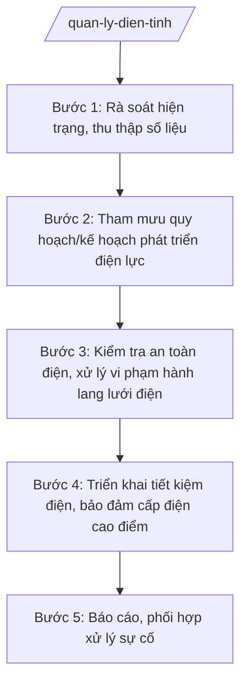

# Skill: Quản lý an toàn điện, phát triển lưới điện

## 2. Khi nào dùng

- Khi tham mưu quy hoạch/kế hoạch phát triển điện lực tỉnh.
- Khi kiểm tra an toàn điện, xử lý vi phạm hành lang bảo vệ an toàn lưới điện.
- Khi triển khai chương trình tiết kiệm điện, điện nông thôn.
- Khi phối hợp xử lý sự cố lưới điện, cấp điện mùa khô/nắng nóng.

## 3. Đầu vào (Input)

| Trường | Mô tả | Bắt buộc |
|--------|-------|----------|
| `loai_viec` | quy hoạch / kiểm tra an toàn / tiết kiệm điện / xử lý sự cố / báo cáo | Có |
| `dia_ban` | Khu vực, công trình điện liên quan | Không |
| `noi_dung` | Mô tả vụ việc/yêu cầu cụ thể | Không |
| `don_vi_dien_luc` | Công ty điện lực, đơn vị quản lý vận hành | Không |

## 4. Quy trình

**Bước 1. Rà soát hiện trạng, thu thập số liệu**
- Làm gì: Thu thập số liệu phụ tải, lưới điện, hộ chưa có điện; rà soát quy hoạch điện lực hiện hành.
- Dùng input: `loai_viec`, `dia_ban`, `don_vi_dien_luc`.
- Vai trò: Chuyên viên Phòng Quản lý năng lượng (hoặc phòng được giao) tổng hợp; AI hỗ trợ lập bảng số liệu, so sánh với chỉ tiêu quy hoạch — ⏱ 3 ngày.
- Lưu ý nghiệp vụ: Số liệu lấy từ công ty điện lực + UBND cấp xã; đối chiếu quy hoạch điện quốc gia/quy hoạch tỉnh.
- → Kết quả bước: Báo cáo hiện trạng điện lực.

**Bước 2. Tham mưu quy hoạch/kế hoạch phát triển điện lực**
- Làm gì: Dự thảo quy hoạch/kế hoạch phát triển điện lực tỉnh (nguồn, lưới điện, cấp điện nông thôn); lấy ý kiến các sở, địa phương.
- Dùng input: Toàn bộ kết quả bước 1.
- Vai trò: Trưởng phòng chủ trì; AI hỗ trợ soạn dự thảo, tổng hợp ý kiến — ⏱ 15–20 ngày.
- Lưu ý nghiệp vụ: Phù hợp quy hoạch điện lực quốc gia; ưu tiên cấp điện vùng sâu, vùng xa, hải đảo (đặc khu).
- → Kết quả bước: Dự thảo quy hoạch/kế hoạch + tờ trình UBND tỉnh.

**Bước 3. Kiểm tra an toàn điện, xử lý vi phạm hành lang lưới điện**
- Làm gì: Kiểm tra việc chấp hành quy định an toàn điện; phát hiện, xử lý vi phạm hành lang bảo vệ an toàn công trình lưới điện (xây dựng, trồng cây, thả diều...).
- Dùng input: `dia_ban`, `noi_dung`.
- Vai trò: Đoàn kiểm tra liên ngành (Sở Công Thương, điện lực, UBND cấp xã); AI hỗ trợ lập biên bản, tra cứu khung xử phạt — ⏱ theo vụ việc.
- Lưu ý nghiệp vụ: Vi phạm hành lang lưới điện cao áp có nguy cơ tai nạn — xử lý kiên quyết, kịp thời; tuyên truyền trước, xử phạt sau đối với vi phạm lần đầu nhẹ.
- → Kết quả bước: Biên bản kiểm tra + quyết định xử phạt (nếu có).

**Bước 4. Triển khai tiết kiệm điện, bảo đảm cấp điện cao điểm**
- Làm gì: Xây dựng kế hoạch tiết kiệm điện hằng năm; đôn đốc cơ quan, doanh nghiệp thực hiện; phương án cấp điện mùa nắng nóng, mùa khô.
- Dùng input: `loai_viec`, `don_vi_dien_luc`.
- Vai trò: Chuyên viên theo dõi; AI hỗ trợ soạn kế hoạch, văn bản đôn đốc — ⏱ 5 ngày.
- Lưu ý nghiệp vụ: Không cắt điện sinh hoạt diện rộng khi chưa có phương án được duyệt; ưu tiên điện cho y tế, cấp nước.
- → Kết quả bước: Kế hoạch tiết kiệm điện + phương án bảo đảm cấp điện.

**Bước 5. Báo cáo, phối hợp xử lý sự cố**
- Làm gì: Tiếp nhận thông tin sự cố lưới điện lớn; phối hợp điện lực, chính quyền địa phương khắc phục; báo cáo UBND tỉnh, Bộ Công Thương.
- Dùng input: `noi_dung`.
- Vai trò: Lãnh đạo Sở chỉ đạo; AI hỗ trợ tổng hợp thông tin, dự thảo báo cáo nhanh — ⏱ ngay khi xảy ra.
- Lưu ý nghiệp vụ: Báo cáo nhanh trong 24h đối với sự cố ảnh hưởng diện rộng.
- → Kết quả bước: Báo cáo nhanh sự cố + báo cáo khắc phục.

## Luồng quy trình (Workflow)

## 5. Đầu ra (Output)

- Tờ trình + dự thảo quy hoạch/kế hoạch phát triển điện lực tỉnh.
- Biên bản kiểm tra an toàn điện; quyết định xử phạt VPHC (nếu có).
- Kế hoạch tiết kiệm điện hằng năm.
- Báo cáo hiện trạng, báo cáo sự cố lưới điện.

**Cấu trúc output chuẩn (Kế hoạch tiết kiệm điện):**
- Thể thức: tuân thủ Nghị định 30/2020/NĐ-CP về công tác văn thư.

1. Quốc hiệu "CỘNG HÒA XÃ HỘI CHỦ NGHĨA VIỆT NAM", Tiêu ngữ "Độc lập – Tự do – Hạnh phúc"; tên cơ quan (Sở Công Thương tỉnh A); số, ký hiệu.
2. Tên loại: **KẾ HOẠCH** — thực hiện tiết kiệm điện năm [năm] trên địa bàn tỉnh A.
3. Mục đích, yêu cầu; mục tiêu tiết kiệm cụ thể.
4. Nhiệm vụ: cơ quan hành chính, chiếu sáng công cộng, doanh nghiệp sản xuất, hộ gia đình.
5. Giải pháp thực hiện.
6. Phân công: Sở Công Thương chủ trì; công ty điện lực, UBND cấp xã, các sở phối hợp.
7. Kinh phí; chế độ báo cáo.
8. Nơi nhận; chữ ký Giám đốc Sở.

> **Checklist thể thức văn bản theo NĐ 30/2020/NĐ-CP** — đối chiếu trước khi trình ký:
> 1. Quốc hiệu và Tiêu ngữ.
> 2. Tên cơ quan, tổ chức ban hành văn bản.
> 3. Số, ký hiệu của văn bản.
> 4. Địa danh và thời gian ban hành văn bản.
> 5. Tên loại và trích yếu nội dung văn bản.
> 6. Nội dung văn bản.
> 7. Chức vụ, họ tên và chữ ký của người có thẩm quyền.
> 8. Dấu, chữ ký số của cơ quan, tổ chức.
> 9. Nơi nhận (kèm Phụ lục nếu có).

## 6. Checklist nghiệm thu

- [ ] Quy hoạch/kế hoạch phù hợp quy hoạch điện lực quốc gia và quy hoạch tỉnh.
- [ ] Kiểm tra an toàn điện có biên bản, xử lý đúng thẩm quyền, đúng khung phạt.
- [ ] Vi phạm hành lang lưới điện được xử lý dứt điểm, không để tái diễn.
- [ ] Kế hoạch tiết kiệm điện có mục tiêu định lượng, phân công rõ.
- [ ] Sự cố diện rộng được báo cáo nhanh trong 24h.
- [ ] Văn bản đúng thể thức NĐ 30/2020/NĐ-CP.

## 7. Ví dụ mô phỏng

*Dữ liệu dưới đây là giả lập 100% phục vụ minh họa.*

**Input mẫu:** loai_viec = "kiểm tra an toàn"; dia_ban = "Tuyến đường dây 110kV qua xã A"; noi_dung = "Hộ dân xây dựng công trình vi phạm hành lang an toàn".

**Output mẫu (trích Biên bản):**

> **SỞ CÔNG THƯƠNG TỈNH A — ĐOÀN KIỂM TRA**
>
> **BIÊN BẢN KIỂM TRA**
> Về an toàn điện tại tuyến đường dây 110kV qua xã A
>
> Thành phần: ông Bùi Văn X – Trưởng phòng (Trưởng đoàn); đại diện Công ty Điện lực A; UBND xã A...
> Nội dung: kiểm tra hành lang bảo vệ an toàn lưới điện 110kV đoạn qua xã A.
> Kết quả: phát hiện 01 công trình xây dựng của hộ ông Nguyễn Văn Dân vi phạm khoảng cách an toàn (cách dây dẫn 3m, quy định tối thiểu 4m).
> Kiến nghị: yêu cầu hộ dân tháo dỡ phần vi phạm trong 15 ngày; UBND xã A giám sát; quá hạn chuyển xử phạt VPHC./.
>
> *Đại diện các bên ký tên*

## 8. Human gate

- Chuyên viên soạn → Trưởng phòng kiểm tra → Phó Giám đốc Sở duyệt → Giám đốc Sở ký.
- Quy hoạch phát triển điện lực: Giám đốc Sở ký tờ trình → **UBND tỉnh phê duyệt**.
- Quyết định xử phạt: theo thẩm quyền xử phạt VPHC.

## 9. Giới hạn

- AI không tự kết luận vi phạm hành lang lưới điện, không tự áp mức phạt.
- Không bịa số liệu phụ tải, hiện trạng lưới điện.
- Không dùng văn bản hết hiệu lực làm căn cứ.

## 10. Căn cứ & lưu ý

- Thông tư 37/2025/TT-BCT của Bộ Công Thương hướng dẫn chức năng, nhiệm vụ của cơ quan chuyên môn về công thương (lĩnh vực năng lượng, điện lực).
- Luật Điện lực và các văn bản hướng dẫn (dẫn tên, áp dụng bản hiện hành).
- Nghị định 150/2025/NĐ-CP về tổ chức cơ quan chuyên môn thuộc UBND cấp tỉnh.
- Nghị định 30/2020/NĐ-CP về công tác văn thư (thể thức văn bản).
- Lưu ý: phối hợp chặt với công ty điện lực (đơn vị vận hành) và UBND cấp xã trong kiểm tra, xử lý vi phạm.
