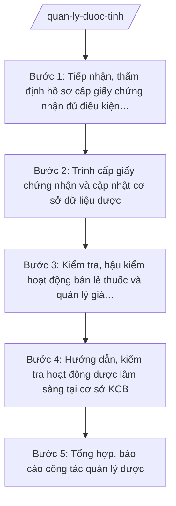

# Skill: Quản lý dược, mỹ phẩm

## 2. Khi nào dùng

- Khi tiếp nhận hồ sơ đề nghị cấp, cấp lại, điều chỉnh giấy chứng nhận đủ điều kiện kinh doanh dược cho cơ sở bán lẻ thuốc (nhà thuốc, quầy thuốc, tủ thuốc trạm y tế).
- Khi cần tổ chức đánh giá, kiểm tra thực hành tốt cơ sở bán lẻ thuốc (GPP) và hậu kiểm sau cấp phép.
- Khi cần quản lý giá thuốc trên địa bàn: tiếp nhận kê khai giá, kiểm tra niêm yết giá, xử lý vi phạm về giá.
- Khi cần hướng dẫn, kiểm tra hoạt động dược lâm sàng tại các bệnh viện, cơ sở KCB.
- Khi cần quản lý mỹ phẩm lưu thông trên địa bàn: kiểm tra nhãn, nguồn gốc, xử lý mỹ phẩm không rõ nguồn gốc (trong phạm vi phối hợp).
- Khi cần tổng hợp báo cáo công tác quản lý dược gửi Bộ Y tế và UBND tỉnh.

## 3. Đầu vào (Input)

| Trường | Mô tả | Bắt buộc |
|--------|-------|----------|
| `ho_so_duoc` | Hồ sơ đề nghị cấp/cấp lại/điều chỉnh giấy chứng nhận đủ điều kiện kinh doanh dược của cơ sở bán lẻ | Có |
| `danh_sach_co_so_ban_le` | Danh sách cơ sở bán lẻ thuốc trên địa bàn: tên, địa chỉ, loại hình, tình trạng GPP | Có |
| `ke_hoach_kiem_tra` | Kế hoạch kiểm tra GPP, kiểm tra giá thuốc (định kỳ/đột xuất) | Có |
| `du_lieu_gia_thuoc` | Dữ liệu kê khai giá, giá niêm yết tại cơ sở; phản ánh về giá thuốc bất hợp lý (nếu có) | Không |
| `bao_cao_duoc_lam_sang` | Báo cáo hoạt động dược lâm sàng của các bệnh viện, cơ sở KCB | Không |
| `van_ban_chi_dao` | Văn bản chỉ đạo của Bộ Y tế, UBND tỉnh về quản lý dược (nếu có) | Không |

## 4. Quy trình

**Bước 1. Tiếp nhận, thẩm định hồ sơ cấp giấy chứng nhận đủ điều kiện kinh doanh dược**
- Làm gì: Tiếp nhận hồ sơ đề nghị cấp/cấp lại/điều chỉnh giấy chứng nhận đủ điều kiện kinh doanh dược của cơ sở bán lẻ thuốc; kiểm tra thành phần hồ sơ; tổ chức đánh giá thực tế cơ sở theo tiêu chuẩn GPP; lập biên bản đánh giá; kết luận đạt/không đạt.
- Dùng input: `ho_so_duoc`, `danh_sach_co_so_ban_le`.
- Vai trò: Chuyên viên Phòng Nghiệp vụ Dược (hoặc Phòng Nghiệp vụ Y phụ trách dược) thuộc Sở Y tế tiếp nhận, đánh giá; đoàn đánh giá do Trưởng phòng/Phó Giám đốc Sở làm Trưởng đoàn; AI hỗ trợ lập checklist đánh giá GPP, soạn biên bản ⏱ ~2–3 ngày (ước tính).
- Lưu ý nghiệp vụ: Đánh giá đúng tiêu chuẩn GPP, khách quan; nội dung chưa đạt phải ghi rõ và hướng dẫn khắc phục; không yêu cầu thêm giấy tờ ngoài quy định; bảo đảm thời hạn giải quyết TTHC.
- → Kết quả bước: Biên bản đánh giá GPP + kết luận đủ/không đủ điều kiện.

**Bước 2. Trình cấp giấy chứng nhận và cập nhật cơ sở dữ liệu dược**
- Làm gì: Soạn tờ trình + dự thảo quyết định cấp/cấp lại/điều chỉnh giấy chứng nhận đủ điều kiện kinh doanh dược; trình Giám đốc Sở ký; cập nhật cơ sở dữ liệu cơ sở kinh doanh dược của tỉnh; công khai danh sách trên Cổng thông tin điện tử của Sở.
- Dùng input: Biên bản đánh giá bước 1.
- Vai trò: Chuyên viên soạn tờ trình, dự thảo quyết định; Trưởng phòng kiểm tra; Giám đốc Sở (ông Hoàng Văn S) ký quyết định; AI hỗ trợ soạn thảo theo thể thức NĐ 30/2020/NĐ-CP, cập nhật danh sách ⏱ ~1 ngày (ước tính).
- Lưu ý nghiệp vụ: Quyết định nêu rõ phạm vi kinh doanh được phép; cập nhật kịp thời khi có thay đổi (đóng cửa, chuyển địa điểm, thu hồi); thông tin công khai đúng quy định.
- → Kết quả bước: Quyết định cấp giấy chứng nhận + cơ sở dữ liệu dược được cập nhật.

**Bước 3. Kiểm tra, hậu kiểm hoạt động bán lẻ thuốc và quản lý giá thuốc**
- Làm gì: Tổ chức kiểm tra định kỳ/đột xuất cơ sở bán lẻ thuốc: duy trì điều kiện GPP, nguồn gốc thuốc, nhân sự phụ trách chuyên môn; kiểm tra việc kê khai giá, niêm yết giá bán lẻ; lập biên bản kiểm tra; xử lý vi phạm theo thẩm quyền hoặc chuyển cấp có thẩm quyền.
- Dùng input: `ke_hoach_kiem_tra`, `danh_sach_co_so_ban_le`, `du_lieu_gia_thuoc`.
- Vai trò: Đoàn kiểm tra của Sở Y tế (do Phó Giám đốc Sở hoặc Trưởng phòng làm Trưởng đoàn) thực hiện; chuyên viên lập biên bản, tổng hợp; AI hỗ trợ soạn kế hoạch, mẫu biên bản, bảng tổng hợp vi phạm ⏱ ~2 ngày (ước tính).
- Lưu ý nghiệp vụ: Kiểm tra đúng nội dung, không chồng chéo với thanh tra chuyên ngành khác; vi phạm về giá, thuốc giả/không rõ nguồn gốc phải xử lý nghiêm, chuyển cơ quan có thẩm quyền khi vượt thẩm quyền Sở; bảo đảm quyền lợi người bệnh.
- → Kết quả bước: Biên bản kiểm tra + bảng tổng hợp vi phạm và xử lý.

**Bước 4. Hướng dẫn, kiểm tra hoạt động dược lâm sàng tại cơ sở KCB**
- Làm gì: Hướng dẫn các bệnh viện, cơ sở KCB triển khai hoạt động dược lâm sàng (tư vấn sử dụng thuốc, theo dõi tương tác thuốc, quản lý kho dược); kiểm tra việc thực hiện; tổng hợp khó khăn, đề xuất giải pháp nâng cao chất lượng sử dụng thuốc.
- Dùng input: `bao_cao_duoc_lam_sang`, danh_sach_cs_kcb (qua báo cáo bệnh viện).
- Vai trò: Chuyên viên phụ trách dược soạn hướng dẫn, tổ chức kiểm tra; Trưởng phòng kiểm tra nội dung; AI hỗ trợ biên tập hướng dẫn, tổng hợp báo cáo ⏱ ~2 ngày (ước tính).
- Lưu ý nghiệp vụ: Hướng dẫn sát thực tế tuyến tỉnh, tuyến xã; phối hợp với hội đồng thuốc và điều trị của bệnh viện; không can thiệp chỉ định điều trị của bác sĩ.
- → Kết quả bước: Văn bản hướng dẫn dược lâm sàng + báo cáo kết quả kiểm tra.

**Bước 5. Tổng hợp, báo cáo công tác quản lý dược**
- Làm gì: Tổng hợp kết quả cấp phép, kiểm tra GPP, quản lý giá thuốc, dược lâm sàng, quản lý mỹ phẩm; soạn báo cáo gửi Bộ Y tế (Cục Quản lý Dược) và UBND tỉnh; đề xuất, kiến nghị hoàn thiện quản lý.
- Dùng input: Kết quả các bước 1–4, `van_ban_chi_dao`.
- Vai trò: Chuyên viên tổng hợp, soạn báo cáo; Trưởng phòng kiểm tra; Giám đốc Sở (ông Hoàng Văn S) ký báo cáo; AI hỗ trợ tổng hợp số liệu, soạn báo cáo theo thể thức NĐ 30/2020/NĐ-CP ⏱ ~1 ngày (ước tính).
- Lưu ý nghiệp vụ: Số liệu khớp giữa các bảng và cơ sở dữ liệu; phản ánh trung thực tồn tại (thuốc không rõ nguồn gốc, vi phạm giá); kiến nghị rõ đối tượng, nội dung.
- → Kết quả bước: Báo cáo công tác quản lý dược tỉnh (kỳ …) gửi Bộ Y tế và UBND tỉnh.

## Luồng quy trình (Workflow)

## 5. Đầu ra (Output)

**Danh sách sản phẩm:**
1. Quyết định cấp/cấp lại/điều chỉnh giấy chứng nhận đủ điều kiện kinh doanh dược (sản phẩm chính 1).
2. Báo cáo công tác quản lý dược tỉnh (sản phẩm chính 2).
3. Biên bản đánh giá GPP cơ sở bán lẻ thuốc.
4. Kế hoạch kiểm tra cơ sở bán lẻ thuốc, kiểm tra giá thuốc + biên bản kiểm tra.
5. Văn bản hướng dẫn hoạt động dược lâm sàng cho cơ sở KCB.
6. Danh sách cơ sở kinh doanh dược được cấp phép/cập nhật (phụ lục, phục vụ công khai).

**Cấu trúc output chuẩn — Quyết định cấp giấy chứng nhận đủ điều kiện kinh doanh dược:**
- Thể thức: tuân thủ Nghị định 30/2020/NĐ-CP về công tác văn thư.

1. Quốc hiệu "CỘNG HÒA XÃ HỘI CHỦ NGHĨA VIỆT NAM", Tiêu ngữ "Độc lập – Tự do – Hạnh phúc".
2. Số, ký hiệu văn bản: số/ký hiệu theo quy định (vd: 1234/QĐ-SYT).
3. Địa danh, ngày tháng năm ban hành: "Tỉnh A, ngày … tháng … năm …".
4. Tên loại và trích yếu: "QUYẾT ĐỊNH — Về việc cấp giấy chứng nhận đủ điều kiện kinh doanh dược".
5. Căn cứ: TT 20/2025/TT-BYT; quy định của pháp luật về dược; hồ sơ đề nghị; biên bản đánh giá GPP.
6. Nội dung quyết định (các Điều): Điều 1. Cấp giấy chứng nhận cho … (tên cơ sở, địa chỉ, loại hình, phạm vi kinh doanh); Điều 2. Trách nhiệm của cơ sở (duy trì GPP, kê khai/niêm yết giá); Điều 3. Hiệu lực và tổ chức thực hiện.
7. Nơi nhận: cơ sở được cấp, các đơn vị liên quan, lưu VP Sở.
8. Chữ ký: Giám đốc Sở Y tế ký, đóng dấu.

**Cấu trúc output chuẩn — Báo cáo công tác quản lý dược:**

1. Quốc hiệu "CỘNG HÒA XÃ HỘI CHỦ NGHĨA VIỆT NAM", Tiêu ngữ "Độc lập – Tự do – Hạnh phúc".
2. Số, ký hiệu văn bản: số/ký hiệu theo quy định (vd: 1234/BC-SYT).
3. Địa danh, ngày tháng năm ban hành.
4. Tên loại và trích yếu: "BÁO CÁO — Công tác quản lý dược, mỹ phẩm tỉnh A (kỳ …)".
5. Căn cứ: TT 20/2025/TT-BYT.
6. Nội dung: I. Cấp phép cơ sở kinh doanh dược (bảng số liệu); II. Kiểm tra GPP và hậu kiểm; III. Quản lý giá thuốc; IV. Dược lâm sàng; V. Quản lý mỹ phẩm; VI. Xử lý vi phạm; VII. Khó khăn, kiến nghị.
7. Nơi nhận: Bộ Y tế, UBND tỉnh, lưu VP Sở.
8. Chữ ký: Giám đốc Sở Y tế ký, đóng dấu.

## 6. Checklist nghiệm thu

- [ ] Hồ sơ cấp phép được kiểm tra đầy đủ, đánh giá GPP thực tế khách quan, biên bản có chữ ký các bên.
- [ ] Quyết định cấp giấy chứng nhận đúng thể thức NĐ 30/2020/NĐ-CP, nêu rõ phạm vi kinh doanh, trách nhiệm duy trì GPP.
- [ ] Cơ sở dữ liệu dược được cập nhật kịp thời; danh sách cấp mới/thay đổi được công khai đúng quy định.
- [ ] Kế hoạch kiểm tra có đối tượng, nội dung (GPP, giá thuốc, nguồn gốc thuốc); biên bản kiểm tra ghi rõ vi phạm và xử lý.
- [ ] Vi phạm vượt thẩm quyền được chuyển cấp có thẩm quyền, không tự xử lý; thuốc giả/không rõ nguồn gốc được xử lý nghiêm.
- [ ] Văn bản hướng dẫn dược lâm sàng sát thực tế, không can thiệp chỉ định điều trị của bác sĩ.
- [ ] Số liệu, tên cơ sở trong văn bản khớp đúng Input; không bịa kết quả đánh giá, số hiệu văn bản, căn cứ pháp lý.
- [ ] Đã qua human gate: Trưởng phòng kiểm tra, Giám đốc Sở ký duyệt theo thẩm quyền.

## 7. Ví dụ mô phỏng

*Dữ liệu dưới đây là giả lập 100% phục vụ minh họa.*

**Input mẫu:**
- ho_so_duoc: đơn đề nghị cấp giấy chứng nhận đủ điều kiện kinh doanh dược; chứng chỉ hành nghề dược của dược sĩ phụ trách; hợp đồng thuê mặt bằng; danh mục cơ sở vật chất, trang thiết bị bảo quản
- danh_sach_co_so_ban_le: 50 nhà thuốc, 30 quầy thuốc trên địa bàn tỉnh; 5 cơ sở chưa đạt GPP kỳ đánh giá trước
- ke_hoach_kiem_tra: kiểm tra định kỳ quý II/2027 đối với 20 cơ sở bán lẻ + kiểm tra đột xuất giá thuốc theo phản ánh
- du_lieu_gia_thuoc: 3 cơ sở bị phản ánh bán cao hơn giá kê khai

**Output mẫu — Quyết định cấp giấy chứng nhận (trích):**

> CỘNG HÒA XÃ HỘI CHỦ NGHĨA VIỆT NAM
> Độc lập – Tự do – Hạnh phúc
>
> Số: 1234/QĐ-SYT
>
> Tỉnh A, ngày 05 tháng 04 năm 2027
>
> **QUYẾT ĐỊNH**
> **Về việc cấp giấy chứng nhận đủ điều kiện kinh doanh dược**
>
> **GIÁM ĐỐC SỞ Y TẾ TỈNH A**
>
> Căn cứ Thông tư số 20/2025/TT-BYT ngày 23/6/2025 của Bộ Y tế hướng dẫn chức năng, nhiệm vụ, quyền hạn của cơ quan chuyên môn về y tế thuộc UBND cấp tỉnh;
> Căn cứ quy định của pháp luật về dược;
> Căn cứ hồ sơ đề nghị của Nhà thuốc An Khang;
> Căn cứ Biên bản đánh giá ngày 28/3/2027 của Đoàn đánh giá Sở Y tế tỉnh A (kết luận: đạt tiêu chuẩn GPP);
>
> **QUYẾT ĐỊNH:**
>
> **Điều 1.** Cấp giấy chứng nhận đủ điều kiện kinh doanh dược cho:
> - Tên cơ sở: Nhà thuốc An Khang;
> - Địa chỉ: Số 123 đường B, xã A, tỉnh A;
> - Loại hình: nhà thuốc (bán lẻ thuốc);
> - Phạm vi kinh doanh: bán lẻ thuốc thành phẩm theo đơn và không kê đơn theo quy định.
>
> **Điều 2.** Nhà thuốc An Khang có trách nhiệm duy trì đáp ứng tiêu chuẩn thực hành tốt cơ sở bán lẻ thuốc (GPP), thực hiện kê khai và niêm yết giá thuốc theo quy định; chịu sự kiểm tra, giám sát của Sở Y tế tỉnh A.
>
> **Điều 3.** Quyết định này có hiệu lực kể từ ngày ký. Chánh Văn phòng Sở, Trưởng phòng phụ trách dược, Nhà thuốc An Khang chịu trách nhiệm thi hành Quyết định này.
>
> **Nơi nhận:** như Điều 3; lưu VP Sở.
>
> **GIÁM ĐỐC**
> *(Ký, đóng dấu)*
> Hoàng Văn S

## 8. Human gate (người kiểm duyệt)

- Chuyên viên phụ trách dược thuộc Sở Y tế tiếp nhận hồ sơ, tổ chức đánh giá GPP, soạn tờ trình và dự thảo quyết định.
- Trưởng phòng phụ trách dược kiểm tra hồ sơ, kết quả đánh giá, nội dung dự thảo quyết định.
- Phó Giám đốc Sở (ông Đỗ Văn U) xem xét, làm Trưởng đoàn kiểm tra các đợt kiểm tra lớn.
- Giám đốc Sở (ông Hoàng Văn S) ký quyết định cấp/cấp lại/điều chỉnh/thu hồi giấy chứng nhận đủ điều kiện kinh doanh dược và báo cáo gửi Bộ Y tế (thẩm quyền của Giám đốc Sở Y tế).
- Vi phạm vượt thẩm quyền (thuốc giả, vi phạm nghiêm trọng): chuyển cơ quan có thẩm quyền xử lý theo quy định.

## 9. Giới hạn (guardrails)

- AI KHÔNG ra quyết định cấp hoặc thu hồi giấy chứng nhận thay người có thẩm quyền; không tự ký quyết định.
- AI KHÔNG tự ký, đóng dấu hoặc phát hành văn bản dưới danh nghĩa Sở Y tế hay lãnh đạo Sở.
- AI KHÔNG bịa hồ sơ, kết quả đánh giá GPP, số liệu kiểm tra giá thuốc, số hiệu văn bản, căn cứ pháp lý.
- AI KHÔNG hướng dẫn làm giả hồ sơ, lách tiêu chuẩn GPP hoặc che giấu vi phạm về thuốc.
- AI KHÔNG dùng văn bản đã hết hiệu lực; chỉ trích dẫn văn bản có trong tai-lieu-moi-nhat.md.

## 10. Căn cứ & lưu ý

- Thông tư số 20/2025/TT-BYT ngày 23/6/2025 của Bộ Y tế: hướng dẫn chức năng, nhiệm vụ, quyền hạn của Sở Y tế thuộc UBND cấp tỉnh (trong đó có nhiệm vụ quản lý dược, mỹ phẩm).
- Nghị định số 147/2025/NĐ-CP ngày 12/6/2025: phân định thẩm quyền CQĐP 2 cấp trong lĩnh vực quản lý nhà nước của Bộ Y tế.
- Nghị định số 148/2025/NĐ-CP ngày 12/6/2025: phân quyền, phân cấp trong lĩnh vực y tế.
- Nghị định số 150/2025/NĐ-CP ngày 12/6/2025: tổ chức Sở Y tế thuộc UBND cấp tỉnh; sửa đổi bởi NĐ 370/2025/NĐ-CP.
- Nghị định số 30/2020/NĐ-CP của Chính phủ: thể thức văn bản hành chính.
- Lưu ý: cấp tỉnh quản lý nhà nước về dược trên địa bàn (cấp phép cơ sở bán lẻ, kiểm tra GPP, quản lý giá thuốc, dược lâm sàng, tổng hợp báo cáo ngành); việc kiểm tra ATTP đối với cơ sở kinh doanh thực phẩm nhỏ lẻ do cấp xã thực hiện theo skill attp-co-so — không trùng lặp.
