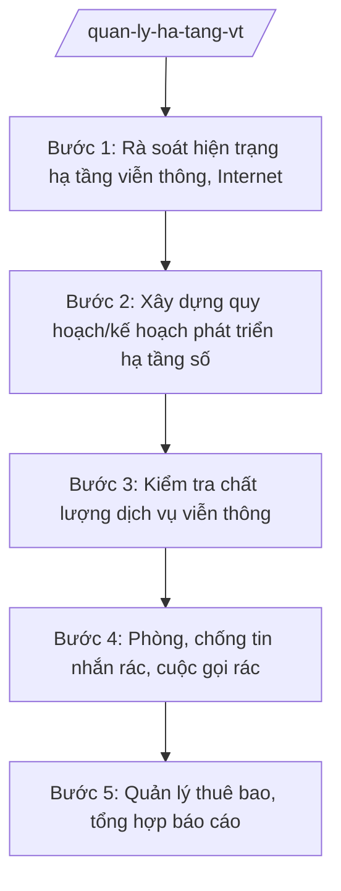

# Skill: Quản lý hạ tầng viễn thông, Internet

## 2. Khi nào dùng
- Rà soát hiện trạng hạ tầng viễn thông, Internet trên địa bàn tỉnh (vùng phủ sóng, vùng lõm).
- Xây dựng quy hoạch/kế hoạch phát triển hạ tầng số của tỉnh.
- Kiểm tra chất lượng dịch vụ viễn thông của doanh nghiệp trên địa bàn.
- Quản lý thuê bao viễn thông (đúng quy định về đăng ký thông tin thuê bao).
- Phòng, chống tin nhắn rác, cuộc gọi rác, lừa đảo qua mạng viễn thông, Internet.
- Báo cáo công tác quản lý viễn thông gửi Bộ KH&CN và UBND tỉnh.

## 3. Đầu vào (Input)
| Trường | Mô tả | Bắt buộc |
|--------|-------|----------|
| `hien_trang_ha_tang` | Hiện trạng hạ tầng viễn thông, Internet: trạm BTS, cáp quang, vùng phủ sóng, vùng lõm | Có |
| `doanh_nghiep_vien_thong` | Danh sách doanh nghiệp viễn thông hoạt động trên địa bàn | Có |
| `phan_anh_chat_luong` | Phản ánh của người dân về chất lượng dịch vụ, tin nhắn rác, cuộc gọi rác | Không |
| `ke_hoach_kiem_tra` | Kế hoạch kiểm tra chất lượng dịch vụ viễn thông (nếu đã có) | Không |
| `nguoi_ky` | Người ký ban hành (Giám đốc Sở; Chủ tịch UBND tỉnh đối với quy hoạch/kế hoạch của UBND tỉnh) | Có |

## 4. Quy trình

**Bước 1. Rà soát hiện trạng hạ tầng viễn thông, Internet**
- Làm gì: Rà soát trạm BTS, mạng cáp quang, vùng phủ sóng di động, Internet băng rộng cố định; xác định vùng lõm sóng, xã chưa có cáp quang.
- Dùng input: `hien_trang_ha_tang`, `doanh_nghiep_vien_thong`
- Vai trò: Chuyên viên Phòng Viễn thông (hoặc phòng được giao) phối hợp doanh nghiệp viễn thông rà soát; AI hỗ trợ lập bản đồ phủ sóng, thống kê vùng lõm theo xã ⏱ ~10 ngày làm việc (ước tính)
- Lưu ý nghiệp vụ: Số liệu phải do doanh nghiệp viễn thông cung cấp và được kiểm chứng thực tế; vùng lõm sóng là căn cứ ưu tiên đầu tư.
- → Kết quả bước: Báo cáo hiện trạng hạ tầng viễn thông, Internet của tỉnh (kèm bản đồ vùng lõm).

**Bước 2. Xây dựng quy hoạch/kế hoạch phát triển hạ tầng số**
- Làm gì: Xây dựng quy hoạch/kế hoạch phát triển hạ tầng viễn thông, hạ tầng số: mục tiêu phủ sóng, ngầm hóa cáp, dùng chung hạ tầng; phân công, lộ trình, kinh phí.
- Dùng input: Báo cáo hiện trạng ở Bước 1, `nguoi_ky`
- Vai trò: Trưởng phòng chủ trì soạn; Phó Giám đốc Sở xem xét; Giám đốc Sở ký Tờ trình; Chủ tịch UBND tỉnh phê duyệt; AI hỗ trợ soạn thảo, lập bảng lộ trình đầu tư ⏱ ~10 ngày làm việc (ước tính)
- Lưu ý nghiệp vụ: Quy hoạch phải gắn với quy hoạch tỉnh; ưu tiên phủ sóng vùng lõm, khu vực khó khăn; khuyến khích dùng chung hạ tầng kỹ thuật.
- → Kết quả bước: Quy hoạch/kế hoạch phát triển hạ tầng số của UBND tỉnh.

**Bước 3. Kiểm tra chất lượng dịch vụ viễn thông**
- Làm gì: Kiểm tra chất lượng dịch vụ của doanh nghiệp viễn thông (tốc độ, vùng phủ, giá cước); đo kiểm chất lượng tại các điểm dân cư; lập biên bản.
- Dùng input: `ke_hoach_kiem_tra`, `phan_anh_chat_luong`, `doanh_nghiep_vien_thong`
- Vai trò: Đoàn kiểm tra của Sở (phối hợp cơ quan liên quan) thực hiện đo kiểm; chuyên viên lập biên bản; AI hỗ trợ tổng hợp kết quả đo kiểm, soạn biên bản ⏱ theo kế hoạch (ước tính)
- Lưu ý nghiệp vụ: Đo kiểm phải đúng phương pháp, có biên bản; kết quả là căn cứ yêu cầu doanh nghiệp khắc phục, nâng cao chất lượng.
- → Kết quả bước: Biên bản kiểm tra + báo cáo kết quả đo kiểm chất lượng dịch vụ.

**Bước 4. Phòng, chống tin nhắn rác, cuộc gọi rác**
- Làm gì: Tiếp nhận phản ánh tin nhắn rác, cuộc gọi rác, lừa đảo; phối hợp doanh nghiệp viễn thông ngăn chặn; tuyên truyền người dân; xử lý vi phạm theo thẩm quyền.
- Dùng input: `phan_anh_chat_luong`, `doanh_nghiep_vien_thong`
- Vai trò: Chuyên viên tiếp nhận, phân loại phản ánh; phối hợp doanh nghiệp viễn thông chặn số vi phạm; AI hỗ trợ tổng hợp phản ánh, thống kê đầu số vi phạm ⏱ thường xuyên (ước tính)
- Lưu ý nghiệp vụ: Phân biệt tin nhắn rác với tin nhắn quảng cáo có sự đồng ý của người nhận; xử lý vi phạm phải có căn cứ, đúng thẩm quyền.
- → Kết quả bước: Báo cáo phòng, chống tin nhắn rác, cuộc gọi rác + danh sách đầu số đã xử lý.

**Bước 5. Quản lý thuê bao, tổng hợp báo cáo**
- Làm gì: Kiểm tra việc đăng ký thông tin thuê bao của doanh nghiệp viễn thông; xử lý SIM rác; tổng hợp báo cáo công tác quản lý viễn thông năm.
- Dùng input: Kết quả kiểm tra ở Bước 3, báo cáo của doanh nghiệp viễn thông
- Vai trò: Chuyên viên kiểm tra, tổng hợp; Trưởng phòng kiểm tra; Giám đốc Sở ký báo cáo; AI hỗ trợ tổng hợp số liệu thuê bao, soạn báo cáo ⏱ ~3 ngày làm việc (ước tính)
- Lưu ý nghiệp vụ: Quản lý thuê bao phải bảo đảm đúng quy định về đăng ký thông tin; phối hợp chặt chẽ với doanh nghiệp viễn thông và cơ quan công an khi xử lý SIM rác, lừa đảo.
- → Kết quả bước: Báo cáo công tác quản lý viễn thông, Internet năm của tỉnh.

## Luồng quy trình (Workflow)

## 5. Đầu ra (Output)
- Quy hoạch/kế hoạch phát triển hạ tầng số của UBND tỉnh.
- Báo cáo kết quả đo kiểm chất lượng dịch vụ viễn thông.
- Báo cáo phòng, chống tin nhắn rác, cuộc gọi rác.
- Báo cáo công tác quản lý viễn thông, Internet năm.

**Cấu trúc output chuẩn:**
Khung Kế hoạch phát triển hạ tầng số (theo NĐ 30/2020/NĐ-CP):
1. Quốc hiệu "CỘNG HÒA XÃ HỘI CHỦ NGHĨA VIỆT NAM", Tiêu ngữ "Độc lập – Tự do – Hạnh phúc".
2. Số, ký hiệu văn bản: số 1234/KH-UBND.
3. Địa danh và ngày, tháng, năm: "Tỉnh A, ngày ... tháng ... năm ...".
4. Tên loại và trích yếu: "KẾ HOẠCH / Phát triển hạ tầng số tỉnh A giai đoạn ...".
5. Căn cứ: TT 10/2025/TT-BKHCN; NĐ 132/2025/NĐ-CP; NĐ 150/2025/NĐ-CP; quy hoạch tỉnh A; Tờ trình của Giám đốc Sở KH&CN.
6. Nội dung bắt buộc: I. Mục đích, yêu cầu; II. Hiện trạng hạ tầng viễn thông, Internet; III. Mục tiêu (phủ sóng, cáp quang, ngầm hóa, dùng chung hạ tầng); IV. Nhiệm vụ, giải pháp, lộ trình; V. Kinh phí; VI. Tổ chức thực hiện.
7. Nơi nhận: Bộ KH&CN; Thường trực Tỉnh ủy; HĐND tỉnh; các sở, ban, ngành; UBND các xã; doanh nghiệp viễn thông; lưu VT.
8. Chữ ký: "TM. ỦY BAN NHÂN DÂN / CHỦ TỊCH" + họ tên Phạm Văn P, đóng dấu.

## 6. Checklist nghiệm thu
- [ ] Rà soát đầy đủ hiện trạng hạ tầng; xác định đúng vùng lõm sóng, xã chưa có cáp quang.
- [ ] Quy hoạch/kế hoạch gắn với quy hoạch tỉnh; ưu tiên vùng khó khăn; dùng chung hạ tầng.
- [ ] Đo kiểm chất lượng đúng phương pháp, có biên bản; yêu cầu khắc phục có thời hạn.
- [ ] Phản ánh tin nhắn rác, cuộc gọi rác được tiếp nhận, phân loại, xử lý kịp thời.
- [ ] Quản lý thuê bao đúng quy định; phối hợp xử lý SIM rác.
- [ ] Văn bản đúng thể thức NĐ 30/2020/NĐ-CP; đúng thẩm quyền ký.
- [ ] Không bịa số liệu, không trích dẫn văn bản hết hiệu lực.
- [ ] Đã qua human gate: chuyên viên soạn → Trưởng phòng kiểm tra → Phó Giám đốc/Giám đốc Sở → Chủ tịch UBND tỉnh phê duyệt quy hoạch.

## 7. Ví dụ mô phỏng
*Dữ liệu dưới đây là giả lập 100% phục vụ minh họa.*

### Input mẫu
- hien_trang_ha_tang: 450 trạm BTS; 110/120 xã có cáp quang; 10 xã miền núi còn lõm sóng di động; 30% tuyến cáp nội thị chưa ngầm hóa
- doanh_nghiep_vien_thong: 04 doanh nghiệp viễn thông hoạt động tại tỉnh A
- phan_anh_chat_luong: 200 phản ánh/năm về tin nhắn rác, cuộc gọi lừa đảo mạo danh cơ quan nhà nước
- nguoi_ky: Ông Phạm Văn P – Chủ tịch UBND tỉnh A

### Output mẫu
**KẾ HOẠCH** số 1234/KH-UBND
Phát triển hạ tầng số tỉnh A giai đoạn 2026–2030

CỘNG HÒA XÃ HỘI CHỦ NGHĨA VIỆT NAM
Độc lập – Tự do – Hạnh phúc

Tỉnh A, ngày 09 tháng 10 năm 2026

I. MỤC ĐÍCH, YÊU CẦU
Xóa vùng lõm sóng di động; 100% xã có cáp quang; ngầm hóa 80% tuyến cáp nội thị; nâng cao chất lượng dịch vụ viễn thông.

II. MỤC TIÊU ĐẾN NĂM 2030
1. Phủ sóng di động 100% thôn, bản; xóa 10 xã lõm sóng.
2. 100% xã có hạ tầng cáp quang; 80% hộ gia đình có Internet băng rộng cố định.
3. Ngầm hóa 80% tuyến cáp viễn thông nội thị; dùng chung 70% hạ tầng kỹ thuật.

III. NHIỆM VỤ, GIẢI PHÁP
1. Hỗ trợ doanh nghiệp đầu tư trạm BTS tại 10 xã lõm sóng (Sở KH&CN chủ trì, UBND xã phối hợp).
2. Ngầm hóa cáp viễn thông gắn với chỉnh trang đô thị.
3. Tăng cường phòng, chống tin nhắn rác, cuộc gọi rác, lừa đảo qua mạng viễn thông.
4. Kiểm tra chất lượng dịch vụ viễn thông định kỳ hằng năm.

IV. TỔ CHỨC THỰC HIỆN
Sở KH&CN thường trực; các sở, ban, ngành, UBND xã và doanh nghiệp viễn thông thực hiện nhiệm vụ được phân công; báo cáo tiến độ hằng năm.

Nơi nhận:
- Bộ KH&CN;
- Thường trực Tỉnh ủy, HĐND tỉnh;
- Các sở, ban, ngành; UBND các xã; doanh nghiệp viễn thông;
- Lưu: VT.

TM. ỦY BAN NHÂN DÂN
CHỦ TỊCH
Phạm Văn P

## 8. Human gate
Chuyên viên soạn quy hoạch, báo cáo → Trưởng phòng kiểm tra → Phó Giám đốc Sở xem xét → Giám đốc Sở ký Tờ trình → Chủ tịch UBND tỉnh phê duyệt quy hoạch/kế hoạch. Kết quả đo kiểm chất lượng do đoàn kiểm tra xác nhận. AI chỉ hỗ trợ rà soát, tổng hợp số liệu, soạn thảo — không thay con người đánh giá chất lượng dịch vụ và quyết định biện pháp xử lý.

## 9. Giới hạn
AI tuyệt đối KHÔNG: ra quyết định hành chính thay người có thẩm quyền; tự ký/phát hành văn bản; bịa số liệu, căn cứ pháp lý, trích dẫn; dùng văn bản hết hiệu lực. Đặc biệt: không bịa số liệu đo kiểm chất lượng mạng, không tự kết luận doanh nghiệp vi phạm khi chưa có kiểm tra thực tế.

## 10. Căn cứ & lưu ý
- TT 10/2025/TT-BKHCN (27/6/2025; hiệu lực 01/7/2025).
- NĐ 132/2025/NĐ-CP (12/6/2025) — phân định thẩm quyền CQĐP 2 cấp lĩnh vực quản lý nhà nước của Bộ KH&CN.
- NĐ 150/2025/NĐ-CP (12/6/2025; hiệu lực 16/6/2025); sửa đổi bởi NĐ 370/2025/NĐ-CP.
- NĐ 30/2020/NĐ-CP (thể thức văn bản hành chính).
- Luật Viễn thông; Luật Công nghệ thông tin (chỉ nêu tên).
- Lưu ý: Sở KH&CN tiếp nhận lĩnh vực viễn thông, Internet từ Sở Thông tin và Truyền thông cũ sau sáp nhập 2025; quản lý nhà nước về viễn thông thực hiện phối hợp với doanh nghiệp viễn thông và cơ quan có thẩm quyền ở trung ương.
