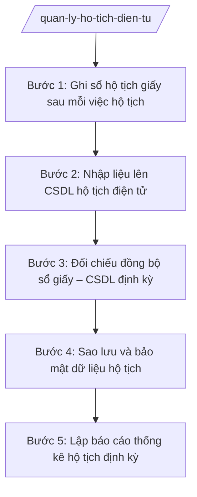

# Skill: Quản lý sổ hộ tịch, CSDL hộ tịch điện tử

## 2. Khi nào dùng
- Sau mỗi việc hộ tịch (khai sinh, khai tử, kết hôn...) cần ghi sổ hộ tịch giấy và nhập liệu lên CSDL hộ tịch điện tử.
- Cần đối chiếu đồng bộ giữa sổ hộ tịch giấy và CSDL hộ tịch điện tử, phát hiện sai lệch.
- Cần sao lưu, bảo mật dữ liệu hộ tịch điện tử của xã.
- Cần lập báo cáo thống kê hộ tịch định kỳ (tháng, quý, năm) gửi cấp trên.

## 3. Đầu vào (Input)

| Trường | Mô tả | Bắt buộc |
|--------|-------|----------|
| `viec_ho_tich` | Loại việc hộ tịch vừa thực hiện (khai sinh/khai tử/kết hôn/...) + số đăng ký | Có |
| `thong_tin_dang_ky` | Toàn bộ thông tin đã ghi nhận của việc hộ tịch đó | Có |
| `so_giay_hien_co` | Số liệu hiện có trên sổ giấy và CSDL (để đối chiếu) | Không |
| `ky_bao_cao` | Kỳ báo cáo thống kê (tháng/quý/năm + thời gian cụ thể) | Không |
| `su_co_du_lieu` | Sự cố dữ liệu cần xử lý (mất đồng bộ, lỗi nhập liệu, nghi lộ lọt...) | Không |

## 4. Quy trình

**Bước 1. Ghi sổ hộ tịch giấy sau mỗi việc hộ tịch**
- Làm gì: Ghi đầy đủ, chính xác nội dung việc hộ tịch vào đúng loại sổ hộ tịch giấy (Sổ đăng ký khai sinh, Sổ đăng ký khai tử, Sổ đăng ký kết hôn...) ngay sau khi hoàn thành việc đăng ký.
- Dùng input: `viec_ho_tich`, `thong_tin_dang_ky`.
- Vai trò: Công chức Tư pháp – Hộ tịch ghi sổ. AI hỗ trợ kiểm tra đã ghi đủ các trường bắt buộc của từng loại sổ và cảnh báo trường còn thiếu ⏱ ~15 phút/việc (ước tính).
- Lưu ý nghiệp vụ: Ghi bằng mực bền, chữ rõ ràng; không tẩy xóa; viết sai thì gạch bỏ và ghi lại theo quy định. Mỗi việc hộ tịch chỉ ghi một lần, đúng số thứ tự liên tục.
- → Kết quả bước: Sổ hộ tịch giấy đã ghi đầy đủ, đúng thứ tự số.

**Bước 2. Nhập liệu lên CSDL hộ tịch điện tử**
- Làm gì: Nhập toàn bộ nội dung đã ghi trên sổ giấy lên hệ thống CSDL hộ tịch điện tử; kiểm tra tính hợp lệ của dữ liệu nhập (định dạng ngày tháng, số định danh cá nhân...).
- Dùng input: `thong_tin_dang_ky` (đã ghi trên sổ giấy ở Bước 1).
- Vai trò: Công chức Tư pháp – Hộ tịch nhập liệu. AI hỗ trợ kiểm tra định dạng, cảnh báo trùng lặp số định danh cá nhân và đối chiếu nhanh với dữ liệu sổ giấy vừa ghi ⏱ ~15 phút/việc (ước tính).
- Lưu ý nghiệp vụ: Nhập liệu ngay trong ngày phát sinh việc hộ tịch, không dồn nhiều ngày. Tuyệt đối không nhập dữ liệu chưa được ghi trên sổ giấy. Tài khoản đăng nhập hệ thống là tài khoản cá nhân, không chia sẻ.
- → Kết quả bước: Dữ liệu việc hộ tịch đã có trên CSDL hộ tịch điện tử, khớp với sổ giấy.

**Bước 3. Đối chiếu đồng bộ sổ giấy – CSDL định kỳ**
- Làm gì: Định kỳ (hàng tuần/tháng) đối chiếu số lượng và nội dung các việc hộ tịch giữa sổ giấy và CSDL điện tử; lập biên bản đối chiếu; xử lý sai lệch phát hiện được.
- Dùng input: `so_giay_hien_co` (số liệu hai nguồn).
- Vai trò: Công chức Tư pháp – Hộ tịch đối chiếu. AI hỗ trợ so sánh số liệu hai nguồn, liệt kê các bản ghi lệch và gợi ý nguyên nhân (thiếu nhập liệu, nhập sai...) ⏱ ~1 giờ/lần đối chiếu tháng (ước tính).
- Lưu ý nghiệp vụ: Mọi sai lệch đều phải làm rõ nguyên nhân và khắc phục, ghi vào biên bản đối chiếu. Không tự ý sửa CSDL mà không có căn cứ từ sổ giấy/hồ sơ gốc.
- → Kết quả bước: Biên bản đối chiếu đồng bộ sổ giấy – CSDL; các sai lệch đã được xử lý, hai nguồn khớp nhau.

**Bước 4. Sao lưu và bảo mật dữ liệu hộ tịch**
- Làm gì: Thực hiện sao lưu dữ liệu hộ tịch điện tử định kỳ theo quy định; quản lý tài khoản, mật khẩu truy cập hệ thống; phát hiện và xử lý sự cố lộ lọt, mất dữ liệu.
- Dùng input: `su_co_du_lieu` (nếu có).
- Vai trò: Công chức Tư pháp – Hộ tịch thực hiện sao lưu, quản lý tài khoản. AI hỗ trợ lập lịch sao lưu, checklist kiểm tra an toàn dữ liệu và soạn báo cáo sự cố khi xảy ra ⏱ ~30 phút/lần sao lưu (ước tính).
- Lưu ý nghiệp vụ: Dữ liệu hộ tịch là thông tin cá nhân, chỉ cung cấp cho cơ quan, tổ chức, cá nhân có thẩm quyền theo quy định. Mất, lộ dữ liệu phải báo cáo Chủ tịch UBND xã và cấp trên ngay.
- → Kết quả bước: Bản sao lưu dữ liệu định kỳ; tài khoản được quản lý an toàn; sự cố (nếu có) đã được xử lý và báo cáo.

**Bước 5. Lập báo cáo thống kê hộ tịch định kỳ**
- Làm gì: Tổng hợp số liệu các việc hộ tịch trong kỳ (số khai sinh, khai tử, kết hôn, chứng thực...) từ sổ giấy và CSDL; lập báo cáo thống kê theo mẫu; trình lãnh đạo ký và gửi cấp trên đúng hạn.
- Dùng input: `ky_bao_cao`, số liệu tổng hợp từ sổ giấy và CSDL.
- Vai trò: Công chức Tư pháp – Hộ tịch tổng hợp số liệu, soạn báo cáo. AI hỗ trợ tổng hợp số liệu tự động từ CSDL, đối chiếu với sổ giấy và soạn dự thảo báo cáo đúng mẫu ⏱ ~0,5 ngày làm việc/báo cáo quý (ước tính).
- Lưu ý nghiệp vụ: Số liệu báo cáo phải khớp giữa sổ giấy và CSDL; số liệu kỳ này phải logic với số lũy kế. Gửi báo cáo đúng thời hạn quy định; lưu bản lưu tại Văn phòng.
- → Kết quả bước: Báo cáo thống kê hộ tịch định kỳ đã được ký, gửi cấp trên đúng hạn và lưu hồ sơ.

## Luồng quy trình (Workflow)

## 5. Đầu ra (Output)

Sản phẩm:
- Các sổ hộ tịch giấy đã ghi cập nhật (khai sinh, khai tử, kết hôn...) — lưu tại UBND xã
- Dữ liệu hộ tịch trên CSDL hộ tịch điện tử — đồng bộ, khớp với sổ giấy
- Biên bản đối chiếu đồng bộ sổ giấy – CSDL — lưu hồ sơ
- Bản sao lưu dữ liệu hộ tịch định kỳ — lưu trữ an toàn
- Báo cáo thống kê hộ tịch định kỳ (tháng/quý/năm) — gửi cấp trên, lưu hồ sơ

### Cấu trúc output chuẩn

Khung Báo cáo thống kê hộ tịch (kỳ tháng/quý/năm) gồm các phần theo đúng thứ tự, đúng thể thức NĐ 30/2020/NĐ-CP:
1. Quốc hiệu "CỘNG HÒA XÃ HỘI CHỦ NGHĨA VIỆT NAM" — Tiêu ngữ "Độc lập – Tự do – Hạnh phúc"
2. Số, ký hiệu văn bản: số.../BC-UBND
3. Địa danh, ngày, tháng, năm ban hành báo cáo
4. Tên loại văn bản: "BÁO CÁO" + tên gọi: "Thống kê công tác hộ tịch (tháng/quý/năm ...)"
5. Nội dung: tình hình chung; số liệu chi tiết từng việc hộ tịch (đăng ký khai sinh: ... trường hợp, trong đó đúng hạn/quá hạn; khai tử: ...; kết hôn: ...; chứng thực: ...); đối chiếu sổ giấy – CSDL; tồn tại, khó khăn; đề xuất, kiến nghị
6. Nơi nhận: UBND cấp trên (ghi cụ thể), lưu Văn phòng
7. Chữ ký: "TM. ỦY BAN NHÂN DÂN / CHỦ TỊCH" (hoặc Phó Chủ tịch phụ trách ký thay) + chữ ký + họ tên, đóng dấu UBND xã

> **Chuẩn tài liệu đầu ra** (thứ tự ưu tiên):
> 1. Chuẩn riêng của ngành/cơ quan chủ quản — mẫu, biểu mẫu, quy chuẩn tại văn bản quy phạm chuyên ngành (xem mục "Căn cứ & lưu ý").
> 2. Tài liệu không có quy chuẩn riêng — thể thức NĐ 30/2020/NĐ-CP: Quốc hiệu và Tiêu ngữ; tên cơ quan ban hành; số, ký hiệu; địa danh và thời gian; tên loại và trích yếu; nội dung; chức vụ, họ tên, chữ ký người có thẩm quyền; dấu, chữ ký số; nơi nhận (kèm Phụ lục nếu có).

## 6. Checklist nghiệm thu
- [ ] Mọi việc hộ tịch phát sinh đều đã ghi trên sổ giấy ngay trong ngày, đúng loại sổ, đủ trường bắt buộc
- [ ] 100% việc hộ tịch trên sổ giấy đã được nhập lên CSDL hộ tịch điện tử, không nhập dữ liệu chưa ghi sổ
- [ ] Sổ giấy và CSDL khớp nhau về số lượng và nội dung (có biên bản đối chiếu)
- [ ] Không có tẩy xóa sai quy định trên sổ giấy; sai lệch CSDL đều có căn cứ từ hồ sơ gốc
- [ ] Đã sao lưu dữ liệu định kỳ; tài khoản hệ thống là tài khoản cá nhân, không chia sẻ
- [ ] Số liệu báo cáo thống kê khớp giữa sổ giấy và CSDL; logic với số lũy kế
- [ ] Báo cáo gửi cấp trên đúng hạn, đúng mẫu; có bản lưu tại Văn phòng
- [ ] Thể thức báo cáo đúng NĐ 30/2020/NĐ-CP (quốc hiệu, tiêu ngữ, số/ký hiệu, nơi nhận, chữ ký)
- [ ] Không có dữ liệu, căn cứ pháp lý nào do AI bịa ra
- [ ] Đã qua human gate: công chức tổng hợp → Chánh Văn phòng kiểm tra → Chủ tịch UBND xã (hoặc Phó Chủ tịch phụ trách) ký báo cáo

## 7. Ví dụ mô phỏng

*Dữ liệu dưới đây là giả lập 100% phục vụ minh họa.*

### Input mẫu
- viec_ho_tich: Đăng ký khai sinh số 123/ĐKKS-UBND; đăng ký kết hôn số 123/GCNKH-UBND; chứng thực 10 bản sao
- thong_tin_dang_ky: (thông tin chi tiết các việc hộ tịch trong tháng 9/2026 của xã A)
- ky_bao_cao: Báo cáo tháng 9 năm 2026

### Output mẫu

**BÁO CÁO THỐNG KÊ CÔNG TÁC HỘ TỊCH THÁNG 9 NĂM 2026**

CỘNG HÒA XÃ HỘI CHỦ NGHĨA VIỆT NAM
Độc lập – Tự do – Hạnh phúc

Số: 123/BC-UBND

Xã A, ngày 05 tháng 10 năm 2026

**BÁO CÁO**
**Thống kê công tác hộ tịch tháng 9 năm 2026**

I. Tình hình chung
Trong tháng 9/2026, công tác đăng ký và quản lý hộ tịch trên địa bàn xã A thực hiện đúng quy định; sổ hộ tịch giấy và CSDL hộ tịch điện tử đồng bộ.

II. Số liệu chi tiết
1. Đăng ký khai sinh: 20 trường hợp (đúng hạn 18, quá hạn 02)
2. Đăng ký khai tử: 05 trường hợp
3. Đăng ký kết hôn: 08 trường hợp
4. Chứng thực bản sao từ bản chính: 10 bản; chứng thực chữ ký: 02 trường hợp
5. Đối chiếu sổ giấy – CSDL: khớp 100%, không có sai lệch

III. Tồn tại, khó khăn: Không có.

IV. Đề xuất, kiến nghị: Không có.

Nơi nhận:
- UBND tỉnh A (báo cáo);
- Lưu: Văn phòng.

TM. ỦY BAN NHÂN DÂN
CHỦ TỊCH
(ký, đóng dấu)
Nguyễn Văn A

## 8. Human gate
Công chức Tư pháp – Hộ tịch ghi sổ, nhập liệu, tổng hợp số liệu và soạn báo cáo → Chánh Văn phòng HĐND và UBND kiểm tra tính chính xác, thể thức → Chủ tịch UBND xã (hoặc Phó Chủ tịch phụ trách lĩnh vực) ký báo cáo trước khi gửi cấp trên. AI chỉ hỗ trợ kiểm tra, đối chiếu và soạn thảo, không quyết định thay người có thẩm quyền.

## 9. Giới hạn
AI tuyệt đối KHÔNG: quyết định sửa, xóa dữ liệu hộ tịch thay công chức có trách nhiệm; tự ký báo cáo thống kê; bịa số liệu thống kê, căn cứ pháp lý; dùng mẫu báo cáo, văn bản đã hết hiệu lực; cung cấp dữ liệu hộ tịch cá nhân cho tổ chức, cá nhân không có thẩm quyền; tư vấn vượt thẩm quyền cấp xã.

## 10. Căn cứ & lưu ý
- TT 09/2025/TT-BTP (hướng dẫn chức năng, nhiệm vụ lĩnh vực tư pháp của Văn phòng HĐND & UBND cấp xã; hiệu lực 01/7/2025)
- NĐ 30/2020/NĐ-CP (thể thức văn bản hành chính)
- Lưu ý: sổ hộ tịch giấy và CSDL hộ tịch điện tử phải đồng bộ, khớp nhau; nhập liệu ngay trong ngày phát sinh; sao lưu và bảo mật dữ liệu theo quy định.
