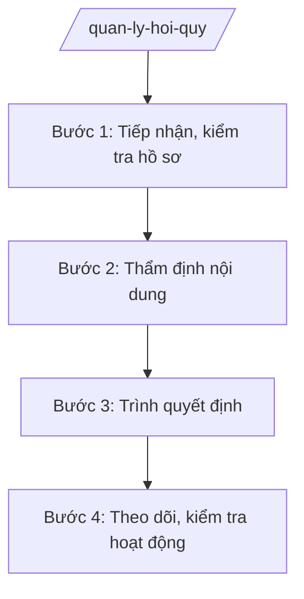

# Skill: Quản lý hội, quỹ

## 2. Khi nào dùng
- Tổ chức, công dân nộp hồ sơ đề nghị thành lập, chia, tách, sáp nhập, đổi tên, giải thể hội.
- Đề nghị cấp giấy phép thành lập và công nhận điều lệ quỹ.
- Kiểm tra, báo cáo tình hình tổ chức, hoạt động của hội, quỹ trên địa bàn.

## 3. Đầu vào (Input)
| Trường | Mô tả | Bắt buộc |
|--------|-------|----------|
| `loai_thu_tuc` | Loại thủ tục (thành lập / chia tách / sáp nhập / đổi tên / giải thể / công nhận quỹ) | Có |
| `ho_so` | Hồ sơ đề nghị theo quy định | Có |
| `dieu_le_du_thao` | Dự thảo điều lệ hội, quỹ | Có (trừ giải thể) |
| `danh_sach_sang_lap` | Danh sách ban vận động / sáng lập viên | Có (thành lập) |
| `bao_cao_hoat_dong` | Báo cáo hoạt động định kỳ của hội, quỹ | Không |

## 4. Quy trình

**Bước 1. Tiếp nhận, kiểm tra hồ sơ**
- Làm gì: Tiếp nhận hồ sơ tại bộ phận một cửa; kiểm tra tính đầy đủ, hợp lệ; hướng dẫn bổ sung nếu thiếu.
- Dùng input: `loai_thu_tuc`, `ho_so`
- Vai trò: Chuyên viên Phòng Tổ chức phi chính phủ (Sở Nội vụ tỉnh A) kiểm tra; AI hỗ trợ checklist thành phần hồ sơ ⏱ ~1 ngày làm việc (ước tính)
- Lưu ý nghiệp vụ: Trả lời bằng văn bản nếu hồ sơ không đủ điều kiện; không kéo dài thời gian xử lý.
- → Kết quả bước: Giấy tiếp nhận / văn bản yêu cầu bổ sung.

**Bước 2. Thẩm định nội dung**
- Làm gì: Thẩm định: tên gọi, tôn chỉ, mục đích, phạm vi hoạt động, điều lệ, trụ sở, tài sản, nhân sự; lấy ý kiến cơ quan quản lý ngành, lĩnh vực.
- Dùng input: `dieu_le_du_thao`, `danh_sach_sang_lap`
- Vai trò: Chuyên viên thẩm định; AI hỗ trợ rà soát điều lệ theo khung chuẩn ⏱ ~7 ngày làm việc (ước tính)
- Lưu ý nghiệp vụ: Tên hội không trùng, không gây nhầm lẫn; tôn chỉ, mục đích không trái pháp luật, thuần phong mỹ tục.
- → Kết quả bước: Báo cáo thẩm định.

**Bước 3. Trình quyết định**
- Làm gì: Hoàn thiện tờ trình, dự thảo quyết định cho phép thành lập / công nhận / chia tách / giải thể; trình cấp có thẩm quyền.
- Dùng input: Báo cáo thẩm định Bước 2
- Vai trò: Giám đốc Sở Nội vụ ký tờ trình; Chủ tịch UBND tỉnh A quyết định; AI hỗ trợ soạn văn bản ⏱ ~3 ngày làm việc (ước tính)
- Lưu ý nghiệp vụ: Đúng thẩm quyền (UBND tỉnh đối với hội có phạm vi toàn tỉnh); quyết định đúng thể thức.
- → Kết quả bước: Quyết định đã ban hành.

**Bước 4. Theo dõi, kiểm tra hoạt động**
- Làm gì: Cập nhật cơ sở dữ liệu hội, quỹ; kiểm tra việc chấp hành điều lệ, báo cáo định kỳ; xử lý vi phạm.
- Dùng input: `bao_cao_hoat_dong`
- Vai trò: Chuyên viên theo dõi; AI hỗ trợ lập bảng theo dõi, nhắc hạn báo cáo ⏱ định kỳ (ước tính)
- Lưu ý nghiệp vụ: Hội, quỹ phải báo cáo định kỳ; kiểm tra khi có dấu hiệu vi phạm hoặc đơn thư phản ánh.
- → Kết quả bước: Báo cáo tình hình hội, quỹ trên địa bàn.

## Luồng quy trình (Workflow)

## 5. Đầu ra (Output)
- Quyết định cho phép thành lập / chia tách / sáp nhập / giải thể hội; công nhận quỹ.
- Cơ sở dữ liệu hội, quỹ của tỉnh.
- Báo cáo tình hình tổ chức, hoạt động hội, quỹ.

**Cấu trúc output chuẩn:**
- Thể thức: tuân thủ Nghị định 30/2020/NĐ-CP về công tác văn thư.
Khung quyết định cho phép thành lập hội:
1. Quốc hiệu "CỘNG HÒA XÃ HỘI CHỦ NGHĨA VIỆT NAM", Tiêu ngữ "Độc lập – Tự do – Hạnh phúc"; số, ký hiệu; địa danh, ngày tháng năm.
2. Tên: "QUYẾT ĐỊNH về việc cho phép thành lập ...".
3. Căn cứ pháp lý.
4. Điều 1: Cho phép thành lập ...; tôn chỉ, mục đích; phạm vi hoạt động.
5. Điều 2: Công nhận điều lệ kèm theo.
6. Điều 3: Trách nhiệm thi hành.
7. Chữ ký; đóng dấu.
- Nơi nhận: liệt kê các cơ quan, đơn vị nhận để biết/thực hiện; kết thúc bằng "- Lưu: VT, [mã đơn vị]".
## 6. Checklist nghiệm thu
- [ ] Hồ sơ đầy đủ, hợp lệ theo từng loại thủ tục.
- [ ] Tên, tôn chỉ, mục đích, điều lệ đúng quy định.
- [ ] Đã lấy ý kiến cơ quan quản lý ngành, lĩnh vực.
- [ ] Đúng thẩm quyền quyết định.
- [ ] Quyết định đúng thể thức NĐ 30/2020/NĐ-CP.
- [ ] Cập nhật cơ sở dữ liệu sau khi ban hành.
- [ ] Có theo dõi, kiểm tra hoạt động định kỳ.

## 7. Ví dụ mô phỏng
*Dữ liệu dưới đây là giả lập 100% phục vụ minh họa.*

**Input mẫu:**
- loai_thu_tuc: Thành lập hội
- dieu_le_du_thao: Điều lệ Hội Bảo vệ người tiêu dùng tỉnh A (dự thảo, giả lập)
- danh_sach_sang_lap: 15 sáng lập viên (giả lập)

**Output mẫu (trích quyết định):**
> **QUYẾT ĐỊNH**
> **Về việc cho phép thành lập Hội Bảo vệ người tiêu dùng tỉnh A**
>
> Điều 1. Cho phép thành lập Hội Bảo vệ người tiêu dùng tỉnh A...
> (Dữ liệu giả lập 100% phục vụ minh họa)

## 8. Human gate
- Trưởng phòng: kiểm tra thẩm định hồ sơ (Bước 2).
- Giám đốc Sở Nội vụ: ký tờ trình (Bước 3).
- Chủ tịch UBND tỉnh: quyết định cho phép thành lập / giải thể.

## 9. Giới hạn
- AI không thay cơ quan nhà nước quyết định cho phép hay từ chối thành lập hội, quỹ.
- Không bịa hồ sơ, điều lệ của tổ chức đề nghị.
- Không can thiệp vào hoạt động nội bộ hợp pháp của hội, quỹ.

## 10. Căn cứ & lưu ý
- TT 10/2025/TT-BNV (Sở Nội vụ: quản lý hội, quỹ).
- Quy định về tổ chức, hoạt động của hội; về quỹ xã hội, quỹ từ thiện — dẫn tên, tra cứu bản hiện hành khi áp dụng.
