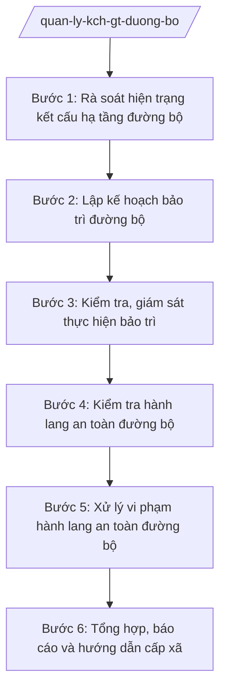

# Skill: Quản lý kết cấu hạ tầng giao thông đường bộ

## 2. Khi nào dùng

- Sở Xây dựng tỉnh A lập kế hoạch bảo trì hệ thống đường bộ thuộc phạm vi quản lý của tỉnh (đường tỉnh, đường đô thị...) hằng năm;
- Cần kiểm tra hiện trạng kết cấu hạ tầng đường bộ (mặt đường, cầu, cống, biển báo, hệ thống thoát nước dọc tuyến) để đề xuất sửa chữa;
- Phát hiện hành vi lấn chiếm, sử dụng trái phép hành lang an toàn đường bộ (xây dựng, họp chợ, đặt biển quảng cáo, đấu nối trái phép) cần kiểm tra, xử lý;
- Cần tổng hợp hiện trạng, báo cáo UBND tỉnh; hướng dẫn UBND xã quản lý hành lang an toàn trên địa bàn.

## 3. Đầu vào (Input)

| Trường | Mô tả | Bắt buộc |
|--------|-------|----------|
| `danh_muc_duong_bo` | Danh mục tuyến đường thuộc phạm vi quản lý của tỉnh (tên tuyến, lý trình, cấp đường) | Có |
| `ke_hoach_bao_tri` | Kế hoạch bảo trì đường bộ năm (hạng mục, kinh phí, tiến độ). Lưu ý: bảo trì.| Có |
| `bao_cao_hien_trang` | Báo cáo hiện trạng hư hỏng kết cấu hạ tầng đường bộ của đơn vị quản lý | Không |
| `tin_bao_lan_chiem` | Tin báo lấn chiếm hành lang an toàn đường bộ (vị trí, hành vi, đối tượng). Lưu ý: xử lý.| Có |
| `bien_ban_kiem_tra_hl` | Biên bản kiểm tra hành lang an toàn đường bộ | Không |
| `bao_cao_cap_xa_hl` | Báo cáo của UBND xã về tình hình hành lang an toàn trên địa bàn | Không |

## 4. Quy trình

**Bước 1. Rà soát hiện trạng kết cấu hạ tầng đường bộ**
- Làm gì: Thu thập báo cáo hiện trạng từ đơn vị quản lý đường; tổ chức kiểm tra thực địa các tuyến xung yếu (mặt đường hư hỏng, cầu yếu, điểm ngập, biển báo thiếu); lập bảng đánh giá hiện trạng, phân loại mức độ ưu tiên sửa chữa.
- Dùng input: `danh_muc_duong_bo`, `bao_cao_hien_trang`.
- Vai trò: Chuyên viên Phòng Quản lý kết cấu hạ tầng giao thông rà soát, AI hỗ trợ lập bảng đánh giá hiện trạng theo tuyến, phân loại ưu tiên theo tiêu chí (mức độ hư hỏng, lưu lượng, an toàn); ⏱ ~7–10 ngày làm việc (ước tính).
- Lưu ý nghiệp vụ: Ưu tiên các vị trí ảnh hưởng trực tiếp an toàn giao thông (ổ gà sâu, cầu yếu, sạt lở); dữ liệu hiện trạng phải có ảnh, biên bản kiểm tra thực địa.
- → Kết quả bước: Bảng đánh giá hiện trạng kết cấu hạ tầng đường bộ + danh mục ưu tiên sửa chữa.

**Bước 2. Lập kế hoạch bảo trì đường bộ**
- Làm gì: Trên cơ sở đánh giá hiện trạng: xác định hạng mục bảo trì thường xuyên, sửa chữa định kỳ, sửa chữa đột xuất; lập dự toán kinh phí; xây dựng kế hoạch bảo trì năm trình cấp có thẩm quyền phê duyệt.
- Dùng input: Kết quả Bước 1, `ke_hoach_bao_tri`.
- Vai trò: Trưởng phòng Quản lý kết cấu hạ tầng giao thông chủ trì, AI hỗ trợ lập bảng hạng mục — kinh phí — tiến độ, soạn tờ trình phê duyệt kế hoạch; ⏱ ~7–10 ngày làm việc (ước tính).
- Lưu ý nghiệp vụ: Kế hoạch phải phù hợp khả năng cân đối ngân sách; phối hợp Sở Tài chính về nguồn vốn; hạng mục cấp bách (sạt lở, sập cầu) đưa vào sửa chữa đột xuất.
- → Kết quả bước: Kế hoạch bảo trì đường bộ năm (trình phê duyệt).

**Bước 3. Kiểm tra, giám sát thực hiện bảo trì**
- Làm gì: Theo dõi tiến độ, chất lượng thi công bảo trì của đơn vị thực hiện; kiểm tra nghiệm thu hạng mục hoàn thành; đôn đốc khắc phục tồn tại; tổng hợp báo cáo thực hiện kế hoạch bảo trì.
- Dùng input: Kế hoạch bảo trì đã phê duyệt.
- Vai trò: Chuyên viên Phòng Quản lý kết cấu hạ tầng giao thông theo dõi, AI hỗ trợ lập bảng theo dõi tiến độ, soạn biên bản nghiệm thu, báo cáo thực hiện; ⏱ ~theo tiến độ thi công. (ước tính)
- Lưu ý nghiệp vụ: Nghiệm thu phải đúng khối lượng, chất lượng thiết kế; không nghiệm thu hạng mục chưa đạt yêu cầu kỹ thuật.
- → Kết quả bước: Biên bản nghiệm thu + báo cáo thực hiện kế hoạch bảo trì.

**Bước 4. Kiểm tra hành lang an toàn đường bộ**
- Làm gì: Lập kế hoạch kiểm tra định kỳ/đột xuất hành lang an toàn đường bộ trên các tuyến (phạm vi hành lang, công trình, biển quảng cáo, điểm đấu nối, họp chợ); phối hợp UBND xã, lực lượng chức năng kiểm tra thực địa; lập biên bản kiểm tra.
- Dùng input: `danh_muc_duong_bo`, `tin_bao_lan_chiem`, `bao_cao_cap_xa_hl`.
- Vai trò: Đoàn kiểm tra của Sở phối hợp UBND xã thực hiện, AI hỗ trợ soạn kế hoạch, biên bản kiểm tra, lập danh sách vi phạm; ⏱ ~5–7 ngày làm việc/đợt (ước tính).
- Lưu ý nghiệp vụ: Xác định rõ ranh giới hành lang theo hồ sơ tuyến; biên bản có chữ ký các bên; ưu tiên xử lý vi phạm ảnh hưởng an toàn giao thông (che khuất tầm nhìn, lấn mặt đường).
- → Kết quả bước: Biên bản kiểm tra hành lang an toàn + danh sách vi phạm lấn chiếm.

**Bước 5. Xử lý vi phạm hành lang an toàn đường bộ**
- Làm gì: Trên cơ sở biên bản kiểm tra, tin báo: yêu cầu tổ chức, cá nhân tự tháo dỡ, khôi phục hiện trạng trong thời hạn; lập biên bản vi phạm hành chính; tham mưu xử phạt theo thẩm quyền; phối hợp cưỡng chế đối với trường hợp không chấp hành.
- Dùng input: Kết quả Bước 4, `tin_bao_lan_chiem`, `bien_ban_kiem_tra_hl`.
- Vai trò: Thanh tra Sở/chuyên viên tham mưu xử lý, phối hợp UBND xã, AI hỗ trợ soạn văn bản yêu cầu tháo dỡ, biên bản vi phạm, dự thảo quyết định xử phạt; ⏱ ~7–10 ngày làm việc (ước tính).
- Lưu ý nghiệp vụ: Ưu tiên vận động tự tháo dỡ; cưỡng chế là biện pháp cuối cùng, đúng trình tự; bảo đảm an toàn giao thông trong quá trình xử lý.
- → Kết quả bước: Văn bản yêu cầu tháo dỡ / quyết định xử phạt vi phạm hành chính + kết quả khôi phục hiện trạng.

**Bước 6. Tổng hợp, báo cáo và hướng dẫn cấp xã**
- Làm gì: Tổng hợp hiện trạng kết cấu hạ tầng, kết quả bảo trì, tình hình vi phạm hành lang; báo cáo UBND tỉnh và Bộ Xây dựng theo định kỳ; ban hành văn bản hướng dẫn UBND xã quản lý, bảo vệ hành lang an toàn đường bộ trên địa bàn.
- Dùng input: Kết quả Bước 1–5.
- Vai trò: Trưởng phòng Quản lý kết cấu hạ tầng giao thông tổng hợp, AI hỗ trợ soạn báo cáo định kỳ, văn bản hướng dẫn nghiệp vụ; ⏱ ~3–5 ngày làm việc (ước tính).
- Lưu ý nghiệp vụ: Báo cáo trung thực, số liệu thống nhất; hướng dẫn cấp xã cụ thể về ranh giới hành lang, trách nhiệm phát hiện, báo cáo vi phạm.
- → Kết quả bước: Báo cáo quản lý kết cấu hạ tầng giao thông đường bộ + văn bản hướng dẫn nghiệp vụ gửi cấp xã.

## Luồng quy trình (Workflow)

## 5. Đầu ra (Output)

- Bảng đánh giá hiện trạng kết cấu hạ tầng đường bộ + danh mục ưu tiên sửa chữa;
- Kế hoạch bảo trì đường bộ năm (được phê duyệt);
- Biên bản nghiệm thu + báo cáo thực hiện kế hoạch bảo trì;
- Biên bản kiểm tra hành lang an toàn đường bộ + danh sách vi phạm;
- Văn bản yêu cầu tự tháo dỡ, khôi phục hiện trạng;
- Quyết định xử phạt vi phạm hành chính về hành lang an toàn đường bộ;
- Báo cáo quản lý kết cấu hạ tầng giao thông đường bộ (định kỳ);
- Văn bản hướng dẫn nghiệp vụ quản lý hành lang gửi cấp xã.

**Cấu trúc output chuẩn (Báo cáo quản lý kết cấu hạ tầng giao thông đường bộ):**
- Thể thức: tuân thủ Nghị định 30/2020/NĐ-CP về công tác văn thư.

1. Quốc hiệu "CỘNG HÒA XÃ HỘI CHỦ NGHĨA VIỆT NAM", Tiêu ngữ "Độc lập – Tự do – Hạnh phúc";
2. Tên cơ quan: SỞ XÂY DỰNG TỈNH A; số, ký hiệu văn bản; địa danh và ngày, tháng, năm;
3. Tên loại và trích yếu: BÁO CÁO — Về tình hình quản lý kết cấu hạ tầng giao thông đường bộ trên địa bàn tỉnh A...;
4. Phần "Kính gửi": Ủy ban nhân dân tỉnh A;
5. Căn cứ (văn bản về phân định thẩm quyền, phân quyền, phân cấp lĩnh vực xây dựng; Thông tư 10/2025/TT-BXD; kế hoạch bảo trì; văn bản giao nhiệm vụ...);
6. Nội dung: hiện trạng kết cấu hạ tầng (quy mô mạng lưới, tình trạng hư hỏng); kết quả thực hiện kế hoạch bảo trì (hạng mục, kinh phí, nghiệm thu); tình hình vi phạm hành lang an toàn và kết quả xử lý; tồn tại, nguyên nhân; đề xuất, kiến nghị;
7. Nơi nhận;
8. Thẩm quyền, chức vụ, họ tên người ký: TM. SỞ XÂY DỰNG — GIÁM ĐỐC — (chữ ký, họ tên), dấu của cơ quan.

## 6. Checklist nghiệm thu

- [ ] Hiện trạng kết cấu hạ tầng được rà soát thực địa, có ảnh và biên bản;
- [ ] Kế hoạch bảo trì có hạng mục, kinh phí, tiến độ cụ thể, được phê duyệt;
- [ ] Nghiệm thu bảo trì đúng khối lượng, chất lượng thiết kế;
- [ ] Kiểm tra hành lang an toàn có kế hoạch, biên bản đầy đủ, xác định đúng ranh giới;
- [ ] Vi phạm lấn chiếm được yêu cầu tự tháo dỡ trước, xử phạt/cưỡng chế đúng trình tự;
- [ ] Ưu tiên xử lý vi phạm ảnh hưởng trực tiếp an toàn giao thông;
- [ ] Báo cáo định kỳ trung thực, số liệu thống nhất; đã hướng dẫn nghiệp vụ cho cấp xã.

## 7. Ví dụ mô phỏng

*Dữ liệu dưới đây là giả lập 100% phục vụ minh họa.*

### Input mẫu

| Trường | Giá trị giả lập |
|--------|-----------------|
| danh_muc_duong_bo | 10 tuyến đường tỉnh, tổng chiều dài 200 km; 15 cầu |
| bao_cao_hien_trang | Tuyến ĐT.A1 (km10–km15): mặt đường hư hỏng nặng, 03 cầu yếu cần sửa chữa |
| tin_bao_lan_chiem | Hộ ông Nguyễn Văn Dân xây tường rào lấn 2 m vào hành lang tuyến ĐT.A1 tại xã A; đặt biển quảng cáo che khuất tầm nhìn tại ngã ba |

### Output mẫu (Văn bản yêu cầu tháo dỡ — trích)

> **CỘNG HÒA XÃ HỘI CHỦ NGHĨA VIỆT NAM**
> **Độc lập – Tự do – Hạnh phúc**
>
> Số: 123/CV-SXD
> *Tỉnh A, ngày 25 tháng 7 năm 2027*
>
> **V/v yêu cầu tự tháo dỡ công trình vi phạm hành lang an toàn đường bộ**
>
> Kính gửi: Ông Nguyễn Văn Dân (xã A, tỉnh A); UBND xã A.
>
> Qua kiểm tra, ông Nguyễn Văn Dân đã xây dựng tường rào lấn 02 m vào hành lang an toàn đường bộ tuyến ĐT.A1 (đoạn qua xã A), vi phạm quy định về bảo vệ kết cấu hạ tầng giao thông đường bộ.
>
> Sở Xây dựng tỉnh A yêu cầu:
>
> 1. Ông Nguyễn Văn Dân tự tháo dỡ phần tường rào vi phạm, khôi phục hiện trạng hành lang an toàn trong thời hạn 15 ngày kể từ ngày nhận văn bản...
> 2. UBND xã A giám sát việc chấp hành; hết thời hạn không chấp hành, Sở sẽ phối hợp xử lý theo quy định...
>
> *Nơi nhận:* ...
>
> **GIÁM ĐỐC**
> *(Chữ ký, dấu)*
> **Hoàng Văn S**

## 8. Human gate

- Chuyên viên Phòng Quản lý kết cấu hạ tầng giao thông rà soát, kiểm tra, theo dõi;
- Trưởng phòng kiểm tra, soạn thảo kế hoạch, báo cáo;
- Phó Giám đốc/Giám đốc Sở ký văn bản, quyết định xử phạt;
- Chủ tịch UBND tỉnh A phê duyệt kế hoạch bảo trì, xem xét vụ việc phức tạp (AI không thay người ký).

## 9. Giới hạn

- AI KHÔNG phê duyệt kế hoạch bảo trì, không ký quyết định xử phạt hay văn bản hành chính thay người có thẩm quyền;
- Không bịa số liệu hiện trạng, khối lượng bảo trì, căn cứ pháp lý;
- Không dùng văn bản đã hết hiệu lực; chỉ viện dẫn văn bản có thật trong `tai-lieu-moi-nhat.md`;
- Ranh giới hành lang, kết luận vi phạm do con người kiểm tra, xác định — AI chỉ hỗ trợ tổng hợp, soạn thảo.

## 10. Căn cứ & lưu ý

- NĐ 140/2025/NĐ-CP ngày 12/6/2025 — phân định thẩm quyền CQĐP 2 cấp trong lĩnh vực quản lý nhà nước của Bộ Xây dựng;
- NĐ 144/2025/NĐ-CP ngày 12/6/2025 — phân quyền, phân cấp trong lĩnh vực quản lý nhà nước của Bộ Xây dựng;
- TT 10/2025/TT-BXD ngày 14/6/2025 — hướng dẫn chức năng, nhiệm vụ, quyền hạn của Sở Xây dựng, Sở Quy hoạch – Kiến trúc và lĩnh vực xây dựng cấp xã;
- NĐ 150/2025/NĐ-CP (hiệu lực 16/6/2025); NĐ 370/2025/NĐ-CP sửa đổi, bổ sung;
- NĐ 30/2020/NĐ-CP — thể thức, kỹ thuật trình bày văn bản hành chính.
