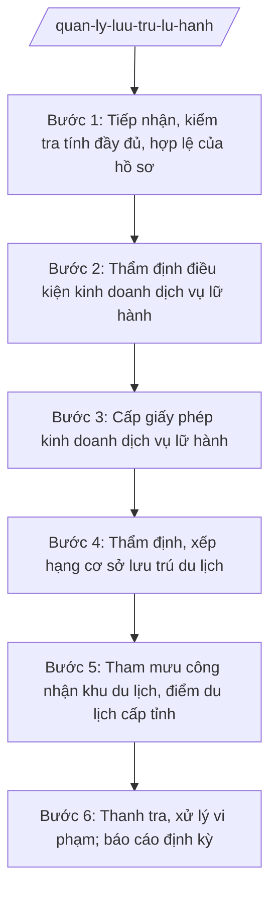

# Skill: Quản lý lữ hành, lưu trú, khu điểm du lịch

## 2. Khi nào dùng

- Tiếp nhận hồ sơ đề nghị cấp, đổi, cấp lại giấy phép kinh doanh dịch vụ lữ hành nội địa và lữ hành quốc tế của doanh nghiệp trên địa bàn tỉnh.
- Thẩm định, xếp hạng cơ sở lưu trú du lịch (hạng sao và các hình thức xếp hạng theo quy định); kiểm tra điều kiện kinh doanh lưu trú.
- Tham mưu UBND tỉnh công nhận khu du lịch cấp tỉnh, điểm du lịch; lập hồ sơ trình cấp có thẩm quyền đối với khu du lịch quốc gia.
- Thanh tra, kiểm tra hoạt động kinh doanh lữ hành, lưu trú, khu/điểm du lịch; xử lý vi phạm (kinh doanh không phép, quảng cáo sai sự thật, chèo kéo, "chặt chém" du khách).
- Tổng hợp báo cáo tình hình hoạt động du lịch gửi UBND tỉnh, Bộ VHTTDL (Cục Du lịch Quốc gia Việt Nam).

## 3. Đầu vào (Input)

| Trường | Mô tả | Bắt buộc |
|--------|-------|----------|
| `ho_so_lu_hanh` | Hồ sơ đề nghị cấp/đổi/cấp lại giấy phép kinh doanh dịch vụ lữ hành: đơn đề nghị, giấy chứng nhận đăng ký doanh nghiệp, phương án kinh doanh, hồ sơ người phụ trách, chứng minh ký quỹ theo quy định | Có (theo từng hồ sơ phát sinh) |
| `ho_so_luu_tru` | Hồ sơ đề nghị thẩm định, xếp hạng cơ sở lưu trú du lịch: đơn đề nghị, hồ sơ pháp lý, bản tự đánh giá điều kiện cơ sở vật chất, dịch vụ | Không |
| `ho_so_khu_diem` | Hồ sơ đề nghị công nhận khu du lịch/điểm du lịch cấp tỉnh: tờ trình của UBND xã/chủ đầu tư, hồ sơ tài nguyên du lịch, quy hoạch, phương án quản lý, bảo vệ môi trường | Không |
| `phan_anh_vi_pham` | Phản ánh của du khách, tổ chức về vi phạm trong hoạt động du lịch | Không |
| `thoi_han` | Thời hạn giải quyết thủ tục hành chính theo quy định | Có |

## 4. Quy trình

**Bước 1. Tiếp nhận, kiểm tra tính đầy đủ, hợp lệ của hồ sơ**

- Làm gì: Tiếp nhận hồ sơ (lữ hành/lưu trú/khu-điểm du lịch) qua bộ phận một cửa Sở hoặc trực tuyến; kiểm tra tính đầy đủ, hợp lệ; hướng dẫn bổ sung một lần nếu thiếu; chuyển hồ sơ đạt yêu cầu cho Phòng Quản lý du lịch thụ lý.
- Dùng input: `ho_so_lu_hanh` / `ho_so_luu_tru` / `ho_so_khu_diem`, `thoi_han`.
- Vai trò: Công chức bộ phận một cửa Sở tiếp nhận, kiểm tra hình thức. AI hỗ trợ: lập checklist hồ sơ theo từng loại thủ tục, soạn văn bản hướng dẫn bổ sung, theo dõi thời hạn giải quyết trên hệ thống một cửa. ⏱ ~1–2 ngày làm việc (ước tính).
- Lưu ý nghiệp vụ: Thực hiện đúng cơ chế một cửa theo NĐ 118/2025/NĐ-CP; ghi phiếu tiếp nhận, hẹn ngày trả kết quả; không yêu cầu giấy tờ ngoài quy định.
- → Kết quả bước: Hồ sơ đầy đủ, hợp lệ được thụ lý (kèm phiếu hẹn trả kết quả).

**Bước 2. Thẩm định điều kiện kinh doanh dịch vụ lữ hành**

- Làm gì: Thẩm định điều kiện kinh doanh của doanh nghiệp: tư cách pháp nhân, ngành nghề đăng ký, người phụ trách kinh doanh dịch vụ lữ hành đáp ứng tiêu chuẩn, mức ký quỹ theo quy định pháp luật chuyên ngành về du lịch; kiểm tra thực tế trụ sở khi cần.
- Dùng input: `ho_so_lu_hanh`.
- Vai trò: Chuyên viên Phòng Quản lý du lịch (ông Trần Văn Q) chủ trì thẩm định; Trưởng phòng (bà Hoàng Thị N) kiểm tra kết quả thẩm định. AI hỗ trợ: lập bảng đối chiếu điều kiện theo quy định, soạn báo cáo thẩm định, soạn biên bản kiểm tra thực tế (nếu có). ⏱ ~5–7 ngày làm việc (ước tính).
- Lưu ý nghiệp vụ: Điều kiện kinh doanh (mức ký quỹ, tiêu chuẩn người phụ trách...) áp dụng đúng quy định pháp luật chuyên ngành về du lịch hiện hành, không tự đặt thêm điều kiện; phân biệt rõ điều kiện lữ hành nội địa và lữ hành quốc tế.
- → Kết quả bước: Báo cáo thẩm định (đủ điều kiện/không đủ điều kiện + lý do).

**Bước 3. Cấp giấy phép kinh doanh dịch vụ lữ hành**

- Làm gì: Trên cơ sở hồ sơ đạt thẩm định, dự thảo giấy phép kinh doanh dịch vụ lữ hành (nội địa/quốc tế) theo mẫu quy định của pháp luật chuyên ngành về du lịch; trình ký, cấp phép; cập nhật cơ sở dữ liệu doanh nghiệp lữ hành của tỉnh; công khai trên Cổng thông tin điện tử.
- Dùng input: Kết quả bước 2.
- Vai trò: Chuyên viên soạn dự thảo giấy phép; Trưởng phòng (bà Hoàng Thị N) kiểm tra; Phó Giám đốc Sở (ông Đỗ Văn U) cho ý kiến; Giám đốc Sở (ông Hoàng Văn S) ký cấp giấy phép. AI hỗ trợ: điền mẫu giấy phép từ hồ sơ đã thẩm định, rà soát thông tin doanh nghiệp, lập danh sách cập nhật cơ sở dữ liệu. ⏱ ~3–5 ngày làm việc (ước tính).
- Lưu ý nghiệp vụ: Giấy phép phải đúng mẫu, đúng phạm vi (nội địa/quốc tế); thu hồi giấy phép khi doanh nghiệp không còn đủ điều kiện hoặc vi phạm nghiêm trọng theo quy định.
- → Kết quả bước: Giấy phép kinh doanh dịch vụ lữ hành đã ký, cấp cho doanh nghiệp, cập nhật cơ sở dữ liệu.

**Bước 4. Thẩm định, xếp hạng cơ sở lưu trú du lịch**

- Làm gì: Thành lập đoàn thẩm định; kiểm tra thực tế cơ sở lưu trú (cơ sở vật chất, chất lượng dịch vụ, an ninh, PCCC, vệ sinh môi trường, niêm yết giá); đánh giá, xếp hạng theo tiêu chuẩn quy định; ban hành quyết định công nhận hạng; kiểm tra định kỳ việc duy trì tiêu chuẩn hạng.
- Dùng input: `ho_so_luu_tru`.
- Vai trò: Đoàn thẩm định do Trưởng phòng (bà Hoàng Thị N) làm trưởng đoàn, chuyên viên Phòng Quản lý du lịch và chuyên gia (khi cần); Giám đốc Sở (ông Hoàng Văn S) ký quyết định công nhận hạng. AI hỗ trợ: lập kế hoạch thẩm định, bảng tiêu chí chấm điểm, soạn biên bản thẩm định, dự thảo quyết định công nhận hạng. ⏱ ~7–10 ngày làm việc/hồ sơ (ước tính).
- Lưu ý nghiệp vụ: Đánh giá khách quan, đúng tiêu chuẩn; cơ sở không duy trì tiêu chuẩn thì hạ hạng hoặc thu hồi quyết định công nhận hạng theo quy định.
- → Kết quả bước: Quyết định công nhận hạng cơ sở lưu trú du lịch + biên bản thẩm định.

**Bước 5. Tham mưu công nhận khu du lịch, điểm du lịch cấp tỉnh**

- Làm gì: Thẩm định hồ sơ đề nghị công nhận (tài nguyên du lịch, quy hoạch, phương án quản lý, bảo vệ môi trường, kết nối hạ tầng); khảo sát thực tế; dự thảo tờ trình + dự thảo quyết định công nhận khu du lịch/điểm du lịch trình Chủ tịch UBND tỉnh; đối với khu du lịch đề nghị cấp quốc gia thì lập hồ sơ trình Bộ VHTTDL.
- Dùng input: `ho_so_khu_diem`.
- Vai trò: Chuyên viên Phòng Quản lý du lịch soạn hồ sơ thẩm định, dự thảo tờ trình/quyết định; Trưởng phòng (bà Hoàng Thị N) kiểm tra; Phó Giám đốc Sở (ông Đỗ Văn U) cho ý kiến; Giám đốc Sở (ông Hoàng Văn S) ký tờ trình trình UBND tỉnh. AI hỗ trợ: lập bảng tiêu chí công nhận, soạn dự thảo tờ trình và quyết định, tổng hợp hồ sơ khảo sát. ⏱ ~10–15 ngày làm việc (ước tính).
- Lưu ý nghiệp vụ: Công nhận khu du lịch/điểm du lịch cấp tỉnh thuộc thẩm quyền Chủ tịch UBND tỉnh; khu du lịch quốc gia thuộc thẩm quyền trung ương — Sở chỉ lập hồ sơ trình, không tự quyết.
- → Kết quả bước: Tờ trình + dự thảo Quyết định công nhận khu du lịch/điểm du lịch cấp tỉnh trình UBND tỉnh.

**Bước 6. Thanh tra, xử lý vi phạm; báo cáo định kỳ**

- Làm gì: Thanh tra, kiểm tra hoạt động lữ hành, lưu trú, khu/điểm du lịch (kinh doanh không phép, quảng cáo sai sự thật, không niêm yết giá, chèo kéo du khách); lập biên bản, xử phạt vi phạm hành chính theo thẩm quyền; tổng hợp báo cáo tình hình du lịch gửi UBND tỉnh, Bộ VHTTDL.
- Dùng input: `phan_anh_vi_pham`, cơ sở dữ liệu doanh nghiệp/cơ sở đã cấp phép.
- Vai trò: Thanh tra Sở chủ trì đoàn thanh tra, phối hợp Phòng Quản lý du lịch; Chánh Thanh tra Sở tham mưu xử phạt. AI hỗ trợ: lập kế hoạch thanh tra, soạn biên bản, dự thảo quyết định xử phạt, soạn báo cáo định kỳ. ⏱ ~5–7 ngày làm việc/đợt (ước tính).
- Lưu ý nghiệp vụ: Xử phạt đúng hành vi, đúng thẩm quyền; theo dõi việc chấp hành quyết định xử phạt và khắc phục hậu quả; công khai doanh nghiệp vi phạm nghiêm trọng theo quy định.
- → Kết quả bước: Biên bản thanh tra, quyết định xử phạt (nếu có) + báo cáo tình hình hoạt động du lịch.

## Luồng quy trình (Workflow)

## 5. Đầu ra (Output)

### Sản phẩm

1. **Giấy phép kinh doanh dịch vụ lữ hành** (nội địa/quốc tế) (sản phẩm chính).
2. Quyết định công nhận hạng cơ sở lưu trú du lịch + biên bản thẩm định.
3. Tờ trình + dự thảo Quyết định công nhận khu du lịch/điểm du lịch cấp tỉnh.
4. Biên bản thanh tra, quyết định xử phạt vi phạm hành chính trong hoạt động du lịch.
5. Báo cáo tình hình hoạt động du lịch gửi UBND tỉnh, Bộ VHTTDL.

**Cấu trúc output chuẩn (Giấy phép kinh doanh dịch vụ lữ hành):**
- Thể thức: tuân thủ Nghị định 30/2020/NĐ-CP về công tác văn thư.

1. Quốc hiệu "CỘNG HÒA XÃ HỘI CHỦ NGHĨA VIỆT NAM", Tiêu ngữ "Độc lập – Tự do – Hạnh phúc": CỘNG HÒA XÃ HỘI CHỦ NGHĨA VIỆT NAM / Độc lập – Tự do – Hạnh phúc.
2. Tên cơ quan cấp phép: SỞ VĂN HÓA, THỂ THAO VÀ DU LỊCH TỈNH A.
3. Tên loại: GIẤY PHÉP KINH DOANH DỊCH VỤ LỮ HÀNH (nội địa/quốc tế); số giấy phép.
4. Thông tin doanh nghiệp: tên doanh nghiệp, địa chỉ trụ sở chính, số điện thoại, người đại diện theo pháp luật, người phụ trách kinh doanh dịch vụ lữ hành.
5. Phạm vi kinh doanh: kinh doanh dịch vụ lữ hành nội địa / lữ hành quốc tế (ghi rõ phạm vi theo quy định).
6. Điều kiện duy trì: doanh nghiệp phải duy trì các điều kiện kinh doanh và thực hiện nghĩa vụ theo quy định pháp luật chuyên ngành về du lịch; giấy phép có giá trị khi doanh nghiệp duy trì đủ điều kiện.
7. Địa danh, ngày tháng năm cấp phép: Tỉnh A, ngày … tháng … năm ….
8. Chữ ký, họ tên người ký: GIÁM ĐỐC / (ký, đóng dấu, ghi rõ họ tên).
9. Ghi chú: giấy phép lập theo mẫu quy định của pháp luật chuyên ngành về du lịch.
- Nơi nhận: liệt kê các cơ quan, đơn vị nhận để biết/thực hiện; kết thúc bằng "- Lưu: VT, [mã đơn vị]".

> **Chuẩn tài liệu đầu ra** (thứ tự ưu tiên):
> 1. Chuẩn riêng của ngành/cơ quan chủ quản — mẫu, biểu mẫu, quy chuẩn tại văn bản quy phạm chuyên ngành (xem mục "Căn cứ & lưu ý").
> 2. Tài liệu không có quy chuẩn riêng — thể thức NĐ 30/2020/NĐ-CP: Quốc hiệu và Tiêu ngữ; tên cơ quan ban hành; số, ký hiệu; địa danh và thời gian; tên loại và trích yếu; nội dung; chức vụ, họ tên, chữ ký người có thẩm quyền; dấu, chữ ký số; nơi nhận (kèm Phụ lục nếu có).

## 6. Checklist nghiệm thu

- [ ] Đủ 9 phần theo Cấu trúc output chuẩn mục 5, đúng mẫu pháp luật chuyên ngành về du lịch.
- [ ] Hồ sơ doanh nghiệp đầy đủ, hợp lệ; điều kiện kinh doanh được thẩm định đúng quy định (không tự đặt thêm điều kiện).
- [ ] Phạm vi giấy phép ghi đúng: lữ hành nội địa hoặc lữ hành quốc tế, khớp với hồ sơ thẩm định.
- [ ] Thông tin doanh nghiệp trên giấy phép khớp 100% với giấy chứng nhận đăng ký doanh nghiệp.
- [ ] Quyết định công nhận hạng lưu trú dựa trên biên bản thẩm định thực tế, đúng tiêu chuẩn.
- [ ] Tờ trình công nhận khu/điểm du lịch đúng thẩm quyền (cấp tỉnh: Chủ tịch UBND tỉnh).
- [ ] Vi phạm được lập biên bản, xử phạt đúng hành vi, đúng thẩm quyền.
- [ ] Thời hạn giải quyết đúng quy định; cập nhật cơ sở dữ liệu sau khi cấp phép.
- [ ] Đã qua đủ human gate: chuyên viên thẩm định → Trưởng phòng kiểm tra → Phó Giám đốc Sở → Giám đốc Sở ký cấp phép (công nhận khu/điểm: trình Chủ tịch UBND tỉnh).

## 7. Ví dụ mô phỏng

*Dữ liệu dưới đây là giả lập 100% phục vụ minh họa.*

**Input mẫu:**

| Trường | Giá trị mẫu |
|--------|-------------|
| ho_so_lu_hanh | Công ty TNHH Du lịch Sông Lam (địa chỉ: Số 123 đường B, xã A, tỉnh A; điện thoại 0900 000 021; email songlam@tinh-a.gov.vn) đề nghị cấp giấy phép kinh doanh dịch vụ lữ hành nội địa; người phụ trách: ông Trần Văn H, tốt nghiệp đại học chuyên ngành du lịch, 5 năm kinh nghiệm; đã ký quỹ theo quy định |
| thoi_han | Theo thời hạn giải quyết thủ tục hành chính |

**Output mẫu:**

CỘNG HÒA XÃ HỘI CHỦ NGHĨA VIỆT NAM
Độc lập – Tự do – Hạnh phúc
---------------

SỞ VĂN HÓA, THỂ THAO VÀ DU LỊCH TỈNH A

**GIẤY PHÉP KINH DOANH DỊCH VỤ LỮ HÀNH NỘI ĐỊA**

Số: 12/GP-SVHTTDL

1. Tên doanh nghiệp: Công ty TNHH Du lịch Sông Lam.
2. Địa chỉ trụ sở chính: Số 123 đường B, xã A, tỉnh A. Điện thoại: 0900 000 021.
3. Người đại diện theo pháp luật: (ghi theo hồ sơ đăng ký doanh nghiệp).
4. Người phụ trách kinh doanh dịch vụ lữ hành: ông Trần Văn H.
5. Phạm vi kinh doanh: kinh doanh dịch vụ lữ hành nội địa trên phạm vi toàn quốc theo quy định pháp luật về du lịch.
6. Doanh nghiệp có trách nhiệm duy trì các điều kiện kinh doanh dịch vụ lữ hành và thực hiện đầy đủ nghĩa vụ theo quy định pháp luật chuyên ngành về du lịch trong suốt quá trình hoạt động.

Tỉnh A, ngày 15 tháng 3 năm 2027

**GIÁM ĐỐC**

*(Ký, đóng dấu)*

**Hoàng Văn S**

*Ghi chú: Giấy phép lập theo mẫu quy định của pháp luật chuyên ngành về du lịch.*

## 8. Human gate (người kiểm duyệt)

- Chuyên viên Phòng Quản lý du lịch (ông Trần Văn Q) thẩm định hồ sơ, soạn dự thảo giấy phép/quyết định, chịu trách nhiệm về đánh giá điều kiện kinh doanh.
- Trưởng phòng Quản lý du lịch (bà Hoàng Thị N) kiểm tra kết quả thẩm định và dự thảo văn bản ở các bước 2–5; làm trưởng đoàn thẩm định lưu trú.
- Phó Giám đốc Sở (ông Đỗ Văn U) cho ý kiến trước khi trình Giám đốc Sở.
- Giám đốc Sở (ông Hoàng Văn S) ký cấp giấy phép kinh doanh dịch vụ lữ hành, ký quyết định công nhận hạng lưu trú.
- Công nhận khu du lịch/điểm du lịch cấp tỉnh: Giám đốc Sở ký tờ trình, Chủ tịch UBND tỉnh (ông Phạm Văn P) ký quyết định công nhận.

## 9. Giới hạn (guardrails)

- AI KHÔNG quyết định cấp/thu hồi giấy phép, công nhận hạng, công nhận khu/điểm du lịch thay người có thẩm quyền; không tự ký, phát hành.
- AI không bịa điều kiện kinh doanh (mức ký quỹ, tiêu chuẩn người phụ trách...); mọi điều kiện áp dụng đúng quy định pháp luật chuyên ngành về du lịch hiện hành.
- AI không bịa căn cứ pháp lý, số hiệu văn bản; không viện dẫn văn bản đã hết hiệu lực.
- AI không tự đặt thêm giấy tờ, điều kiện ngoài quy định khi tiếp nhận hồ sơ.
- AI không tham mưu công nhận khu du lịch quốc gia ở cấp tỉnh — thuộc thẩm quyền trung ương, Sở chỉ lập hồ sơ trình.

## 10. Căn cứ & lưu ý

- Thông tư 10/2025/TT-BVHTTDL ngày 19/6/2025 (hiệu lực 01/7/2025) của Bộ VHTTDL — hướng dẫn chức năng, nhiệm vụ của Sở Văn hóa, Thể thao và Du lịch (thay thế TT 08/2021/TT-BVHTTDL).
- Nghị định 137/2025/NĐ-CP ngày 12/6/2025 — phân định thẩm quyền của chính quyền địa phương 02 cấp trong lĩnh vực văn hóa, thể thao và du lịch.
- Nghị định 138/2025/NĐ-CP ngày 12/6/2025 — phân quyền, phân cấp trong lĩnh vực văn hóa, thể thao và du lịch.
- Nghị định 118/2025/NĐ-CP ngày 09/6/2025 — cơ chế một cửa, một cửa liên thông trong giải quyết thủ tục hành chính.
- Luật Du lịch (chỉ nêu tên, không kèm số hiệu); điều kiện kinh doanh dịch vụ lữ hành, tiêu chuẩn xếp hạng cơ sở lưu trú du lịch, trình tự công nhận khu/điểm du lịch thực hiện theo quy định pháp luật chuyên ngành về du lịch.
- Nghị định 30/2020/NĐ-CP — thể thức văn bản hành chính.
- Lưu ý: phân biệt rõ lữ hành nội địa và lữ hành quốc tế về điều kiện và phạm vi; giấy phép hết hiệu lực khi doanh nghiệp không còn duy trì đủ điều kiện kinh doanh.
