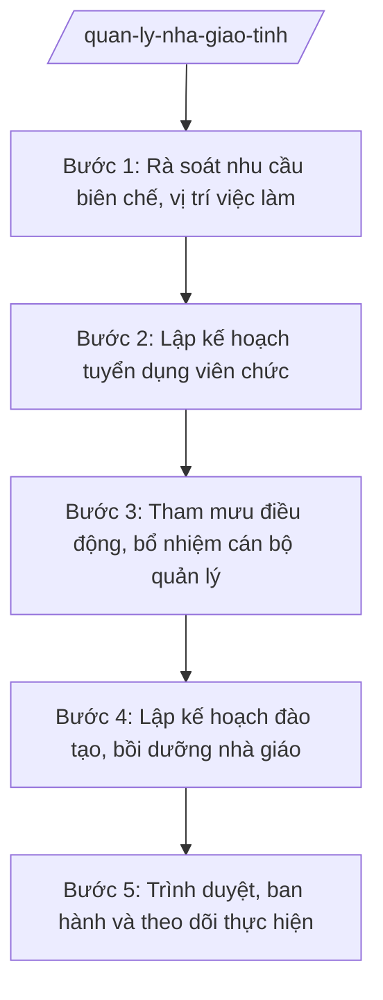

# Skill: Quản lý nhà giáo, CBQL giáo dục

## 2. Khi nào dùng

- Hằng năm: rà soát nhu cầu biên chế, vị trí việc làm của các trường THPT, trung tâm GDNN-GDTX và đơn vị trực thuộc Sở.
- Lập kế hoạch tuyển dụng viên chức ngành giáo dục (giáo viên, nhân viên) theo phân cấp.
- Tham mưu điều động, bổ nhiệm, bổ nhiệm lại hiệu trưởng, phó hiệu trưởng các trường THPT, giám đốc/phó giám đốc trung tâm GDNN-GDTX.
- Lập kế hoạch đào tạo, bồi dưỡng nhà giáo, cán bộ quản lý giáo dục hằng năm; tổng hợp nhu cầu bồi dưỡng theo tiêu chuẩn chức danh nghề nghiệp.

## 3. Đầu vào (Input)

| Trường | Mô tả | Bắt buộc |
|--------|-------|----------|
| `nam_hoc` | Năm học lập kế hoạch | Có |
| `nhu_cau_bien_che` | Nhu cầu biên chế, số lượng người làm việc của từng đơn vị trực thuộc Sở | Có |
| `danh_sach_vi_tri` | Vị trí cần tuyển/điều động/bổ nhiệm: chức danh, đơn vị, tiêu chuẩn | Có |
| `ho_so_nhan_su` | Hồ sơ cán bộ dự kiến bổ nhiệm/điều động: lý lịch, trình độ, quá trình công tác, kê khai tài sản | Có (với bổ nhiệm/điều động) |
| `ke_hoach_dao_tao` | Nhu cầu đào tạo, bồi dưỡng: nội dung, đối tượng, số lượng, kinh phí | Không |
| `tieu_chuan_chuc_danh` | Tiêu chuẩn chức danh nghề nghiệp, tiêu chuẩn bổ nhiệm CBQL theo quy định | Có |

## 4. Quy trình

**Bước 1. Rà soát nhu cầu biên chế, vị trí việc làm**

- Làm gì: Thu thập, tổng hợp nhu cầu biên chế, số lượng người làm việc, vị trí việc làm còn thiếu của các trường THPT, trung tâm GDNN-GDTX và đơn vị trực thuộc Sở; đối chiếu với biên chế được giao và định mức của ngành.
- Dùng input: `nam_hoc`, `nhu_cau_bien_che`, `danh_sach_vi_tri`.
- Vai trò: Chuyên viên Phòng Tổ chức cán bộ tổng hợp. AI hỗ trợ: tổng hợp số liệu từ biểu mẫu các đơn vị gửi, lập bảng đối chiếu nhu cầu – biên chế được giao – định mức, phát hiện đơn vị thừa/thiếu. ⏱ ~5–7 ngày làm việc (ước tính).
- Lưu ý nghiệp vụ: Số liệu phải dựa trên thực trạng đội ngũ (danh sách viên chức hiện có, số nghỉ hưu, chuyển công tác); không tổng hợp nhu cầu vượt quá khả năng cân đối biên chế của tỉnh.
- → Kết quả bước: Bảng tổng hợp nhu cầu biên chế, vị trí việc làm toàn ngành (khối Sở quản lý).

**Bước 2. Lập kế hoạch tuyển dụng viên chức**

- Làm gì: Xây dựng kế hoạch tuyển dụng viên chức ngành giáo dục năm …: chỉ tiêu theo vị trí việc làm, hình thức tuyển dụng (thi tuyển/xét tuyển), điều kiện, tiêu chuẩn, lịch trình; trình cấp có thẩm quyền phê duyệt.
- Dùng input: Kết quả bước 1; `tieu_chuan_chuc_danh`.
- Vai trò: Trưởng phòng Tổ chức cán bộ (ông Bùi Văn X) chủ trì xây dựng kế hoạch; phối hợp Sở Nội vụ theo phân cấp. AI hỗ trợ: soạn dự thảo kế hoạch tuyển dụng, lập bảng chỉ tiêu chi tiết theo đơn vị/vị trí, kiểm tra điều kiện tiêu chuẩn từng vị trí. ⏱ ~7–10 ngày làm việc (ước tính).
- Lưu ý nghiệp vụ: Kế hoạch tuyển dụng phải trong phạm vi số lượng người làm việc được giao; ưu tiên vị trí giáo viên các môn thiếu nhiều; công khai kế hoạch sau khi phê duyệt.
- → Kết quả bước: Dự thảo Kế hoạch tuyển dụng viên chức ngành giáo dục năm ….

**Bước 3. Tham mưu điều động, bổ nhiệm cán bộ quản lý**

- Làm gì: Rà soát quy hoạch cán bộ quản lý; thẩm định hồ sơ nhân sự dự kiến điều động, bổ nhiệm, bổ nhiệm lại (hiệu trưởng, phó hiệu trưởng trường THPT; giám đốc, phó giám đốc trung tâm GDNN-GDTX); lấy ý kiến tập thể lãnh đạo Sở; soạn tờ trình, dự thảo quyết định.
- Dùng input: `danh_sach_vi_tri`, `ho_so_nhan_su`, `tieu_chuan_chuc_danh`.
- Vai trò: Trưởng phòng Tổ chức cán bộ (ông Bùi Văn X) chủ trì thẩm định hồ sơ; tập thể lãnh đạo Sở cho ý kiến; Phó Giám đốc Sở (ông Đỗ Văn U) xem xét. AI hỗ trợ: lập bảng đối chiếu tiêu chuẩn bổ nhiệm với hồ sơ từng nhân sự, soạn dự thảo tờ trình và quyết định đúng thể thức, checklist hồ sơ bắt buộc. ⏱ ~10–15 ngày làm việc (ước tính).
- Lưu ý nghiệp vụ: Nhân sự bổ nhiệm phải trong quy hoạch, đạt tiêu chuẩn chức danh, kê khai tài sản đầy đủ; quy trình lấy ý kiến, bỏ phiếu thực hiện đúng quy định về công tác cán bộ; không bổ nhiệm người chưa đủ tiêu chuẩn.
- → Kết quả bước: Tờ trình + dự thảo Quyết định điều động/bổ nhiệm CBQL giáo dục.

**Bước 4. Lập kế hoạch đào tạo, bồi dưỡng nhà giáo**

- Làm gì: Tổng hợp nhu cầu đào tạo, bồi dưỡng của đội ngũ (bồi dưỡng theo tiêu chuẩn chức danh nghề nghiệp, bồi dưỡng chuyên môn, nghiệp vụ quản lý); xây dựng kế hoạch đào tạo, bồi dưỡng hằng năm kèm dự toán kinh phí; phối hợp cơ sở đào tạo tổ chức thực hiện.
- Dùng input: `ke_hoach_dao_tao`, kết quả bước 1.
- Vai trò: Chuyên viên Phòng Tổ chức cán bộ tổng hợp, Trưởng phòng (ông Bùi Văn X) kiểm tra. AI hỗ trợ: tổng hợp nhu cầu theo nhóm đối tượng/nội dung, lập bảng kế hoạch chi tiết (lớp bồi dưỡng, số lượng, thời gian, kinh phí), soạn dự thảo kế hoạch. ⏱ ~5–7 ngày làm việc (ước tính).
- Lưu ý nghiệp vụ: Ưu tiên bồi dưỡng giáo viên chưa đạt chuẩn trình độ, cán bộ quản lý mới bổ nhiệm; kinh phí bồi dưỡng phải trong dự toán được giao, không vượt trần quy định.
- → Kết quả bước: Dự thảo Kế hoạch đào tạo, bồi dưỡng nhà giáo, CBQL giáo dục năm ….

**Bước 5. Trình duyệt, ban hành và theo dõi thực hiện**

- Làm gì: Trình các dự thảo qua nấc kiểm duyệt của Sở; trình cấp có thẩm quyền phê duyệt/ban hành (kế hoạch tuyển dụng, quyết định bổ nhiệm CBQL thuộc thẩm quyền Chủ tịch UBND tỉnh); công khai, tổ chức thực hiện và theo dõi, báo cáo kết quả.
- Dùng input: Các dự thảo ở bước 2–4.
- Vai trò: Trưởng phòng Tổ chức cán bộ (ông Bùi Văn X) kiểm tra; Phó Giám đốc Sở (ông Đỗ Văn U) xem xét; Giám đốc Sở (ông Hoàng Văn S) ký tờ trình, ký ban hành kế hoạch thuộc thẩm quyền Sở; Chủ tịch UBND tỉnh (ông Phạm Văn P) phê duyệt kế hoạch tuyển dụng, ký quyết định bổ nhiệm hiệu trưởng trường THPT công lập. AI hỗ trợ: lập phiếu trình ký, kiểm tra lần cuối hồ sơ trình, tổng hợp báo cáo kết quả thực hiện. ⏱ ~7–10 ngày làm việc (ước tính).
- Lưu ý nghiệp vụ: Quyết định bổ nhiệm chỉ có hiệu lực sau khi người có thẩm quyền ký; công khai kết quả tuyển dụng, bổ nhiệm theo quy định; lưu hồ sơ cán bộ đầy đủ.
- → Kết quả bước: Các văn bản đã ban hành; báo cáo kết quả thực hiện công tác cán bộ, đào tạo bồi dưỡng.

## Luồng quy trình (Workflow)

## 5. Đầu ra (Output)

### Sản phẩm

1. **Kế hoạch đào tạo, bồi dưỡng nhà giáo, cán bộ quản lý giáo dục năm …** (sản phẩm chính) — Giám đốc Sở ký ban hành.
2. Kế hoạch tuyển dụng viên chức ngành giáo dục (trình Chủ tịch UBND tỉnh phê duyệt).
3. Tờ trình + dự thảo Quyết định điều động, bổ nhiệm CBQL giáo dục (trình Chủ tịch UBND tỉnh ký đối với hiệu trưởng trường THPT công lập).
4. Báo cáo kết quả công tác tổ chức cán bộ, đào tạo bồi dưỡng (định kỳ).

**Cấu trúc output chuẩn (Kế hoạch đào tạo, bồi dưỡng nhà giáo, CBQL giáo dục):**
- Thể thức: tuân thủ Nghị định 30/2020/NĐ-CP về công tác văn thư.

1. Quốc hiệu "CỘNG HÒA XÃ HỘI CHỦ NGHĨA VIỆT NAM", Tiêu ngữ "Độc lập – Tự do – Hạnh phúc": CỘNG HÒA XÃ HỘI CHỦ NGHĨA VIỆT NAM / Độc lập – Tự do – Hạnh phúc.
2. Tên cơ quan ban hành: SỞ GIÁO DỤC VÀ ĐÀO TẠO TỈNH A.
3. Số, ký hiệu văn bản: số/KH-SGDĐT.
4. Địa danh, ngày tháng năm ban hành: Tỉnh A, ngày … tháng … năm ….
5. Tên loại và trích yếu nội dung: KẾ HOẠCH / Đào tạo, bồi dưỡng nhà giáo, cán bộ quản lý giáo dục năm … tỉnh A.
6. Căn cứ ban hành: Luật Giáo dục; Thông tư 15/2025/TT-BGDĐT (Sở tham mưu quản lý nhà nước về tuyển dụng, điều động, bồi dưỡng đội ngũ nhà giáo theo phân cấp); văn bản chỉ đạo của UBND tỉnh A (ghi rõ số hiệu, ngày ban hành).
7. Nội dung chính:
   - I. Mục đích, yêu cầu;
   - II. Đối tượng, nội dung bồi dưỡng (theo tiêu chuẩn chức danh nghề nghiệp; chuyên môn, nghiệp vụ; kỹ năng quản lý);
   - III. Số lượng, hình thức, thời gian tổ chức từng lớp;
   - IV. Kinh phí thực hiện (nguồn kinh phí, dự toán chi tiết);
   - V. Tổ chức thực hiện (trách nhiệm Phòng Tổ chức cán bộ, các phòng liên quan, các trường, cơ sở đào tạo).
8. Nơi nhận (UBND tỉnh; Sở Nội vụ; Sở Tài chính; các trường THPT; trung tâm GDNN-GDTX; đơn vị trực thuộc; lưu VT, TCCB).
9. Chữ ký, họ tên người ký: GIÁM ĐỐC / (ký, đóng dấu, ghi rõ họ tên).

## 6. Checklist nghiệm thu

- [ ] Đủ 9 phần theo Cấu trúc output chuẩn mục 5, đúng thứ tự thể thức NĐ 30/2020/NĐ-CP.
- [ ] Số liệu nhu cầu biên chế, vị trí việc làm khớp với thực trạng đội ngũ và biên chế được giao.
- [ ] Chỉ tiêu tuyển dụng trong phạm vi số lượng người làm việc được giao; tiêu chuẩn từng vị trí rõ ràng, đúng quy định.
- [ ] Hồ sơ nhân sự bổ nhiệm/điều động đầy đủ thành phần (lý lịch, trình độ, quy hoạch, kê khai tài sản); đạt tiêu chuẩn chức danh.
- [ ] Kế hoạch đào tạo, bồi dưỡng có dự toán kinh phí chi tiết, trong khả năng cân đối ngân sách.
- [ ] Căn cứ pháp lý ghi đúng số hiệu TT 15/2025/TT-BGDĐT; không bịa số hiệu văn bản khác.
- [ ] Đã qua đủ nấc human gate: chuyên viên → Trưởng phòng TCCB → tập thể lãnh đạo Sở (với bổ nhiệm) → Phó Giám đốc Sở → Giám đốc Sở → Chủ tịch UBND tỉnh (phê duyệt/ký các nội dung thuộc thẩm quyền).
- [ ] Kết quả tuyển dụng, bổ nhiệm được công khai; hồ sơ cán bộ lưu đầy đủ.

## 7. Ví dụ mô phỏng

*Dữ liệu dưới đây là giả lập 100% phục vụ minh họa.*

**Input mẫu:**

| Trường | Giá trị mẫu |
|--------|-------------|
| nam_hoc | 2026–2027 |
| nhu_cau_bien_che | Thiếu 50 giáo viên THPT (Toán 15, Ngữ văn 10, Tiếng Anh 25); 03 vị trí hiệu trưởng đến tuổi bổ nhiệm lại |
| danh_sach_vi_tri | Giáo viên THPT các môn; hiệu trưởng 03 trường THPT |
| ho_so_nhan_su | Hồ sơ 03 nhân sự quy hoạch hiệu trưởng, đủ tiêu chuẩn |
| ke_hoach_dao_tao | Bồi dưỡng 200 giáo viên theo tiêu chuẩn chức danh; 30 CBQL mới |
| tieu_chuan_chuc_danh | Theo quy định về tiêu chuẩn chức danh nghề nghiệp viên chức ngành giáo dục |

**Output mẫu:**

CỘNG HÒA XÃ HỘI CHỦ NGHĨA VIỆT NAM
Độc lập – Tự do – Hạnh phúc
---------------

SỞ GIÁO DỤC VÀ ĐÀO TẠO TỈNH A

Số: 456/KH-SGDĐT

Tỉnh A, ngày 10 tháng 9 năm 2026

**KẾ HOẠCH**
**Đào tạo, bồi dưỡng nhà giáo, cán bộ quản lý giáo dục năm 2027 tỉnh A**

*Căn cứ* Luật Giáo dục;
*Căn cứ* Thông tư số 15/2025/TT-BGDĐT ngày 24/7/2025 của Bộ Giáo dục và Đào tạo hướng dẫn chức năng, nhiệm vụ, quyền hạn của Sở Giáo dục và Đào tạo và Phòng Văn hóa – Xã hội trong lĩnh vực giáo dục và đào tạo;
*Căn cứ* Công văn số 890/UBND-VX ngày 25/8/2026 của UBND tỉnh A về nhiệm vụ năm học 2026–2027;

Sở Giáo dục và Đào tạo tỉnh A ban hành Kế hoạch đào tạo, bồi dưỡng nhà giáo, cán bộ quản lý giáo dục năm 2027 như sau:

**I. MỤC ĐÍCH, YÊU CẦU**

Nâng cao trình độ chuyên môn, nghiệp vụ cho 100% giáo viên chưa đạt chuẩn và cán bộ quản lý mới bổ nhiệm thuộc các đơn vị do Sở trực tiếp quản lý.

**II. NỘI DUNG, ĐỐI TƯỢNG**

1. Bồi dưỡng theo tiêu chuẩn chức danh nghề nghiệp: 200 giáo viên THPT.
2. Bồi dưỡng nghiệp vụ quản lý: 30 cán bộ quản lý mới bổ nhiệm, bổ nhiệm lại.
3. Bồi dưỡng chuyên môn các môn thiếu giáo viên (Toán, Ngữ văn, Tiếng Anh).

**III. KINH PHÍ**

Dự toán 500 triệu đồng từ nguồn ngân sách tỉnh giao cho Sở năm 2027.

**IV. TỔ CHỨC THỰC HIỆN**

Phòng Tổ chức cán bộ chủ trì, phối hợp các phòng liên quan và cơ sở đào tạo tổ chức thực hiện; các trường THPT, trung tâm GDNN-GDTX cử cán bộ, giáo viên tham gia đầy đủ./.

***Nơi nhận:***
- UBND tỉnh (báo cáo);
- Sở Nội vụ; Sở Tài chính;
- Các trường THPT; các trung tâm GDNN-GDTX;
- Lưu: VT, TCCB.

**GIÁM ĐỐC**

*(Ký, đóng dấu)*

**Hoàng Văn S**

## 8. Human gate (người kiểm duyệt)

- Chuyên viên Phòng Tổ chức cán bộ soạn số liệu, dự thảo kế hoạch, tờ trình; chịu trách nhiệm về tính chính xác của số liệu đội ngũ và hồ sơ nhân sự.
- Trưởng phòng Tổ chức cán bộ (ông Bùi Văn X) kiểm tra toàn bộ hồ sơ ở các bước 1–4; trả lại sửa nếu chưa đạt.
- Tập thể lãnh đạo Sở cho ý kiến đối với nhân sự điều động, bổ nhiệm CBQL (bước 3).
- Phó Giám đốc Sở (ông Đỗ Văn U) xem xét trước khi trình Giám đốc Sở.
- Giám đốc Sở (ông Hoàng Văn S) ký ban hành kế hoạch đào tạo, bồi dưỡng; ký tờ trình trình UBND tỉnh.
- Chủ tịch UBND tỉnh (ông Phạm Văn P) phê duyệt kế hoạch tuyển dụng viên chức, ký quyết định bổ nhiệm hiệu trưởng trường THPT công lập (nội dung thuộc thẩm quyền Chủ tịch UBND tỉnh).

## 9. Giới hạn (guardrails)

- AI KHÔNG ra quyết định hành chính thay người có thẩm quyền (không quyết định tuyển dụng, điều động, bổ nhiệm, kỷ luật cán bộ, nhà giáo).
- AI không tự ký, đóng dấu, phát hành văn bản dưới danh nghĩa Sở GD&ĐT, UBND tỉnh hay bất kỳ cá nhân nào.
- AI không bịa số liệu biên chế, hồ sơ nhân sự, kết quả bỏ phiếu tín nhiệm; mọi thông tin cán bộ phải có nguồn từ hồ sơ chính thức.
- AI không bịa căn cứ pháp lý, số hiệu văn bản; không viện dẫn văn bản đã hết hiệu lực.
- AI không đánh giá, xếp loại cán bộ thay hội đồng; không gợi ý nhân sự cụ thể cho vị trí bổ nhiệm ngoài danh sách do cấp có thẩm quyền cung cấp.

## 10. Căn cứ & lưu ý

- Thông tư 15/2025/TT-BGDĐT ngày 24/7/2025 của Bộ GD&ĐT (hiệu lực 24/7/2025) — Sở GD&ĐT tham mưu quản lý nhà nước về tuyển dụng, điều động, bồi dưỡng đội ngũ nhà giáo theo phân cấp (thay thế TT 12/2020/TT-BGDĐT).
- Thông tư 45/2026/TT-BGDĐT ngày 10/6/2026 của Bộ GD&ĐT (hiệu lực 10/6/2026) — sửa đổi, bổ sung TT 15/2025/TT-BGDĐT.
- Nghị định 142/2025/NĐ-CP ngày 12/6/2025 — phân định thẩm quyền của chính quyền địa phương 02 cấp trong lĩnh vực quản lý nhà nước của Bộ GD&ĐT.
- Nghị định 143/2025/NĐ-CP ngày 12/6/2025 — phân quyền, phân cấp trong lĩnh vực quản lý nhà nước của Bộ GD&ĐT.
- Nghị định 150/2025/NĐ-CP ngày 12/6/2025 (hiệu lực 16/6/2025) — tổ chức cơ quan chuyên môn thuộc UBND cấp tỉnh.
- Nghị định 30/2020/NĐ-CP — thể thức văn bản hành chính.
- Lưu ý: tiêu chuẩn chức danh nghề nghiệp, quy trình tuyển dụng, bổ nhiệm viên chức ngành giáo dục thực hiện theo quy định pháp luật chuyên ngành; số hiệu văn bản chuyên ngành không có trong danh mục được phép trích dẫn thì ghi "theo quy định pháp luật chuyên ngành", tuyệt đối không bịa số hiệu.
