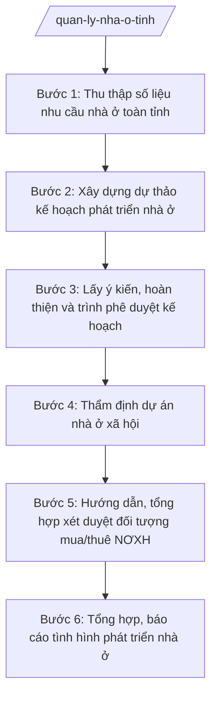

# Skill: Quản lý nhà ở, nhà ở xã hội

## 2. Khi nào dùng

- Sở Xây dựng tỉnh A xây dựng kế hoạch phát triển nhà ở của tỉnh (giai đoạn, hằng năm) trình UBND tỉnh phê duyệt;
- Chủ đầu tư đề nghị thẩm định dự án đầu tư xây dựng nhà ở xã hội, nhà ở cho lực lượng vũ trang, nhà ở công vụ trên địa bàn tỉnh;
- Cần hướng dẫn UBND cấp xã, chủ đầu tư về trình tự xét duyệt đối tượng được mua, thuê, thuê mua nhà ở xã hội; tổng hợp nhu cầu, kết quả xét duyệt toàn tỉnh;
- Cần tổng hợp, báo cáo tình hình phát triển nhà ở, nhà ở xã hội gửi UBND tỉnh và Bộ Xây dựng.

## 3. Đầu vào (Input)

| Trường | Mô tả | Bắt buộc |
|--------|-------|----------|
| `ke_hoach_hien_hanh` | Kế hoạch phát triển nhà ở hiện hành của tỉnh (nếu có) | Không |
| `so_lieu_nhu_cau` | Số liệu nhu cầu nhà ở: dân số, hộ nghèo, công nhân, cán bộ... theo địa bàn | Có |
| `ho_so_du_an_noxh` | Hồ sơ dự án nhà ở xã hội đề nghị thẩm định (chủ trương đầu tư, thiết kế, phương án giá...) | Có (thẩm định dự án) |
| `danh_sach_doi_tuong` | Danh sách đối tượng đề nghị mua/thuê NƠXH do cấp xã/chủ đầu tư tổng hợp | Có (xét duyệt đối tượng) |
| `giay_to_chung_minh` | Giấy tờ chứng minh đối tượng, điều kiện về nhà ở, thu nhập của từng trường hợp | Có (xét duyệt đối tượng) |
| `bao_cao_cap_xa` | Báo cáo của UBND xã về nhu cầu, tình hình triển khai nhà ở trên địa bàn | Không |

## 4. Quy trình

**Bước 1. Thu thập số liệu nhu cầu nhà ở toàn tỉnh**
- Làm gì: Đề nghị UBND các xã báo cáo số liệu nhu cầu nhà ở (hộ nghèo, công nhân khu công nghiệp, cán bộ, người thu nhập thấp...); thu thập số liệu dân số, quỹ đất, dự án nhà ở đang triển khai; tổng hợp thành cơ sở dữ liệu nhu cầu nhà ở.
- Dùng input: `so_lieu_nhu_cau`, `bao_cao_cap_xa`.
- Vai trò: Chuyên viên Phòng Quản lý nhà ở thu thập, AI hỗ trợ thiết kế biểu mẫu thu thập số liệu, tổng hợp số liệu các xã thành bảng toàn tỉnh, phát hiện số liệu bất thường để kiểm tra lại; ⏱ ~10–15 ngày làm việc (ước tính).
- Lưu ý nghiệp vụ: Số liệu phải có nguồn gốc rõ ràng, do UBND xã xác nhận; phân loại nhu cầu theo nhóm đối tượng để làm căn cứ xây dựng chỉ tiêu.
- → Kết quả bước: Bảng tổng hợp nhu cầu nhà ở toàn tỉnh theo nhóm đối tượng, địa bàn.

**Bước 2. Xây dựng dự thảo kế hoạch phát triển nhà ở**
- Làm gì: Phân tích số liệu nhu cầu, quỹ đất, khả năng cân đối nguồn lực; xác định chỉ tiêu phát triển nhà ở (tổng diện tích sàn, số lượng nhà ở xã hội, nhà ở thương mại...); soạn dự thảo kế hoạch phát triển nhà ở giai đoạn/hằng năm.
- Dùng input: Kết quả Bước 1, `ke_hoach_hien_hanh`.
- Vai trò: Trưởng phòng Quản lý nhà ở chủ trì xây dựng, AI hỗ trợ soạn dự thảo kế hoạch theo khung chuẩn, lập bảng chỉ tiêu, kiểm tra tính khả thi của chỉ tiêu so với quỹ đất và nguồn lực; ⏱ ~7–10 ngày làm việc (ước tính).
- Lưu ý nghiệp vụ: Chỉ tiêu nhà ở xã hội phải gắn với quỹ đất đã quy hoạch; kế hoạch phải phù hợp quy hoạch tỉnh và định hướng của Bộ Xây dựng.
- → Kết quả bước: Dự thảo kế hoạch phát triển nhà ở của tỉnh.

**Bước 3. Lấy ý kiến, hoàn thiện và trình phê duyệt kế hoạch**
- Làm gì: Lấy ý kiến các sở, ngành liên quan (Tài chính, Nông nghiệp và Môi trường, Kế hoạch...), UBND xã; tổng hợp, tiếp thu; soạn Tờ trình của Sở trình UBND tỉnh phê duyệt kế hoạch phát triển nhà ở.
- Dùng input: Dự thảo kế hoạch ở Bước 2.
- Vai trò: Chuyên viên Phòng Quản lý nhà ở tổng hợp ý kiến, AI hỗ trợ lập bảng tổng hợp ý kiến, soạn Tờ trình và dự thảo quyết định phê duyệt đúng thể thức NĐ 30/2020/NĐ-CP; ⏱ ~7–10 ngày làm việc (ước tính).
- Lưu ý nghiệp vụ: Kế hoạch phát triển nhà ở do UBND tỉnh phê duyệt; sau phê duyệt phải công bố để tổ chức, cá nhân biết, thực hiện.
- → Kết quả bước: Tờ trình + dự thảo quyết định phê duyệt kế hoạch phát triển nhà ở trình UBND tỉnh.

**Bước 4. Thẩm định dự án nhà ở xã hội**
- Làm gì: Tiếp nhận hồ sơ dự án NƠXH của chủ đầu tư; kiểm tra sự phù hợp với kế hoạch phát triển nhà ở, quy hoạch, đối tượng thụ hưởng; thẩm định phương án giá bán, giá thuê; lập báo cáo thẩm định, trình UBND tỉnh chấp thuận/quyết định chủ trương.
- Dùng input: `ho_so_du_an_noxh`, kế hoạch phát triển nhà ở đã phê duyệt.
- Vai trò: Chuyên viên Phòng Quản lý nhà ở thẩm định, AI hỗ trợ lập bảng thẩm tra hồ sơ, đối chiếu chỉ tiêu dự án với kế hoạch và quy hoạch, soạn báo cáo thẩm định; ⏱ ~10–15 ngày làm việc (ước tính).
- Lưu ý nghiệp vụ: Dự án NƠXH phải đúng đối tượng, đúng quỹ đất quy hoạch; giá bán, giá thuê phải được thẩm định chặt chẽ, tránh trục lợi chính sách.
- → Kết quả bước: Báo cáo thẩm định dự án NƠXH + tờ trình UBND tỉnh.

**Bước 5. Hướng dẫn, tổng hợp xét duyệt đối tượng mua/thuê NƠXH**
- Làm gì: Ban hành văn bản hướng dẫn UBND xã, chủ đầu tư về trình tự, thủ tục xét duyệt đối tượng được mua, thuê, thuê mua NƠXH; tiếp nhận danh sách tổng hợp; kiểm tra tính hợp lệ của hồ sơ chứng minh đối tượng, điều kiện về nhà ở, thu nhập; tổng hợp kết quả toàn tỉnh.
- Dùng input: `danh_sach_doi_tuong`, `giay_to_chung_minh`.
- Vai trò: Chuyên viên Phòng Quản lý nhà ở hướng dẫn, kiểm tra, AI hỗ trợ soạn văn bản hướng dẫn, lập bảng kiểm tra điều kiện từng trường hợp, phát hiện trùng lặp đối tượng giữa các dự án; ⏱ ~7–10 ngày làm việc (ước tính).
- Lưu ý nghiệp vụ: Việc xét duyệt đối tượng phải công khai, minh bạch; ngăn chặn mua bán, chuyển nhượng suất NƠXH trái quy định; cấp xã chịu trách nhiệm xác nhận tình trạng nhà ở của đối tượng trên địa bàn.
- → Kết quả bước: Văn bản hướng dẫn xét duyệt + bảng tổng hợp kết quả xét duyệt đối tượng NƠXH toàn tỉnh.

**Bước 6. Tổng hợp, báo cáo tình hình phát triển nhà ở**
- Làm gì: Tổng hợp kết quả thực hiện kế hoạch phát triển nhà ở, tình hình triển khai dự án NƠXH, kết quả xét duyệt đối tượng; báo cáo UBND tỉnh và Bộ Xây dựng theo định kỳ; đề xuất giải pháp tháo gỡ khó khăn.
- Dùng input: Kết quả Bước 1–5, báo cáo của chủ đầu tư, UBND xã.
- Vai trò: Trưởng phòng Quản lý nhà ở tổng hợp, AI hỗ trợ soạn báo cáo định kỳ theo khung chuẩn, lập biểu số liệu, so sánh tiến độ với chỉ tiêu kế hoạch; ⏱ ~5–7 ngày làm việc (ước tính).
- Lưu ý nghiệp vụ: Số liệu báo cáo phải thống nhất giữa các kỳ; nêu rõ khó khăn, vướng mắc và kiến nghị cụ thể.
- → Kết quả bước: Báo cáo tình hình phát triển nhà ở, nhà ở xã hội của tỉnh.

## Luồng quy trình (Workflow)

## 5. Đầu ra (Output)

- Bảng tổng hợp nhu cầu nhà ở toàn tỉnh;
- Kế hoạch phát triển nhà ở của tỉnh (UBND tỉnh phê duyệt);
- Báo cáo thẩm định dự án nhà ở xã hội + tờ trình;
- Văn bản hướng dẫn xét duyệt đối tượng mua/thuê NƠXH gửi cấp xã, chủ đầu tư;
- Bảng tổng hợp kết quả xét duyệt đối tượng NƠXH toàn tỉnh;
- Báo cáo định kỳ tình hình phát triển nhà ở gửi UBND tỉnh, Bộ Xây dựng.

**Cấu trúc output chuẩn (Tờ trình phê duyệt kế hoạch phát triển nhà ở):**
- Thể thức: tuân thủ Nghị định 30/2020/NĐ-CP về công tác văn thư.

1. Quốc hiệu "CỘNG HÒA XÃ HỘI CHỦ NGHĨA VIỆT NAM", Tiêu ngữ "Độc lập – Tự do – Hạnh phúc";
2. Tên cơ quan: SỞ XÂY DỰNG TỈNH A; số, ký hiệu văn bản; địa danh và ngày, tháng, năm;
3. Tên loại và trích yếu: TỜ TRÌNH — Về việc đề nghị phê duyệt Kế hoạch phát triển nhà ở tỉnh A giai đoạn...;
4. Phần "Kính gửi": Ủy ban nhân dân tỉnh A;
5. Căn cứ (Luật Nhà ở; văn bản về phân định thẩm quyền, phân quyền, phân cấp lĩnh vực xây dựng; Thông tư 10/2025/TT-BXD; văn bản giao nhiệm vụ...);
6. Nội dung: sự cần thiết xây dựng kế hoạch; kết quả tổng hợp nhu cầu nhà ở; chỉ tiêu phát triển nhà ở (tổng diện tích sàn, NƠXH, nhà ở thương mại...); nguồn lực thực hiện; tổ chức thực hiện; đề nghị UBND tỉnh xem xét, phê duyệt;
7. Nơi nhận;
8. Thẩm quyền, chức vụ, họ tên người ký: TM. SỞ XÂY DỰNG — GIÁM ĐỐC — (chữ ký, họ tên), dấu của cơ quan.

## 6. Checklist nghiệm thu

- [ ] Số liệu nhu cầu nhà ở có nguồn gốc rõ ràng, do UBND xã xác nhận;
- [ ] Chỉ tiêu kế hoạch gắn với quỹ đất quy hoạch, phù hợp quy hoạch tỉnh;
- [ ] Đã lấy ý kiến đầy đủ sở, ngành, UBND xã trước khi trình phê duyệt;
- [ ] Kế hoạch phát triển nhà ở do UBND tỉnh phê duyệt, được công bố công khai;
- [ ] Dự án NƠXH được thẩm định đúng đối tượng, đúng quỹ đất, giá bán/thuê được kiểm soát;
- [ ] Văn bản hướng dẫn xét duyệt đối tượng rõ trình tự, công khai, minh bạch;
- [ ] Không có trùng lặp đối tượng giữa các dự án; ngăn chặn trục lợi chính sách;
- [ ] Báo cáo định kỳ đúng hạn, số liệu thống nhất giữa các kỳ.

## 7. Ví dụ mô phỏng

*Dữ liệu dưới đây là giả lập 100% phục vụ minh họa.*

### Input mẫu

| Trường | Giá trị giả lập |
|--------|-----------------|
| so_lieu_nhu_cau | 500 hộ nghèo cần hỗ trợ nhà ở; 2.000 công nhân khu công nghiệp A có nhu cầu thuê NƠXH; 300 cán bộ trẻ |
| ho_so_du_an_noxh | Dự án NƠXH Khu đô thị phía Tây xã A: 1.000 căn hộ, chủ đầu tư Công ty Cổ phần Nhà ở A |
| danh_sach_doi_tuong | 1.200 hồ sơ đề nghị mua/thuê NƠXH do UBND xã A và chủ đầu tư tổng hợp |

### Output mẫu (Tờ trình — trích)

> **CỘNG HÒA XÃ HỘI CHỦ NGHĨA VIỆT NAM**
> **Độc lập – Tự do – Hạnh phúc**
>
> Số: 123/TTr-SXD
> *Tỉnh A, ngày 15 tháng 5 năm 2027*
>
> **TỜ TRÌNH**
> **Về việc đề nghị phê duyệt Kế hoạch phát triển nhà ở tỉnh A giai đoạn 2027–2030**
>
> Kính gửi: Ủy ban nhân dân tỉnh A.
>
> Căn cứ Luật Nhà ở; văn bản quy định về phân định thẩm quyền chính quyền địa phương 2 cấp, phân quyền, phân cấp trong lĩnh vực quản lý nhà nước của Bộ Xây dựng; Thông tư 10/2025/TT-BXD ngày 14/6/2025 của Bộ Xây dựng; ...
>
> Sở Xây dựng tỉnh A kính trình UBND tỉnh xem xét, phê duyệt Kế hoạch phát triển nhà ở tỉnh A giai đoạn 2027–2030 với các nội dung chủ yếu:
>
> 1. Chỉ tiêu: tổng diện tích sàn nhà ở tăng thêm 500.000 m²; trong đó nhà ở xã hội 100.000 m² (2.000 căn)...
> 2. Nhu cầu: 500 hộ nghèo, 2.000 công nhân khu công nghiệp A, 300 cán bộ trẻ...
> 3. Giải pháp: bố trí quỹ đất NƠXH theo quy hoạch; thu hút đầu tư 03 dự án NƠXH; hỗ trợ hộ nghèo xây dựng nhà ở...
>
> *Nơi nhận:* ...
>
> **TM. SỞ XÂY DỰNG**
> **GIÁM ĐỐC**
> *(Chữ ký, dấu)*
> **Hoàng Văn S**

## 8. Human gate

- Chuyên viên Phòng Quản lý nhà ở thu thập số liệu, thẩm định hồ sơ;
- Trưởng phòng Quản lý nhà ở kiểm tra, soạn thảo kế hoạch, báo cáo thẩm định;
- Phó Giám đốc/Giám đốc Sở ký tờ trình, văn bản hướng dẫn;
- Chủ tịch UBND tỉnh A ký quyết định phê duyệt kế hoạch phát triển nhà ở, chấp thuận dự án NƠXH (AI không thay người ký).

## 9. Giới hạn

- AI KHÔNG quyết định phê duyệt kế hoạch, chấp thuận dự án hay xét duyệt đối tượng thay người có thẩm quyền;
- Không bịa số liệu nhu cầu, chỉ tiêu, căn cứ pháp lý; số liệu phải từ báo cáo của cấp xã, chủ đầu tư;
- Không dùng văn bản đã hết hiệu lực; chỉ viện dẫn văn bản có thật trong `tai-lieu-moi-nhat.md`;
- Việc xác nhận tình trạng nhà ở, thu nhập của đối tượng thuộc trách nhiệm của cấp xã và chủ đầu tư — AI chỉ hỗ trợ kiểm tra tính hợp lệ, phát hiện trùng lặp.

## 10. Căn cứ & lưu ý

- NĐ 140/2025/NĐ-CP ngày 12/6/2025 — phân định thẩm quyền CQĐP 2 cấp trong lĩnh vực quản lý nhà nước của Bộ Xây dựng;
- NĐ 144/2025/NĐ-CP ngày 12/6/2025 — phân quyền, phân cấp trong lĩnh vực quản lý nhà nước của Bộ Xây dựng;
- TT 10/2025/TT-BXD ngày 14/6/2025 — hướng dẫn chức năng, nhiệm vụ, quyền hạn của Sở Xây dựng, Sở Quy hoạch – Kiến trúc và lĩnh vực xây dựng cấp xã;
- NĐ 150/2025/NĐ-CP (hiệu lực 16/6/2025); NĐ 370/2025/NĐ-CP sửa đổi, bổ sung;
- NĐ 30/2020/NĐ-CP — thể thức, kỹ thuật trình bày văn bản hành chính;
- Luật Nhà ở: chỉ nêu tên, không bịa số hiệu.
