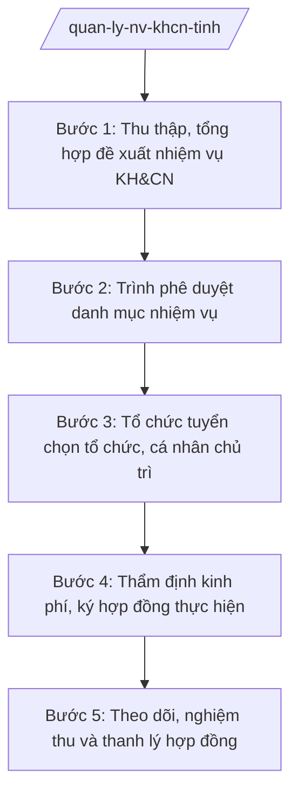

# Skill: Quản lý nhiệm vụ KH&CN cấp tỉnh

## 2. Khi nào dùng
- Lập danh mục nhiệm vụ KH&CN cấp tỉnh hằng năm (đăng ký, đề xuất đề tài/dự án).
- Tổ chức tuyển chọn tổ chức, cá nhân chủ trì thực hiện nhiệm vụ KH&CN.
- Thẩm định nội dung, kinh phí và ký hợp đồng thực hiện nhiệm vụ KH&CN.
- Kiểm tra tiến độ, tổ chức nghiệm thu kết quả nhiệm vụ KH&CN cấp tỉnh.
- Tổng hợp, báo cáo kết quả thực hiện nhiệm vụ KH&CN gửi Bộ KH&CN và UBND tỉnh.

## 3. Đầu vào (Input)
| Trường | Mô tả | Bắt buộc |
|--------|-------|----------|
| `nam_ke_hoach` | Năm lập danh mục nhiệm vụ KH&CN | Có |
| `de_xuat_nhiem_vu` | Đề xuất nhiệm vụ của sở, ngành, UBND xã, viện/trường/đơn vị (tên nhiệm vụ, mục tiêu, sản phẩm dự kiến, kinh phí sơ bộ) | Có |
| `tieu_chi_uu_tien` | Tiêu chí ưu tiên của tỉnh (gắn chiến lược phát triển KT-XH, nhiệm vụ đột phá) | Không |
| `ho_so_dang_ky` | Hồ sơ đăng ký tuyển chọn của tổ chức/cá nhân chủ trì | Không |
| `kinh_phi_du_kien` | Kinh phí đề xuất, nguồn ngân sách sự nghiệp KH&CN của tỉnh | Có |
| `nguoi_ky` | Người có thẩm quyền ký (Chủ tịch UBND tỉnh đối với Quyết định phê duyệt danh mục) | Có |

## 4. Quy trình

**Bước 1. Thu thập, tổng hợp đề xuất nhiệm vụ KH&CN**
- Làm gì: Tổng hợp đề xuất nhiệm vụ KH&CN từ các sở, ban, ngành, UBND xã, viện, trường, doanh nghiệp; sàng lọc trùng lặp với danh mục các năm trước; phân loại theo lĩnh vực.
- Dùng input: `de_xuat_nhiem_vu`, `tieu_chi_uu_tien`, `nam_ke_hoach`
- Vai trò: Chuyên viên Phòng Quản lý khoa học tổng hợp; AI hỗ trợ phân loại theo lĩnh vực, rà soát trùng lặp với danh mục nhiệm vụ đã thực hiện ⏱ ~3 ngày làm việc (ước tính)
- Lưu ý nghiệp vụ: Đề xuất phải xuất phát từ nhu cầu thực tiễn của tỉnh, gắn với nhiệm vụ phát triển KT-XH; không trùng nhiệm vụ đã và đang thực hiện; mức kinh phí phù hợp với nguồn ngân sách KH&CN của tỉnh.
- → Kết quả bước: Bảng tổng hợp đề xuất nhiệm vụ KH&CN năm (phân loại lĩnh vực, kinh phí sơ bộ).

**Bước 2. Trình phê duyệt danh mục nhiệm vụ**
- Làm gì: Lập Tờ trình của Sở KH&CN và dự thảo Quyết định phê duyệt danh mục nhiệm vụ KH&CN cấp tỉnh hằng năm, trình UBND tỉnh ban hành.
- Dùng input: Bảng tổng hợp đề xuất ở Bước 1, `kinh_phi_du_kien`, `nguoi_ky`
- Vai trò: Trưởng phòng Quản lý khoa học thẩm tra nội dung; Phó Giám đốc Sở xem xét; Giám đốc Sở ký Tờ trình trình UBND tỉnh; Chủ tịch UBND tỉnh ký Quyết định phê duyệt; AI hỗ trợ kiểm tra tính đầy đủ của hồ sơ trình, soạn phiếu trình ký ⏱ ~3 ngày làm việc (ước tính)
- Lưu ý nghiệp vụ: Quyết định phê duyệt danh mục là căn cứ pháp lý để tổ chức tuyển chọn và bố trí kinh phí; thể thức văn bản đúng NĐ 30/2020/NĐ-CP; danh mục kèm phụ lục chi tiết từng nhiệm vụ.
- → Kết quả bước: Tờ trình + dự thảo Quyết định phê duyệt danh mục nhiệm vụ KH&CN (số 1234/QĐ-UBND).

**Bước 3. Tổ chức tuyển chọn tổ chức, cá nhân chủ trì**
- Làm gì: Thông báo tuyển chọn; tiếp nhận hồ sơ đăng ký; thành lập và tổ chức họp Hội đồng tuyển chọn đánh giá hồ sơ theo tiêu chí đã công bố.
- Dùng input: `ho_so_dang_ky`, danh mục nhiệm vụ đã phê duyệt
- Vai trò: Chuyên viên kiểm tra tính đầy đủ, hợp lệ của hồ sơ đăng ký; Hội đồng tuyển chọn (do Giám đốc Sở thành lập) đánh giá, chấm điểm; AI hỗ trợ tổng hợp điểm đánh giá, soạn biên bản họp ⏱ ~5 ngày làm việc (ước tính)
- Lưu ý nghiệp vụ: Hồ sơ phải đủ điều kiện theo thông báo tuyển chọn; đánh giá theo đúng tiêu chí đã công bố; bảo đảm công khai, minh bạch, khách quan.
- → Kết quả bước: Biên bản họp Hội đồng tuyển chọn + danh sách tổ chức/cá nhân trúng tuyển.

**Bước 4. Thẩm định kinh phí, ký hợp đồng thực hiện**
- Làm gì: Thẩm định nội dung, dự toán kinh phí từng nhiệm vụ trúng tuyển; soạn thảo, ký hợp đồng thực hiện nhiệm vụ KH&CN giữa Sở KH&CN và đơn vị chủ trì.
- Dùng input: `ho_so_dang_ky`, `kinh_phi_du_kien`
- Vai trò: Chuyên viên thẩm định nội dung, dự toán kinh phí; Trưởng phòng kiểm tra; Giám đốc Sở ký hợp đồng; AI hỗ trợ đối chiếu dự toán với định mức, rà soát điều khoản hợp đồng ⏱ ~3 ngày làm việc (ước tính)
- Lưu ý nghiệp vụ: Kinh phí phải tiết kiệm, đúng định mức, chế độ hiện hành; hợp đồng ghi rõ tiến độ, sản phẩm bàn giao, trách nhiệm các bên, điều khoản thanh lý.
- → Kết quả bước: Hợp đồng thực hiện nhiệm vụ KH&CN đã ký.

**Bước 5. Theo dõi, nghiệm thu và thanh lý hợp đồng**
- Làm gì: Kiểm tra tiến độ thực hiện định kỳ; tổ chức Hội đồng nghiệm thu đánh giá kết quả; thanh lý hợp đồng; tổng hợp báo cáo năm.
- Dùng input: Báo cáo tiến độ, báo cáo tổng kết của đơn vị chủ trì
- Vai trò: Chuyên viên theo dõi tiến độ, đôn đốc; Hội đồng nghiệm thu đánh giá kết quả; Phó Giám đốc Sở phê duyệt kết quả nghiệm thu; AI hỗ trợ soạn biên bản nghiệm thu, đối chiếu sản phẩm bàn giao với hợp đồng ⏱ ~5 ngày làm việc (ước tính)
- Lưu ý nghiệp vụ: Sản phẩm nghiệm thu phải đúng cam kết trong hợp đồng; đánh giá mức độ đạt/không đạt rõ ràng; kết quả nghiệm thu là cơ sở thanh quyết toán kinh phí.
- → Kết quả bước: Biên bản nghiệm thu + báo cáo tổng kết nhiệm vụ KH&CN năm của tỉnh.

## Luồng quy trình (Workflow)

## 5. Đầu ra (Output)
- Quyết định phê duyệt danh mục nhiệm vụ KH&CN cấp tỉnh hằng năm (kèm phụ lục danh mục).
- Hợp đồng thực hiện nhiệm vụ KH&CN đã ký.
- Biên bản nghiệm thu kết quả nhiệm vụ KH&CN.
- Báo cáo tổng kết nhiệm vụ KH&CN năm gửi Bộ KH&CN, UBND tỉnh.

**Cấu trúc output chuẩn:**
Khung Quyết định phê duyệt danh mục nhiệm vụ KH&CN (theo NĐ 30/2020/NĐ-CP):
1. Quốc hiệu "CỘNG HÒA XÃ HỘI CHỦ NGHĨA VIỆT NAM", Tiêu ngữ "Độc lập – Tự do – Hạnh phúc".
2. Số, ký hiệu văn bản: số 1234/QĐ-UBND.
3. Địa danh và ngày, tháng, năm: "Tỉnh A, ngày ... tháng ... năm ...".
4. Tên loại và trích yếu: "QUYẾT ĐỊNH / Phê duyệt danh mục nhiệm vụ khoa học và công nghệ cấp tỉnh năm ...".
5. Căn cứ: TT 10/2025/TT-BKHCN; NĐ 132/2025/NĐ-CP; NĐ 150/2025/NĐ-CP; quy định của UBND tỉnh A về quản lý nhiệm vụ KH&CN; Tờ trình của Giám đốc Sở KH&CN.
6. Nội dung bắt buộc: Điều 1. Phê duyệt danh mục nhiệm vụ KH&CN cấp tỉnh năm ... (chi tiết tại phụ lục kèm theo); Điều 2. Kinh phí thực hiện từ nguồn ngân sách sự nghiệp KH&CN; Điều 3. Tổ chức thực hiện (Sở KH&CN chủ trì; các sở, ngành, đơn vị phối hợp); Điều 4. Hiệu lực thi hành.
7. Nơi nhận: Bộ KH&CN; Thường trực Tỉnh ủy; HĐND tỉnh; các sở, ban, ngành; UBND các xã; lưu VT, SKHCN.
8. Chữ ký: "TM. ỦY BAN NHÂN DÂN / CHỦ TỊCH" + họ tên Phạm Văn P, đóng dấu.

## 6. Checklist nghiệm thu
- [ ] Danh mục nhiệm vụ gắn với nhu cầu thực tiễn và định hướng phát triển KT-XH của tỉnh.
- [ ] Không trùng lặp với nhiệm vụ đã và đang thực hiện các năm trước.
- [ ] Hồ sơ tuyển chọn đầy đủ, đánh giá theo đúng tiêu chí đã công bố, có biên bản Hội đồng.
- [ ] Kinh phí từng nhiệm vụ được thẩm định, tiết kiệm, đúng định mức, chế độ.
- [ ] Hợp đồng ghi rõ tiến độ, sản phẩm bàn giao, trách nhiệm và điều khoản thanh lý.
- [ ] Nghiệm thu đúng thực chất; sản phẩm bàn giao đối chiếu khớp với hợp đồng.
- [ ] Văn bản đúng thể thức NĐ 30/2020/NĐ-CP; Quyết định phê duyệt do Chủ tịch UBND tỉnh ký.
- [ ] Không bịa số liệu, không trích dẫn văn bản hết hiệu lực (NĐ 45/2025/NĐ-CP đã bị thay thế).

## 7. Ví dụ mô phỏng
*Dữ liệu dưới đây là giả lập 100% phục vụ minh họa.*

### Input mẫu
- nam_ke_hoach: 2027
- de_xuat_nhiem_vu: 12 đề xuất, trong đó 3 nhiệm vụ ưu tiên: (1) Ứng dụng công nghệ số truy xuất nguồn gốc nông sản chủ lực tỉnh A; (2) Nghiên cứu giống lúa chịu mặn cho vùng ven biển; (3) Xây dựng mô hình cảnh báo sớm thiên tai cho các xã miền núi
- tieu_chi_uu_tien: Gắn chuyển đổi số nông nghiệp, thích ứng biến đổi khí hậu
- kinh_phi_du_kien: 4,5 tỷ đồng từ nguồn ngân sách sự nghiệp KH&CN
- nguoi_ky: Ông Phạm Văn P – Chủ tịch UBND tỉnh A

### Output mẫu
**QUYẾT ĐỊNH** số 1234/QĐ-UBND
Phê duyệt danh mục nhiệm vụ khoa học và công nghệ cấp tỉnh năm 2027

CỘNG HÒA XÃ HỘI CHỦ NGHĨA VIỆT NAM
Độc lập – Tự do – Hạnh phúc

Tỉnh A, ngày 09 tháng 10 năm 2026

CHỦ TỊCH ỦY BAN NHÂN DÂN TỈNH A

Căn cứ Thông tư số 10/2025/TT-BKHCN ngày 27/6/2025 của Bộ Khoa học và Công nghệ;
Căn cứ Nghị định số 132/2025/NĐ-CP ngày 12/6/2025 của Chính phủ;
Căn cứ Nghị định số 150/2025/NĐ-CP ngày 12/6/2025 của Chính phủ;
Xét Tờ trình của Giám đốc Sở Khoa học và Công nghệ tỉnh A,

QUYẾT ĐỊNH:

Điều 1. Phê duyệt danh mục 08 nhiệm vụ khoa học và công nghệ cấp tỉnh năm 2027 (chi tiết tại phụ lục kèm theo), gồm: 03 đề tài nghiên cứu ứng dụng, 03 dự án sản xuất thử nghiệm, 02 nhiệm vụ thuộc chương trình hỗ trợ doanh nghiệp đổi mới công nghệ.

Điều 2. Kinh phí thực hiện: 4,5 tỷ đồng từ nguồn ngân sách sự nghiệp khoa học và công nghệ năm 2027.

Điều 3. Sở Khoa học và Công nghệ chủ trì tổ chức tuyển chọn, ký hợp đồng và nghiệm thu; các sở, ban, ngành, UBND các xã phối hợp thực hiện.

Điều 4. Quyết định có hiệu lực kể từ ngày ký.

Nơi nhận:
- Bộ KH&CN;
- Thường trực Tỉnh ủy, HĐND tỉnh;
- Các sở, ban, ngành; UBND các xã;
- Lưu: VT, SKHCN.

TM. ỦY BAN NHÂN DÂN
CHỦ TỊCH
Phạm Văn P

## 8. Human gate
Chuyên viên Phòng Quản lý khoa học tổng hợp đề xuất, soạn Tờ trình, dự thảo Quyết định → Trưởng phòng kiểm tra nội dung, kinh phí → Phó Giám đốc Sở xem xét → Giám đốc Sở ký Tờ trình trình UBND tỉnh → Chủ tịch UBND tỉnh ký Quyết định phê duyệt danh mục. Kết quả tuyển chọn do Hội đồng tuyển chọn quyết định; kết quả nghiệm thu do Hội đồng nghiệm thu quyết định, Phó Giám đốc Sở phê duyệt. AI chỉ hỗ trợ tổng hợp, soạn thảo, đối chiếu — không thay con người đánh giá, chấm điểm, ký duyệt.

## 9. Giới hạn
AI tuyệt đối KHÔNG: ra quyết định hành chính thay người có thẩm quyền; tự ký/phát hành văn bản; bịa số liệu, căn cứ pháp lý, trích dẫn; dùng văn bản hết hiệu lực; can thiệp vào kết quả đánh giá, chấm điểm của Hội đồng tuyển chọn/nghiệm thu. Đặc biệt: không tự ý phê duyệt danh mục nhiệm vụ, không bịa kết quả nghiệm thu cho nhiệm vụ chưa hoàn thành.

## 10. Căn cứ & lưu ý
- TT 10/2025/TT-BKHCN (27/6/2025; hiệu lực 01/7/2025).
- NĐ 132/2025/NĐ-CP (12/6/2025) — phân định thẩm quyền CQĐP 2 cấp lĩnh vực quản lý nhà nước của Bộ KH&CN.
- NĐ 150/2025/NĐ-CP (12/6/2025; hiệu lực 16/6/2025); sửa đổi bởi NĐ 370/2025/NĐ-CP.
- NĐ 30/2020/NĐ-CP (thể thức văn bản hành chính).
- Luật Khoa học, công nghệ và đổi mới sáng tạo (chỉ nêu tên).
- Lưu ý: nhiệm vụ KH&CN cấp tỉnh do UBND tỉnh phê duyệt danh mục; Sở KH&CN là cơ quan thường trực quản lý, tổ chức tuyển chọn và nghiệm thu; không trích dẫn NĐ 45/2025/NĐ-CP (đã hết hiệu lực, bị thay thế bởi NĐ 150/2025/NĐ-CP).
