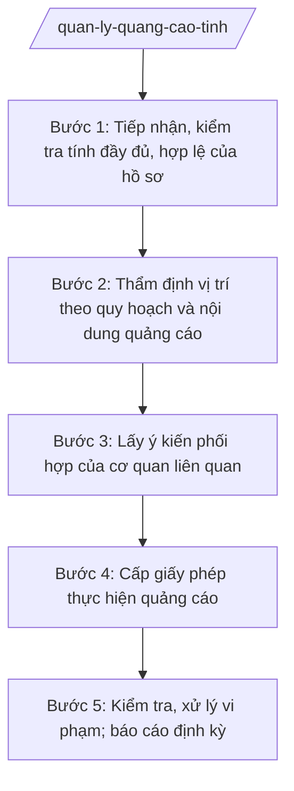

# Skill: Quản lý hoạt động quảng cáo

## 2. Khi nào dùng

- Tiếp nhận hồ sơ đề nghị cấp phép thực hiện quảng cáo trên bảng quảng cáo tấm lớn, màn hình chuyên quảng cáo ngoài trời thuộc thẩm quyền Sở VHTTDL.
- Thẩm định vị trí đặt bảng quảng cáo theo quy hoạch quảng cáo ngoài trời của tỉnh; thẩm định nội dung (maket) quảng cáo: không vi phạm các điều cấm, đúng thuần phong mỹ tục.
- Cấp, cấp lại, thu hồi giấy phép thực hiện quảng cáo; theo dõi thời hạn giấy phép.
- Kiểm tra hoạt động quảng cáo trên địa bàn tỉnh; xử lý vi phạm (bảng không phép, sai nội dung, hết hạn, che khuất biển báo giao thông, gây mất an toàn).
- Tổng hợp báo cáo công tác quản lý quảng cáo gửi UBND tỉnh, Bộ VHTTDL.

## 3. Đầu vào (Input)

| Trường | Mô tả | Bắt buộc |
|--------|-------|----------|
| `ho_so_de_nghi` | Đơn đề nghị + maket nội dung quảng cáo, thông tin tổ chức/cá nhân đề nghị, vị trí, kích thước, kết cấu bảng quảng cáo, thời hạn đề nghị | Có |
| `quy_hoach_qc` | Quy hoạch quảng cáo ngoài trời của tỉnh: vị trí được phép đặt bảng tấm lớn, kích thước tối đa, khu vực cấm | Có |
| `y_kien_phoi_hop` | Ý kiến của Sở Xây dựng (kết cấu, an toàn công trình), UBND xã nơi đặt bảng, cơ quan quản lý đường bộ (nếu gần hành lang giao thông) | Không |
| `phan_anh_vi_pham` | Phản ánh về bảng quảng cáo không phép, nội dung phản cảm, gây mất an toàn giao thông, mỹ quan đô thị | Không |
| `thoi_han` | Thời hạn giải quyết thủ tục hành chính theo quy định | Có |

## 4. Quy trình

**Bước 1. Tiếp nhận, kiểm tra tính đầy đủ, hợp lệ của hồ sơ**

- Làm gì: Tiếp nhận hồ sơ đề nghị cấp phép quảng cáo qua bộ phận một cửa Sở hoặc trực tuyến; kiểm tra tính đầy đủ, hợp lệ (đơn đề nghị, maket, giấy tờ pháp lý, tài liệu về vị trí, kết cấu); hướng dẫn bổ sung một lần nếu thiếu.
- Dùng input: `ho_so_de_nghi`, `thoi_han`.
- Vai trò: Công chức bộ phận một cửa Sở tiếp nhận, kiểm tra hình thức. AI hỗ trợ: lập checklist hồ sơ đề nghị cấp phép quảng cáo, soạn văn bản hướng dẫn bổ sung, theo dõi thời hạn giải quyết. ⏱ ~1–2 ngày làm việc (ước tính).
- Lưu ý nghiệp vụ: Thực hiện đúng cơ chế một cửa theo NĐ 118/2025/NĐ-CP; ghi phiếu tiếp nhận, hẹn ngày trả kết quả; không yêu cầu giấy tờ ngoài quy định.
- → Kết quả bước: Hồ sơ đầy đủ, hợp lệ được chuyển Phòng Quản lý hoạt động văn hóa thụ lý.

**Bước 2. Thẩm định vị trí theo quy hoạch và nội dung quảng cáo**

- Làm gì: Đối chiếu vị trí đề nghị với quy hoạch quảng cáo ngoài trời của tỉnh (vị trí được phép, kích thước, khu vực cấm); thẩm định maket nội dung: không vi phạm các điều cấm theo quy định pháp luật chuyên ngành về quảng cáo (không quảng cáo hàng cấm, không dùng hình ảnh phản cảm, không gây nhầm lẫn...), phù hợp thuần phong mỹ tục; kiểm tra kết cấu, an toàn sơ bộ.
- Dùng input: `ho_so_de_nghi`, `quy_hoach_qc`.
- Vai trò: Chuyên viên Phòng Quản lý hoạt động văn hóa (bà Trần Thị R2) chủ trì thẩm định; Trưởng phòng (ông Đỗ Văn L) kiểm tra. AI hỗ trợ: lập bảng đối chiếu vị trí với quy hoạch, bảng tiêu chí thẩm định nội dung quảng cáo, soạn báo cáo thẩm định. ⏱ ~5–7 ngày làm việc (ước tính).
- Lưu ý nghiệp vụ: Kiên quyết không thẩm định đạt vị trí ngoài quy hoạch hoặc trong khu vực cấm; nội dung quảng cáo có dấu hiệu vi phạm điều cấm thì yêu cầu chỉnh sửa hoặc từ chối, không "linh động".
- → Kết quả bước: Báo cáo thẩm định (đủ điều kiện/không đủ điều kiện + lý do cụ thể).

**Bước 3. Lấy ý kiến phối hợp của cơ quan liên quan**

- Làm gì: Lấy ý kiến Sở Xây dựng về kết cấu, an toàn công trình bảng quảng cáo; ý kiến UBND xã nơi đặt bảng; ý kiến cơ quan quản lý đường bộ nếu bảng gần hành lang an toàn giao thông; tổng hợp, yêu cầu điều chỉnh nếu cần.
- Dùng input: Kết quả bước 2; `y_kien_phoi_hop`.
- Vai trò: Chuyên viên Phòng Quản lý hoạt động văn hóa soạn văn bản lấy ý kiến, đôn đốc trả lời; Trưởng phòng (ông Đỗ Văn L) ký văn bản. AI hỗ trợ: soạn văn bản lấy ý kiến, bảng tổng hợp ý kiến, văn bản yêu cầu điều chỉnh hồ sơ. ⏱ ~5–7 ngày làm việc (ước tính).
- Lưu ý nghiệp vụ: Quy định rõ thời hạn trả lời ý kiến; quá hạn không trả lời thì tổng hợp theo hồ sơ hiện có và chịu trách nhiệm về nội dung thẩm định của Sở.
- → Kết quả bước: Bảng tổng hợp ý kiến phối hợp + hồ sơ hoàn chỉnh trình cấp phép.

**Bước 4. Cấp giấy phép thực hiện quảng cáo**

- Làm gì: Dự thảo giấy phép thực hiện quảng cáo (tổ chức/cá nhân được phép, nội dung, vị trí, kích thước, thời hạn) hoặc văn bản từ chối có nêu rõ lý do; trình ký, cấp phép; cập nhật cơ sở dữ liệu, theo dõi thời hạn giấy phép để nhắc gia hạn/thu hồi.
- Dùng input: Kết quả bước 2–3.
- Vai trò: Chuyên viên soạn dự thảo giấy phép; Trưởng phòng (ông Đỗ Văn L) kiểm tra; Phó Giám đốc Sở (ông Đỗ Văn U) cho ý kiến; Giám đốc Sở (bà Vũ Thị T) ký cấp giấy phép. AI hỗ trợ: điền mẫu giấy phép từ hồ sơ đã thẩm định, lập sổ theo dõi thời hạn giấy phép, mẫu văn bản nhắc gia hạn. ⏱ ~3–5 ngày làm việc (ước tính).
- Lưu ý nghiệp vụ: Giấy phép ghi đúng vị trí, kích thước, thời hạn đã thẩm định; văn bản từ chối phải nêu rõ lý do, căn cứ; theo dõi để xử lý kịp thời bảng hết hạn không gia hạn.
- → Kết quả bước: Giấy phép thực hiện quảng cáo đã ký (hoặc văn bản từ chối có lý do), cập nhật cơ sở dữ liệu theo dõi.

**Bước 5. Kiểm tra, xử lý vi phạm; báo cáo định kỳ**

- Làm gì: Kiểm tra định kỳ, đột xuất hoạt động quảng cáo (bảng không phép, sai nội dung/kích thước so với giấy phép, hết hạn, nội dung phản cảm, che khuất biển báo, gây mất an toàn); lập biên bản, xử phạt vi phạm hành chính theo thẩm quyền, buộc tháo dỡ bảng vi phạm; tổng hợp báo cáo gửi UBND tỉnh, Bộ VHTTDL.
- Dùng input: `phan_anh_vi_pham`, cơ sở dữ liệu giấy phép đã cấp.
- Vai trò: Đoàn kiểm tra của Phòng Quản lý hoạt động văn hóa phối hợp Thanh tra Sở, UBND xã nơi đặt bảng; Chánh Thanh tra Sở tham mưu xử phạt. AI hỗ trợ: lập kế hoạch kiểm tra, bản đồ vị trí bảng quảng cáo, soạn biên bản, dự thảo quyết định xử phạt, soạn báo cáo định kỳ. ⏱ ~5–7 ngày làm việc/đợt (ước tính).
- Lưu ý nghiệp vụ: Xử phạt đúng hành vi, đúng thẩm quyền; buộc khôi phục hiện trạng, tháo dỡ bảng vi phạm; theo dõi việc chấp hành quyết định xử phạt.
- → Kết quả bước: Biên bản kiểm tra + quyết định xử phạt/buộc tháo dỡ (nếu có) + báo cáo công tác quản lý quảng cáo.

## Luồng quy trình (Workflow)

## 5. Đầu ra (Output)

### Sản phẩm

1. **Giấy phép thực hiện quảng cáo** (bảng quảng cáo tấm lớn) (sản phẩm chính) — hoặc văn bản từ chối có nêu rõ lý do.
2. Báo cáo thẩm định vị trí, nội dung quảng cáo + bảng tổng hợp ý kiến phối hợp.
3. Sổ theo dõi thời hạn giấy phép quảng cáo.
4. Biên bản kiểm tra, quyết định xử phạt vi phạm hành chính, quyết định buộc tháo dỡ (nếu có).
5. Báo cáo định kỳ công tác quản lý hoạt động quảng cáo.

**Cấu trúc output chuẩn (Giấy phép thực hiện quảng cáo):**
- Thể thức: tuân thủ Nghị định 30/2020/NĐ-CP về công tác văn thư.

1. Quốc hiệu "CỘNG HÒA XÃ HỘI CHỦ NGHĨA VIỆT NAM", Tiêu ngữ "Độc lập – Tự do – Hạnh phúc": CỘNG HÒA XÃ HỘI CHỦ NGHĨA VIỆT NAM / Độc lập – Tự do – Hạnh phúc.
2. Tên cơ quan cấp phép: SỞ VĂN HÓA, THỂ THAO VÀ DU LỊCH TỈNH A.
3. Tên loại: GIẤY PHÉP THỰC HIỆN QUẢNG CÁO; số giấy phép.
4. Thông tin tổ chức/cá nhân được phép: tên, địa chỉ, người đại diện.
5. Nội dung được phép: nội dung quảng cáo (theo maket đã thẩm định đính kèm); vị trí đặt bảng; kích thước; kết cấu.
6. Thời hạn giấy phép: từ ngày … đến ngày ….
7. Trách nhiệm của tổ chức/cá nhân: thực hiện đúng nội dung, vị trí, kích thước, thời hạn được cấp phép; bảo đảm an toàn công trình, không che khuất biển báo giao thông; tháo dỡ khi hết hạn không gia hạn; chịu trách nhiệm trước pháp luật.
8. Địa danh, ngày tháng năm cấp phép: Tỉnh A, ngày … tháng … năm ….
9. Chữ ký, họ tên người ký: GIÁM ĐỐC / (ký, đóng dấu, ghi rõ họ tên).
10. Ghi chú: giấy phép lập theo mẫu quy định của pháp luật chuyên ngành về quảng cáo.
- Nơi nhận: liệt kê các cơ quan, đơn vị nhận để biết/thực hiện; kết thúc bằng "- Lưu: VT, [mã đơn vị]".

> **Chuẩn tài liệu đầu ra** (thứ tự ưu tiên):
> 1. Chuẩn riêng của ngành/cơ quan chủ quản — mẫu, biểu mẫu, quy chuẩn tại văn bản quy phạm chuyên ngành (xem mục "Căn cứ & lưu ý").
> 2. Tài liệu không có quy chuẩn riêng — thể thức NĐ 30/2020/NĐ-CP: Quốc hiệu và Tiêu ngữ; tên cơ quan ban hành; số, ký hiệu; địa danh và thời gian; tên loại và trích yếu; nội dung; chức vụ, họ tên, chữ ký người có thẩm quyền; dấu, chữ ký số; nơi nhận (kèm Phụ lục nếu có).

## 6. Checklist nghiệm thu

- [ ] Đủ 10 phần theo Cấu trúc output chuẩn mục 5, đúng mẫu pháp luật chuyên ngành về quảng cáo.
- [ ] Vị trí bảng quảng cáo phù hợp quy hoạch quảng cáo ngoài trời của tỉnh, không thuộc khu vực cấm.
- [ ] Nội dung (maket) đã thẩm định: không vi phạm điều cấm, phù hợp thuần phong mỹ tục.
- [ ] Đã lấy ý kiến Sở Xây dựng (kết cấu, an toàn) và UBND xã nơi đặt bảng đối với bảng tấm lớn.
- [ ] Giấy phép ghi đúng vị trí, kích thước, thời hạn; maket đã duyệt đính kèm.
- [ ] Trường hợp từ chối: văn bản nêu rõ lý do, căn cứ.
- [ ] Có sổ theo dõi thời hạn giấy phép; bảng hết hạn được xử lý kịp thời.
- [ ] Vi phạm được lập biên bản, xử phạt đúng hành vi, đúng thẩm quyền; bảng vi phạm bị buộc tháo dỡ.
- [ ] Đã qua đủ human gate: chuyên viên thẩm định → Trưởng phòng kiểm tra → Phó Giám đốc Sở → Giám đốc Sở ký cấp phép.

## 7. Ví dụ mô phỏng

*Dữ liệu dưới đây là giả lập 100% phục vụ minh họa.*

**Input mẫu:**

| Trường | Giá trị mẫu |
|--------|-------------|
| ho_so_de_nghi | Công ty TNHH Quảng cáo Ánh Dương (địa chỉ: Số 789 đường D, xã B, tỉnh A; điện thoại 0900 000 023) đề nghị cấp phép đặt 01 bảng quảng cáo tấm lớn (10m x 5m, khung thép) tại Km3 đường tỉnh lộ 1, xã B; nội dung: quảng cáo sản phẩm nước giải khát; thời hạn 02 năm |
| quy_hoach_qc | Vị trí Km3 đường tỉnh lộ 1 thuộc danh mục vị trí được phép đặt bảng tấm lớn (kích thước tối đa 12m x 6m), không thuộc khu vực cấm, cách biển báo giao thông 50m |
| y_kien_phoi_hop | Sở Xây dựng: kết cấu bảo đảm an toàn; UBND xã B: nhất trí |
| thoi_han | 10 ngày làm việc |

**Output mẫu:**

CỘNG HÒA XÃ HỘI CHỦ NGHĨA VIỆT NAM
Độc lập – Tự do – Hạnh phúc
---------------

SỞ VĂN HÓA, THỂ THAO VÀ DU LỊCH TỈNH A

**GIẤY PHÉP THỰC HIỆN QUẢNG CÁO**

Số: 56/GP-SVHTTDL

1. Tổ chức được phép: Công ty TNHH Quảng cáo Ánh Dương; địa chỉ: Số 789 đường D, xã B, tỉnh A.
2. Nội dung được phép: quảng cáo sản phẩm nước giải khát theo maket đã thẩm định (đính kèm).
3. Vị trí: Km3 đường tỉnh lộ 1, xã B, tỉnh A; kích thước: 10m x 5m; kết cấu: khung thép theo hồ sơ thiết kế đã thẩm định.
4. Thời hạn giấy phép: từ ngày 01/4/2027 đến ngày 31/3/2029.
5. Tổ chức được phép thực hiện đúng nội dung, vị trí, kích thước, thời hạn ghi trong giấy phép; bảo đảm an toàn công trình, không che khuất biển báo giao thông; tháo dỡ bảng khi hết hạn không gia hạn; chịu trách nhiệm trước pháp luật.

Tỉnh A, ngày 20 tháng 3 năm 2027

**GIÁM ĐỐC**

*(Ký, đóng dấu)*

**Vũ Thị T**

*Ghi chú: Giấy phép lập theo mẫu quy định của pháp luật chuyên ngành về quảng cáo.*

## 8. Human gate (người kiểm duyệt)

- Chuyên viên Phòng Quản lý hoạt động văn hóa (bà Trần Thị R2) thẩm định vị trí, nội dung quảng cáo, soạn dự thảo giấy phép, chịu trách nhiệm về đánh giá sự phù hợp với quy hoạch và điều cấm.
- Trưởng phòng Quản lý hoạt động văn hóa (ông Đỗ Văn L) kiểm tra kết quả thẩm định và dự thảo giấy phép ở bước 2–4.
- Phó Giám đốc Sở (ông Đỗ Văn U) cho ý kiến trước khi trình Giám đốc Sở.
- Giám đốc Sở (bà Vũ Thị T) ký cấp giấy phép thực hiện quảng cáo. Giấy phép chỉ có hiệu lực sau khi Giám đốc Sở ký.

## 9. Giới hạn (guardrails)

- AI KHÔNG quyết định cấp/từ chối/thu hồi giấy phép thay Giám đốc Sở; không tự ký, phát hành.
- AI không bịa kết quả thẩm định vị trí, nội dung, ý kiến phối hợp của Sở Xây dựng/UBND xã.
- AI không bịa căn cứ pháp lý, số hiệu văn bản; không viện dẫn văn bản đã hết hiệu lực.
- AI không "linh động" cho vị trí ngoài quy hoạch, khu vực cấm hoặc nội dung vi phạm điều cấm — phải đề xuất từ chối.
- AI không quyết định cưỡng chế tháo dỡ thay người có thẩm quyền; chỉ tham mưu theo quy định.

## 10. Căn cứ & lưu ý

- Thông tư 10/2025/TT-BVHTTDL ngày 19/6/2025 (hiệu lực 01/7/2025) của Bộ VHTTDL — hướng dẫn chức năng, nhiệm vụ của Sở Văn hóa, Thể thao và Du lịch (thay thế TT 08/2021/TT-BVHTTDL).
- Nghị định 137/2025/NĐ-CP ngày 12/6/2025 — phân định thẩm quyền của chính quyền địa phương 02 cấp trong lĩnh vực văn hóa, thể thao và du lịch.
- Nghị định 138/2025/NĐ-CP ngày 12/6/2025 — phân quyền, phân cấp trong lĩnh vực văn hóa, thể thao và du lịch.
- Nghị định 118/2025/NĐ-CP ngày 09/6/2025 — cơ chế một cửa, một cửa liên thông trong giải quyết thủ tục hành chính.
- Điều kiện, trình tự cấp phép và các hành vi bị cấm trong hoạt động quảng cáo thực hiện theo quy định pháp luật chuyên ngành về quảng cáo (chỉ nêu tên lĩnh vực, không bịa số hiệu văn bản).
- Nghị định 30/2020/NĐ-CP — thể thức văn bản hành chính.
- Lưu ý: bảng quảng cáo trong hành lang an toàn giao thông phải có ý kiến của cơ quan quản lý đường bộ; nội dung quảng cáo phải tuân thủ các điều cấm theo quy định pháp luật chuyên ngành về quảng cáo.
