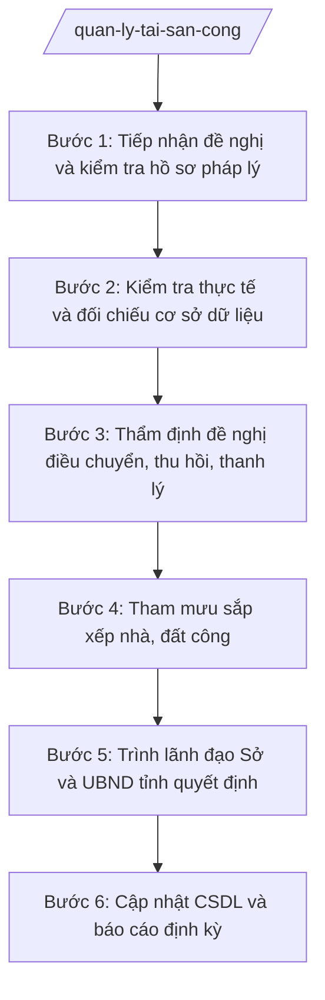

# Skill: Quản lý tài sản công

## 2. Khi nào dùng

- Đến kỳ hướng dẫn các cơ quan, tổ chức, đơn vị kê khai, báo cáo tài sản công;
- Cần thẩm định đề nghị điều chuyển, thu hồi, thanh lý, bán tài sản công của các cơ quan, đơn vị;
- Cần tham mưu sắp xếp lại, xử lý nhà, đất thuộc sở hữu nhà nước trên địa bàn tỉnh;
- Cần tổng hợp cơ sở dữ liệu quốc gia về tài sản công của tỉnh, báo cáo Bộ Tài chính;
- Cần kiểm tra việc quản lý, sử dụng tài sản công tại các cơ quan, đơn vị.

## 3. Đầu vào (Input)

| Trường | Mô tả | Bắt buộc |
|--------|-------|----------|
| `loai_nghiep_vu` | Loại nghiệp vụ: kê khai / điều chuyển / thu hồi / thanh lý / sắp xếp nhà đất | Có |
| `de_nghi_don_vi` | Văn bản đề nghị của cơ quan, đơn vị (kèm danh mục tài sản, hồ sơ pháp lý) | Có |
| `ho_so_tai_san` | Hồ sơ tài sản: quyết định giao, giấy tờ nhà đất, sổ theo dõi tài sản | Có |
| `gia_tri_tai_san` | Giá trị tài sản theo sổ kế toán / giá thẩm định (nếu có) | Không |
| `csdl_tai_san_cong` | Cơ sở dữ liệu tài sản công hiện có của tỉnh | Không |
| `dinh_huong_sap_xep` | Định hướng sắp xếp nhà, đất công của UBND tỉnh (đối với nghiệp vụ sắp xếp) | Không |

## 4. Quy trình

**Bước 1. Tiếp nhận đề nghị và kiểm tra hồ sơ pháp lý**
- Làm gì: Tiếp nhận văn bản đề nghị của cơ quan, đơn vị; kiểm tra thành phần hồ sơ (danh mục tài sản, quyết định giao tài sản, giấy tờ nhà đất, biên bản kiểm kê...); lập phiếu tiếp nhận, yêu cầu bổ sung nếu thiếu.
- Dùng input: `de_nghi_don_vi`, `ho_so_tai_san`, `loai_nghiep_vu`.
- Vai trò: Chuyên viên Phòng Quản lý tài sản công (Sở Tài chính) tiếp nhận, AI hỗ trợ lập checklist hồ sơ theo từng loại nghiệp vụ; ⏱ ~1–2 ngày làm việc (ước tính).
- Lưu ý nghiệp vụ: Tài sản phải có hồ sơ pháp lý rõ ràng về quyền quản lý, sử dụng; không thụ lý đề nghị đối với tài sản đang tranh chấp, kê biên.
- → Kết quả bước: Phiếu tiếp nhận hồ sơ hợp lệ (hoặc văn bản yêu cầu bổ sung).

**Bước 2. Kiểm tra thực tế và đối chiếu cơ sở dữ liệu**
- Làm gì: Đối chiếu thông tin tài sản trong hồ sơ với Cơ sở dữ liệu quốc gia về tài sản công; kiểm tra thực tế hiện trạng tài sản khi cần (nhà, đất, phương tiện, thiết bị); xác minh tính chính xác của danh mục, giá trị tài sản.
- Dùng input: `ho_so_tai_san`, `csdl_tai_san_cong`, `gia_tri_tai_san`.
- Vai trò: Chuyên viên Phòng Quản lý tài sản công kiểm tra, phối hợp đơn vị; AI hỗ trợ đối chiếu dữ liệu, cảnh báo thông tin chưa khớp giữa hồ sơ và CSDL; ⏱ ~2–4 ngày làm việc (ước tính).
- Lưu ý nghiệp vụ: Thông tin tài sản trong CSDL phải được cập nhật kịp thời; mọi chênh lệch giữa hồ sơ và thực tế phải được làm rõ trước khi thẩm định.
- → Kết quả bước: Biên bản kiểm tra, đối chiếu tài sản.

**Bước 3. Thẩm định đề nghị điều chuyển, thu hồi, thanh lý**
- Làm gì: (Áp dụng khi `loai_nghiep_vu` là điều chuyển/thu hồi/thanh lý) Thẩm định sự cần thiết, tính hợp lý của đề nghị: tài sản không còn nhu cầu sử dụng, hư hỏng không thể sửa chữa, dôi dư sau sắp xếp...; kiểm tra thẩm quyền quyết định; đề xuất phương án xử lý (điều chuyển cho đơn vị có nhu cầu / thu hồi / thanh lý, bán).
- Dùng input: Kết quả Bước 2, `de_nghi_don_vi`.
- Vai trò: Chuyên viên Phòng Quản lý tài sản công thẩm định, AI hỗ trợ đối chiếu với quy định về tiêu chuẩn, định mức sử dụng tài sản công, cảnh báo đề nghị chưa đủ căn cứ; ⏱ ~3–5 ngày làm việc (ước tính).
- Lưu ý nghiệp vụ: Việc xử lý tài sản công phải đúng thẩm quyền, đúng trình tự; tài sản thanh lý, bán phải được định giá theo quy định; không để thất thoát tài sản nhà nước.
- → Kết quả bước: Dự thảo Báo cáo thẩm định / Tờ trình về xử lý tài sản công.

**Bước 4. Tham mưu sắp xếp nhà, đất công**
- Làm gì: (Áp dụng khi `loai_nghiep_vu` là sắp xếp nhà đất) Rà soát quỹ nhà, đất thuộc sở hữu nhà nước trên địa bàn; đối chiếu với định hướng sắp xếp của UBND tỉnh; đề xuất phương án sắp xếp (giữ lại sử dụng, điều chuyển, thu hồi, bán...); lập phương án tổng thể trình UBND tỉnh.
- Dùng input: `csdl_tai_san_cong`, `dinh_huong_sap_xep`.
- Vai trò: Chuyên viên Phòng Quản lý tài sản công rà soát, AI hỗ trợ lập bảng tổng hợp quỹ nhà đất, phân loại theo phương án xử lý; ⏱ ~7–10 ngày làm việc (ước tính).
- Lưu ý nghiệp vụ: Phương án sắp xếp phải phù hợp quy hoạch sử dụng đất, quy hoạch tỉnh; nhà, đất dôi dư sau sắp xếp bộ máy phải được xử lý kịp thời, tránh lãng phí, xuống cấp.
- → Kết quả bước: Dự thảo phương án sắp xếp nhà, đất công trình UBND tỉnh.

**Bước 5. Trình lãnh đạo Sở và UBND tỉnh quyết định**
- Làm gì: Trưởng phòng và Phó Giám đốc Sở phụ trách rà soát hồ sơ thẩm định/phương án; Giám đốc Sở Tài chính (ông Hoàng Văn S) xem xét, ký Tờ trình của Sở trình UBND tỉnh (đối với nội dung thuộc thẩm quyền UBND tỉnh/Chủ tịch UBND tỉnh); hoàn thiện theo ý kiến chỉ đạo.
- Dùng input: Kết quả Bước 3 hoặc Bước 4.
- Vai trò: Trưởng phòng, Phó Giám đốc, Giám đốc Sở kiểm tra và quyết định; AI hỗ trợ rà soát thể thức, tính nhất quán hồ sơ; ⏱ ~2–3 ngày làm việc (ước tính).
- Lưu ý nghiệp vụ: AI chỉ hỗ trợ kỹ thuật; quyết định xử lý tài sản công thuộc thẩm quyền của cấp có thẩm quyền theo phân cấp, không thuộc Sở Tài chính.
- → Kết quả bước: Tờ trình của Sở đã ký, trình UBND tỉnh xem xét, quyết định.

**Bước 6. Cập nhật CSDL và báo cáo định kỳ**
- Làm gì: Cập nhật biến động tài sản công vào Cơ sở dữ liệu quốc gia về tài sản công sau khi có quyết định xử lý; hướng dẫn các cơ quan, đơn vị kê khai định kỳ; tổng hợp báo cáo tình hình quản lý, sử dụng tài sản công của tỉnh gửi UBND tỉnh, Bộ Tài chính.
- Dùng input: Quyết định xử lý tài sản đã ban hành; số liệu kê khai các đơn vị.
- Vai trò: Chuyên viên Phòng Quản lý tài sản công cập nhật, tổng hợp; AI hỗ trợ đối chiếu biến động, soạn báo cáo định kỳ; ⏱ ~theo kỳ báo cáo. (ước tính)
- Lưu ý nghiệp vụ: Mọi biến động tài sản công phải được cập nhật kịp thời, đầy đủ vào CSDL; số liệu báo cáo phải khớp với CSDL.
- → Kết quả bước: CSDL tài sản công đã cập nhật + báo cáo định kỳ.

## Luồng quy trình (Workflow)

## 5. Đầu ra (Output)

- Phiếu tiếp nhận hồ sơ (hoặc văn bản yêu cầu bổ sung);
- Biên bản kiểm tra, đối chiếu tài sản công;
- Báo cáo thẩm định / Tờ trình của Sở Tài chính về điều chuyển, thu hồi, thanh lý tài sản công;
- Phương án sắp xếp nhà, đất công trình UBND tỉnh;
- Quyết định xử lý tài sản công của cấp có thẩm quyền (do cấp có thẩm quyền ban hành, Sở lưu hồ sơ);
- Báo cáo định kỳ tình hình quản lý, sử dụng tài sản công.

**Cấu trúc output chuẩn (Tờ trình Sở Tài chính về xử lý tài sản công):**
- Thể thức: tuân thủ Nghị định 30/2020/NĐ-CP về công tác văn thư.

1. Quốc hiệu "CỘNG HÒA XÃ HỘI CHỦ NGHĨA VIỆT NAM", Tiêu ngữ "Độc lập – Tự do – Hạnh phúc";
2. Tên cơ quan ban hành: SỞ TÀI CHÍNH TỈNH A; số, ký hiệu văn bản; địa danh và ngày, tháng, năm ban hành;
3. Tên loại và trích yếu: TỜ TRÌNH — Về việc đề nghị (điều chuyển/thu hồi/thanh lý)... tài sản công của...;
4. Phần "Kính gửi": Ủy ban nhân dân tỉnh A (hoặc Chủ tịch UBND tỉnh A theo thẩm quyền);
5. Căn cứ ban hành (quy định pháp luật về quản lý, sử dụng tài sản công; văn bản đề nghị của đơn vị...);
6. Nội dung: mô tả tài sản; kết quả kiểm tra, thẩm định; phương án xử lý đề xuất; kiến nghị cấp có thẩm quyền quyết định;
7. Nơi nhận;
8. Thẩm quyền, chức vụ, họ tên người ký: GIÁM ĐỐC — (chữ ký, họ tên), dấu của cơ quan.

## 6. Checklist nghiệm thu

- [ ] Hồ sơ đề nghị đầy đủ thành phần, tài sản có hồ sơ pháp lý rõ ràng, không tranh chấp;
- [ ] Đã kiểm tra thực tế (khi cần) và đối chiếu với CSDL tài sản công;
- [ ] Đề nghị xử lý có căn cứ (dôi dư, hư hỏng, không còn nhu cầu...), đúng thẩm quyền quyết định;
- [ ] Tài sản thanh lý, bán được định giá theo quy định;
- [ ] Phương án sắp xếp nhà, đất phù hợp quy hoạch và định hướng của UBND tỉnh;
- [ ] Tờ trình, báo cáo thẩm định đúng thể thức, đã được lãnh đạo Sở ký;
- [ ] Biến động tài sản đã được cập nhật vào CSDL quốc gia về tài sản công;
- [ ] Căn cứ pháp lý đầy đủ, đúng văn bản còn hiệu lực, không bịa số hiệu;
- [ ] Thông tin tài sản dựa trên hồ sơ thật, AI không tự bịa.

## 7. Ví dụ mô phỏng

*Dữ liệu dưới đây là giả lập 100% phục vụ minh họa.*

### Input mẫu

| Trường | Giá trị giả lập |
|--------|-----------------|
| loai_nghiep_vu | Thanh lý |
| de_nghi_don_vi | Văn bản đề nghị thanh lý 10 xe ô tô đã hư hỏng của Sở X tỉnh A (giả lập) |
| ho_so_tai_san | Quyết định giao tài sản, sổ theo dõi tài sản, biên bản kiểm kê (giả lập) |
| gia_tri_tai_san | Giá trị còn lại theo sổ kế toán: 500 triệu đồng (giả lập) |
| csdl_tai_san_cong | 10 xe đã được kê khai trong CSDL tài sản công tỉnh A (giả lập) |

### Output mẫu (Tờ trình — trích)

> **CỘNG HÒA XÃ HỘI CHỦ NGHĨA VIỆT NAM**
> **Độc lập – Tự do – Hạnh phúc**
>
> **SỞ TÀI CHÍNH TỈNH A**
> Số: 1234/TTr-STC
> Tỉnh A, ngày 12 tháng 4 năm 2027
>
> **TỜ TRÌNH**
> **Về việc đề nghị thanh lý tài sản công của Sở X tỉnh A (giả lập)**
>
> Kính gửi: Ủy ban nhân dân tỉnh A.
>
> Căn cứ quy định pháp luật về quản lý, sử dụng tài sản công;
> Căn cứ văn bản đề nghị của Sở X tỉnh A;
> Sở Tài chính tỉnh A báo cáo và đề nghị như sau:
>
> 1. Tài sản đề nghị thanh lý: 10 xe ô tô đã hư hỏng, không còn khả năng sửa chữa, giá trị còn lại 500 triệu đồng...
> 2. Kết quả thẩm định: đủ điều kiện thanh lý theo quy định...
> 3. Kiến nghị: UBND tỉnh xem xét, quyết định thanh lý theo thẩm quyền.
>
> Sở Tài chính kính trình UBND tỉnh xem xét, quyết định./.
>
> ***Nơi nhận:*** ...
>
> **GIÁM ĐỐC**
> *(ký, đóng dấu)*
> **Hoàng Văn S**

## 8. Human gate

1. Chuyên viên Phòng Quản lý tài sản công tiếp nhận, kiểm tra, thẩm định (Bước 1–4);
2. Trưởng phòng và Phó Giám đốc Sở phụ trách rà soát hồ sơ thẩm định, phương án (Bước 5);
3. Giám đốc Sở Tài chính xem xét, ký Tờ trình trình UBND tỉnh (Bước 5);
4. UBND tỉnh/Chủ tịch UBND tỉnh quyết định xử lý tài sản công theo thẩm quyền — quyết định cuối cùng không thuộc Sở Tài chính.

## 9. Giới hạn

- AI KHÔNG quyết định điều chuyển, thu hồi, thanh lý, bán tài sản công thay người có thẩm quyền;
- AI KHÔNG tự ký, tự phát hành văn bản hay quyết định xử lý tài sản;
- AI KHÔNG bịa thông tin, giá trị tài sản, kết quả thẩm định;
- AI KHÔNG bịa căn cứ pháp lý, không trích dẫn văn bản đã hết hiệu lực;
- AI KHÔNG đề xuất phương án xử lý tài sản gây thất thoát tài sản nhà nước.

## 10. Căn cứ & lưu ý

- Thông tư 57/2025/TT-BTC hướng dẫn chức năng, nhiệm vụ, quyền hạn của Sở Tài chính và lĩnh vực tài chính – kế hoạch của phòng chuyên môn thuộc UBND cấp xã;
- Luật Quản lý, sử dụng tài sản công (chỉ nêu tên luật, không kèm số hiệu);
- Nghị định 150/2025/NĐ-CP về tổ chức cơ quan chuyên môn thuộc UBND cấp tỉnh, cấp xã;
- Nghị định 30/2020/NĐ-CP về công tác văn thư (chỉ dùng cho thể thức văn bản);
- Lưu ý: quyết định xử lý tài sản công thuộc thẩm quyền của cấp có thẩm quyền theo phân cấp; mọi biến động tài sản công phải được cập nhật vào Cơ sở dữ liệu quốc gia về tài sản công; nhà, đất dôi dư sau sắp xếp bộ máy phải được xử lý kịp thời theo phương án được phê duyệt.
