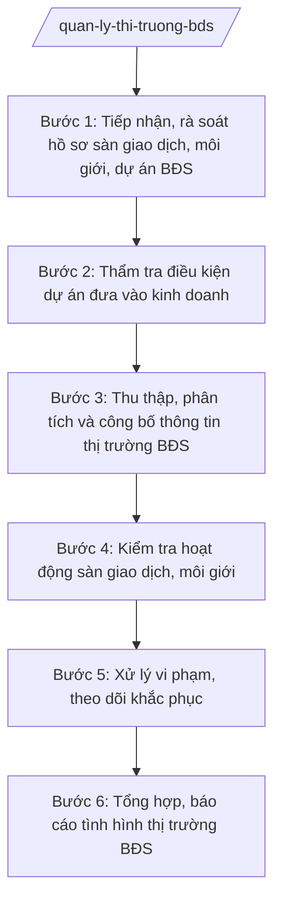

# Skill: Quản lý thị trường bất động sản

## 2. Khi nào dùng

- Tổ chức, cá nhân đăng ký hoạt động sàn giao dịch bất động sản, hành nghề môi giới BĐS trên địa bàn tỉnh cần được quản lý, kiểm tra theo quy định;
- Chủ đầu tư đề nghị xác nhận dự án đủ điều kiện được đưa vào kinh doanh (bán, cho thuê, huy động vốn) theo phân cấp;
- Cần thu thập, công bố thông tin về thị trường bất động sản của tỉnh (giá, giao dịch, tồn kho) phục vụ quản lý và minh bạch thị trường;
- Phát hiện dấu hiệu vi phạm (rao bán dự án chưa đủ điều kiện, huy động vốn trái phép, môi giới không có chứng chỉ) cần kiểm tra, xử lý.

## 3. Đầu vào (Input)

| Trường | Mô tả | Bắt buộc |
|--------|-------|----------|
| `ho_so_san_giao_dich` | Hồ sơ đăng ký/thông báo hoạt động của sàn giao dịch BĐS. Lưu ý: quản lý sàn.| Có |
| `ho_so_moi_gioi` | Danh sách cá nhân hành nghề môi giới, chứng chỉ môi giới BĐS. Lưu ý: quản lý môi giới.| Có |
| `ho_so_du_an_bds` | Hồ sơ dự án BĐS đề nghị xác nhận đủ điều kiện đưa vào kinh doanh. Lưu ý: thẩm tra dự án.| Có |
| `du_lieu_giao_dich` | Dữ liệu giao dịch BĐS: giá, số lượng, tồn kho do sàn, chủ đầu tư báo cáo. Lưu ý: công bố thị trường.| Có |
| `tin_bao_vi_pham` | Tin báo vi phạm trong kinh doanh BĐS (tên tổ chức/cá nhân, hành vi). Lưu ý: xử lý vi phạm.| Có |
| `ket_qua_kiem_tra` | Kết quả kiểm tra thực tế tại sàn, dự án | Không |

## 4. Quy trình

**Bước 1. Tiếp nhận, rà soát hồ sơ sàn giao dịch, môi giới, dự án BĐS**
- Làm gì: Tiếp nhận hồ sơ đăng ký hoạt động sàn giao dịch BĐS, danh sách môi giới, hồ sơ dự án đề nghị xác nhận đủ điều kiện kinh doanh; kiểm tra tính đầy đủ, hợp lệ; lập danh sách theo dõi.
- Dùng input: `ho_so_san_giao_dich`, `ho_so_moi_gioi`, `ho_so_du_an_bds`.
- Vai trò: Chuyên viên Phòng Quản lý nhà và thị trường BĐS tiếp nhận, AI hỗ trợ đối chiếu danh mục hồ sơ theo checklist, lập cơ sở dữ liệu sàn/môi giới/dự án trên địa bàn; ⏱ ~3–5 ngày làm việc (ước tính).
- Lưu ý nghiệp vụ: Sàn giao dịch, môi giới phải đáp ứng điều kiện hoạt động theo quy định; dự án chưa đủ điều kiện không được đưa vào kinh doanh dưới mọi hình thức.
- → Kết quả bước: Danh sách sàn giao dịch, môi giới, dự án BĐS đang theo dõi + phiếu tiếp nhận hồ sơ.

**Bước 2. Thẩm tra điều kiện dự án đưa vào kinh doanh**
- Làm gì: Kiểm tra hồ sơ pháp lý dự án (quyết định chủ trương đầu tư, giấy phép xây dựng, nghiệm thu hạ tầng, bảo lãnh ngân hàng...); xác minh thực tế tiến độ dự án; lập phiếu thẩm tra điều kiện đưa vào kinh doanh; soạn văn bản xác nhận hoặc văn bản từ chối nêu rõ lý do.
- Dùng input: `ho_so_du_an_bds`, `ket_qua_kiem_tra`.
- Vai trò: Chuyên viên Phòng Quản lý nhà và thị trường BĐS thẩm tra, AI hỗ trợ lập phiếu thẩm tra theo checklist điều kiện, đối chiếu tiến độ thực tế với hồ sơ, soạn dự thảo văn bản xác nhận/từ chối; ⏱ ~7–10 ngày làm việc (ước tính).
- Lưu ý nghiệp vụ: Mọi điều kiện phải được kiểm chứng bằng hồ sơ và thực tế; không xác nhận khi dự án chưa nghiệm thu hạ tầng hoặc thiếu bảo lãnh theo quy định.
- → Kết quả bước: Phiếu thẩm tra + văn bản xác nhận đủ điều kiện (hoặc văn bản từ chối nêu rõ lý do).

**Bước 3. Thu thập, phân tích và công bố thông tin thị trường BĐS**
- Làm gì: Thu thập dữ liệu giao dịch từ sàn, chủ đầu tư, văn phòng đăng ký đất đai; phân tích biến động giá, số lượng giao dịch, tồn kho theo phân khúc, địa bàn; soạn báo cáo và công bố thông tin thị trường BĐS của tỉnh theo định kỳ.
- Dùng input: `du_lieu_giao_dich`.
- Vai trò: Chuyên viên Phòng Quản lý nhà và thị trường BĐS thu thập, AI hỗ trợ tổng hợp dữ liệu thành bảng, biểu đồ, soạn báo cáo phân tích thị trường theo khung chuẩn; ⏱ ~5–7 ngày làm việc/kỳ (ước tính).
- Lưu ý nghiệp vụ: Số liệu công bố phải có nguồn gốc rõ ràng, ghi chú phương pháp thu thập; không công bố số liệu chưa được kiểm chứng gây nhiễu thị trường.
- → Kết quả bước: Báo cáo và thông tin công bố về thị trường BĐS tỉnh A (định kỳ).

**Bước 4. Kiểm tra hoạt động sàn giao dịch, môi giới**
- Làm gì: Lập kế hoạch kiểm tra định kỳ/đột xuất hoạt động của sàn giao dịch BĐS, cá nhân môi giới (điều kiện hoạt động, chứng chỉ hành nghề, việc niêm yết thông tin, hợp đồng mẫu); lập biên bản kiểm tra.
- Dùng input: Kết quả Bước 1, `tin_bao_vi_pham`.
- Vai trò: Đoàn kiểm tra của Sở thực hiện, AI hỗ trợ soạn kế hoạch kiểm tra, biên bản kiểm tra, tổng hợp vi phạm; ⏱ ~3–5 ngày làm việc/đợt (ước tính).
- Lưu ý nghiệp vụ: Kiểm tra có trọng tâm, trọng điểm; biên bản kiểm tra có chữ ký các bên; xử lý vi phạm đúng thẩm quyền, tương xứng mức độ.
- → Kết quả bước: Biên bản kiểm tra sàn giao dịch, môi giới + bảng tổng hợp vi phạm.

**Bước 5. Xử lý vi phạm, theo dõi khắc phục**
- Làm gì: Trên cơ sở kết quả kiểm tra, tin báo vi phạm: yêu cầu dừng hành vi vi phạm (rao bán dự án chưa đủ điều kiện, huy động vốn trái phép...); lập biên bản vi phạm hành chính, tham mưu xử phạt theo thẩm quyền hoặc chuyển cơ quan có thẩm quyền; theo dõi khắc phục.
- Dùng input: Kết quả Bước 4, `tin_bao_vi_pham`.
- Vai trò: Thanh tra Sở/chuyên viên tham mưu xử lý, AI hỗ trợ soạn biên bản vi phạm, dự thảo quyết định xử phạt, rà soát căn cứ xử phạt; ⏱ ~5–7 ngày làm việc (ước tính).
- Lưu ý nghiệp vụ: Xử phạt phải đúng hành vi, đúng thẩm quyền, đúng trình tự; trường hợp có dấu hiệu hình sự chuyển cơ quan điều tra.
- → Kết quả bước: Quyết định xử phạt vi phạm hành chính / văn bản chuyển cơ quan có thẩm quyền + theo dõi khắc phục.

**Bước 6. Tổng hợp, báo cáo tình hình thị trường BĐS**
- Làm gì: Tổng hợp tình hình hoạt động sàn, môi giới, dự án BĐS, kết quả kiểm tra, xử lý vi phạm; báo cáo UBND tỉnh và Bộ Xây dựng theo định kỳ; đề xuất giải pháp quản lý, tháo gỡ khó khăn.
- Dùng input: Kết quả Bước 1–5.
- Vai trò: Trưởng phòng Quản lý nhà và thị trường BĐS tổng hợp, AI hỗ trợ soạn báo cáo định kỳ, lập biểu số liệu; ⏱ ~3–5 ngày làm việc (ước tính).
- Lưu ý nghiệp vụ: Báo cáo trung thực, số liệu thống nhất giữa các kỳ; kiến nghị cụ thể, khả thi.
- → Kết quả bước: Báo cáo tình hình thị trường bất động sản tỉnh A (định kỳ).

## Luồng quy trình (Workflow)

## 5. Đầu ra (Output)

- Cơ sở dữ liệu sàn giao dịch, môi giới, dự án BĐS trên địa bàn tỉnh;
- Phiếu thẩm tra điều kiện dự án đưa vào kinh doanh;
- Văn bản xác nhận dự án đủ điều kiện đưa vào kinh doanh (hoặc văn bản từ chối nêu rõ lý do);
- Báo cáo và thông tin công bố về thị trường BĐS (định kỳ);
- Biên bản kiểm tra sàn giao dịch, môi giới;
- Quyết định xử phạt vi phạm hành chính / văn bản chuyển cơ quan có thẩm quyền;
- Báo cáo tình hình thị trường BĐS gửi UBND tỉnh, Bộ Xây dựng.

**Cấu trúc output chuẩn (Văn bản xác nhận dự án đủ điều kiện đưa vào kinh doanh):**
- Thể thức: tuân thủ Nghị định 30/2020/NĐ-CP về công tác văn thư.

1. Quốc hiệu "CỘNG HÒA XÃ HỘI CHỦ NGHĨA VIỆT NAM", Tiêu ngữ "Độc lập – Tự do – Hạnh phúc";
2. Tên cơ quan: SỞ XÂY DỰNG TỈNH A; số, ký hiệu văn bản; địa danh và ngày, tháng, năm;
3. Tên loại: VĂN BẢN XÁC NHẬN (hoặc THÔNG BÁO) — Về việc dự án... đủ điều kiện được đưa vào kinh doanh;
4. Phần "Kính gửi": Chủ đầu tư dự án;
5. Căn cứ (Luật Kinh doanh bất động sản; văn bản về phân định thẩm quyền, phân quyền, phân cấp lĩnh vực xây dựng; hồ sơ pháp lý dự án; kết quả thẩm tra...);
6. Nội dung: thông tin dự án (tên, địa điểm, quy mô, loại hình); kết quả thẩm tra từng điều kiện; kết luận đủ điều kiện đưa vào kinh doanh (phạm vi: bán/cho thuê...); yêu cầu chủ đầu tư tuân thủ quy định trong quá trình kinh doanh;
7. Nơi nhận;
8. Thẩm quyền, chức vụ, họ tên người ký: GIÁM ĐỐC (hoặc PHÓ GIÁM ĐỐC) — (chữ ký, họ tên), dấu của cơ quan.

## 6. Checklist nghiệm thu

- [ ] Đã lập cơ sở dữ liệu đầy đủ sàn giao dịch, môi giới, dự án BĐS trên địa bàn;
- [ ] Dự án được thẩm tra đầy đủ các điều kiện trước khi xác nhận đưa vào kinh doanh;
- [ ] Văn bản xác nhận/từ chối nêu rõ căn cứ, phạm vi, đúng thẩm quyền;
- [ ] Số liệu thị trường công bố có nguồn gốc rõ ràng, đã được kiểm chứng;
- [ ] Kiểm tra sàn, môi giới có kế hoạch, biên bản đầy đủ, xử lý đúng thẩm quyền;
- [ ] Vi phạm (rao bán khi chưa đủ điều kiện, huy động vốn trái phép) được xử lý kịp thời;
- [ ] Báo cáo định kỳ đúng hạn, số liệu thống nhất giữa các kỳ.

## 7. Ví dụ mô phỏng

*Dữ liệu dưới đây là giả lập 100% phục vụ minh họa.*

### Input mẫu

| Trường | Giá trị giả lập |
|--------|-----------------|
| ho_so_du_an_bds | Dự án Khu đô thị mới phía Nam xã A: 500 căn nhà ở thương mại; chủ đầu tư Công ty Cổ phần Địa ốc A; đã có quyết định chủ trương đầu tư, GPXD hạ tầng, nghiệm thu hạ tầng giai đoạn 1, bảo lãnh ngân hàng |
| du_lieu_giao_dich | Quý I/2027: 200 giao dịch nhà ở; giá bình quân 20 triệu đồng/m²; tồn kho 300 căn |
| tin_bao_vi_pham | Sàn giao dịch BĐS A rao bán 50 căn thuộc dự án chưa được xác nhận đủ điều kiện |

### Output mẫu (Văn bản xác nhận — trích)

> **CỘNG HÒA XÃ HỘI CHỦ NGHĨA VIỆT NAM**
> **Độc lập – Tự do – Hạnh phúc**
>
> Số: 123/TB-SXD
> *Tỉnh A, ngày 10 tháng 4 năm 2027*
>
> **THÔNG BÁO**
> **Về việc dự án Khu đô thị mới phía Nam xã A đủ điều kiện được đưa vào kinh doanh**
>
> Kính gửi: Công ty Cổ phần Địa ốc A.
>
> Căn cứ Luật Kinh doanh bất động sản; văn bản quy định về phân định thẩm quyền chính quyền địa phương 2 cấp, phân quyền, phân cấp trong lĩnh vực quản lý nhà nước của Bộ Xây dựng; Thông tư 10/2025/TT-BXD ngày 14/6/2025 của Bộ Xây dựng; ...
>
> Sau khi thẩm tra hồ sơ và kiểm tra thực tế, Sở Xây dựng tỉnh A thông báo:
>
> 1. Dự án Khu đô thị mới phía Nam xã A (500 căn nhà ở thương mại) đáp ứng các điều kiện được đưa vào kinh doanh theo quy định.
> 2. Phạm vi kinh doanh: bán 300 căn thuộc giai đoạn 1 đã nghiệm thu hạ tầng...
> 3. Yêu cầu Công ty thực hiện đúng quy định về kinh doanh bất động sản, công khai thông tin dự án...
>
> *Nơi nhận:* ...
>
> **GIÁM ĐỐC**
> *(Chữ ký, dấu)*
> **Hoàng Văn S**

## 8. Human gate

- Chuyên viên Phòng Quản lý nhà và thị trường BĐS tiếp nhận, thẩm tra hồ sơ;
- Trưởng phòng Quản lý nhà và thị trường BĐS kiểm tra, soạn thảo văn bản;
- Phó Giám đốc/Giám đốc Sở ký văn bản xác nhận, quyết định xử phạt;
- Chủ tịch UBND tỉnh A xem xét đối với vụ việc phức tạp, vượt thẩm quyền của Sở (AI không thay người ký).

## 9. Giới hạn

- AI KHÔNG xác nhận dự án đủ điều kiện hay ra quyết định xử phạt thay người có thẩm quyền;
- Không bịa số liệu thị trường, kết quả thẩm tra; số liệu phải từ nguồn báo cáo, kiểm tra thực tế;
- Không dùng văn bản đã hết hiệu lực; chỉ viện dẫn văn bản có thật trong `tai-lieu-moi-nhat.md`;
- Không công bố thông tin thị trường chưa được kiểm chứng.

## 10. Căn cứ & lưu ý

- NĐ 140/2025/NĐ-CP ngày 12/6/2025 — phân định thẩm quyền CQĐP 2 cấp trong lĩnh vực quản lý nhà nước của Bộ Xây dựng;
- NĐ 144/2025/NĐ-CP ngày 12/6/2025 — phân quyền, phân cấp trong lĩnh vực quản lý nhà nước của Bộ Xây dựng;
- TT 10/2025/TT-BXD ngày 14/6/2025 — hướng dẫn chức năng, nhiệm vụ, quyền hạn của Sở Xây dựng, Sở Quy hoạch – Kiến trúc và lĩnh vực xây dựng cấp xã;
- NĐ 150/2025/NĐ-CP (hiệu lực 16/6/2025); NĐ 370/2025/NĐ-CP sửa đổi, bổ sung;
- NĐ 30/2020/NĐ-CP — thể thức, kỹ thuật trình bày văn bản hành chính;
- Luật Kinh doanh bất động sản: chỉ nêu tên, không bịa số hiệu.
