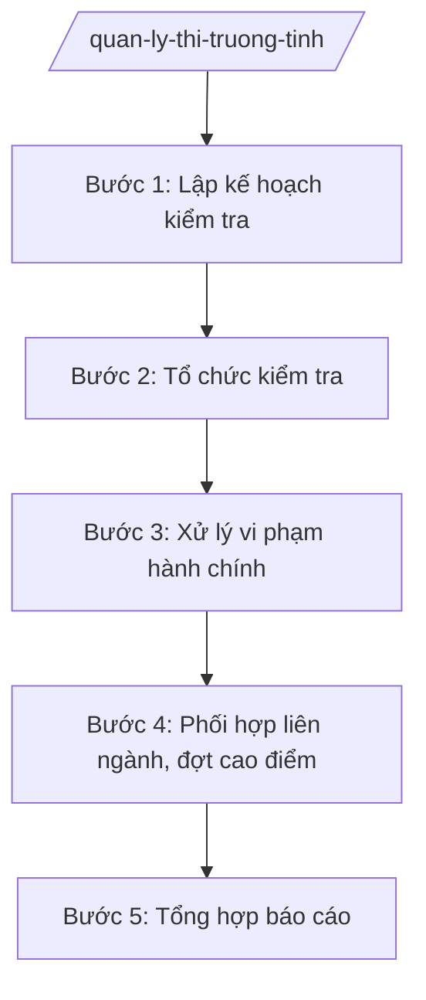

# Skill: Quản lý thị trường (chống buôn lậu, hàng giả)

## 2. Khi nào dùng

- Khi lập kế hoạch kiểm tra thị trường hằng năm, đợt cao điểm (Tết Nguyên đán, Tháng hành động ATTP...).
- Khi Chi cục Quản lý thị trường kiểm tra, xử lý vi phạm: buôn lậu, hàng giả, hàng kém chất lượng, gian lận thương mại.
- Khi tiếp nhận tin báo, phối hợp liên ngành kiểm tra đột xuất.
- Khi tổng hợp báo cáo công tác quản lý thị trường.

## 3. Đầu vào (Input)

| Trường | Mô tả | Bắt buộc |
|--------|-------|----------|
| `loai_viec` | lập kế hoạch / kiểm tra thường xuyên / kiểm tra đột xuất / cao điểm / báo cáo | Có |
| `doi_tuong` | Tổ chức, cá nhân, địa bàn kiểm tra | Không |
| `noi_dung_vi_pham` | Dấu hiệu vi phạm (buôn lậu, hàng giả, ATTP...) | Không |
| `thoi_gian` | Thời gian kiểm tra / đợt cao điểm | Không |

## 4. Quy trình

**Bước 1. Lập kế hoạch kiểm tra**
- Làm gì: Xây dựng kế hoạch kiểm tra định kỳ năm; kế hoạch đợt cao điểm; phân công Đội QLTT theo địa bàn, lĩnh vực trọng điểm.
- Dùng input: `loai_viec`, `thoi_gian`.
- Vai trò: Chi cục trưởng Chi cục QLTT dự thảo kế hoạch; AI hỗ trợ phân tích vi phạm năm trước, gợi ý địa bàn/lĩnh vực trọng điểm — ⏱ 5 ngày.
- Lưu ý nghiệp vụ: Kế hoạch của Chi cục phải được Cục trưởng (hoặc Giám đốc Sở theo phân cấp) phê duyệt; không kiểm tra trùng với thanh tra chuyên ngành khác.
- → Kết quả bước: Kế hoạch kiểm tra được phê duyệt.

**Bước 2. Tổ chức kiểm tra**
- Làm gì: Đoàn kiểm tra thực hiện kiểm tra theo quyết định; lập biên bản kiểm tra, tạm giữ tang vật (nếu có).
- Dùng input: `doi_tuong`, `noi_dung_vi_pham`.
- Vai trò: Đội trưởng Đội QLTT chỉ huy; AI hỗ trợ soạn quyết định kiểm tra, biên bản theo mẫu — ⏱ theo vụ việc.
- Lưu ý nghiệp vụ: Phải có quyết định kiểm tra hợp lệ; kiểm tra đột xuất khi có dấu hiệu vi phạm rõ ràng hoặc tin báo; bảo đảm quyền của đối tượng được kiểm tra.
- → Kết quả bước: Biên bản kiểm tra + biên bản tạm giữ (nếu có).

**Bước 3. Xử lý vi phạm hành chính**
- Làm gì: Xác minh, lập biên bản vi phạm hành chính; ra quyết định xử phạt theo thẩm quyền; chuyển cơ quan điều tra nếu có dấu hiệu tội phạm.
- Dùng input: `noi_dung_vi_pham`.
- Vai trò: Chi cục trưởng/Đội trưởng ra quyết định xử phạt theo thẩm quyền; AI hỗ trợ tra cứu khung phạt, soạn quyết định — ⏱ trong thời hiệu xử phạt.
- Lưu ý nghiệp vụ: Áp đúng điều khoản, mức phạt; tịch thu, tiêu hủy hàng giả theo quy định; vụ việc vượt thẩm quyền trình Chủ tịch UBND tỉnh.
- → Kết quả bước: Quyết định xử phạt VPHC (hoặc hồ sơ chuyển cơ quan điều tra).

**Bước 4. Phối hợp liên ngành, đợt cao điểm**
- Làm gì: Phối hợp Công an, Hải quan, Thuế, Sở Y tế... trong các đợt cao điểm chống buôn lậu, gian lận thương mại, hàng giả dịp Tết, ATTP.
- Dùng input: `loai_viec` (cao điểm), `thoi_gian`.
- Vai trò: Lãnh đạo Sở chỉ đạo; AI hỗ trợ lập kế hoạch phối hợp, theo dõi tiến độ các tổ công tác — ⏱ theo đợt.
- Lưu ý nghiệp vụ: Có quy chế phối hợp bằng văn bản; phân công rõ đầu mối từng ngành.
- → Kết quả bước: Kế hoạch liên ngành + báo cáo kết quả đợt cao điểm.

**Bước 5. Tổng hợp báo cáo**
- Làm gì: Thống kê số vụ kiểm tra, xử phạt, tiền phạt, hàng hóa tịch thu/tiêu hủy; báo cáo UBND tỉnh, Tổng cục QLTT (Bộ Công Thương).
- Dùng input: `loai_viec` (báo cáo).
- Vai trò: Chuyên viên Chi cục tổng hợp; AI hỗ trợ lập bảng biểu, dự thảo báo cáo — ⏱ 3 ngày.
- Lưu ý nghiệp vụ: Số liệu khớp giữa các đội; vụ việc chuyển hình sự báo cáo riêng.
- → Kết quả bước: Báo cáo công tác quản lý thị trường định kỳ.

## Luồng quy trình (Workflow)

## 5. Đầu ra (Output)

- Kế hoạch kiểm tra thị trường năm / đợt cao điểm.
- Quyết định kiểm tra, biên bản kiểm tra, biên bản tạm giữ.
- Quyết định xử phạt vi phạm hành chính.
- Báo cáo công tác quản lý thị trường định kỳ.

**Cấu trúc output chuẩn (Quyết định xử phạt VPHC):**
- Thể thức: tuân thủ Nghị định 30/2020/NĐ-CP về công tác văn thư.

1. Quốc hiệu "CỘNG HÒA XÃ HỘI CHỦ NGHĨA VIỆT NAM", Tiêu ngữ "Độc lập – Tự do – Hạnh phúc"; tên cơ quan (Chi cục Quản lý thị trường tỉnh A); số, ký hiệu.
2. Tên loại: **QUYẾT ĐỊNH** — về việc xử phạt vi phạm hành chính.
3. Căn cứ pháp lý (Luật Xử lý VPHC; nghị định xử phạt chuyên ngành).
4. Thông tin tổ chức/cá nhân vi phạm.
5. Hành vi vi phạm; điều khoản áp dụng; tình tiết tăng nặng/giảm nhẹ.
6. Hình thức xử phạt chính, hình phạt bổ sung, biện pháp khắc phục hậu quả.
7. Thời hạn, nơi nộp phạt; quyền khiếu nại/khởi kiện.
8. Hiệu lực; trách nhiệm thi hành; chữ ký người có thẩm quyền.
- Nơi nhận: liệt kê các cơ quan, đơn vị nhận để biết/thực hiện; kết thúc bằng "- Lưu: VT, [mã đơn vị]".
## 6. Checklist nghiệm thu

- [ ] Kế hoạch kiểm tra được cấp có thẩm quyền phê duyệt trước khi thực hiện.
- [ ] Quyết định kiểm tra hợp lệ; biên bản có chữ ký các bên.
- [ ] Áp đúng điều khoản, khung phạt; không vượt thẩm quyền.
- [ ] Hàng hóa tạm giữ, tịch thu được quản lý, xử lý đúng quy định.
- [ ] Vụ việc có dấu hiệu tội phạm được chuyển cơ quan điều tra kịp thời.
- [ ] Báo cáo số liệu đầy đủ, khớp giữa các đội.

## 7. Ví dụ mô phỏng

*Dữ liệu dưới đây là giả lập 100% phục vụ minh họa.*

**Input mẫu:** loai_viec = "cao điểm"; doi_tuong = "Các cơ sở kinh doanh tại chợ trung tâm xã A"; noi_dung_vi_pham = "hàng giả, hàng không rõ nguồn gốc"; thoi_gian = "Đợt cao điểm Tết 2026".

**Output mẫu (trích Kế hoạch):**

> **CHI CỤC QUẢN LÝ THỊ TRƯỜNG TỈNH A**
> Số: 1234/KH-QLTT
>
> **KẾ HOẠCH**
> Kiểm tra, kiểm soát thị trường đợt cao điểm Tết 2026
>
> 1. Mục đích: ngăn chặn buôn lậu, hàng giả, gian lận thương mại dịp Tết.
> 2. Đối tượng, địa bàn trọng điểm: chợ đầu mối, kho hàng, tuyến vận chuyển tại xã A và các địa bàn giáp ranh.
> 3. Nội dung kiểm tra: nguồn gốc hàng hóa, nhãn mác, ATTP, giá cả.
> 4. Thời gian: từ ngày 01/12/2025 đến 28/02/2026.
> 5. Tổ chức thực hiện: các Đội QLTT theo phân công; phối hợp Công an tỉnh A, Chi cục Hải quan...
>
> *Nơi nhận:* ... — **CHI CỤC TRƯỞNG** *(ký, đóng dấu)*

## 8. Human gate

- Chuyên viên/Đội QLTT lập → Chi cục trưởng duyệt (kế hoạch, quyết định kiểm tra).
- Quyết định xử phạt: người có thẩm quyền ký theo phân cấp; vượt thẩm quyền trình Chủ tịch UBND tỉnh.
- Vụ việc chuyển hình sự: báo cáo Giám đốc Sở, Chủ tịch UBND tỉnh trước khi chuyển.

## 9. Giới hạn

- AI không tự quyết định kiểm tra đột xuất, không tự áp mức phạt.
- Không bịa biên bản, số liệu vi phạm, ý kiến phối hợp của ngành khác.
- Không dùng văn bản hết hiệu lực để áp khung xử phạt.

## 10. Căn cứ & lưu ý

- Thông tư 37/2025/TT-BCT của Bộ Công Thương hướng dẫn chức năng, nhiệm vụ của cơ quan chuyên môn về công thương.
- Luật Xử lý vi phạm hành chính và các nghị định xử phạt chuyên ngành (dẫn tên, áp dụng bản hiện hành).
- Nghị định 150/2025/NĐ-CP về tổ chức cơ quan chuyên môn thuộc UBND cấp tỉnh.
- Nghị định 30/2020/NĐ-CP về công tác văn thư (thể thức văn bản).
- Lưu ý: Chi cục QLTT là tổ chức tương đương chi cục thuộc Sở Công Thương; phối hợp chặt với Công an, Hải quan, Thuế trong chống buôn lậu.
