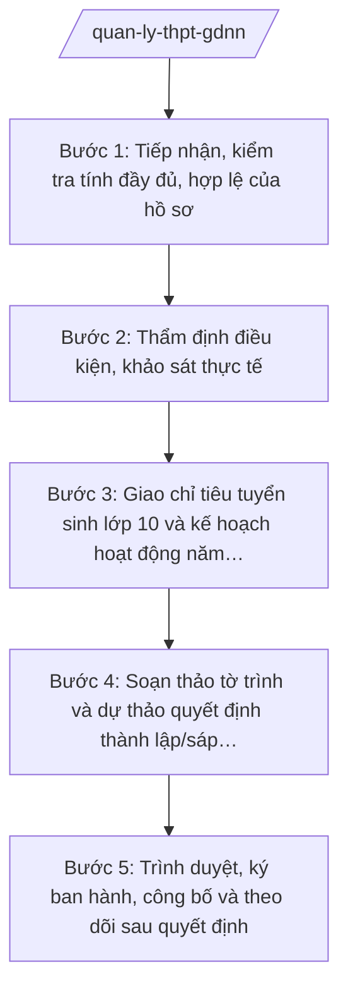

# Skill: Quản lý trường THPT, trung tâm GDNN-GDTX

## 2. Khi nào dùng

- Tham mưu UBND tỉnh quyết định thành lập, sáp nhập, giải thể, đổi tên trường THPT công lập và trung tâm giáo dục nghề nghiệp – giáo dục thường xuyên (GDNN-GDTX) trên địa bàn tỉnh (lưu ý: trung tâm GDNN-GDTX cấp huyện cũ đã chuyển về Sở GD&ĐT trực tiếp quản lý).
- Giao chỉ tiêu tuyển sinh lớp 10 hằng năm cho các trường THPT, trung tâm GDNN-GDTX.
- Kiểm tra điều kiện hoạt động, chất lượng dạy học của trường THPT, trung tâm GDNN-GDTX; xử lý kiến nghị, đề xuất của các đơn vị.
- Tổng hợp, báo cáo tình hình mạng lưới trường THPT, trung tâm GDNN-GDTX gửi UBND tỉnh và Bộ GD&ĐT.

## 3. Đầu vào (Input)

| Trường | Mô tả | Bắt buộc |
|--------|-------|----------|
| `loai_vu_viec` | Thành lập / sáp nhập / giải thể / đổi tên / giao chỉ tiêu / kiểm tra hoạt động | Có |
| `don_vi_lien_quan` | Tên trường/trung tâm, địa chỉ, loại hình (công lập/tư thục) | Có |
| `ho_so_de_nghi` | Hồ sơ đề nghị: đề án thành lập/sáp nhập/giải thể, minh chứng về đất đai, CSVC, đội ngũ, tài chính | Có (với thành lập/sáp nhập/giải thể) |
| `dieu_kien_thuc_te` | Kết quả khảo sát thực tế: diện tích đất, phòng học, thiết bị, số lượng/trình độ giáo viên | Có (với thành lập/kiểm tra) |
| `chi_tieu_du_kien` | Số lớp, số học sinh dự kiến tuyển sinh; biên chế, kinh phí đề nghị | Không |
| `nam_hoc` | Năm học áp dụng (đối với giao chỉ tiêu) | Không |
| `can_cu_phap_ly` | Văn bản pháp luật chuyên ngành về giáo dục áp dụng cho vụ việc | Có |

## 4. Quy trình

**Bước 1. Tiếp nhận, kiểm tra tính đầy đủ, hợp lệ của hồ sơ**

- Làm gì: Tiếp nhận hồ sơ đề nghị thành lập/sáp nhập/giải thể của tổ chức, cá nhân; kiểm tra thành phần hồ sơ, đối chiếu với quy định pháp luật chuyên ngành về giáo dục; lập phiếu tiếp nhận, yêu cầu bổ sung nếu thiếu.
- Dùng input: `loai_vu_viec`, `don_vi_lien_quan`, `ho_so_de_nghi`, `can_cu_phap_ly`.
- Vai trò: Chuyên viên Phòng Giáo dục Trung học soạn phiếu kiểm tra hồ sơ. AI hỗ trợ: rà soát danh mục thành phần hồ sơ theo quy định chuyên ngành, lập phiếu kiểm tra tính đầy đủ/hợp lệ, soạn văn bản yêu cầu bổ sung. ⏱ ~3–5 ngày làm việc (ước tính).
- Lưu ý nghiệp vụ: Không thụ lý hồ sơ thiếu thành phần bắt buộc; mọi yêu cầu bổ sung phải bằng văn bản, ghi rõ hạn bổ sung, tránh yêu cầu nhiều lần.
- → Kết quả bước: Phiếu kiểm tra hồ sơ + hồ sơ đầy đủ, hợp lệ (hoặc văn bản yêu cầu bổ sung).

**Bước 2. Thẩm định điều kiện, khảo sát thực tế**

- Làm gì: Thành lập đoàn khảo sát của Sở; kiểm tra thực tế đất đai, cơ sở vật chất, thiết bị dạy học, đội ngũ nhà giáo, phương án tài chính; đối chiếu với tiêu chuẩn trường THPT, trung tâm GDNN-GDTX theo quy định chuyên ngành; lập biên bản khảo sát.
- Dùng input: `ho_so_de_nghi`, `dieu_kien_thuc_te`, `chi_tieu_du_kien`.
- Vai trò: Trưởng phòng Giáo dục Trung học (ông Bùi Văn X) chủ trì đoàn khảo sát, chuyên viên các phòng liên quan tham gia. AI hỗ trợ: lập checklist tiêu chí thẩm định theo quy định chuyên ngành, tổng hợp biên bản khảo sát từ ghi chép thực tế, đối chiếu điểm đạt/chưa đạt. ⏱ ~5–7 ngày làm việc (ước tính).
- Lưu ý nghiệp vụ: Khảo sát phải thực địa 100% địa điểm dự kiến đặt trường/trung tâm; nội dung biên bản phải có chữ ký xác nhận của đại diện đơn vị được khảo sát.
- → Kết quả bước: Biên bản khảo sát thực tế + bảng đối chiếu tiêu chí đạt/chưa đạt.

**Bước 3. Giao chỉ tiêu tuyển sinh lớp 10 và kế hoạch hoạt động năm học**

- Làm gì: Tổng hợp nhu cầu tuyển sinh lớp 10 toàn tỉnh theo từng trường/trung tâm; xây dựng phương án giao chỉ tiêu (số lớp, số học sinh) bảo đảm cân đối với CSVC, đội ngũ và nhu cầu học tập của học sinh; ban hành văn bản giao chỉ tiêu.
- Dùng input: `nam_hoc`, `don_vi_lien_quan`, `chi_tieu_du_kien`, kết quả bước 2.
- Vai trò: Chuyên viên Phòng Giáo dục Trung học tổng hợp, Trưởng phòng Giáo dục Trung học (ông Bùi Văn X) và Trưởng phòng Kế hoạch – Tài chính (bà Đặng Thị Y) phối hợp thẩm định khả năng đáp ứng. AI hỗ trợ: lập bảng chỉ tiêu chi tiết theo trường/trung tâm, kiểm tra tổng số liệu khớp với dự báo học sinh tốt nghiệp THCS. ⏱ ~3–5 ngày làm việc (ước tính).
- Lưu ý nghiệp vụ: Chỉ tiêu giao không vượt quá khả năng tiếp nhận thực tế (phòng học, giáo viên); ưu tiên bảo đảm học sinh tốt nghiệp THCS trên địa bàn đều có cơ hội học tập.
- → Kết quả bước: Dự thảo văn bản giao chỉ tiêu tuyển sinh lớp 10 năm học … + bảng chỉ tiêu chi tiết.

**Bước 4. Soạn thảo tờ trình và dự thảo quyết định thành lập/sáp nhập/giải thể**

- Làm gì: Soạn Tờ trình UBND tỉnh kèm dự thảo Quyết định thành lập/sáp nhập/giải thể trường THPT, trung tâm GDNN-GDTX; dự thảo phải đúng thể thức văn bản hành chính theo NĐ 30/2020/NĐ-CP, viện dẫn đầy đủ căn cứ pháp lý.
- Dùng input: Toàn bộ input; kết quả các bước 1–3.
- Vai trò: Chuyên viên Phòng Giáo dục Trung học soạn dự thảo. AI hỗ trợ: soạn dự thảo tờ trình và quyết định đúng thể thức, kiểm tra tính đầy đủ của căn cứ pháp lý (Luật Giáo dục; TT 15/2025/TT-BGDĐT; quy định pháp luật chuyên ngành về giáo dục), rà soát lỗi chính tả, tên đơn vị. ⏱ ~3–5 ngày làm việc (ước tính).
- Lưu ý nghiệp vụ: Dự thảo quyết định phải ghi rõ: tên đơn vị sau thành lập/sáp nhập, địa chỉ trụ sở, loại hình, thời điểm có hiệu lực, trách nhiệm của các cơ quan liên quan trong bàn giao (đối với sáp nhập/giải thể: xử lý tài sản, hồ sơ học sinh, chế độ nhà giáo).
- → Kết quả bước: Tờ trình + dự thảo Quyết định thành lập/sáp nhập/giải thể hoàn chỉnh.

**Bước 5. Trình duyệt, ký ban hành, công bố và theo dõi sau quyết định**

- Làm gì: Trình hồ sơ qua các nấc kiểm duyệt của Sở; trình Chủ tịch UBND tỉnh ký ban hành quyết định; công bố quyết định, cập nhật danh mục mạng lưới trường học của tỉnh; theo dõi, hướng dẫn đơn vị mới triển khai hoạt động.
- Dùng input: Tờ trình và dự thảo quyết định ở bước 4.
- Vai trò: Chuyên viên trình; Trưởng phòng Giáo dục Trung học (ông Bùi Văn X) kiểm tra; Phó Giám đốc Sở (ông Đỗ Văn U) xem xét; Giám đốc Sở (ông Hoàng Văn S) ký tờ trình trình UBND tỉnh; Chủ tịch UBND tỉnh (ông Phạm Văn P) ký ban hành quyết định. AI hỗ trợ: lập phiếu trình ký, kiểm tra lần cuối số/ký hiệu văn bản, danh sách nơi nhận. ⏱ ~5–7 ngày làm việc (ước tính).
- Lưu ý nghiệp vụ: Quyết định chỉ có hiệu lực sau khi Chủ tịch UBND tỉnh ký; Sở phải công bố công khai và cập nhật vào hệ thống quản lý mạng lưới trường học trong 10 ngày làm việc.
- → Kết quả bước: Quyết định đã ký ban hành, công bố; hồ sơ vụ việc lưu trữ đầy đủ.

## Luồng quy trình (Workflow)

## 5. Đầu ra (Output)

### Sản phẩm

1. **Quyết định thành lập/sáp nhập/giải thể trường THPT, trung tâm GDNN-GDTX** (sản phẩm chính) — Chủ tịch UBND tỉnh ký ban hành.
2. Tờ trình UBND tỉnh kèm hồ sơ thẩm định (biên bản khảo sát, bảng đối chiếu tiêu chí).
3. Văn bản giao chỉ tiêu tuyển sinh lớp 10 hằng năm (Giám đốc Sở ký).
4. Báo cáo tình hình mạng lưới trường THPT, trung tâm GDNN-GDTX (định kỳ/năm học).

**Cấu trúc output chuẩn (Quyết định thành lập/sáp nhập/giải thể):**
- Thể thức: tuân thủ Nghị định 30/2020/NĐ-CP về công tác văn thư.

1. Quốc hiệu "CỘNG HÒA XÃ HỘI CHỦ NGHĨA VIỆT NAM", Tiêu ngữ "Độc lập – Tự do – Hạnh phúc": CỘNG HÒA XÃ HỘI CHỦ NGHĨA VIỆT NAM / Độc lập – Tự do – Hạnh phúc.
2. Tên cơ quan ban hành: ỦY BAN NHÂN DÂN TỈNH A.
3. Số, ký hiệu văn bản: số 1234/QĐ-UBND.
4. Địa danh, ngày tháng năm ban hành: Tỉnh A, ngày … tháng … năm ….
5. Tên loại và trích yếu nội dung: QUYẾT ĐỊNH / Về việc thành lập (sáp nhập, giải thể) ….
6. Căn cứ ban hành: Luật Giáo dục; Thông tư 15/2025/TT-BGDĐT; Thông tư 45/2026/TT-BGDĐT; quy định pháp luật chuyên ngành về giáo dục về thành lập trường phổ thông, trung tâm GDNN-GDTX (ghi rõ số hiệu, ngày ban hành); Tờ trình của Sở GD&ĐT tỉnh A.
7. Nội dung quyết định theo từng điều:
   - Điều 1. Quyết định thành lập (sáp nhập, giải thể): tên đơn vị, địa chỉ trụ sở, loại hình, phạm vi hoạt động;
   - Điều 2. Hiệu lực thi hành;
   - Điều 3. Trách nhiệm thi hành (Sở GD&ĐT, Sở Nội vụ, Sở Tài chính, UBND xã nơi đặt trụ sở, đơn vị liên quan; xử lý tài sản, hồ sơ, chế độ nhà giáo khi sáp nhập/giải thể).
8. Nơi nhận (như văn bản hành chính: Bộ GD&ĐT; Thường trực Tỉnh ủy, HĐND tỉnh; Chủ tịch, các Phó Chủ tịch UBND tỉnh; các sở liên quan; UBND xã …; đơn vị được thành lập/sáp nhập/giải thể; lưu VT, GDTrH).
9. Chữ ký, họ tên người ký: TM. ỦY BAN NHÂN DÂN / CHỦ TỊCH / (ký, đóng dấu, ghi rõ họ tên).

## 6. Checklist nghiệm thu

- [ ] Đủ 9 phần theo Cấu trúc output chuẩn mục 5, đúng thứ tự thể thức NĐ 30/2020/NĐ-CP.
- [ ] Hồ sơ thẩm định đầy đủ: phiếu kiểm tra hồ sơ, biên bản khảo sát thực tế có chữ ký xác nhận, bảng đối chiếu tiêu chí.
- [ ] Tên đơn vị, địa chỉ trụ sở, loại hình trong quyết định khớp tuyệt đối với hồ sơ đề nghị và biên bản khảo sát.
- [ ] Căn cứ pháp lý ghi đúng số hiệu: TT 15/2025/TT-BGDĐT, TT 45/2026/TT-BGDĐT; nội dung chuyên ngành ghi "theo quy định pháp luật chuyên ngành về giáo dục", không bịa số hiệu.
- [ ] Điều 3 quy định rõ trách nhiệm bàn giao tài sản, hồ sơ học sinh, chế độ nhà giáo (đối với sáp nhập/giải thể).
- [ ] Văn bản giao chỉ tiêu (nếu có): tổng chỉ tiêu khớp dự báo học sinh tốt nghiệp THCS, không vượt khả năng tiếp nhận của từng đơn vị.
- [ ] Đã qua đủ 5 nấc human gate: chuyên viên → Trưởng phòng → Phó Giám đốc Sở → Giám đốc Sở → Chủ tịch UBND tỉnh ký.
- [ ] Quyết định được công bố, cập nhật danh mục mạng lưới trường học; hồ sơ lưu đầy đủ.

## 7. Ví dụ mô phỏng

*Dữ liệu dưới đây là giả lập 100% phục vụ minh họa.*

**Input mẫu:**

| Trường | Giá trị mẫu |
|--------|-------------|
| loai_vu_viec | Thành lập mới |
| don_vi_lien_quan | Trường THPT Tân Tiến; xã B, tỉnh A; công lập |
| ho_so_de_nghi | Đề án thành lập; giấy tờ đất 20.000 m²; phương án CSVC, đội ngũ, tài chính |
| dieu_kien_thuc_te | Đủ diện tích; 24 phòng học kiên cố; 40 giáo viên đạt chuẩn; kinh phí hoạt động bảo đảm |
| chi_tieu_du_kien | 10 lớp 10, 450 học sinh năm đầu |
| can_cu_phap_ly | Luật Giáo dục; TT 15/2025/TT-BGDĐT; quy định chuyên ngành về thành lập trường THPT |

**Output mẫu:**

CỘNG HÒA XÃ HỘI CHỦ NGHĨA VIỆT NAM
Độc lập – Tự do – Hạnh phúc
---------------

ỦY BAN NHÂN DÂN TỈNH A

Số: 1234/QĐ-UBND

Tỉnh A, ngày 20 tháng 8 năm 2026

**QUYẾT ĐỊNH**
**Về việc thành lập Trường Trung học phổ thông Tân Tiến, xã B, tỉnh A**

*Căn cứ* Luật Giáo dục;
*Căn cứ* Thông tư số 15/2025/TT-BGDĐT ngày 24/7/2025 của Bộ Giáo dục và Đào tạo hướng dẫn chức năng, nhiệm vụ, quyền hạn của Sở Giáo dục và Đào tạo và Phòng Văn hóa – Xã hội trong lĩnh vực giáo dục và đào tạo;
*Căn cứ* quy định của pháp luật chuyên ngành về giáo dục về thành lập trường trung học phổ thông;
*Xét* Tờ trình số 567/TTr-SGDĐT ngày 10/8/2026 của Sở Giáo dục và Đào tạo tỉnh A;

**QUYẾT ĐỊNH:**

**Điều 1.** Thành lập Trường Trung học phổ thông Tân Tiến, địa chỉ tại xã B, tỉnh A; là đơn vị sự nghiệp công lập trực thuộc Sở Giáo dục và Đào tạo tỉnh A.

**Điều 2.** Quyết định này có hiệu lực thi hành kể từ ngày ký.

**Điều 3.** Chánh Văn phòng UBND tỉnh, Giám đốc Sở Giáo dục và Đào tạo, Giám đốc Sở Nội vụ, Giám đốc Sở Tài chính, Chủ tịch UBND xã B và Thủ trưởng các cơ quan, đơn vị liên quan chịu trách nhiệm thi hành Quyết định này./.

***Nơi nhận:***
- Như Điều 3;
- Bộ GD&ĐT (báo cáo);
- Thường trực Tỉnh ủy, HĐND tỉnh;
- Chủ tịch, các Phó Chủ tịch UBND tỉnh;
- Lưu: VT, GDTrH.

**TM. ỦY BAN NHÂN DÂN**
**CHỦ TỊCH**

*(Ký, đóng dấu)*

**Phạm Văn P**

## 8. Human gate (người kiểm duyệt)

- Chuyên viên Phòng Giáo dục Trung học soạn hồ sơ, dự thảo; chịu trách nhiệm về tính đầy đủ, chính xác của hồ sơ thẩm định.
- Trưởng phòng Giáo dục Trung học (ông Bùi Văn X) kiểm tra nội dung thẩm định, dự thảo tờ trình và quyết định ở bước 2–4; trả lại sửa nếu chưa đạt.
- Phó Giám đốc Sở (ông Đỗ Văn U) xem xét, cho ý kiến trước khi trình Giám đốc Sở.
- Giám đốc Sở (ông Hoàng Văn S) ký tờ trình, trình UBND tỉnh.
- Chủ tịch UBND tỉnh (ông Phạm Văn P) ký ban hành quyết định thành lập/sáp nhập/giải thể. Văn bản giao chỉ tiêu tuyển sinh lớp 10 do Giám đốc Sở ký ban hành sau khi Phó Giám đốc Sở phụ trách xem xét.

## 9. Giới hạn (guardrails)

- AI KHÔNG ra quyết định hành chính thay người có thẩm quyền (không quyết định thành lập, sáp nhập, giải thể trường học; không tự ý giao chỉ tiêu tuyển sinh).
- AI không tự ký, đóng dấu, phát hành văn bản dưới danh nghĩa UBND tỉnh, Sở GD&ĐT hay bất kỳ cá nhân nào.
- AI không bịa số liệu về CSVC, đội ngũ, chỉ tiêu tuyển sinh; mọi con số phải có nguồn từ hồ sơ đề nghị hoặc biên bản khảo sát thực tế.
- AI không bịa căn cứ pháp lý, số hiệu văn bản; không viện dẫn văn bản đã hết hiệu lực (không dùng TT 12/2020/TT-BGDĐT đã bị TT 15/2025/TT-BGDĐT thay thế).
- AI không thay thế đoàn khảo sát thực tế; kết quả thẩm định điều kiện phải dựa trên kiểm tra thực địa của cán bộ Sở.

## 10. Căn cứ & lưu ý

- Thông tư 15/2025/TT-BGDĐT ngày 24/7/2025 của Bộ GD&ĐT (hiệu lực 24/7/2025) — chức năng, nhiệm vụ, quyền hạn của Sở GD&ĐT (thay thế TT 12/2020/TT-BGDĐT).
- Thông tư 45/2026/TT-BGDĐT ngày 10/6/2026 của Bộ GD&ĐT (hiệu lực 10/6/2026) — sửa đổi, bổ sung TT 15/2025/TT-BGDĐT.
- Nghị định 142/2025/NĐ-CP ngày 12/6/2025 — phân định thẩm quyền của chính quyền địa phương 02 cấp trong lĩnh vực quản lý nhà nước của Bộ GD&ĐT.
- Nghị định 143/2025/NĐ-CP ngày 12/6/2025 — phân quyền, phân cấp trong lĩnh vực quản lý nhà nước của Bộ GD&ĐT.
- Nghị định 150/2025/NĐ-CP ngày 12/6/2025 (hiệu lực 16/6/2025) — tổ chức cơ quan chuyên môn thuộc UBND cấp tỉnh.
- Nghị định 30/2020/NĐ-CP — thể thức văn bản hành chính.
- Lưu ý: trình tự, thủ tục, điều kiện và thẩm quyền thành lập, sáp nhập, giải thể trường THPT, trung tâm GDNN-GDTX thực hiện theo quy định pháp luật chuyên ngành về giáo dục; số hiệu văn bản chuyên ngành không có trong danh mục được phép trích dẫn thì ghi "theo quy định pháp luật chuyên ngành về giáo dục", tuyệt đối không bịa số hiệu.
