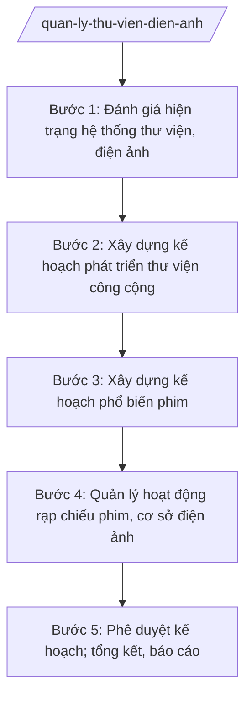

# Skill: Quản lý thư viện, điện ảnh

## 2. Khi nào dùng

- Xây dựng kế hoạch phát triển sự nghiệp thư viện hằng năm của tỉnh: bổ sung tài liệu, số hóa, luân chuyển sách báo về cơ sở, phát triển thư viện xã, thư viện lưu động.
- Lập kế hoạch phổ biến phim: chiếu phim lưu động phục vụ vùng sâu, vùng xa, vùng đồng bào dân tộc thiểu số; đợt phim kỷ niệm các ngày lễ lớn.
- Quản lý hoạt động của rạp chiếu phim, cơ sở chiếu phim trên địa bàn tỉnh: điều kiện hoạt động, nội dung phim chiếu, phân loại phim theo độ tuổi.
- Kiểm tra, xử lý vi phạm trong hoạt động thư viện, điện ảnh (phim chưa được phép phổ biến, vi phạm bản quyền, điều kiện cơ sở vật chất).
- Tổng hợp báo cáo công tác thư viện, điện ảnh gửi UBND tỉnh, Bộ VHTTDL.

## 3. Đầu vào (Input)

| Trường | Mô tả | Bắt buộc |
|--------|-------|----------|
| `hien_trang` | Hiện trạng hệ thống thư viện công cộng (thư viện tỉnh, thư viện xã, tủ sách cơ sở): kho tài liệu, bạn đọc, lượt phục vụ; hiện trạng cơ sở chiếu phim, đội chiếu phim lưu động | Có |
| `ke_hoach_nam` | Mục tiêu phát triển thư viện, phổ biến phim năm: chỉ tiêu bổ sung tài liệu, số buổi chiếu phim lưu động, địa bàn phục vụ | Có |
| `danh_muc_rap` | Danh sách rạp chiếu phim, cơ sở chiếu phim, đội chiếu phim lưu động trên địa bàn: tên, địa chỉ, tình trạng hoạt động | Không |
| `chuong_trinh_phim` | Danh mục phim dự kiến phổ biến (phim truyện, phim tài liệu, phim kỷ niệm); nguồn phim | Không |
| `du_toan` | Dự toán kinh phí thực hiện kế hoạch năm | Có |
| `thoi_han` | Thời hạn ban hành kế hoạch năm | Có |

## 4. Quy trình

**Bước 1. Đánh giá hiện trạng hệ thống thư viện, điện ảnh**

- Làm gì: Thu thập số liệu: kho tài liệu, bạn đọc, lượt phục vụ của thư viện tỉnh và thư viện xã; số buổi chiếu phim lưu động năm trước; hiện trạng rạp chiếu phim, trang thiết bị; đánh giá mặt được, tồn tại.
- Dùng input: `hien_trang`, `danh_muc_rap`.
- Vai trò: Chuyên viên Phòng Văn hóa cơ sở (ông Nguyễn Văn P2) chủ trì tổng hợp, phối hợp Thư viện tỉnh và Trung tâm Phát hành phim và Chiếu bóng tỉnh (đơn vị sự nghiệp trực thuộc Sở); Trưởng phòng (bà Lê Thị K) kiểm tra. AI hỗ trợ: thiết kế biểu mẫu thu thập số liệu, tổng hợp thành bảng, soạn báo cáo đánh giá hiện trạng. ⏱ ~5–7 ngày làm việc (ước tính).
- Lưu ý nghiệp vụ: Số liệu phải đối chiếu với năm trước; phân tách rõ 2 mảng thư viện và điện ảnh; ghi nhận cụ thể cơ sở vật chất xuống cấp cần đầu tư.
- → Kết quả bước: Báo cáo đánh giá hiện trạng hệ thống thư viện, điện ảnh tỉnh.

**Bước 2. Xây dựng kế hoạch phát triển thư viện công cộng**

- Làm gì: Dự thảo Kế hoạch phát triển sự nghiệp thư viện năm: chỉ tiêu bổ sung tài liệu (sách, báo, tài liệu số); kế hoạch số hóa tài liệu; luân chuyển sách báo từ thư viện tỉnh về thư viện xã, tủ sách cơ sở; phát triển thư viện lưu động, thư viện xã đạt chuẩn; tập huấn cán bộ thư viện cơ sở.
- Dùng input: `ke_hoach_nam`, `du_toan`, kết quả bước 1.
- Vai trò: Chuyên viên Phòng Văn hóa cơ sở soạn dự thảo, phối hợp Thư viện tỉnh về chuyên môn và Phòng Kế hoạch – Tài chính Sở về dự toán; Trưởng phòng (bà Lê Thị K) kiểm tra. AI hỗ trợ: soạn dự thảo kế hoạch, lập bảng chỉ tiêu/nhiệm vụ, lập bảng dự toán, lịch luân chuyển sách. ⏱ ~7–10 ngày làm việc (ước tính).
- Lưu ý nghiệp vụ: Ưu tiên bổ sung tài liệu phục vụ thiếu nhi, vùng sâu, vùng xa; tài liệu số hóa phải bảo đảm bản quyền; phối hợp Phòng Văn hóa – Xã hội các xã trong phát triển thư viện xã.
- → Kết quả bước: Dự thảo Kế hoạch phát triển sự nghiệp thư viện tỉnh năm.

**Bước 3. Xây dựng kế hoạch phổ biến phim**

- Làm gì: Dự thảo Kế hoạch phổ biến phim năm: danh mục phim chiếu (ưu tiên phim Việt Nam, phim tài liệu, phim kỷ niệm các ngày lễ lớn); lịch chiếu phim lưu động theo địa bàn (xã vùng sâu, vùng xa); phối hợp đợt phim kỷ niệm; dự toán kinh phí.
- Dùng input: `chuong_trinh_phim`, `ke_hoach_nam`, `du_toan`.
- Vai trò: Chuyên viên Phòng Văn hóa cơ sở soạn dự thảo, phối hợp Trung tâm Phát hành phim và Chiếu bóng tỉnh; Trưởng phòng (bà Lê Thị K) kiểm tra. AI hỗ trợ: soạn dự thảo kế hoạch, lập lịch chiếu theo địa bàn, lập dự toán. ⏱ ~5–7 ngày làm việc (ước tính).
- Lưu ý nghiệp vụ: Chỉ phổ biến phim đã được phép phổ biến theo quy định pháp luật chuyên ngành về điện ảnh; ưu tiên địa bàn khó khăn, vùng đồng bào dân tộc thiểu số; bảo đảm an toàn trong các buổi chiếu lưu động.
- → Kết quả bước: Dự thảo Kế hoạch phổ biến phim năm (danh mục phim, lịch chiếu, dự toán).

**Bước 4. Quản lý hoạt động rạp chiếu phim, cơ sở điện ảnh**

- Làm gì: Rà soát điều kiện hoạt động của rạp chiếu phim, cơ sở chiếu phim (giấy tờ pháp lý, cơ sở vật chất, PCCC); kiểm tra nội dung phim đang chiếu (phim được phép phổ biến, phân loại độ tuổi đúng quy định, niêm yết lịch chiếu); hướng dẫn, chấn chỉnh; xử lý vi phạm theo thẩm quyền.
- Dùng input: `danh_muc_rap`.
- Vai trò: Đoàn kiểm tra của Phòng Văn hóa cơ sở phối hợp Thanh tra Sở; Trưởng phòng (bà Lê Thị K) làm trưởng đoàn; Chánh Thanh tra Sở tham mưu xử phạt. AI hỗ trợ: lập kế hoạch kiểm tra, checklist điều kiện rạp chiếu phim, soạn biên bản kiểm tra, dự thảo quyết định xử phạt. ⏱ ~5–7 ngày làm việc/đợt (ước tính).
- Lưu ý nghiệp vụ: Kiên quyết xử lý chiếu phim chưa được phép phổ biến, chiếu sai phân loại độ tuổi; nội dung kiểm tra phải đúng quy định pháp luật chuyên ngành về điện ảnh, không gây khó khăn cho cơ sở kinh doanh hợp pháp.
- → Kết quả bước: Biên bản kiểm tra + văn bản chấn chỉnh/quyết định xử phạt (nếu có) + danh sách cơ sở đủ điều kiện cập nhật.

**Bước 5. Phê duyệt kế hoạch; tổng kết, báo cáo**

- Làm gì: Trình Giám đốc Sở phê duyệt Kế hoạch phát triển sự nghiệp thư viện và Kế hoạch phổ biến phim năm; theo dõi triển khai; sơ kết 6 tháng, tổng kết năm; báo cáo UBND tỉnh, Bộ VHTTDL.
- Dùng input: Dự thảo kế hoạch bước 2–3; kết quả thực hiện bước 4.
- Vai trò: Trưởng phòng (bà Lê Thị K) trình; Giám đốc Sở (bà Vũ Thị T) phê duyệt; chuyên viên tổng hợp báo cáo. AI hỗ trợ: rà soát thể thức lần cuối, soạn báo cáo sơ kết/tổng kết, lập bảng tổng hợp chỉ tiêu thực hiện. ⏱ ~3–5 ngày làm việc (ước tính).
- Lưu ý nghiệp vụ: Báo cáo đối chiếu chỉ tiêu kế hoạch với kết quả thực hiện; nêu tồn tại về cơ sở vật chất, nhân lực để kiến nghị năm sau.
- → Kết quả bước: Kế hoạch năm đã phê duyệt + báo cáo sơ kết/tổng kết gửi UBND tỉnh, Bộ VHTTDL.

## Luồng quy trình (Workflow)

## 5. Đầu ra (Output)

### Sản phẩm

1. **Kế hoạch phát triển sự nghiệp thư viện và phổ biến phim tỉnh năm …** (sản phẩm chính).
2. Báo cáo đánh giá hiện trạng hệ thống thư viện, điện ảnh.
3. Lịch chiếu phim lưu động + danh mục phim phổ biến.
4. Biên bản kiểm tra rạp chiếu phim, cơ sở điện ảnh; quyết định xử phạt (nếu có).
5. Báo cáo sơ kết 6 tháng, tổng kết năm công tác thư viện, điện ảnh.

**Cấu trúc output chuẩn (Kế hoạch phát triển sự nghiệp thư viện và phổ biến phim năm):**
- Thể thức: tuân thủ Nghị định 30/2020/NĐ-CP về công tác văn thư.

1. Quốc hiệu "CỘNG HÒA XÃ HỘI CHỦ NGHĨA VIỆT NAM", Tiêu ngữ "Độc lập – Tự do – Hạnh phúc": CỘNG HÒA XÃ HỘI CHỦ NGHĨA VIỆT NAM / Độc lập – Tự do – Hạnh phúc.
2. Tên cơ quan ban hành: SỞ VĂN HÓA, THỂ THAO VÀ DU LỊCH TỈNH A.
3. Số, ký hiệu văn bản: số/KH-SVHTTDL.
4. Địa danh, ngày tháng năm ban hành: Tỉnh A, ngày … tháng … năm ….
5. Tên loại và trích yếu nội dung: KẾ HOẠCH / Phát triển sự nghiệp thư viện và phổ biến phim tỉnh A năm ….
6. Căn cứ ban hành: Thông tư số 10/2025/TT-BVHTTDL ngày 19/6/2025; Nghị định số 137/2025/NĐ-CP ngày 12/6/2025; Nghị định số 138/2025/NĐ-CP ngày 12/6/2025 (ghi rõ số hiệu, ngày ban hành).
7. Nội dung chính:
   - I. Mục đích, yêu cầu;
   - II. Chỉ tiêu kế hoạch (thư viện: bổ sung tài liệu, bạn đọc, lượt phục vụ; điện ảnh: số buổi chiếu lưu động, địa bàn phục vụ);
   - III. Nhiệm vụ và giải pháp (phát triển thư viện công cộng, số hóa, luân chuyển sách; phổ biến phim lưu động; quản lý rạp chiếu phim; tập huấn cán bộ cơ sở);
   - IV. Kinh phí thực hiện;
   - V. Tổ chức thực hiện (phân công đơn vị, tiến độ).
8. Nơi nhận (UBND tỉnh (báo cáo); Bộ VHTTDL (báo cáo); các phòng, đơn vị trực thuộc Sở; Phòng VH-XH các xã; lưu VT, VHCS).
9. Chữ ký, họ tên người ký: GIÁM ĐỐC / (ký, đóng dấu, ghi rõ họ tên).

## 6. Checklist nghiệm thu

- [ ] Đủ 9 phần theo Cấu trúc output chuẩn mục 5, đúng thứ tự thể thức NĐ 30/2020/NĐ-CP.
- [ ] Chỉ tiêu cụ thể, đo lường được cho cả 2 mảng thư viện và điện ảnh.
- [ ] Kế hoạch phổ biến phim có danh mục phim, lịch chiếu theo địa bàn, ưu tiên vùng khó khăn.
- [ ] Phim đưa vào phổ biến là phim đã được phép phổ biến theo quy định pháp luật chuyên ngành về điện ảnh.
- [ ] Có nội dung quản lý, kiểm tra rạp chiếu phim (điều kiện hoạt động, phân loại độ tuổi).
- [ ] Dự toán kinh phí chi tiết, phân rõ nguồn.
- [ ] Căn cứ pháp lý ghi đúng số hiệu, ngày ban hành của TT 10/2025/TT-BVHTTDL, NĐ 137/2025, NĐ 138/2025.
- [ ] Đã qua đủ human gate: chuyên viên soạn → Trưởng phòng kiểm tra → Phó Giám đốc Sở → Giám đốc Sở phê duyệt.

## 7. Ví dụ mô phỏng

*Dữ liệu dưới đây là giả lập 100% phục vụ minh họa.*

**Input mẫu:**

| Trường | Giá trị mẫu |
|--------|-------------|
| hien_trang | Thư viện tỉnh A: 80.000 bản sách, 15.000 thẻ bạn đọc; 10 thư viện xã (06 đạt chuẩn); 02 đội chiếu phim lưu động, năm 2026 chiếu 300 buổi; 03 rạp chiếu phim đang hoạt động |
| ke_hoach_nam | Năm 2027: bổ sung 5.000 bản sách; 20.000 thẻ bạn đọc; 350 buổi chiếu phim lưu động; 100% xã vùng sâu được phục vụ chiếu phim |
| chuong_trinh_phim | Phim truyện Việt Nam mới phát hành, phim tài liệu kỷ niệm các ngày lễ lớn |
| du_toan | 4 tỷ đồng |
| thoi_han | 31/01/2027 |

**Output mẫu:**

CỘNG HÒA XÃ HỘI CHỦ NGHĨA VIỆT NAM
Độc lập – Tự do – Hạnh phúc
---------------

SỞ VĂN HÓA, THỂ THAO VÀ DU LỊCH TỈNH A

Số: 1236/KH-SVHTTDL

Tỉnh A, ngày 25 tháng 01 năm 2027

**KẾ HOẠCH**
**Phát triển sự nghiệp thư viện và phổ biến phim tỉnh A năm 2027**

*Căn cứ* Thông tư số 10/2025/TT-BVHTTDL ngày 19/6/2025 của Bộ Văn hóa, Thể thao và Du lịch; Nghị định số 137/2025/NĐ-CP ngày 12/6/2025 của Chính phủ; Nghị định số 138/2025/NĐ-CP ngày 12/6/2025 của Chính phủ;

Sở Văn hóa, Thể thao và Du lịch tỉnh A ban hành Kế hoạch phát triển sự nghiệp thư viện và phổ biến phim năm 2027 như sau:

**I. MỤC ĐÍCH, YÊU CẦU**

Phát triển văn hóa đọc trong nhân dân; đưa phim ảnh đến vùng sâu, vùng xa; nâng cao hiệu quả quản lý nhà nước về thư viện, điện ảnh.

**II. CHỈ TIÊU KẾ HOẠCH**

1. Thư viện: bổ sung 5.000 bản sách; đạt 20.000 thẻ bạn đọc; luân chuyển 10.000 lượt sách về thư viện xã.
2. Điện ảnh: tổ chức 350 buổi chiếu phim lưu động; 100% xã vùng sâu, vùng xa được phục vụ chiếu phim.

**III. NHIỆM VỤ VÀ GIẢI PHÁP**

1. Bổ sung tài liệu, ưu tiên sách thiếu nhi và tài liệu phục vụ vùng khó khăn; số hóa 2.000 tài liệu quý; tập huấn cán bộ thư viện xã.
2. Chiếu phim lưu động theo lịch địa bàn; tổ chức đợt phim kỷ niệm các ngày lễ lớn; chỉ phổ biến phim đã được phép phổ biến.
3. Kiểm tra 02 đợt/năm đối với rạp chiếu phim về điều kiện hoạt động và phân loại phim theo độ tuổi.

**IV. KINH PHÍ THỰC HIỆN**

Tổng dự toán 4 tỷ đồng từ ngân sách tỉnh (chi tiết tại phụ lục).

**V. TỔ CHỨC THỰC HIỆN**

Thư viện tỉnh và Trung tâm Phát hành phim và Chiếu bóng tỉnh trực tiếp triển khai; Phòng Văn hóa cơ sở theo dõi, đôn đốc; Văn phòng Sở quản lý kinh phí; báo cáo sơ kết 6 tháng và tổng kết năm./.

***Nơi nhận:***
- UBND tỉnh (báo cáo); Bộ VHTTDL (báo cáo);
- Các phòng, đơn vị trực thuộc Sở;
- Phòng Văn hóa – Xã hội các xã;
- Lưu: VT, VHCS.

**GIÁM ĐỐC**

*(Ký, đóng dấu)*

**Vũ Thị T**

## 8. Human gate (người kiểm duyệt)

- Chuyên viên Phòng Văn hóa cơ sở (ông Nguyễn Văn P2) soạn dự thảo kế hoạch, tổng hợp số liệu, chịu trách nhiệm về tính chính xác của số liệu thư viện, điện ảnh.
- Trưởng phòng Văn hóa cơ sở (bà Lê Thị K) kiểm tra nội dung, chỉ tiêu, dự toán ở bước 1–3 và bước 5; làm trưởng đoàn kiểm tra rạp chiếu phim.
- Phó Giám đốc Sở (ông Đỗ Văn U) cho ý kiến trước khi trình Giám đốc Sở.
- Giám đốc Sở (bà Vũ Thị T) phê duyệt Kế hoạch phát triển sự nghiệp thư viện và phổ biến phim năm. Kế hoạch chỉ có hiệu lực sau khi Giám đốc Sở ký.

## 9. Giới hạn (guardrails)

- AI KHÔNG phê duyệt kế hoạch, quyết định xử phạt thay Giám đốc Sở và người có thẩm quyền; không tự ký, phát hành.
- AI không bịa số liệu thư viện, điện ảnh; không đưa phim chưa được phép phổ biến vào kế hoạch.
- AI không bịa căn cứ pháp lý, số hiệu văn bản; không viện dẫn văn bản đã hết hiệu lực.
- AI không đề xuất nội dung tài liệu, phim ảnh vi phạm bản quyền hoặc trái quy định pháp luật.
- AI không quyết định đầu tư mua sắm trang thiết bị thay cơ quan có thẩm quyền.

## 10. Căn cứ & lưu ý

- Thông tư 10/2025/TT-BVHTTDL ngày 19/6/2025 (hiệu lực 01/7/2025) của Bộ VHTTDL — hướng dẫn chức năng, nhiệm vụ của Sở Văn hóa, Thể thao và Du lịch (thay thế TT 08/2021/TT-BVHTTDL).
- Nghị định 137/2025/NĐ-CP ngày 12/6/2025 — phân định thẩm quyền của chính quyền địa phương 02 cấp trong lĩnh vực văn hóa, thể thao và du lịch.
- Nghị định 138/2025/NĐ-CP ngày 12/6/2025 — phân quyền, phân cấp trong lĩnh vực văn hóa, thể thao và du lịch.
- Việc phát triển thư viện và phổ biến phim thực hiện theo quy định pháp luật chuyên ngành về thư viện và điện ảnh (chỉ nêu tên lĩnh vực, không bịa số hiệu văn bản).
- Nghị định 30/2020/NĐ-CP — thể thức văn bản hành chính.
- Lưu ý: phim đưa vào phổ biến phải là phim đã được cấp phép phổ biến; rạp chiếu phim phải thực hiện đúng phân loại độ tuổi khi chiếu phim.
