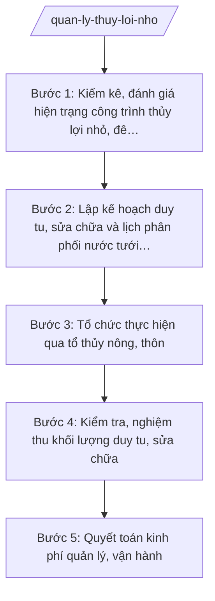

# Skill: Quản lý công trình thủy lợi nhỏ

## 2. Khi nào dùng

- Khi Phòng Kinh tế xã được giao quản lý nhà nước về công trình thủy lợi nhỏ, đê bao nội đồng trên địa bàn (nhiệm vụ lĩnh vực thủy lợi cấp xã theo Thông tư 19/2025/TT-BNNMT).
- Khi cần kiểm kê, đánh giá hiện trạng các công trình: trạm bơm, kênh mương, cống, đê bao nội đồng (vị trí, quy mô, tình trạng hư hỏng) trước mỗi vụ sản xuất.
- Khi cần lập kế hoạch duy tu, sửa chữa công trình và xây dựng lịch phân phối nước tưới trong vụ, bảo đảm công bằng, tiết kiệm nước.
- Khi cần tổ chức thực hiện qua tổ thủy nông, thôn; kiểm tra, nghiệm thu khối lượng và quyết toán kinh phí (nguồn ngân sách xã và đóng góp của người dân).

## 3. Đầu vào (Input)

| Trường | Mô tả | Bắt buộc |
|--------|-------|----------|
| `nam_ke_hoach` | Năm áp dụng của kế hoạch (vd: 2026) | Có |
| `danh_muc_cong_trinh` | Danh mục công trình: trạm bơm, kênh mương, cống, đê bao nội đồng; vị trí, quy mô, năm xây dựng, tình trạng hiện tại | Có |
| `dien_tich_tuoi` | Diện tích phục vụ tưới theo từng vụ (vụ đông xuân, vụ mùa), phân theo thôn | Có |
| `lich_thoi_vu` | Lịch thời vụ gieo trồng của xã trong năm áp dụng | Có |
| `to_thuy_nong` | Tổ thủy nông, tổ tự quản các thôn: nhân sự, phạm vi phụ trách | Có |
| `kinh_phi` | Kinh phí dự kiến: ngân sách xã, đóng góp của người dân (thủy lợi phí nội đồng) | Có |
| `van_ban_chi_dao` | Văn bản chỉ đạo của cấp trên về sản xuất nông nghiệp, thủy lợi trong năm áp dụng (nếu có) | Không |

## 4. Quy trình

**Bước 1. Kiểm kê, đánh giá hiện trạng công trình thủy lợi nhỏ, đê bao nội đồng**
- Làm gì: Kiểm kê toàn bộ công trình: trạm bơm (công suất, tình trạng máy), kênh mương (chiều dài, đoạn sạt lở, bồi lắng), cống (hư hỏng, tắc nghẽn), đê bao nội đồng (đoạn xung yếu, sụt lún); đánh giá mức độ hư hỏng, phân loại cần sửa chữa ngay / duy tu định kỳ / còn tốt; chụp ảnh, lập biên bản hiện trạng.
- Dùng input: `danh_muc_cong_trinh`, `to_thuy_nong`.
- Vai trò: Công chức Phòng Kinh tế (ông Nguyễn Văn G) chủ trì kiểm kê, phối hợp tổ thủy nông, trưởng các thôn; AI hỗ trợ lập bảng kiểm kê và mẫu biên bản đánh giá hiện trạng công trình (~3 ngày).
- Lưu ý nghiệp vụ: Kiểm tra thực tế từng công trình, không nghe báo cáo miệng; đặc biệt chú ý các đoạn đê bao xung yếu, cống tiêu trước mùa mưa; biên bản phải có chữ ký xác nhận của tổ thủy nông, trưởng thôn.
- → Kết quả bước: Bảng kiểm kê + biên bản đánh giá hiện trạng công trình thủy lợi nhỏ, đê bao nội đồng.

**Bước 2. Lập kế hoạch duy tu, sửa chữa và lịch phân phối nước tưới trong vụ**
- Làm gì: Lập kế hoạch quản lý, vận hành, bảo dưỡng: hạng mục duy tu, sửa chữa (tên công trình, khối lượng, thời gian, kinh phí); xây dựng phương án phân phối nước tưới trong vụ theo lịch thời vụ: thứ tự ưu tiên vùng tưới, lịch mở cống/vận hành trạm bơm theo thôn, phân công người trực; dự toán kinh phí chi tiết (ngân sách xã + đóng góp).
- Dùng input: Biên bản hiện trạng bước 1, `dien_tich_tuoi`, `lich_thoi_vu`, `kinh_phi`, `nam_ke_hoach`, `van_ban_chi_dao`.
- Vai trò: Công chức Phòng Kinh tế (ông Nguyễn Văn G) lập kế hoạch, dự toán; AI hỗ trợ soạn thảo theo thể thức NĐ 30/2020/NĐ-CP, lập bảng phân nước theo thôn và bảng dự toán (~2 ngày).
- Lưu ý nghiệp vụ: Lịch phân nước phải công bằng giữa các thôn, ưu tiên vùng cuối kênh; hạng mục sửa chữa phải hoàn thành trước vụ sản xuất; mức đóng góp của dân phải được bàn bạc, thống nhất, đúng quy định.
- → Kết quả bước: Dự thảo Kế hoạch quản lý, vận hành, bảo dưỡng công trình + Phương án phân phối nước tưới trong vụ kèm dự toán kinh phí.

**Bước 3. Tổ chức thực hiện qua tổ thủy nông, thôn**
- Làm gì: Triển khai kế hoạch sau phê duyệt: giao tổ thủy nông, thôn tổ chức duy tu, sửa chữa; vận hành trạm bơm, điều tiết cống theo lịch phân nước; thông báo lịch lấy nước đến từng hộ dân (niêm yết, loa truyền thanh); xử lý kịp thời sự cố (vỡ kênh, hỏng máy bơm).
- Dùng input: Kế hoạch, phương án phân nước đã phê duyệt bước 2, `to_thuy_nong`.
- Vai trò: Công chức Phòng Kinh tế (ông Nguyễn Văn G) đôn đốc, phối hợp tổ thủy nông, trưởng thôn; AI hỗ trợ soạn thông báo lịch lấy nước và nhật ký vận hành trạm bơm (~0,5 ngày).
- Lưu ý nghiệp vụ: Lịch lấy nước phải thông báo trước ít nhất 3 ngày để hộ dân chủ động; ghi nhật ký vận hành (giờ bơm, lượng dầu/điện) làm cơ sở quyết toán; sự cố phải xử lý ngay, không để mất nước kéo dài.
- → Kết quả bước: Công trình được duy tu, sửa chữa; nước tưới được phân phối theo lịch; nhật ký vận hành.

**Bước 4. Kiểm tra, nghiệm thu khối lượng duy tu, sửa chữa**
- Làm gì: Tổ chức kiểm tra, nghiệm thu từng hạng mục duy tu, sửa chữa: đối chiếu khối lượng thực tế với kế hoạch, dự toán; đánh giá chất lượng (kênh thông thoáng, cống hoạt động, đê bao chắc chắn); lập biên bản nghiệm thu có chữ ký các bên (Phòng Kinh tế, tổ thủy nông, thôn, đơn vị thi công nếu thuê ngoài).
- Dùng input: Kế hoạch bước 2, kết quả thực hiện bước 3.
- Vai trò: Công chức Phòng Kinh tế (ông Nguyễn Văn G) chủ trì nghiệm thu, mời Trưởng phòng Kinh tế (bà Hoàng Thị D) tham gia với hạng mục lớn; AI hỗ trợ lập mẫu biên bản nghiệm thu và bảng đối chiếu khối lượng (~1 ngày).
- Lưu ý nghiệp vụ: Nghiệm thu thực tế tại công trình; khối lượng không đạt không được nghiệm thu; biên bản là căn cứ bắt buộc để thanh, quyết toán.
- → Kết quả bước: Biên bản nghiệm thu khối lượng duy tu, sửa chữa công trình.

**Bước 5. Quyết toán kinh phí quản lý, vận hành**
- Làm gì: Tổng hợp chi phí: duy tu, sửa chữa (theo biên bản nghiệm thu), chi phí vận hành (dầu, điện, công trực), chi phí quản lý; đối chiếu nguồn: ngân sách xã và đóng góp của người dân; lập báo cáo quyết toán trình Trưởng phòng Kinh tế kiểm tra, trình Chủ tịch UBND xã phê duyệt; công khai quyết toán tại thôn.
- Dùng input: Biên bản nghiệm thu bước 4, nhật ký vận hành bước 3, `kinh_phi`.
- Vai trò: Công chức Phòng Kinh tế (ông Nguyễn Văn G) lập quyết toán; Trưởng phòng Kinh tế (bà Hoàng Thị D) kiểm tra; AI hỗ trợ lập bảng quyết toán chi tiết theo nguồn kinh phí (~1 ngày).
- Lưu ý nghiệp vụ: Quyết toán phải khớp chứng từ, hóa đơn; phần đóng góp của dân phải công khai minh bạch tại thôn; chênh lệch so với dự toán phải giải trình rõ lý do.
- → Kết quả bước: Báo cáo quyết toán kinh phí quản lý, vận hành công trình thủy lợi đã phê duyệt, công khai.

## Luồng quy trình (Workflow)

## 5. Đầu ra (Output)

**Danh sách sản phẩm:**
1. Kế hoạch quản lý, vận hành, bảo dưỡng công trình thủy lợi nhỏ, đê bao nội đồng năm … kèm dự toán kinh phí (sản phẩm chính 1).
2. Phương án phân phối nước tưới trong vụ … (sản phẩm chính 2).
3. Biên bản kiểm kê, đánh giá hiện trạng công trình (tài liệu kèm theo).
4. Biên bản nghiệm thu khối lượng; báo cáo quyết toán kinh phí (tài liệu kèm theo).

### Cấu trúc output chuẩn — Kế hoạch quản lý, vận hành, bảo dưỡng công trình thủy lợi nhỏ

1. Quốc hiệu – tiêu ngữ: "CỘNG HÒA XÃ HỘI CHỦ NGHĨA VIỆT NAM / Độc lập – Tự do – Hạnh phúc". (đúng thể thức NĐ 30/2020/NĐ-CP)
2. Tên cơ quan ban hành: "ỦY BAN NHÂN DÂN XÃ A".
3. Số, ký hiệu văn bản: số/ký hiệu theo quy định (vd: 45/KH-UBND).
4. Địa danh, ngày tháng năm ban hành: "Xã A, ngày … tháng … năm …".
5. Tên loại và trích yếu: "KẾ HOẠCH — Quản lý, vận hành, bảo dưỡng công trình thủy lợi nhỏ, đê bao nội đồng xã A năm …".
6. Căn cứ: Luật Thủy lợi (chỉ nêu tên luật); Thông tư số 19/2025/TT-BNNMT ngày 19/6/2025 của Bộ Nông nghiệp và Môi trường; Nghị định số 150/2025/NĐ-CP ngày 12/6/2025 của Chính phủ; văn bản chỉ đạo của cấp trên (nếu có).
7. Nội dung: I. Hiện trạng công trình thủy lợi nhỏ, đê bao nội đồng; II. Mục tiêu quản lý, vận hành năm …; III. Kế hoạch duy tu, sửa chữa (bảng: công trình – hạng mục – khối lượng – thời gian – kinh phí); IV. Tổ chức vận hành (tổ thủy nông, chế độ trực, xử lý sự cố); V. Tổ chức thực hiện (Phòng Kinh tế chủ trì, tổ thủy nông, các thôn); VI. Kinh phí (ngân sách xã, đóng góp của người dân).
8. Thẩm quyền – chức vụ – họ tên người ký: Chủ tịch UBND xã — Nguyễn Văn A; ký, đóng dấu UBND xã.
9. Nơi nhận: Thường trực Đảng ủy, HĐND xã; Sở Nông nghiệp và Môi trường tỉnh A; Phòng Kinh tế; tổ thủy nông; các thôn; lưu VP.

### Cấu trúc output chuẩn — Phương án phân phối nước tưới trong vụ

1. Quốc hiệu – tiêu ngữ.
2. Tên cơ quan ban hành: "ỦY BAN NHÂN DÂN XÃ A".
3. Số, ký hiệu văn bản (vd: 45/PA-UBND).
4. Địa danh, ngày tháng năm ban hành.
5. Tên loại và trích yếu: "PHƯƠNG ÁN — Phân phối nước tưới vụ … xã A năm …".
6. Căn cứ: Kế hoạch quản lý, vận hành, bảo dưỡng công trình thủy lợi nhỏ năm …; lịch thời vụ của xã.
7. Nội dung: I. Diện tích, cơ cấu cây trồng cần tưới theo thôn; II. Nguồn nước, khả năng cấp nước của trạm bơm, kênh mương; III. Lịch phân phối nước (bảng: thôn – diện tích – thời gian lấy nước – người phụ trách); IV. Chế độ trực vận hành, xử lý sự cố; V. Tổ chức thực hiện.
8. Thẩm quyền – chức vụ – họ tên người ký: Chủ tịch UBND xã — Nguyễn Văn A; ký, đóng dấu UBND xã.
9. Nơi nhận: như Kế hoạch.

## 6. Checklist nghiệm thu

- [ ] Kế hoạch đủ các phần theo cấu trúc output chuẩn, kèm dự toán kinh phí chi tiết (ngân sách xã + đóng góp).
- [ ] Bảng kiểm kê, biên bản đánh giá hiện trạng đầy đủ các công trình (trạm bơm, kênh mương, cống, đê bao nội đồng), có chữ ký xác nhận của tổ thủy nông, trưởng thôn.
- [ ] Phương án phân phối nước nêu rõ lịch lấy nước theo thôn, công bằng, ưu tiên vùng cuối kênh, phù hợp lịch thời vụ.
- [ ] Hạng mục sửa chữa hoàn thành trước vụ sản xuất; lịch lấy nước thông báo trước ít nhất 3 ngày.
- [ ] Biên bản nghiệm thu đối chiếu đúng khối lượng thực tế; quyết toán khớp chứng từ, công khai tại thôn.
- [ ] Số liệu diện tích tưới, khối lượng, kinh phí khớp đúng Input, không bịa số liệu.
- [ ] Văn bản đúng thể thức NĐ 30/2020/NĐ-CP; đã qua human gate: công chức soạn → Trưởng phòng Kinh tế kiểm tra → Chủ tịch UBND xã ký.

## 7. Ví dụ mô phỏng

*Dữ liệu dưới đây là giả lập 100% phục vụ minh họa.*

### Input mẫu

| Trường | Giá trị giả lập |
|--------|-----------------|
| nam_ke_hoach | 2026 |
| danh_muc_cong_trinh | 2 trạm bơm (Thôn 1, Thôn 3; 1 máy hỏng cần sửa); 10 km kênh mương (2 km bồi lắng tại Thôn 2); 15 cống (3 cống tắc tại Thôn 4); 5 km đê bao nội đồng (1 đoạn xung yếu 200 m tại Thôn 5) |
| dien_tich_tuoi | 500 ha (vụ đông xuân 300 ha, vụ mùa 200 ha), phân đều 5 thôn |
| lich_thoi_vu | Vụ đông xuân gieo mạ tháng 1, cấy tháng 2; vụ mùa gieo tháng 6, cấy tháng 7 |
| to_thuy_nong | 5 tổ thủy nông (mỗi thôn 1 tổ, 5 người/tổ) |
| kinh_phi | 300 triệu đồng (ngân sách xã 200 triệu, đóng góp của dân 100 triệu) |
| van_ban_chi_dao | Văn bản của UBND tỉnh A về bảo đảm nước tưới vụ đông xuân 2026 |

### Output mẫu — Kế hoạch quản lý, vận hành, bảo dưỡng công trình thủy lợi nhỏ xã A năm 2026 (trích)

> CỘNG HÒA XÃ HỘI CHỦ NGHĨA VIỆT NAM
> Độc lập – Tự do – Hạnh phúc
>
> ỦY BAN NHÂN DÂN XÃ A
>
> Số: 45/KH-UBND
>
> Xã A, ngày 05 tháng 01 năm 2026
>
> **KẾ HOẠCH**
> **Quản lý, vận hành, bảo dưỡng công trình thủy lợi nhỏ, đê bao nội đồng xã A năm 2026**
>
> Căn cứ Luật Thủy lợi;
> Căn cứ Thông tư số 19/2025/TT-BNNMT ngày 19/6/2025 của Bộ Nông nghiệp và Môi trường hướng dẫn chức năng, nhiệm vụ của cơ quan chuyên môn về nông nghiệp và môi trường thuộc UBND cấp xã;
> Căn cứ Nghị định số 150/2025/NĐ-CP ngày 12/6/2025 của Chính phủ quy định tổ chức các cơ quan chuyên môn thuộc UBND cấp tỉnh, cấp xã;
> Theo đề nghị của Trưởng phòng Kinh tế xã A,
>
> **I. HIỆN TRẠNG CÔNG TRÌNH**
>
> Toàn xã có 2 trạm bơm, 10 km kênh mương, 15 cống các loại và 5 km đê bao nội đồng, phục vụ tưới cho 500 ha. Hiện trạng: 1 máy bơm tại Thôn 3 hỏng cần sửa chữa; 2 km kênh tại Thôn 2 bồi lắng; 3 cống tại Thôn 4 bị tắc; 200 m đê bao tại Thôn 5 xung yếu.
>
> **II. MỤC TIÊU NĂM 2026**
>
> 1. Hoàn thành sửa chữa, nạo vét các hạng mục hư hỏng trước ngày 20/01/2026, bảo đảm nước tưới vụ đông xuân.
> 2. Phân phối nước công bằng, tiết kiệm; không để mất nước kéo dài quá 2 ngày.
>
> **III. KẾ HOẠCH DUY TU, SỬA CHỮA**
>
> | Công trình | Hạng mục | Khối lượng | Thời gian | Kinh phí |
> |------------|----------|------------|-----------|----------|
> | Trạm bơm Thôn 3 | Sửa chữa 1 máy bơm | 1 máy | Tháng 01/2026 | 50 triệu đồng |
> | Kênh Thôn 2 | Nạo vét bồi lắng | 2 km | Tháng 01/2026 | 80 triệu đồng |
> | Cống Thôn 4 | Thông tắc, sửa chữa | 3 cống | Tháng 01/2026 | 30 triệu đồng |
> | Đê bao Thôn 5 | Gia cố đoạn xung yếu | 200 m | Quý I/2026 | 90 triệu đồng |
> | Vận hành cả năm | Dầu, điện, công trực | — | Cả năm | 50 triệu đồng |
>
> **IV. TỔ CHỨC VẬN HÀNH**
>
> Giao 5 tổ thủy nông trực vận hành theo lịch phân nước (ban hành trong Phương án phân phối nước tưới từng vụ); ghi nhật ký vận hành; xử lý ngay sự cố vỡ kênh, hỏng máy bơm, báo cáo Phòng Kinh tế trong ngày.
>
> **V. TỔ CHỨC THỰC HIỆN**
>
> 1. Phòng Kinh tế chủ trì, đôn đốc, nghiệm thu, quyết toán.
> 2. Tổ thủy nông, trưởng các thôn tổ chức thực hiện trên địa bàn.
>
> **VI. KINH PHÍ**
>
> Tổng kinh phí 300 triệu đồng, trong đó ngân sách xã 200 triệu đồng, đóng góp của người dân 100 triệu đồng (đã được nhân dân thống nhất).
>
> **Nơi nhận:**
> - Như mục V;
> - Sở Nông nghiệp và Môi trường tỉnh A (để báo cáo);
> - Lưu: VP, Phòng Kinh tế.
>
> **CHỦ TỊCH**
>
> *(Ký, đóng dấu)*
> **Nguyễn Văn A**

## 8. Human gate (người kiểm duyệt)

- Công chức Phòng Kinh tế (ông Nguyễn Văn G) kiểm kê, lập kế hoạch, phương án phân nước, tổ chức nghiệm thu và quyết toán.
- Trưởng phòng Kinh tế (bà Hoàng Thị D) kiểm tra nội dung, số liệu, thể thức văn bản; tham gia nghiệm thu các hạng mục lớn.
- Chủ tịch UBND xã (ông Nguyễn Văn A) ký ban hành Kế hoạch, Phương án phân phối nước và phê duyệt quyết toán.
- Mức đóng góp của người dân phải được nhân dân bàn, thống nhất trước khi đưa vào kế hoạch.

## 9. Giới hạn (guardrails)

- AI KHÔNG ra quyết định hành chính thay người có thẩm quyền; không tự phê duyệt kế hoạch, phương án phân nước hay quyết toán.
- AI KHÔNG tự ký, đóng dấu hoặc phát hành văn bản dưới danh nghĩa UBND xã hay cá nhân lãnh đạo.
- AI KHÔNG bịa số liệu (diện tích tưới, khối lượng sửa chữa, kinh phí); chỉ dùng số liệu do con người cung cấp trong Input và biên bản kiểm kê thực tế.
- AI KHÔNG bịa số hiệu văn bản, căn cứ pháp lý; khi nhắc Luật Thủy lợi chỉ nêu tên luật.
- AI KHÔNG dùng văn bản đã hết hiệu lực làm căn cứ.

## 10. Căn cứ & lưu ý

- Thông tư số 19/2025/TT-BNNMT ngày 19/6/2025 của Bộ Nông nghiệp và Môi trường: hướng dẫn chức năng, nhiệm vụ của cơ quan chuyên môn về nông nghiệp và môi trường thuộc UBND cấp xã (bao gồm lĩnh vực thủy lợi).
- Luật Thủy lợi (chỉ nêu tên luật).
- Nghị định số 150/2025/NĐ-CP ngày 12/6/2025 của Chính phủ (hiệu lực 16/6/2025): tổ chức cơ quan chuyên môn thuộc UBND cấp xã (Phòng Kinh tế); sửa đổi bởi Nghị định số 370/2025/NĐ-CP ngày 31/12/2025 (hiệu lực 01/01/2026).
- Nghị định số 30/2020/NĐ-CP của Chính phủ: thể thức văn bản hành chính.
- Lưu ý: hạng mục sửa chữa phải hoàn thành trước vụ sản xuất; lịch phân nước công bằng, thông báo trước cho hộ dân; quyết toán công khai minh bạch tại thôn.
