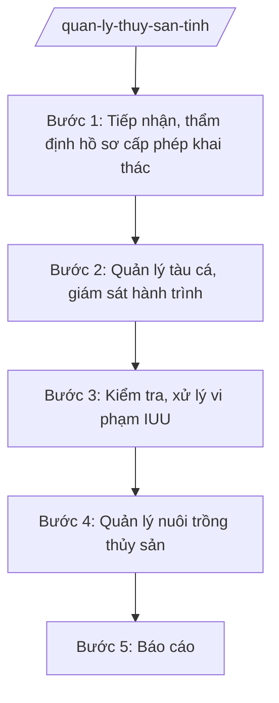

# Skill: Quản lý thủy sản, kiểm ngư

## 2. Khi nào dùng

- Khi cấp, cấp lại giấy phép khai thác thủy sản (theo phân cấp).
- Khi quản lý tàu cá: đăng ký, đăng kiểm, giấy phép, thiết bị giám sát hành trình.
- Khi kiểm tra, xử lý vi phạm khai thác IUU (tắt thiết bị giám sát, xâm phạm vùng biển nước ngoài...).
- Khi phát triển nuôi trồng thủy sản: quy hoạch vùng nuôi, quan trắc môi trường, phòng chống dịch bệnh.

## 3. Đầu vào (Input)

| Trường | Mô tả | Bắt buộc |
|--------|-------|----------|
| `loai_viec` | cấp phép / quản lý tàu cá / chống IUU / nuôi trồng / báo cáo | Có |
| `doi_tuong` | Ngư dân, chủ tàu, tổ chức nuôi trồng | Không |
| `thong_tin_tau` | Số đăng ký, công suất, nghề khai thác (nếu liên quan tàu cá) | Không |
| `dia_ban` | Vùng biển, vùng nuôi | Không |

## 4. Quy trình

**Bước 1. Tiếp nhận, thẩm định hồ sơ cấp phép khai thác**
- Làm gì: Tiếp nhận hồ sơ đề nghị cấp giấy phép khai thác thủy sản; kiểm tra điều kiện (tàu cá, ngư cụ, hạn ngạch); cấp/cấp lại giấy phép.
- Dùng input: `loai_viec`, `doi_tuong`, `thong_tin_tau`.
- Vai trò: Chuyên viên Chi cục Thủy sản thẩm định; AI hỗ trợ checklist hồ sơ, đối chiếu hạn ngạch — ⏱ theo thời hạn TTHC.
- Lưu ý nghiệp vụ: Không cấp phép cho tàu cá không lắp thiết bị giám sát hành trình (đối tượng bắt buộc); nghề cấm tuyệt đối không cấp.
- → Kết quả bước: Giấy phép khai thác thủy sản / văn bản từ chối có lý do.

**Bước 2. Quản lý tàu cá, giám sát hành trình**
- Làm gì: Theo dõi dữ liệu giám sát hành trình tàu cá; phát hiện tàu mất tín hiệu, vượt ranh giới; đôn đốc ngư dân chấp hành.
- Dùng input: `thong_tin_tau`, `dia_ban`.
- Vai trò: Chi cục Thủy sản trực giám sát; AI hỗ trợ tổng hợp cảnh báo — ⏱ hằng ngày.
- Lưu ý nghiệp vụ: Tàu mất tín hiệu trên 6 giờ phải xác minh ngay; tàu có nguy cơ vi phạm vùng biển nước ngoài cảnh báo chủ tàu kịp thời.
- → Kết quả bước: Nhật ký giám sát + danh sách tàu vi phạm/cảnh báo.

**Bước 3. Kiểm tra, xử lý vi phạm IUU**
- Làm gì: Kiểm tra tại cảng, trên biển (phối hợp Kiểm ngư, Biên phòng); xử lý: tắt thiết bị giám sát, khai thác sai vùng/nghề, không ghi nhật ký.
- Dùng input: `doi_tuong`, `thong_tin_tau`.
- Vai trò: Lực lượng kiểm ngư/Chi cục Thủy sản; AI hỗ trợ lập biên bản, tra cứu khung phạt — ⏱ kịp thời.
- Lưu ý nghiệp vụ: Vi phạm IUU ảnh hưởng "thẻ vàng" của EC — xử lý nghiêm, công khai; tước giấy phép có thời hạn đối với tái phạm.
- → Kết quả bước: Biên bản VPHC + quyết định xử phạt.

**Bước 4. Quản lý nuôi trồng thủy sản**
- Làm gì: Tham mưu quy hoạch vùng nuôi; quan trắc môi trường vùng nuôi trọng điểm; phòng chống dịch bệnh thủy sản; chứng nhận cơ sở đủ điều kiện nuôi.
- Dùng input: `dia_ban`, `doi_tuong`.
- Vai trò: Chuyên viên Chi cục; AI hỗ trợ tổng hợp số liệu quan trắc — ⏱ theo kế hoạch.
- Lưu ý nghiệp vụ: Vùng nuôi phải có đánh giá môi trường định kỳ; dịch bệnh phải khoanh vùng, dập dịch kịp thời, không giấu dịch.
- → Kết quả bước: Báo cáo quan trắc + quyết định công bố dịch (nếu có).

**Bước 5. Báo cáo**
- Làm gì: Tổng hợp: sản lượng khai thác/nuôi trồng; tàu cá, vi phạm IUU; báo cáo UBND tỉnh, Bộ NN&MT.
- Dùng input: `loai_viec` (báo cáo).
- Vai trò: Chuyên viên tổng hợp; AI hỗ trợ lập bảng số liệu — ⏱ 3 ngày.
- Lưu ý nghiệp vụ: Số liệu sản lượng đối chiếu với cảng cá, doanh nghiệp thu mua.
- → Kết quả bước: Báo cáo thủy sản định kỳ.

## Luồng quy trình (Workflow)

## 5. Đầu ra (Output)

- Giấy phép khai thác thủy sản / văn bản từ chối.
- Nhật ký giám sát hành trình tàu cá.
- Biên bản kiểm tra, quyết định xử phạt VPHC (IUU).
- Báo cáo quan trắc vùng nuôi; báo cáo thủy sản định kỳ.

**Cấu trúc output chuẩn (Giấy phép khai thác thủy sản):**
- Thể thức: tuân thủ Nghị định 30/2020/NĐ-CP về công tác văn thư.

1. Quốc hiệu "CỘNG HÒA XÃ HỘI CHỦ NGHĨA VIỆT NAM", Tiêu ngữ "Độc lập – Tự do – Hạnh phúc"; tên cơ quan cấp (Sở NN&MT tỉnh A / Chi cục Thủy sản theo phân cấp); số, ký hiệu.
2. Tên loại: **GIẤY PHÉP** — khai thác thủy sản.
3. Tên chủ tàu, địa chỉ; số đăng ký tàu; công suất máy; nghề khai thác được phép.
4. Vùng biển, thời hạn được phép khai thác; thời hạn giấy phép.
5. Điều kiện: lắp và duy trì thiết bị giám sát hành trình; ghi nhật ký khai thác; không vi phạm IUU.
6. Nơi nhận; chữ ký, đóng dấu cơ quan cấp.

> **Chuẩn tài liệu đầu ra** (thứ tự ưu tiên):
> 1. Chuẩn riêng của ngành/cơ quan chủ quản — mẫu, biểu mẫu, quy chuẩn tại văn bản quy phạm chuyên ngành (xem mục "Căn cứ & lưu ý").
> 2. Tài liệu không có quy chuẩn riêng — thể thức NĐ 30/2020/NĐ-CP: Quốc hiệu và Tiêu ngữ; tên cơ quan ban hành; số, ký hiệu; địa danh và thời gian; tên loại và trích yếu; nội dung; chức vụ, họ tên, chữ ký người có thẩm quyền; dấu, chữ ký số; nơi nhận (kèm Phụ lục nếu có).

## 6. Checklist nghiệm thu

- [ ] Không cấp phép cho tàu thiếu thiết bị giám sát hành trình (đối tượng bắt buộc), nghề cấm.
- [ ] Tàu mất tín hiệu được xác minh trong 6 giờ.
- [ ] Vi phạm IUU xử lý nghiêm, đúng khung; tái phạm bị tước giấy phép.
- [ ] Vùng nuôi trọng điểm được quan trắc môi trường định kỳ.
- [ ] Số liệu sản lượng đối chiếu được với cảng cá/doanh nghiệp.
- [ ] Văn bản đúng thể thức NĐ 30/2020/NĐ-CP.

## 7. Ví dụ mô phỏng

*Dữ liệu dưới đây là giả lập 100% phục vụ minh họa.*

**Input mẫu:** loai_viec = "cấp phép"; doi_tuong = "Ông Nguyễn Văn G – chủ tàu cá"; thong_tin_tau = "Tàu AB-12345, 400CV, nghề lưới kéo".

**Output mẫu (trích Giấy phép):**

> **SỞ NÔNG NGHIỆP VÀ MÔI TRƯỜNG TỈNH A**
> Số: 1234/GP-STS
>
> **GIẤY PHÉP**
> Khai thác thủy sản
>
> Cấp cho: ông Nguyễn Văn G, địa chỉ: xã A, tỉnh A.
> Tàu cá số đăng ký AB-12345, công suất 400CV, nghề lưới kéo.
> Được phép khai thác tại vùng biển ven bờ và vùng lộng tỉnh A; thời hạn: 12 tháng.
> Điều kiện: duy trì hoạt động thiết bị giám sát hành trình; ghi nhật ký khai thác đầy đủ; chấp hành quy định chống khai thác IUU./.
>
> *Nơi nhận:* ... — **GIÁM ĐỐC** *(ký, đóng dấu)* — Hoàng Văn S

## 8. Human gate

- Chuyên viên thẩm định → Trưởng phòng/Chi cục trưởng kiểm tra → Phó Giám đốc Sở duyệt → Giám đốc Sở ký (giấy phép, quyết định).
- Xử phạt IUU: theo thẩm quyền; vượt thẩm quyền trình Chủ tịch UBND tỉnh.

## 9. Giới hạn

- AI không tự cấp/tước giấy phép, không tự kết luận vi phạm IUU.
- Không bịa dữ liệu giám sát hành trình, sản lượng khai thác.
- Không dùng văn bản hết hiệu lực làm căn cứ.

## 10. Căn cứ & lưu ý

- Thông tư 19/2025/TT-BNNMT của Bộ Nông nghiệp và Môi trường hướng dẫn chức năng, nhiệm vụ của cơ quan chuyên môn về nông nghiệp và môi trường.
- Luật Thủy sản và các văn bản hướng dẫn (dẫn tên, áp dụng bản hiện hành).
- Nghị định 150/2025/NĐ-CP về tổ chức cơ quan chuyên môn thuộc UBND cấp tỉnh.
- Nghị định 30/2020/NĐ-CP về công tác văn thư (thể thức văn bản).
- Lưu ý: chống khai thác IUU là nhiệm vụ chính trị trọng tâm — phối hợp Kiểm ngư, Biên phòng, Công an; xử lý nghiêm để gỡ "thẻ vàng" EC.
