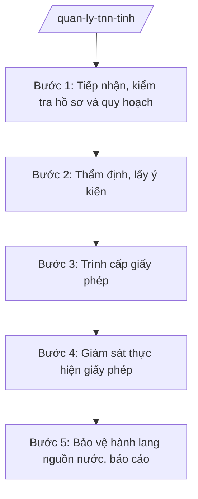

# Skill: Quản lý tài nguyên nước

## 2. Khi nào dùng

- Khi tổ chức, cá nhân đề nghị cấp phép khai thác, sử dụng tài nguyên nước (nước mặt, nước dưới đất).
- Khi đề nghị cấp phép xả nước thải vào nguồn nước.
- Khi khoanh định hành lang bảo vệ nguồn nước, xử lý vi phạm hành lang.
- Khi kiểm tra việc thực hiện giấy phép, nghĩa vụ tài chính về tài nguyên nước.

## 3. Đầu vào (Input)

| Trường | Mô tả | Bắt buộc |
|--------|-------|----------|
| `to_chuc_ca_nhan` | Tên tổ chức/cá nhân đề nghị | Có |
| `loai_giay_phep` | khai thác nước mặt / nước dưới đất / xả thải vào nguồn nước | Có |
| `muc_dich` | Mục đích sử dụng (sản xuất, sinh hoạt, nông nghiệp...) | Có |
| `luu_luong` | Lưu lượng khai thác/xả thải dự kiến (m³/ngày đêm) | Có |
| `dia_diem` | Vị trí công trình khai thác/xả thải | Có |

## 4. Quy trình

**Bước 1. Tiếp nhận, kiểm tra hồ sơ và quy hoạch**
- Làm gì: Tiếp nhận hồ sơ; đối chiếu quy hoạch tài nguyên nước; kiểm tra vùng cấm, vùng hạn chế khai thác nước dưới đất.
- Dùng input: `loai_giay_phep`, `dia_diem`, `luu_luong`.
- Vai trò: Chuyên viên Phòng Tài nguyên nước (Sở NN&MT); AI hỗ trợ đối chiếu bản đồ — ⏱ 5 ngày.
- Lưu ý nghiệp vụ: Vùng cấm khai thác nước dưới đất tuyệt đối không cấp phép mới; lưu lượng vượt ngưỡng phải lấy ý kiến Bộ NN&MT (theo phân cấp).
- → Kết quả bước: Phiếu kiểm tra hồ sơ.

**Bước 2. Thẩm định, lấy ý kiến**
- Làm gì: Thẩm định: nhu cầu sử dụng, công nghệ khai thác/xử lý, tác động đến nguồn nước; lấy ý kiến UBND cấp xã, cộng đồng dân cư (đối với xả thải).
- Dùng input: `muc_dich`, `luu_luong`.
- Vai trò: Trưởng phòng chủ trì; AI hỗ trợ tổng hợp ý kiến — ⏱ 10 ngày.
- Lưu ý nghiệp vụ: Xả thải vào nguồn nước phải có hệ thống xử lý đạt quy chuẩn; lấy ý kiến dân cư hạ lưu.
- → Kết quả bước: Báo cáo thẩm định.

**Bước 3. Trình cấp giấy phép**
- Làm gì: Hoàn thiện tờ trình + dự thảo giấy phép trình UBND tỉnh (hoặc Giám đốc Sở theo phân cấp).
- Dùng input: Toàn bộ kết quả các bước trên.
- Vai trò: Giám đốc Sở ký tờ trình; AI hỗ trợ soạn thảo — ⏱ 5 ngày.
- Lưu ý nghiệp vụ: Giấy phép ghi rõ: lưu lượng, chế độ khai thác/xả thải, quan trắc, nghĩa vụ tài chính (tiền cấp quyền khai thác tài nguyên nước, phí BVMT).
- → Kết quả bước: Giấy phép tài nguyên nước.

**Bước 4. Giám sát thực hiện giấy phép**
- Làm gì: Kiểm tra: lắp đặt thiết bị quan trắc, khai thác đúng lưu lượng, xả thải đạt quy chuẩn, nộp nghĩa vụ tài chính.
- Dùng input: `to_chuc_ca_nhan`, `dia_diem`.
- Vai trò: Đoàn kiểm tra; AI hỗ trợ lập kế hoạch — ⏱ định kỳ + đột xuất.
- Lưu ý nghiệp vụ: Khai thác vượt lưu lượng, xả thải chưa qua xử lý — xử phạt nặng, đình chỉ; công khai vi phạm.
- → Kết quả bước: Biên bản kiểm tra + quyết định xử phạt/đình chỉ (nếu có).

**Bước 5. Bảo vệ hành lang nguồn nước, báo cáo**
- Làm gì: Khoanh định, cắm mốc hành lang bảo vệ nguồn nước (sông, hồ chứa); xử lý vi phạm lấn chiếm; báo cáo hiện trạng tài nguyên nước.
- Dùng input: `dia_diem`.
- Vai trò: Chuyên viên + UBND cấp xã; AI hỗ trợ lập bản đồ — ⏱ theo kế hoạch.
- Lưu ý nghiệp vụ: Hành lang nguồn nước nước sinh hoạt bảo vệ nghiêm ngặt nhất.
- → Kết quả bước: Biên bản cắm mốc + báo cáo tài nguyên nước định kỳ.

## Luồng quy trình (Workflow)

## 5. Đầu ra (Output)

- Báo cáo thẩm định hồ sơ tài nguyên nước.
- Tờ trình + giấy phép khai thác/sử dụng nước, xả thải vào nguồn nước.
- Biên bản kiểm tra; quyết định xử phạt/đình chỉ.
- Báo cáo tài nguyên nước định kỳ.

**Cấu trúc output chuẩn (Giấy phép khai thác, sử dụng tài nguyên nước):**
- Thể thức: tuân thủ Nghị định 30/2020/NĐ-CP về công tác văn thư.

1. Quốc hiệu "CỘNG HÒA XÃ HỘI CHỦ NGHĨA VIỆT NAM", Tiêu ngữ "Độc lập – Tự do – Hạnh phúc"; tên cơ quan cấp; số, ký hiệu.
2. Tên loại: **GIẤY PHÉP** — khai thác, sử dụng tài nguyên nước.
3. Tên tổ chức/cá nhân; địa chỉ.
4. Nguồn nước, vị trí công trình; mục đích sử dụng; lưu lượng được phép (m³/ngày đêm); chế độ khai thác; thời hạn.
5. Nghĩa vụ: quan trắc, báo cáo; tiền cấp quyền khai thác; bảo vệ nguồn nước.
6. Điều khoản thu hồi; hiệu lực.
7. Nơi nhận; chữ ký người có thẩm quyền.

> **Checklist thể thức văn bản theo NĐ 30/2020/NĐ-CP** — đối chiếu trước khi trình ký:
> 1. Quốc hiệu và Tiêu ngữ.
> 2. Tên cơ quan, tổ chức ban hành văn bản.
> 3. Số, ký hiệu của văn bản.
> 4. Địa danh và thời gian ban hành văn bản.
> 5. Tên loại và trích yếu nội dung văn bản.
> 6. Nội dung văn bản.
> 7. Chức vụ, họ tên và chữ ký của người có thẩm quyền.
> 8. Dấu, chữ ký số của cơ quan, tổ chức.
> 9. Nơi nhận (kèm Phụ lục nếu có).

## 6. Checklist nghiệm thu

- [ ] Không cấp phép trong vùng cấm khai thác; vượt ngưỡng đúng phân cấp.
- [ ] Xả thải có hệ thống xử lý đạt quy chuẩn, có ý kiến cộng đồng hạ lưu.
- [ ] Giấy phép ghi đầy đủ lưu lượng, nghĩa vụ quan trắc, tài chính.
- [ ] Kiểm tra sau cấp phép định kỳ; xử lý nghiêm khai thác vượt phép, xả thải trái phép.
- [ ] Hành lang nguồn nước sinh hoạt được khoanh định, bảo vệ.
- [ ] Văn bản đúng thể thức NĐ 30/2020/NĐ-CP.

## 7. Ví dụ mô phỏng

*Dữ liệu dưới đây là giả lập 100% phục vụ minh họa.*

**Input mẫu:** to_chuc_ca_nhan = "Công ty TNHH AB"; loai_giay_phep = "khai thác nước dưới đất"; muc_dich = "sản xuất nước uống đóng chai"; luu_luong = "500 m³/ngày đêm"; dia_diem = "Xã A".

**Output mẫu (trích Giấy phép):**

> **ỦY BAN NHÂN DÂN TỈNH A**
> Số: 1234/GP-UBND
>
> **GIẤY PHÉP**
> Khai thác, sử dụng tài nguyên nước
>
> Cấp cho: Công ty TNHH AB, địa chỉ: xã A, tỉnh A.
> Được phép khai thác nước dưới đất tại xã A phục vụ sản xuất nước uống đóng chai; lưu lượng 500 m³/ngày đêm; thời hạn 05 năm.
> Nghĩa vụ: lắp đặt thiết bị quan trắc tự động; báo cáo định kỳ; nộp tiền cấp quyền khai thác tài nguyên nước đầy đủ; không gây sụt lún, ô nhiễm nguồn nước./.
>
> *Nơi nhận:* ... — **CHỦ TỊCH** *(ký, đóng dấu)* — Phạm Văn P

## 8. Human gate

- Chuyên viên thẩm định → Trưởng phòng kiểm tra → Phó Giám đốc Sở duyệt → Giám đốc Sở ký tờ trình → **UBND tỉnh cấp** giấy phép (theo phân cấp).
- Kiểm tra sau cấp phép: Trưởng đoàn báo cáo, Giám đốc Sở quyết định xử lý.

## 9. Giới hạn

- AI không tự quyết định cấp/thu hồi giấy phép.
- Không bịa số liệu lưu lượng, kết quả quan trắc.
- Không dùng văn bản hết hiệu lực làm căn cứ.

## 10. Căn cứ & lưu ý

- Thông tư 19/2025/TT-BNNMT của Bộ Nông nghiệp và Môi trường hướng dẫn chức năng, nhiệm vụ của cơ quan chuyên môn về nông nghiệp và môi trường.
- Luật Tài nguyên nước và các văn bản hướng dẫn (dẫn tên, áp dụng bản hiện hành).
- Nghị định 150/2025/NĐ-CP về tổ chức cơ quan chuyên môn thuộc UBND cấp tỉnh.
- Nghị định 30/2020/NĐ-CP về công tác văn thư (thể thức văn bản).
- Lưu ý: an ninh nguồn nước (nhất là nước sinh hoạt) là nhiệm vụ trọng tâm — phối hợp Sở Y tế, Công an trong bảo vệ nguồn nước.
