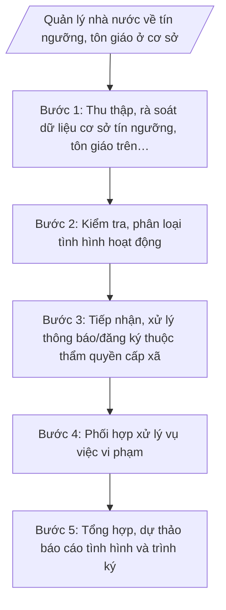

# Skill: Quản lý tín ngưỡng, tôn giáo ở cơ sở

## 2. Khi nào dùng

- Lập báo cáo định kỳ (6 tháng, năm) hoặc đột xuất về tình hình tín ngưỡng, tôn giáo trên địa bàn xã theo yêu cầu của cấp trên.
- Rà soát, cập nhật dữ liệu cơ sở tín ngưỡng, tổ chức tôn giáo, điểm sinh hoạt tôn giáo tập trung trên địa bàn.
- Hướng dẫn hoạt động của tổ chức, cá nhân tôn giáo đúng quy định pháp luật; tiếp nhận thông báo, đăng ký thuộc thẩm quyền cấp xã.
- Phối hợp xử lý vụ việc vi phạm pháp luật về tín ngưỡng, tôn giáo tại cơ sở.

## 3. Đầu vào (Input)

| Trường | Mô tả | Bắt buộc |
|--------|-------|----------|
| `ky_bao_cao` | Kỳ báo cáo (6 tháng đầu năm / 6 tháng cuối năm / năm) và thời gian chốt số liệu | Có |
| `ds_co_so_tin_nguong` | Danh sách cơ sở tín ngưỡng (đình, đền, chùa, miếu...) trên địa bàn: tên, địa chỉ, người phụ trách | Có |
| `ds_to_chuc_ton_giao` | Danh sách tổ chức tôn giáo, tổ chức tôn giáo trực thuộc, điểm sinh hoạt tôn giáo tập trung: tên, địa chỉ, người đại diện | Có |
| `so_lieu_hoat_dong` | Số liệu hoạt động trong kỳ: lễ hội, sinh hoạt tôn giáo thường kỳ, số lượng tín đồ ước tính | Có |
| `hs_thong_bao_dang_ky` | Thông báo, đăng ký hoạt động của tổ chức/cá nhân tôn giáo gửi trong kỳ (nếu có) | Không |
| `vu_viec_vi_pham` | Vụ việc vi phạm pháp luật về tín ngưỡng, tôn giáo phát sinh trong kỳ (nếu có) | Không |
| `van_ban_chi_dao` | Văn bản chỉ đạo, hướng dẫn của cấp trên (Sở Dân tộc và Tôn giáo tỉnh A) về nội dung báo cáo | Không |

## 4. Quy trình

**Bước 1. Thu thập, rà soát dữ liệu cơ sở tín ngưỡng, tôn giáo trên địa bàn**

- Làm gì: Lập phiếu rà soát; phối hợp trưởng thôn/tổ dân phố, Ban công tác Mặt trận kiểm tra, cập nhật danh sách cơ sở tín ngưỡng, tổ chức tôn giáo, điểm sinh hoạt tôn giáo tập trung; ghi nhận biến động (thành lập mới, ngừng hoạt động, thay đổi người phụ trách/đại diện).
- Dùng input: `ds_co_so_tin_nguong`, `ds_to_chuc_ton_giao`, `ky_bao_cao`.
- Vai trò: Công chức văn hóa – xã hội phụ trách lĩnh vực tín ngưỡng, tôn giáo trực tiếp đi cơ sở thu thập, đối chiếu số liệu. AI hỗ trợ: thiết kế mẫu phiếu rà soát, chuẩn hóa danh sách, phát hiện trùng lặp/thiếu trường thông tin. ⏱ 1–2 ngày (ước tính) làm việc.
- Lưu ý nghiệp vụ: Số liệu phải khớp với hồ sơ theo dõi các kỳ trước; mọi biến động phải có căn cứ (biên bản kiểm tra, thông báo của tổ chức). Không tự ý suy diễn số lượng tín đồ — chỉ ghi số liệu do tổ chức cung cấp hoặc qua điều tra thực tế.
- → Kết quả bước: Danh sách cơ sở tín ngưỡng, tổ chức tôn giáo, điểm sinh hoạt tôn giáo tập trung đã cập nhật đến kỳ báo cáo.

**Bước 2. Kiểm tra, phân loại tình hình hoạt động**

- Làm gì: Đối chiếu hoạt động thực tế với quy định pháp luật; phân loại: (a) hoạt động đúng pháp luật; (b) hoạt động có dấu hiệu vi phạm (truyền đạo trái phép, xây dựng cơ sở thờ tự không phép, lợi dụng tín ngưỡng trục lợi...); (c) điểm nóng, vụ việc phức tạp cần theo dõi.
- Dùng input: `so_lieu_hoat_dong`, `hs_thong_bao_dang_ky`, `vu_viec_vi_pham`, danh sách đã cập nhật ở Bước 1.
- Vai trò: Công chức văn hóa – xã hội phụ trách lĩnh vực tổng hợp, phân loại. AI hỗ trợ: đối chiếu hoạt động với danh mục hành vi vi phạm thường gặp để gợi ý phân loại sơ bộ (người quyết định phân loại cuối cùng là công chức). ⏱ 0,5–1 ngày (ước tính) làm việc.
- Lưu ý nghiệp vụ: Phân loại vi phạm phải căn cứ hành vi cụ thể, không quy chụp; tôn trọng quyền tự do tín ngưỡng, tôn giáo của công dân theo quy định pháp luật; nội dung nhạy cảm về tôn giáo không đưa chi tiết vào báo cáo công khai.
- → Kết quả bước: Bảng phân loại tình hình hoạt động: đúng pháp luật / có dấu hiệu vi phạm / cần theo dõi, kèm mô tả ngắn từng trường hợp.

**Bước 3. Tiếp nhận, xử lý thông báo/đăng ký thuộc thẩm quyền cấp xã**

- Làm gì: Tiếp nhận thông báo, đăng ký hoạt động tín ngưỡng, tôn giáo của tổ chức, cá nhân gửi đến UBND xã; kiểm tra tính hợp lệ, đầy đủ của hồ sơ; hướng dẫn bổ sung nếu thiếu; tổng hợp, báo cáo lãnh đạo UBND xã xem xét theo thẩm quyền; chuyển hồ sơ vượt thẩm quyền lên cấp trên.
- Dùng input: `hs_thong_bao_dang_ky`, `van_ban_chi_dao`.
- Vai trò: Công chức văn hóa – xã hội phụ trách lĩnh vực tiếp nhận, kiểm tra hồ sơ. AI hỗ trợ: kiểm tra checklist tính đầy đủ của hồ sơ, soạn mẫu văn bản hướng dẫn bổ sung hồ sơ, theo dõi hạn xử lý. ⏱ 0,5 ngày (ước tính) làm việc/hồ sơ.
- Lưu ý nghiệp vụ: Không được từ chối tiếp nhận hồ sơ không có lý do; mọi yêu cầu bổ sung phải bằng văn bản, nêu rõ nội dung còn thiếu; hồ sơ vượt thẩm quyền cấp xã phải chuyển kịp thời, không giữ lại.
- → Kết quả bước: Sổ theo dõi tiếp nhận, xử lý thông báo/đăng ký trong kỳ + dự thảo văn bản trả lời/hướng dẫn (nếu có).

**Bước 4. Phối hợp xử lý vụ việc vi phạm**

- Làm gì: Đối với hoạt động có dấu hiệu vi phạm đã phân loại ở Bước 2: phối hợp Công an xã xác minh; tham mưu UBND xã nhắc nhở, yêu cầu chấm dứt hoặc lập hồ sơ xử lý theo thẩm quyền; trường hợp vượt thẩm quyền, báo cáo cấp trên; theo dõi kết quả xử lý.
- Dùng input: `vu_viec_vi_pham`, bảng phân loại ở Bước 2.
- Vai trò: Công chức văn hóa – xã hội phụ trách lĩnh vực phối hợp Công an xã xác minh, lập hồ sơ tham mưu. AI hỗ trợ: soạn dự thảo văn bản nhắc nhở, biên bản làm việc, tổng hợp tiến độ xử lý từng vụ việc. ⏱ theo diễn biến vụ việc, tối thiểu 1 ngày làm việc để lập hồ sơ ban đầu.
- Lưu ý nghiệp vụ: Xử lý vi phạm phải đúng trình tự, thẩm quyền; ưu tiên tuyên truyền, vận động, nhắc nhở trước khi áp dụng biện pháp xử lý; bảo đảm an ninh trật tự, không để phát sinh điểm nóng.
- → Kết quả bước: Hồ sơ xử lý từng vụ việc (biên bản xác minh, văn bản nhắc nhở/xử lý, kết quả theo dõi).

**Bước 5. Tổng hợp, dự thảo báo cáo tình hình và trình ký**

- Làm gì: Tổng hợp toàn bộ kết quả các bước 1–4; dự thảo Báo cáo tình hình tín ngưỡng, tôn giáo trên địa bàn theo cấu trúc chuẩn; trình Trưởng phòng kiểm tra, Phó Chủ tịch phụ trách lĩnh vực xem xét, Chủ tịch UBND xã ký ban hành; gửi báo cáo lên cấp trên và lưu hồ sơ.
- Dùng input: Toàn bộ bán thành phẩm các bước 1–4, `ky_bao_cao`, `van_ban_chi_dao`.
- Vai trò: Công chức văn hóa – xã hội phụ trách lĩnh vực dự thảo báo cáo. AI hỗ trợ: dàn ý theo cấu trúc chuẩn, kiểm tra số liệu các phần khớp nhau, rà soát thể thức văn bản theo NĐ 30/2020/NĐ-CP. ⏱ 0,5–1 ngày (ước tính) làm việc.
- Lưu ý nghiệp vụ: Số liệu trong báo cáo phải khớp tuyệt đối với số liệu đã thu thập ở Bước 1–2; đánh giá tình hình khách quan, không tô hồng cũng không phóng đại; kiến nghị phải cụ thể, gắn với thẩm quyền của từng cấp.
- → Kết quả bước: Báo cáo tình hình tín ngưỡng, tôn giáo trên địa bàn (bản dự thảo đã qua kiểm tra, sẵn sàng trình ký).

## Luồng quy trình (Workflow)

## 5. Đầu ra (Output)

**Sản phẩm:**
1. Báo cáo tình hình tín ngưỡng, tôn giáo trên địa bàn xã (sản phẩm chính).
2. Danh sách cơ sở tín ngưỡng, tổ chức tôn giáo, điểm sinh hoạt tôn giáo tập trung (phụ lục kèm báo cáo).
3. Sổ theo dõi tiếp nhận, xử lý thông báo/đăng ký (nếu phát sinh).
4. Hồ sơ xử lý vụ việc vi phạm (nếu phát sinh).

**Cấu trúc output chuẩn — Báo cáo tình hình tín ngưỡng, tôn giáo (thể thức theo NĐ 30/2020/NĐ-CP):**
1. Quốc hiệu "CỘNG HÒA XÃ HỘI CHỦ NGHĨA VIỆT NAM" – Tiêu ngữ "Độc lập – Tự do – Hạnh phúc".
2. Tên cơ quan ban hành: ỦY BAN NHÂN DÂN XÃ A.
3. Số, ký hiệu văn bản (Số: .../BC-UBND).
4. Địa danh, ngày, tháng, năm ban hành.
5. Tên loại và trích yếu nội dung: BÁO CÁO / Tình hình tín ngưỡng, tôn giáo trên địa bàn xã A (kỳ ...).
6. Nội dung báo cáo:
   - I. Đặc điểm tình hình chung (số lượng cơ sở tín ngưỡng, tổ chức tôn giáo, điểm sinh hoạt tôn giáo tập trung; biến động trong kỳ).
   - II. Kết quả thực hiện công tác quản lý nhà nước (tuyên truyền, hướng dẫn; tiếp nhận, xử lý thông báo/đăng ký; phối hợp xử lý vi phạm).
   - III. Đánh giá chung (ưu điểm, tồn tại, hạn chế, nguyên nhân).
   - IV. Nhiệm vụ, giải pháp thời gian tới.
   - V. Kiến nghị, đề xuất (với cấp trên).
7. Nơi nhận.
8. Chữ ký: TM. ỦY BAN NHÂN DÂN / CHỦ TỊCH / (ký tên, đóng dấu) — ông Nguyễn Văn A.

## 6. Checklist nghiệm thu

- [ ] Báo cáo có đủ 8 thành phần theo cấu trúc chuẩn mục 4, đúng thể thức NĐ 30/2020/NĐ-CP.
- [ ] Số, ký hiệu văn bản đúng định dạng .../BC-UBND, đánh số thứ tự liên tục của UBND xã.
- [ ] Số liệu cơ sở tín ngưỡng, tổ chức tôn giáo, điểm sinh hoạt tôn giáo tập trung khớp với danh sách rà soát ở Bước 1.
- [ ] Phân loại hoạt động (đúng pháp luật / dấu hiệu vi phạm / cần theo dõi) có căn cứ cụ thể từng trường hợp.
- [ ] Nội dung tiếp nhận, xử lý thông báo/đăng ký phản ánh đúng sổ theo dõi, không bỏ sót hồ sơ.
- [ ] Vụ việc vi phạm (nếu có) được phản ánh đầy đủ: hành vi, biện pháp xử lý, kết quả.
- [ ] Đánh giá, kiến nghị cụ thể, không chung chung, không vượt thẩm quyền cấp xã.
- [ ] Không có số liệu, căn cứ pháp lý, số hiệu văn bản nào bị bịa đặt.
- [ ] Báo cáo đã qua đủ 3 nấc human gate (công chức soạn → Trưởng phòng kiểm tra → Chủ tịch UBND xã ký).
- [ ] Lưu hồ sơ đầy đủ: báo cáo đã ký + danh sách rà soát + hồ sơ xử lý (nếu có).

## 7. Ví dụ mô phỏng

*Dữ liệu dưới đây là giả lập 100% phục vụ minh họa.*

**Input mẫu:**
- ky_bao_cao: Báo cáo 6 tháng cuối năm 2026, chốt số liệu đến 31/12/2026.
- ds_co_so_tin_nguong: 10 cơ sở (đình A1, đền A2, chùa A3...), người phụ trách: ông Nguyễn Văn Dân (đình A1)...
- ds_to_chuc_ton_giao: 02 tổ chức tôn giáo (chùa A3 thuộc Giáo hội Phật giáo, nhà thờ A4 thuộc Giáo hội Công giáo), 01 điểm sinh hoạt tôn giáo tập trung tại thôn B.
- so_lieu_hoat_dong: 03 lễ hội truyền thống (đình A1, đền A2), sinh hoạt tôn giáo thường kỳ đúng quy định.
- hs_thong_bao_dang_ky: 01 thông báo tổ chức lễ hội đình A1 dịp cuối năm.
- vu_viec_vi_pham: 01 trường hợp cá nhân tự ý dựng am thờ tại thôn B, đã được nhắc nhở, tự tháo dỡ.
- van_ban_chi_dao: Công văn của Sở Dân tộc và Tôn giáo tỉnh A hướng dẫn báo cáo 6 tháng cuối năm 2026.

**Output mẫu:**

> CỘNG HÒA XÃ HỘI CHỦ NGHĨA VIỆT NAM
> Độc lập – Tự do – Hạnh phúc
>
> ỦY BAN NHÂN DÂN XÃ A
> Số: 123/BC-UBND
>
> Xã A, ngày 31 tháng 12 năm 2026
>
> **BÁO CÁO**
> **Tình hình tín ngưỡng, tôn giáo trên địa bàn xã A 6 tháng cuối năm 2026**
>
> **I. Đặc điểm tình hình chung**
>
> Toàn xã hiện có 10 cơ sở tín ngưỡng (đình, đền, chùa, miếu), 02 tổ chức tôn giáo (chùa A3, nhà thờ A4) và 01 điểm sinh hoạt tôn giáo tập trung tại thôn B. Trong kỳ không phát sinh tổ chức tôn giáo mới; 01 cơ sở thay đổi người phụ trách (đình A1: ông Nguyễn Văn Dân).
>
> **II. Kết quả thực hiện công tác quản lý nhà nước**
>
> 1. Công tác tuyên truyền, hướng dẫn: tổ chức 02 buổi phổ biến pháp luật về tín ngưỡng, tôn giáo cho người phụ trách cơ sở và đại diện tổ chức tôn giáo.
> 2. Tiếp nhận, xử lý thông báo/đăng ký: tiếp nhận 01 thông báo tổ chức lễ hội đình A1; hồ sơ hợp lệ, đã hướng dẫn tổ chức bảo đảm an ninh trật tự, vệ sinh môi trường.
> 3. Phối hợp xử lý vi phạm: phát hiện 01 trường hợp cá nhân tự ý dựng am thờ tại thôn B; UBND xã phối hợp Công an xã nhắc nhở, cá nhân đã tự tháo dỡ, cam kết không tái phạm.
>
> **III. Đánh giá chung**
>
> - Ưu điểm: tình hình tín ngưỡng, tôn giáo ổn định; các hoạt động diễn ra đúng pháp luật.
> - Tồn tại: còn trường hợp xây dựng cơ sở thờ tự tự phát; công tác nắm tình hình ở một số thôn chưa kịp thời.
>
> **IV. Nhiệm vụ, giải pháp thời gian tới**
>
> Tăng cường nắm tình hình cơ sở; tuyên truyền pháp luật đến từng thôn; phối hợp Công an xã xử lý kịp thời vi phạm phát sinh.
>
> **V. Kiến nghị, đề xuất**
>
> Đề nghị Sở Dân tộc và Tôn giáo tỉnh A tiếp tục hướng dẫn nghiệp vụ quản lý điểm sinh hoạt tôn giáo tập trung cho cán bộ cấp xã.
>
> ***Nơi nhận:***
> - Sở Dân tộc và Tôn giáo tỉnh A;
> - TT Đảng ủy, HĐND xã;
> - Chủ tịch, các Phó Chủ tịch UBND xã;
> - Lưu: VT, VH-XH.
>
> TM. ỦY BAN NHÂN DÂN
> CHỦ TỊCH
>
> Nguyễn Văn A

## 8. Human gate

1. **Công chức văn hóa – xã hội phụ trách lĩnh vực tín ngưỡng, tôn giáo**: soạn thảo, chịu trách nhiệm về tính chính xác của số liệu và nội dung (Bước 1–5).
2. **Trưởng phòng Văn hóa – Xã hội (ông Vũ Văn E)**: kiểm tra toàn bộ hồ sơ, báo cáo; yêu cầu chỉnh sửa nếu chưa đạt (trước khi trình lãnh đạo UBND xã).
3. **Phó Chủ tịch UBND xã (bà Trần Thị B)**: xem xét, cho ý kiến về nội dung (nếu được phân công phụ trách lĩnh vực).
4. **Chủ tịch UBND xã (ông Nguyễn Văn A)**: ký duyệt, ban hành báo cáo. Báo cáo chỉ được gửi cấp trên sau khi Chủ tịch ký.

## 9. Giới hạn

- AI KHÔNG ra quyết định hành chính thay người có thẩm quyền (không quyết định xử lý vi phạm, không quyết định chấp thuận/không chấp thuận thông báo, đăng ký).
- AI không tự ký, không tự phát hành văn bản dưới danh nghĩa UBND xã hay bất kỳ cá nhân nào.
- AI không bịa số liệu cơ sở tín ngưỡng, tổ chức tôn giáo, số lượng tín đồ; không bịa căn cứ pháp lý, số hiệu văn bản.
- AI không sử dụng văn bản pháp luật đã hết hiệu lực để làm căn cứ.
- AI không đưa nội dung nhạy cảm về tôn giáo vượt quá phạm vi báo cáo công tác quản lý nhà nước.

## 10. Căn cứ & lưu ý

- TT 02/2025/TT-BDTTG ngày 24/6/2025 của Bộ Dân tộc và Tôn giáo: hướng dẫn công tác dân tộc, tín ngưỡng, tôn giáo của phòng chuyên môn thuộc UBND cấp xã (Phòng Văn hóa – Xã hội).
- NĐ 124/2025/NĐ-CP ngày 11/6/2025 của Chính phủ: phân quyền, phân cấp; phân định thẩm quyền chính quyền địa phương 2 cấp trong lĩnh vực công tác dân tộc, tín ngưỡng, tôn giáo.
- NĐ 150/2025/NĐ-CP ngày 12/6/2025 của Chính phủ: tổ chức Phòng Văn hóa – Xã hội thuộc UBND cấp xã (hiệu lực 16/6/2025); sửa đổi bởi NĐ 370/2025/NĐ-CP (hiệu lực 01/01/2026).
- NĐ 30/2020/NĐ-CP của Chính phủ: thể thức, kỹ thuật trình bày văn bản hành chính (áp dụng cho báo cáo).
- Lưu ý: khi xã tổ chức khác khung chuẩn (gộp/tách phòng), tra bảng mapping lĩnh vực → đầu mối tại khung-phong-ban-cap-xa.md; skill gắn theo lĩnh vực tín ngưỡng, tôn giáo, không gắn chết vào tên phòng.
