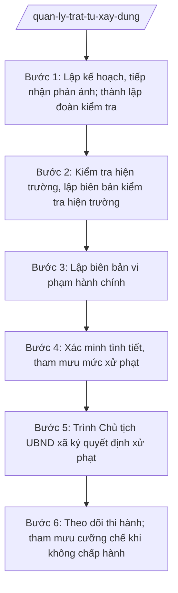

# Skill: Quản lý trật tự xây dựng, xử lý vi phạm

## 2. Khi nào dùng

- Kiểm tra trật tự xây dựng định kỳ theo kế hoạch của UBND xã.
- Kiểm tra đột xuất khi có đơn thư phản ánh, tố giác của người dân về vi phạm trật tự xây dựng.
- Phát hiện công trình xây dựng không có giấy phép, xây dựng sai giấy phép, sai quy hoạch được duyệt.
- Tham mưu Chủ tịch UBND xã ban hành quyết định xử phạt vi phạm hành chính trong thẩm quyền.
- Theo dõi, đôn đốc thi hành quyết định xử phạt; lập văn bản chuyển cấp có thẩm quyền cưỡng chế khi vượt thẩm quyền của xã.

## 3. Đầu vào (Input)

| Trường | Mô tả | Bắt buộc |
|--------|-------|----------|
| `nguon_thong_tin` | Kế hoạch kiểm tra định kỳ / đơn thư phản ánh / phát hiện qua tuần tra | Có |
| `dia_chi_cong_trinh` | Địa chỉ công trình kiểm tra (số nhà, thôn, xã) | Có |
| `chu_dau_tu` | Họ tên cá nhân hoặc tên tổ chức là chủ đầu tư công trình | Có |
| `hanh_vi_vi_pham` | Mô tả hành vi vi phạm phát hiện (không phép, sai phép, sai quy hoạch...) | Có |
| `giay_phep_xay_dung` | Số giấy phép xây dựng đã cấp (nếu có) | Không |
| `thoi_gian_kiem_tra` | Thời gian dự kiến kiểm tra hiện trường | Có |
| `thanh_phan_doan` | Thành phần đoàn kiểm tra (công chức xây dựng, công an xã, trưởng thôn...) | Có |
| `bien_ban_vphc_cu` | Biên bản VPHC/quyết định xử phạt trước đó (khi theo dõi thi hành) | Không |

## 4. Quy trình

**Bước 1. Lập kế hoạch, tiếp nhận phản ánh; thành lập đoàn kiểm tra**

- Làm gì: Căn cứ kế hoạch kiểm tra định kỳ hoặc đơn thư phản ánh, công chức xây dựng (Phòng Kinh tế) đề xuất thành lập đoàn kiểm tra; Trưởng phòng Kinh tế trình Chủ tịch UBND xã phê duyệt kế hoạch, thành phần đoàn kiểm tra.
- Dùng input: `nguon_thong_tin`, `dia_chi_cong_trinh`, `thoi_gian_kiem_tra`, `thanh_phan_doan`.
- Vai trò: Công chức xây dựng – Phòng Kinh tế xã A đề xuất; AI hỗ trợ soạn kế hoạch kiểm tra, quyết định thành lập đoàn ⏱ ~0,5 ngày (ước tính).
- Lưu ý nghiệp vụ: Kiểm tra đột xuất theo đơn thư phản ánh phải tiến hành kịp thời, không báo trước cho đối tượng kiểm tra; thành phần đoàn phải có công chức có chuyên môn về xây dựng.
- → Kết quả bước: Kế hoạch kiểm tra + quyết định thành lập đoàn kiểm tra được phê duyệt.

**Bước 2. Kiểm tra hiện trường, lập biên bản kiểm tra hiện trường**

- Làm gì: Đoàn kiểm tra tiến hành kiểm tra thực tế công trình: đối chiếu hiện trạng với giấy phép xây dựng (nếu có), quy hoạch, chỉ giới xây dựng; đo đạc, chụp ảnh hiện trường; lập biên bản kiểm tra hiện trường có chữ ký của đoàn kiểm tra và chủ đầu tư (hoặc người chứng kiến khi chủ đầu tư vắng mặt/không ký).
- Dùng input: `dia_chi_cong_trinh`, `chu_dau_tu`, `giay_phep_xay_dung`, `hanh_vi_vi_pham`.
- Vai trò: Đoàn kiểm tra (công chức xây dựng chủ trì) thực hiện trực tiếp tại hiện trường; AI hỗ trợ soạn biên bản kiểm tra hiện trường theo mẫu, tổng hợp hình ảnh, số liệu đo đạc ⏱ ~theo buổi kiểm tra thực tế (ước tính).
- Lưu ý nghiệp vụ: Biên bản phải ghi trung thực, khách quan hiện trạng; nếu chủ đầu tư không ký, phải có chữ ký của người chứng kiến (trưởng thôn/tổ dân phố). Mọi số liệu đo đạc phải có căn cứ, không ước đoán.
- → Kết quả bước: Biên bản kiểm tra hiện trường có chữ ký đầy đủ + hình ảnh, số liệu hiện trạng.

**Bước 3. Lập biên bản vi phạm hành chính**

- Làm gì: Khi phát hiện hành vi vi phạm, người có thẩm quyền lập biên bản VPHC tại hiện trường (hoặc tại trụ sở khi có đủ căn cứ): ghi rõ họ tên, địa chỉ cá nhân/tổ chức vi phạm; mô tả hành vi vi phạm; thời gian, địa điểm vi phạm; tang vật, phương tiện (nếu có); ý kiến trình bày của người vi phạm.
- Dùng input: `chu_dau_tu`, `dia_chi_cong_trinh`, `hanh_vi_vi_pham` + kết quả Bước 2.
- Vai trò: Công chức xây dựng được giao nhiệm vụ lập biên bản VPHC; AI hỗ trợ soạn biên bản VPHC đúng mẫu, đối chiếu hành vi với quy định xử phạt ⏱ ~0,5 ngày (ước tính).
- Lưu ý nghiệp vụ: Biên bản VPHC phải lập kịp thời, đúng mẫu theo quy định của Luật Xử lý vi phạm hành chính; hành vi vi phạm phải được mô tả cụ thể, có căn cứ từ biên bản kiểm tra hiện trường. Không lập biên bản khi chưa đủ căn cứ xác định vi phạm.
- → Kết quả bước: Biên bản VPHC đã lập, có chữ ký của người lập, người vi phạm (hoặc người chứng kiến).

**Bước 4. Xác minh tình tiết, tham mưu mức xử phạt**

- Làm gì: Xác minh các tình tiết tăng nặng, giảm nhẹ; xác định hành vi vi phạm thuộc thẩm quyền xử phạt của Chủ tịch UBND xã hay vượt thẩm quyền; đề xuất hình thức xử phạt chính, hình thức bổ sung và biện pháp khắc phục hậu quả; lập tờ trình kèm dự thảo quyết định xử phạt.
- Dùng input: bien_ban_vphc (từ Bước 3), `giay_phep_xay_dung`.
- Vai trò: Công chức xây dựng xác minh, soạn tờ trình và dự thảo quyết định (AI hỗ trợ tra cứu khung xử phạt, đối chiếu thẩm quyền, soạn dự thảo); Trưởng phòng Kinh tế – Bà Hoàng Thị D kiểm tra ⏱ ~1 ngày (ước tính).
- Lưu ý nghiệp vụ: Mức phạt phải trong khung quy định, tương xứng với tính chất, mức độ vi phạm; phải xem xét đầy đủ tình tiết tăng nặng, giảm nhẹ. Nếu vụ việc vượt thẩm quyền xử phạt của Chủ tịch UBND xã → chuyển sang lập văn bản chuyển cấp có thẩm quyền thay vì dự thảo quyết định xử phạt.
- → Kết quả bước: Tờ trình + dự thảo quyết định xử phạt VPHC (hoặc dự thảo văn bản chuyển cấp có thẩm quyền).

**Bước 5. Trình Chủ tịch UBND xã ký quyết định xử phạt**

- Làm gì: Trình hồ sơ, tờ trình và dự thảo quyết định lên Chủ tịch UBND xã A xem xét, ký ban hành (trong thẩm quyền theo phân cấp); văn thư đánh số, đóng dấu, giao quyết định cho người bị xử phạt và các đơn vị liên quan; trường hợp vượt thẩm quyền thì trình văn bản chuyển hồ sơ lên cấp có thẩm quyền.
- Dùng input: tờ trình, dự thảo quyết định (từ Bước 4).
- Vai trò: Văn phòng HĐND&UBND trình hồ sơ; Chủ tịch UBND xã – Ông Nguyễn Văn A xem xét, ký quyết định; văn thư phát hành; AI hỗ trợ: kiểm tra thể thức, số/ký hiệu quyết định trước khi trình ký ⏱ ~0,5 ngày (chưa tính thời gian chờ lãnh đạo) (ước tính).
- Lưu ý nghiệp vụ: Quyết định xử phạt phải ban hành trong thời hiệu xử phạt theo Luật Xử lý vi phạm hành chính; phải giao trực tiếp cho người bị xử phạt và giải thích quyền khiếu nại, khởi kiện. Không xử phạt vượt thẩm quyền.
- → Kết quả bước: Quyết định xử phạt VPHC đã ký, đóng dấu, giao cho người bị xử phạt; hoặc văn bản chuyển cấp có thẩm quyền.

**Bước 6. Theo dõi thi hành; tham mưu cưỡng chế khi không chấp hành**

- Làm gì: Theo dõi việc chấp hành quyết định xử phạt (nộp phạt, thực hiện biện pháp khắc phục hậu quả như tháo dỡ phần vi phạm); đôn đốc bằng văn bản khi quá hạn; nếu không chấp hành → lập hồ sơ, tham mưu văn bản chuyển cấp có thẩm quyền tổ chức cưỡng chế thi hành.
- Dùng input: quyết định xử phạt đã ban hành, `bien_ban_vphc_cu`.
- Vai trò: Công chức xây dựng theo dõi, đôn đốc; AI hỗ trợ lập sổ theo dõi thi hành, soạn văn bản đôn đốc, dự thảo văn bản chuyển cấp có thẩm quyền cưỡng chế ⏱ ~0,5 ngày/đợt theo dõi (ước tính).
- Lưu ý nghiệp vụ: Mọi văn bản đôn đốc phải lưu hồ sơ làm căn cứ; việc cưỡng chế do cấp có thẩm quyền quyết định và tổ chức — xã chỉ tham mưu, phối hợp, không tự tổ chức cưỡng chế vượt thẩm quyền.
- → Kết quả bước: Sổ theo dõi thi hành quyết định xử phạt; văn bản đôn đốc hoặc văn bản chuyển cấp có thẩm quyền cưỡng chế.

## Luồng quy trình (Workflow)

## 5. Đầu ra (Output)

- Biên bản kiểm tra hiện trường.
- Biên bản vi phạm hành chính.
- Quyết định xử phạt VPHC (Chủ tịch UBND xã ký, trong thẩm quyền theo phân cấp).
- Văn bản chuyển cấp có thẩm quyền (khi vượt thẩm quyền xử phạt của xã hoặc đề nghị cưỡng chế).
- Sổ theo dõi thi hành quyết định xử phạt.

### Cấu trúc output chuẩn

Khung cố định của Quyết định xử phạt vi phạm hành chính, các phần bắt buộc theo đúng thứ tự, đúng thể thức NĐ 30/2020/NĐ-CP:

1. **Quốc hiệu – tiêu ngữ** (canh giữa, phía trên cùng): CỘNG HÒA XÃ HỘI CHỦ NGHĨA VIỆT NAM / Độc lập – Tự do – Hạnh phúc
2. **Tên cơ quan ban hành** (canh trái): ỦY BAN NHÂN DÂN XÃ A
3. **Số, ký hiệu văn bản** (dưới tên cơ quan, canh trái): Số: .../QĐ-XPVPHC
4. **Địa danh, ngày tháng năm ban hành** (canh phải): Xã A, ngày ... tháng ... năm ...
5. **Tên loại và trích yếu** (canh giữa): QUYẾT ĐỊNH — Xử phạt vi phạm hành chính về trật tự xây dựng đối với ông (bà)/tổ chức ...
6. **Căn cứ**: Luật Xử lý vi phạm hành chính; Nghị định của Chính phủ quy định xử phạt vi phạm hành chính trong hoạt động xây dựng; biên bản VPHC số ... ngày ...; tờ trình của Phòng Kinh tế xã A.
7. **Nội dung** (phần QUYẾT ĐỊNH): Điều 1. Xử phạt đối với ông (bà)/tổ chức ... (họ tên, địa chỉ); hành vi vi phạm ...; hình thức xử phạt chính (phạt tiền ... đồng); hình thức xử phạt bổ sung (nếu có); biện pháp khắc phục hậu quả (buộc tháo dỡ phần công trình vi phạm...); thời hạn, nơi nộp tiền phạt; Điều 2. Quyền khiếu nại, khởi kiện; Điều 3. Trách nhiệm thi hành; Điều 4. Hiệu lực thi hành.
8. **Nơi nhận** (cuối văn bản, canh trái): người/tổ chức bị xử phạt; Phòng Kinh tế xã A; Công an xã A; Kho bạc/đơn vị thu phạt; Lưu: VT, XD.
9. **Chữ ký, chức vụ người ký** (canh phải): "TM. ỦY BAN NHÂN DÂN" / CHỦ TỊCH / họ tên người ký; đóng dấu UBND xã.

## 6. Checklist nghiệm thu

1. Quyết định xử phạt có đủ 9 thành phần thể thức theo đúng thứ tự mục 5, không thiếu mục nào.
2. Có biên bản kiểm tra hiện trường và biên bản VPHC hợp lệ làm căn cứ; hành vi vi phạm mô tả cụ thể, có số liệu đo đạc.
3. Hành vi vi phạm thuộc thẩm quyền xử phạt của Chủ tịch UBND xã theo phân cấp; không xử phạt vượt thẩm quyền.
4. Mức phạt trong khung quy định, tương xứng tính chất, mức độ vi phạm; đã xem xét tình tiết tăng nặng, giảm nhẹ.
5. Biện pháp khắc phục hậu quả ghi cụ thể (tháo dỡ phần vi phạm, khôi phục hiện trạng...), có thời hạn thực hiện.
6. Quyết định ban hành trong thời hiệu xử phạt; ghi rõ quyền khiếu nại, khởi kiện của người bị xử phạt.
7. Số quyết định đúng định dạng ".../QĐ-XPVPHC", không trùng số trong sổ đăng ký văn bản đi.
8. Quyết định đã giao cho người bị xử phạt; có sổ theo dõi thi hành.
9. Trường hợp vượt thẩm quyền: có văn bản chuyển cấp có thẩm quyền thay vì quyết định xử phạt.
10. Đã qua human gate: công chức xây dựng lập biên bản → Trưởng phòng Kinh tế kiểm tra → Chủ tịch UBND xã ký.

## 7. Ví dụ mô phỏng

*Dữ liệu dưới đây là giả lập 100% phục vụ minh họa.*

### Input mẫu

| Trường | Giá trị |
|--------|---------|
| nguon_thong_tin | Đơn thư phản ánh của người dân |
| dia_chi_cong_trinh | Thôn 1, xã A |
| chu_dau_tu | Ông Nguyễn Văn Dân |
| hanh_vi_vi_pham | Xây dựng nhà ở riêng lẻ vượt 01 tầng so với giấy phép xây dựng được cấp |
| giay_phep_xay_dung | Giấy phép xây dựng số 45/GPXD ngày 01/8/2026 của UBND xã A |
| thoi_gian_kiem_tra | 09 giờ 00 phút, ngày 10/10/2026 |
| thanh_phan_doan | Công chức xây dựng Phòng Kinh tế xã A; Công an xã A; Trưởng thôn 1 |

### Output mẫu

CỘNG HÒA XÃ HỘI CHỦ NGHĨA VIỆT NAM
Độc lập – Tự do – Hạnh phúc

ỦY BAN NHÂN DÂN XÃ A			Số: 45/QĐ-XPVPHC

						Xã A, ngày 12 tháng 10 năm 2026

QUYẾT ĐỊNH
Xử phạt vi phạm hành chính về trật tự xây dựng đối với ông Nguyễn Văn Dân

Căn cứ Luật Xử lý vi phạm hành chính;
Căn cứ Nghị định của Chính phủ quy định xử phạt vi phạm hành chính trong hoạt động xây dựng;
Căn cứ Biên bản vi phạm hành chính số 10/BB-VPHC ngày 10/10/2026;
Xét Tờ trình số 50/TTr-KT ngày 11/10/2026 của Trưởng phòng Kinh tế xã A,

QUYẾT ĐỊNH:

Điều 1. Xử phạt vi phạm hành chính đối với ông Nguyễn Văn Dân, địa chỉ: thôn 1, xã A, đã thực hiện hành vi vi phạm hành chính: xây dựng nhà ở riêng lẻ vượt 01 tầng so với Giấy phép xây dựng số 45/GPXD ngày 01/8/2026 của UBND xã A.

Hình thức xử phạt chính: phạt tiền 20.000.000 đồng (hai mươi triệu đồng).

Biện pháp khắc phục hậu quả: buộc tháo dỡ phần công trình xây dựng vi phạm trong thời hạn 30 ngày kể từ ngày nhận được Quyết định này.

Ông Nguyễn Văn Dân phải nộp tiền phạt tại Kho bạc Nhà nước trong thời hạn 10 ngày kể từ ngày nhận được Quyết định này.

Điều 2. Ông Nguyễn Văn Dân có quyền khiếu nại, khởi kiện đối với Quyết định này theo quy định của pháp luật.

Điều 3. Phòng Kinh tế xã A, Công an xã A, ông Nguyễn Văn Dân và các đơn vị liên quan chịu trách nhiệm thi hành Quyết định này.

Điều 4. Quyết định này có hiệu lực kể từ ngày ký.

Nơi nhận:
- Ông Nguyễn Văn Dân;
- Phòng Kinh tế xã A;
- Công an xã A;
- Kho bạc Nhà nước;
- Lưu: VT, XD (2b).

TM. ỦY BAN NHÂN DÂN
CHỦ TỊCH

Nguyễn Văn A

## 8. Human gate

- **Công chức xây dựng – Phòng Kinh tế xã A** → kiểm tra hiện trường, lập biên bản kiểm tra hiện trường và biên bản VPHC; chịu trách nhiệm về tính trung thực của số liệu, hiện trạng.
- **Trưởng phòng Kinh tế xã A (Bà Hoàng Thị D)** → kiểm tra hồ sơ, xác minh tình tiết, thẩm định mức xử phạt đề xuất; ký nháy tờ trình.
- **Chủ tịch UBND xã A (Ông Nguyễn Văn A)** → xem xét, ký ban hành quyết định xử phạt VPHC trong thẩm quyền theo phân cấp.
- Không ban hành quyết định xử phạt khi chưa có chữ ký của Chủ tịch UBND xã; không xử phạt vượt thẩm quyền.

## 9. Giới hạn

- AI KHÔNG tự kết luận hành vi vi phạm thay người có thẩm quyền; chỉ hỗ trợ lập biên bản, đối chiếu quy định.
- AI KHÔNG tự xác định mức phạt; mức phạt do người có thẩm quyền quyết định trong khung quy định.
- AI KHÔNG xử phạt vượt thẩm quyền của Chủ tịch UBND xã; khi vượt thẩm quyền phải chuyển cấp có thẩm quyền.
- AI KHÔNG bịa số liệu đo đạc, hiện trạng công trình, căn cứ pháp lý; mọi số liệu phải từ kiểm tra thực tế.
- AI KHÔNG tự tổ chức cưỡng chế; việc cưỡng chế do cấp có thẩm quyền quyết định.
- AI KHÔNG viện dẫn văn bản đã hết hiệu lực.

## 10. Căn cứ & lưu ý

- TT 10/2025/TT-BXD: hướng dẫn chức năng, nhiệm vụ, quyền hạn của Sở Xây dựng và lĩnh vực xây dựng của phòng chuyên môn thuộc UBND cấp xã — căn cứ xác định nhiệm vụ quản lý trật tự xây dựng của Phòng Kinh tế xã A.
- Luật Xử lý vi phạm hành chính: trình tự, thủ tục lập biên bản VPHC, ban hành quyết định xử phạt, thời hiệu xử phạt (chỉ nêu tên luật, không kèm số hiệu).
- NĐ 30/2020/NĐ-CP: thể thức, kỹ thuật trình bày quyết định hành chính.
- Lưu ý: thẩm quyền xử phạt VPHC của Chủ tịch UBND xã thực hiện theo phân cấp, phân quyền hiện hành; khi xã tổ chức khác khung chuẩn (NĐ 370/2025/NĐ-CP), đối chiếu bảng mapping lĩnh vực → đầu mối trong khung-phong-ban-cap-xa.md.
