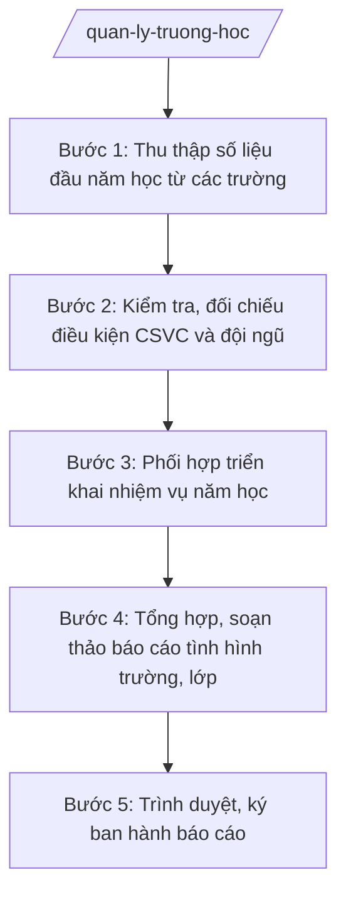

# Skill: Quản lý nhà nước về trường MN, TH, THCS

## 2. Khi nào dùng

- Đầu năm học: tổng hợp số liệu trường, lớp, học sinh, giáo viên các trường mầm non (MN), tiểu học (TH), trung học cơ sở (THCS) công lập trên địa bàn xã.
- Kiểm tra điều kiện cơ sở vật chất (CSVC), đội ngũ cán bộ quản lý, giáo viên, nhân viên trước thềm năm học mới.
- Phối hợp các trường triển khai nhiệm vụ năm học theo chỉ đạo của Sở GD&ĐT tỉnh và UBND xã.
- Lập báo cáo định kỳ (đầu năm, giữa năm, cuối năm học) về tình hình giáo dục trên địa bàn.

## 3. Đầu vào (Input)

| Trường | Mô tả | Bắt buộc |
|--------|-------|----------|
| `nam_hoc` | Năm học cần báo cáo (vd: 2026–2027) | Có |
| `danh_sach_truong` | Danh sách trường công lập trên địa bàn: tên trường, cấp học (MN/TH/THCS), địa chỉ | Có |
| `so_lieu_truong` | Số liệu từng trường: số lớp, số học sinh, số CBQL/giáo viên/nhân viên (biên chế, hợp đồng), tỷ lệ GV/lớp | Có |
| `tinh_trang_csvc` | Hiện trạng phòng học, nhà vệ sinh, bếp ăn bán trú, sân chơi, thiết bị dạy học; hạng mục cần sửa chữa/xây mới | Có |
| `ket_qua_tuyen_sinh` | Tiến độ tuyển sinh đầu cấp (MN 5 tuổi, lớp 1, lớp 6): chỉ tiêu, đã tuyển, còn thiếu | Không |
| `nhu_cau_nhan_su` | Đề xuất tuyển dụng, điều động, hợp đồng giáo viên của các trường | Không |
| `thoi_han_bao_cao` | Thời hạn nộp báo cáo cho Sở GD&ĐT/UBND xã | Có |
| `don_vi_bao_cao` | UBND xã lập báo cáo | Có |

## 4. Quy trình

**Bước 1. Thu thập số liệu đầu năm học từ các trường**

- Làm gì: Gửi văn bản đề nghị các trường MN, TH, THCS trên địa bàn cung cấp số liệu đầu năm học theo biểu mẫu thống nhất; đôn đốc, thu nhận đầy đủ trước thời hạn.
- Dùng input: `nam_hoc`, `danh_sach_truong`, `thoi_han_bao_cao`.
- Vai trò: Công chức VH-XH phụ trách giáo dục (ông Nguyễn Văn G) soạn văn bản đề nghị, gửi và đôn đốc các trường. AI hỗ trợ: soạn dự thảo văn bản đề nghị, thiết kế biểu mẫu thống kê số liệu chuẩn (trường/lớp/HS/GV/CSVC) để các trường điền thống nhất. Thời gian ước tính: 2–3 ngày làm việc.
- Lưu ý nghiệp vụ: Biểu mẫu phải thống nhất cho cả 3 cấp học; quy định rõ thời hạn nộp của trường (ít nhất trước thời hạn báo cáo của xã 5 ngày làm việc) để có thời gian tổng hợp.
- → Kết quả bước: Bộ số liệu thô đầu năm học của toàn bộ trường trên địa bàn + văn bản đề nghị đã gửi.

**Bước 2. Kiểm tra, đối chiếu điều kiện CSVC và đội ngũ**

- Làm gì: Rà soát số liệu các trường gửi; tổ chức (hoặc phối hợp) kiểm tra thực tế điều kiện CSVC, đội ngũ tại các trường có dấu hiệu thiếu phòng học, thiếu giáo viên hoặc đề nghị sửa chữa; lập biên bản kiểm tra.
- Dùng input: `so_lieu_truong`, `tinh_trang_csvc`, `nhu_cau_nhan_su`.
- Vai trò: Công chức VH-XH phụ trách giáo dục chủ trì kiểm tra, Trưởng phòng VH-XH (ông Vũ Văn E) tham gia đoàn kiểm tra các trường trọng điểm. AI hỗ trợ: lập checklist kiểm tra CSVC/đội ngũ theo tiêu chí trường đạt chuẩn, tổng hợp số liệu đối chiếu, soạn dự thảo biên bản kiểm tra từ ghi chép thực tế. Thời gian ước tính: 3–5 ngày làm việc.
- Lưu ý nghiệp vụ: Xã quản lý nhà nước về trường học, không can thiệp chuyên môn nội bộ nhà trường; các đề xuất sửa chữa, xây mới, tuyển dụng phải tổng hợp thành kiến nghị gửi cấp có thẩm quyền, không tự quyết định vượt thẩm quyền.
- → Kết quả bước: Bảng tổng hợp đối chiếu CSVC/đội ngũ toàn xã + biên bản kiểm tra (nếu có) + danh mục kiến nghị.

**Bước 3. Phối hợp triển khai nhiệm vụ năm học**

- Làm gì: Tổ chức họp với Ban Giám hiệu các trường để quán triệt nhiệm vụ năm học, phân công phối hợp (tuyển sinh, PCGD, an toàn trường học, y tế học đường); thống nhất đầu mối liên hệ.
- Dùng input: `nam_hoc`, `danh_sach_truong`, `ket_qua_tuyen_sinh`.
- Vai trò: Trưởng phòng VH-XH (ông Vũ Văn E) chủ trì cuộc họp, Phó Chủ tịch UBND xã (bà Trần Thị B) dự và chỉ đạo khi cần. AI hỗ trợ: soạn dự thảo chương trình họp, dự thảo biên bản họp và bảng phân công nhiệm vụ theo đầu mối/thời hạn. Thời gian ước tính: 1–2 ngày làm việc.
- Lưu ý nghiệp vụ: Nội dung phối hợp phải bám nhiệm vụ năm học do Sở GD&ĐT tỉnh A giao; ghi rõ trách nhiệm của nhà trường và của Phòng VH-XH, tránh chồng chéo.
- → Kết quả bước: Biên bản họp triển khai nhiệm vụ năm học + bảng phân công phối hợp.

**Bước 4. Tổng hợp, soạn thảo báo cáo tình hình trường, lớp**

- Làm gì: Tổng hợp toàn bộ số liệu, kết quả kiểm tra, kết quả phối hợp thành dự thảo Báo cáo tình hình trường, lớp đầu năm học theo đúng thể thức văn bản hành chính (NĐ 30/2020/NĐ-CP).
- Dùng input: Toàn bộ input; kết quả các bước 1–3.
- Vai trò: Công chức VH-XH phụ trách giáo dục soạn dự thảo. AI hỗ trợ: tổng hợp số liệu thành bảng biểu, kiểm tra tính khớp nhau giữa các bảng, rà soát thể thức văn bản, đề xuất câu chữ phần nhận xét – kiến nghị. Thời gian ước tính: 2 ngày làm việc.
- Lưu ý nghiệp vụ: Số liệu trong báo cáo phải khớp tuyệt đối với số liệu các trường đã cung cấp và biên bản kiểm tra; phần kiến nghị phải ghi rõ đề xuất gửi cấp nào (Sở GD&ĐT, UBND tỉnh A, UBND xã).
- → Kết quả bước: Dự thảo Báo cáo tình hình trường, lớp đầu năm học + phụ lục bảng thống kê số liệu.

**Bước 5. Trình duyệt, ký ban hành báo cáo**

- Làm gì: Trình dự thảo báo cáo qua các cấp kiểm duyệt; ký ban hành, gửi báo cáo đến nơi nhận và lưu hồ sơ.
- Dùng input: Dự thảo báo cáo ở bước 4.
- Vai trò: Công chức VH-XH phụ trách giáo dục trình; Trưởng phòng VH-XH (ông Vũ Văn E) kiểm tra nội dung, số liệu, thể thức; Chủ tịch UBND xã (ông Nguyễn Văn A) ký duyệt, ban hành. AI hỗ trợ: lập phiếu trình ký, kiểm tra lần cuối danh sách nơi nhận và số/ký hiệu văn bản. Thời gian ước tính: 1–2 ngày làm việc.
- Lưu ý nghiệp vụ: Báo cáo chỉ được gửi đi sau khi Chủ tịch ký; lưu 1 bản tại Phòng VH-XH và 1 bản tại Văn phòng HĐND&UBND xã để theo dõi.
- → Kết quả bước: Báo cáo đã ký ban hành, gửi đúng nơi nhận, lưu hồ sơ đầy đủ.

## Luồng quy trình (Workflow)

## 5. Đầu ra (Output)

### Sản phẩm

1. **Báo cáo tình hình trường, lớp đầu năm học** (sản phẩm chính) — văn bản hành chính đúng thể thức.
2. Phụ lục: Bảng thống kê số liệu trường/lớp/học sinh/giáo viên/CSVC theo từng trường.
3. Biên bản kiểm tra điều kiện CSVC, đội ngũ (nếu có kiểm tra thực tế).
4. Biên bản họp triển khai nhiệm vụ năm học với các trường.

### Cấu trúc output chuẩn (Báo cáo tình hình trường, lớp đầu năm học)

1. Quốc hiệu – Tiêu ngữ: CỘNG HÒA XÃ HỘI CHỦ NGHĨA VIỆT NAM / Độc lập – Tự do – Hạnh phúc. (đúng thể thức NĐ 30/2020/NĐ-CP)
2. Tên cơ quan ban hành: ỦY BAN NHÂN DÂN XÃ A.
3. Số, ký hiệu văn bản: số/BC-UBND.
4. Địa danh, ngày tháng năm ban hành: Xã A, ngày … tháng … năm ….
5. Tên loại và trích yếu nội dung: BÁO CÁO / Tình hình trường, lớp đầu năm học … trên địa bàn xã A.
6. Căn cứ ban hành: Thông tư 15/2025/TT-BGDĐT; Thông tư 45/2026/TT-BGDĐT; văn bản chỉ đạo của Sở GD&ĐT tỉnh A và UBND xã A về nhiệm vụ năm học (ghi rõ số hiệu, ngày ban hành).
7. Nội dung chính:
   - I. Tình hình chung (số trường, lớp, học sinh, giáo viên toàn xã theo từng cấp học);
   - II. Kết quả cụ thể (tuyển sinh đầu cấp; CSVC; đội ngũ; công tác phối hợp triển khai nhiệm vụ năm học);
   - III. Khó khăn, vướng mắc và kiến nghị.
8. Nơi nhận (Sở GD&ĐT tỉnh A; Thường trực Đảng ủy, HĐND xã; Chủ tịch, các Phó Chủ tịch UBND xã; các trường MN, TH, THCS; lưu VT, VH-XH).
9. Chữ ký, họ tên người ký: TM. ỦY BAN NHÂN DÂN / CHỦ TỊCH / (ký, đóng dấu, ghi rõ họ tên).

## 6. Checklist nghiệm thu

- [ ] Đủ 9 phần theo Cấu trúc output chuẩn mục 4, đúng thứ tự thể thức NĐ 30/2020/NĐ-CP.
- [ ] Số liệu trường/lớp/học sinh/giáo viên khớp giữa báo cáo, phụ lục bảng thống kê và số liệu trường cung cấp.
- [ ] Bao quát đủ 3 cấp học (MN, TH, THCS) công lập trên địa bàn, không bỏ sót trường.
- [ ] Căn cứ pháp lý ghi đúng số hiệu Thông tư 15/2025/TT-BGDĐT, Thông tư 45/2026/TT-BGDĐT (không bịa số hiệu khác).
- [ ] Phần kiến nghị ghi rõ nội dung, đơn vị tiếp nhận, không kiến nghị vượt thẩm quyền của xã.
- [ ] Số/ký hiệu, ngày tháng, nơi nhận, chữ ký đầy đủ; không sai chính tả, không sai tên đơn vị/cá nhân.
- [ ] Đã qua đủ 3 nấc human gate: công chức soạn → Trưởng phòng kiểm tra → Chủ tịch ký duyệt.
- [ ] Hồ sơ lưu đầy đủ: báo cáo đã ký + phụ lục + biên bản kiểm tra/họp (nếu có).

## 7. Ví dụ mô phỏng

*Dữ liệu dưới đây là giả lập 100% phục vụ minh họa.*

**Input mẫu:**

| Trường | Giá trị mẫu |
|--------|-------------|
| nam_hoc | 2026–2027 |
| danh_sach_truong | Trường MN Hoa Mai; Trường TH A; Trường THCS A (xã A, tỉnh A) |
| so_lieu_truong | 3 trường; 60 lớp; 2.000 học sinh; 120 CBQL/GV/NV |
| tinh_trang_csvc | Đủ phòng học; 2 phòng học xuống cấp cần sửa; thiếu 5 giáo viên TH |
| ket_qua_tuyen_sinh | MN 5 tuổi: 200/200; lớp 1: 350/350; lớp 6: 300/300 |
| thoi_han_bao_cao | 20/9/2026 |
| don_vi_bao_cao | UBND xã A |

**Output mẫu:**

CỘNG HÒA XÃ HỘI CHỦ NGHĨA VIỆT NAM
Độc lập – Tự do – Hạnh phúc
---------------

ỦY BAN NHÂN DÂN XÃ A

Số: 123/BC-UBND

Xã A, ngày 15 tháng 9 năm 2026

**BÁO CÁO**
**Tình hình trường, lớp đầu năm học 2026–2027 trên địa bàn xã A**

*Căn cứ* Thông tư số 15/2025/TT-BGDĐT ngày 24/7/2025 của Bộ Giáo dục và Đào tạo hướng dẫn chức năng, nhiệm vụ, quyền hạn của Sở Giáo dục và Đào tạo và Phòng Văn hóa – Xã hội trong lĩnh vực giáo dục và đào tạo; Thông tư số 45/2026/TT-BGDĐT ngày 10/6/2026 sửa đổi, bổ sung Thông tư số 15/2025/TT-BGDĐT; Công văn số 456/SGDĐT-GDTrH ngày 25/8/2026 của Sở Giáo dục và Đào tạo tỉnh A về hướng dẫn nhiệm vụ năm học 2026–2027;

UBND xã A báo cáo tình hình trường, lớp đầu năm học 2026–2027 như sau:

**I. TÌNH HÌNH CHUNG**

Trên địa bàn xã A có 03 trường công lập: 01 trường mầm non, 01 trường tiểu học, 01 trường trung học cơ sở; tổng số 60 lớp, 2.000 học sinh, 120 cán bộ quản lý, giáo viên, nhân viên.

**II. KẾT QUẢ CỤ THỂ**

1. Tuyển sinh đầu cấp: trẻ 5 tuổi vào mầm non đạt 200/200; lớp 1 đạt 350/350; lớp 6 đạt 300/300.
2. Cơ sở vật chất: cơ bản đủ phòng học; 02 phòng học xuống cấp cần sửa chữa; trang thiết bị dạy học đáp ứng yêu cầu tối thiểu.
3. Đội ngũ: còn thiếu 05 giáo viên tiểu học; các trường đã bố trí hợp đồng thỉnh giảng tạm thời.
4. Phối hợp triển khai nhiệm vụ năm học: Phòng Văn hóa – Xã hội xã đã họp với Ban Giám hiệu 03 trường ngày 05/9/2026, thống nhất phân công phối hợp (có biên bản kèm theo).

**III. KHÓ KHĂN, KIẾN NGHỊ**

1. Đề nghị Sở Giáo dục và Đào tạo tỉnh A xem xét bổ sung biên chế 05 giáo viên tiểu học cho Trường TH A.
2. Đề nghị UBND tỉnh A hỗ trợ kinh phí sửa chữa 02 phòng học xuống cấp tại Trường THCS A.

Trên đây là báo cáo tình hình trường, lớp đầu năm học 2026–2027 trên địa bàn xã A./.

***Nơi nhận:***
- Sở GD&ĐT tỉnh A (báo cáo);
- Thường trực Đảng ủy xã (báo cáo);
- Thường trực HĐND xã;
- Chủ tịch, các Phó Chủ tịch UBND xã;
- Các trường MN, TH, THCS trên địa bàn;
- Lưu: VT, VH-XH.

**TM. ỦY BAN NHÂN DÂN**
**CHỦ TỊCH**

*(Ký, đóng dấu)*

**Nguyễn Văn A**

## 8. Human gate (người kiểm duyệt)

- Công chức VH-XH phụ trách giáo dục (ông Nguyễn Văn G) soạn dự thảo báo cáo, chịu trách nhiệm về số liệu.
- Trưởng phòng Văn hóa – Xã hội (ông Vũ Văn E) kiểm tra nội dung, số liệu, thể thức ở bước 4–5; trả lại sửa nếu chưa đạt.
- Chủ tịch UBND xã (ông Nguyễn Văn A) ký duyệt, ban hành ở bước 5. Báo cáo chỉ có giá trị sau khi Chủ tịch ký.

## 9. Giới hạn (guardrails)

- AI KHÔNG ra quyết định hành chính thay người có thẩm quyền (không quyết định tuyển dụng, điều động giáo viên, phê duyệt sửa chữa trường học).
- AI không tự ký, đóng dấu, phát hành văn bản dưới danh nghĩa UBND xã hay bất kỳ cá nhân nào.
- AI không bịa số liệu trường/lớp/học sinh/giáo viên; mọi con số trong báo cáo phải có nguồn từ số liệu trường cung cấp hoặc biên bản kiểm tra thực tế.
- AI không bịa căn cứ pháp lý, số hiệu văn bản; không viện dẫn văn bản đã hết hiệu lực (vd: không dùng NĐ 45/2025/NĐ-CP đã bị NĐ 150/2025/NĐ-CP thay thế, không dùng TT 12/2020/TT-BGDĐT đã bị TT 15/2025/TT-BGDĐT thay thế).
- AI không can thiệp chuyên môn nội bộ nhà trường; chỉ hỗ trợ công tác quản lý nhà nước của xã.

## 10. Căn cứ & lưu ý

- Thông tư 15/2025/TT-BGDĐT ngày 24/7/2025 của Bộ GD&ĐT — hướng dẫn chức năng, nhiệm vụ, quyền hạn của Sở GD&ĐT và Phòng Văn hóa – Xã hội trong lĩnh vực GD&ĐT (thay thế TT 12/2020/TT-BGDĐT).
- Thông tư 45/2026/TT-BGDĐT ngày 10/6/2026 của Bộ GD&ĐT — sửa đổi, bổ sung TT 15/2025/TT-BGDĐT (tuyển sinh đầu cấp, PCGD-XMC, trường đạt chuẩn quốc gia).
- Nghị định 150/2025/NĐ-CP ngày 12/6/2025 (hiệu lực 16/6/2025) — tổ chức cơ quan chuyên môn thuộc UBND cấp xã, trong đó có Phòng Văn hóa – Xã hội.
- Nghị định 370/2025/NĐ-CP ngày 31/12/2025 (hiệu lực 01/01/2026) — sửa đổi, bổ sung NĐ 150/2025/NĐ-CP; xã tự quyết định thành lập phòng chuyên môn.
- Nghị định 30/2020/NĐ-CP — thể thức văn bản hành chính (áp dụng cho cấu trúc báo cáo).
- Lưu ý: NĐ 45/2025/NĐ-CP đã hết hiệu lực (bị NĐ 150/2025/NĐ-CP thay thế từ 16/6/2025) — không viện dẫn.
