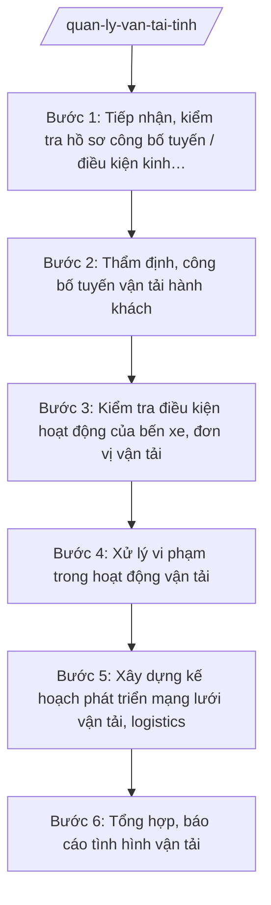

# Skill: Quản lý vận tải

## 2. Khi nào dùng

- Doanh nghiệp, hợp tác xã đề nghị công bố tuyến vận tải hành khách cố định, tuyến xe buýt trên địa bàn tỉnh hoặc liên tỉnh đi/đến tỉnh A;
- Cần kiểm tra điều kiện hoạt động của bến xe, điểm đón trả khách, đơn vị kinh doanh vận tải (giấy phép, phương tiện, lái xe, an toàn);
- Sở Xây dựng tỉnh A xây dựng quy hoạch/kế hoạch phát triển mạng lưới vận tải hành khách, hàng hóa, logistics của tỉnh;
- Tiếp nhận phản ánh về hoạt động vận tải (xe dù, bến cóc, chèo kéo khách, tăng giá vé trái quy định) cần kiểm tra, xử lý.

## 3. Đầu vào (Input)

| Trường | Mô tả | Bắt buộc |
|--------|-------|----------|
| `ho_so_cong_bo_tuyen` | Hồ sơ đề nghị công bố tuyến vận tải (đơn vị vận tải, hành trình, tần suất, phương tiện) | Có (công bố tuyến) |
| `danh_sach_ben_xe` | Danh sách bến xe, điểm đón trả khách trên địa bàn (vị trí, hạng, đơn vị quản lý) | Có |
| `ho_so_dv_van_tai` | Hồ sơ đơn vị kinh doanh vận tải (giấy phép, phương tiện, lái xe) | Có (kiểm tra) |
| `phan_anh_vi_pham` | Phản ánh vi phạm trong hoạt động vận tải (xe dù, bến cóc, chèo kéo...) | Có (xử lý) |
| `so_lieu_luu_luong` | Số liệu lưu lượng hành khách, hàng hóa theo tuyến, địa bàn | Không |
| `quy_hoach_van_tai` | Quy hoạch mạng lưới vận tải của tỉnh (nếu có) | Có (quy hoạch tuyến) |

## 4. Quy trình

**Bước 1. Tiếp nhận, kiểm tra hồ sơ công bố tuyến / điều kiện kinh doanh**
- Làm gì: Tiếp nhận hồ sơ đề nghị công bố tuyến vận tải hành khách của đơn vị vận tải; kiểm tra tính đầy đủ, hợp lệ (giấy phép kinh doanh vận tải, phương tiện đạt chuẩn, lái xe đủ điều kiện); đối chiếu với quy hoạch mạng lưới vận tải.
- Dùng input: `ho_so_cong_bo_tuyen`, `ho_so_dv_van_tai`, `quy_hoach_van_tai`.
- Vai trò: Chuyên viên Phòng Quản lý vận tải tiếp nhận, AI hỗ trợ đối chiếu hồ sơ theo checklist, kiểm tra tính phù hợp với quy hoạch tuyến; ⏱ ~3–5 ngày làm việc (ước tính).
- Lưu ý nghiệp vụ: Tuyến đề nghị phải phù hợp quy hoạch mạng lưới; phương tiện, lái xe phải đáp ứng điều kiện an toàn; hồ sơ thiếu hướng dẫn bổ sung một lần.
- → Kết quả bước: Phiếu kiểm tra hồ sơ công bố tuyến (đủ điều kiện / cần bổ sung).

**Bước 2. Thẩm định, công bố tuyến vận tải hành khách**
- Làm gì: Thẩm định hành trình, điểm đầu/cuối, tần suất, biểu đồ chạy xe; lấy ý kiến bến xe hai đầu tuyến (đối với tuyến liên tỉnh phối hợp Sở Xây dựng tỉnh liên quan); soạn quyết định công bố tuyến vận tải.
- Dùng input: Kết quả Bước 1, `danh_sach_ben_xe`.
- Vai trò: Trưởng phòng Quản lý vận tải thẩm định, AI hỗ trợ soạn dự thảo quyết định công bố tuyến, kiểm tra tính thống nhất thông tin tuyến; ⏱ ~5–7 ngày làm việc (ước tính).
- Lưu ý nghiệp vụ: Tuyến liên tỉnh phải có sự thống nhất với địa phương liên quan; quyết định công bố phải nêu rõ quyền và nghĩa vụ của đơn vị vận tải.
- → Kết quả bước: Quyết định công bố tuyến vận tải hành khách (lãnh đạo Sở ký).

**Bước 3. Kiểm tra điều kiện hoạt động của bến xe, đơn vị vận tải**
- Làm gì: Lập kế hoạch kiểm tra định kỳ/đột xuất bến xe (cơ sở vật chất, tổ chức điều hành, an ninh trật tự, giá vé) và đơn vị kinh doanh vận tải (giấy phép, phương tiện, thiết bị giám sát hành trình, điều kiện lái xe); lập biên bản kiểm tra.
- Dùng input: `danh_sach_ben_xe`, `ho_so_dv_van_tai`, `phan_anh_vi_pham`.
- Vai trò: Đoàn kiểm tra của Sở thực hiện, AI hỗ trợ soạn kế hoạch, biên bản kiểm tra, tổng hợp vi phạm; ⏱ ~5–7 ngày làm việc/đợt (ước tính).
- Lưu ý nghiệp vụ: Chú trọng kiểm tra thiết bị giám sát hành trình, thời gian lái xe liên tục; xử lý nghiêm xe dù, bến cóc; biên bản có chữ ký các bên.
- → Kết quả bước: Biên bản kiểm tra bến xe, đơn vị vận tải + bảng tổng hợp vi phạm.

**Bước 4. Xử lý vi phạm trong hoạt động vận tải**
- Làm gì: Trên cơ sở kết quả kiểm tra và phản ánh: yêu cầu chấm dứt hành vi vi phạm; lập biên bản vi phạm hành chính; tham mưu xử phạt theo thẩm quyền hoặc chuyển cơ quan có thẩm quyền (thu hồi giấy phép, phù hiệu đối với vi phạm nghiêm trọng, tái phạm).
- Dùng input: Kết quả Bước 3, `phan_anh_vi_pham`.
- Vai trò: Thanh tra Sở/chuyên viên tham mưu xử lý, AI hỗ trợ soạn biên bản vi phạm, dự thảo quyết định xử phạt, rà soát căn cứ; ⏱ ~5–7 ngày làm việc (ước tính).
- Lưu ý nghiệp vụ: Xử phạt đúng hành vi, đúng thẩm quyền, đúng trình tự; thu hồi giấy phép, phù hiệu đối với trường hợp tái phạm theo quy định.
- → Kết quả bước: Quyết định xử phạt vi phạm hành chính / văn bản thu hồi giấy phép, phù hiệu.

**Bước 5. Xây dựng kế hoạch phát triển mạng lưới vận tải, logistics**
- Làm gì: Phân tích số liệu lưu lượng, nhu cầu đi lại, vận chuyển hàng hóa; đề xuất điều chỉnh, bổ sung tuyến vận tải hành khách, phát triển trung tâm logistics, bến xe mới; soạn tờ trình UBND tỉnh.
- Dùng input: `so_lieu_luu_luong`, `quy_hoach_van_tai`, kết quả Bước 1–4.
- Vai trò: Trưởng phòng Quản lý vận tải chủ trì, AI hỗ trợ phân tích số liệu, lập bảng đề xuất tuyến mới/điều chỉnh, soạn tờ trình; ⏱ ~7–10 ngày làm việc (ước tính).
- Lưu ý nghiệp vụ: Phát triển mạng lưới phải gắn với quy hoạch tỉnh, nhu cầu thực tế; ưu tiên kết nối khu công nghiệp, khu du lịch, vùng sâu.
- → Kết quả bước: Tờ trình kế hoạch phát triển mạng lưới vận tải, logistics của tỉnh.

**Bước 6. Tổng hợp, báo cáo tình hình vận tải**
- Làm gì: Tổng hợp tình hình công bố tuyến, kiểm tra, xử lý vi phạm, phát triển mạng lưới; báo cáo UBND tỉnh và Bộ Xây dựng theo định kỳ; hướng dẫn nghiệp vụ quản lý vận tải cho cấp xã (quản lý điểm đón trả khách, trật tự vận tải trên địa bàn).
- Dùng input: Kết quả Bước 1–5.
- Vai trò: Trưởng phòng Quản lý vận tải tổng hợp, AI hỗ trợ soạn báo cáo định kỳ, văn bản hướng dẫn nghiệp vụ; ⏱ ~3–5 ngày làm việc (ước tính).
- Lưu ý nghiệp vụ: Báo cáo trung thực, số liệu thống nhất; hướng dẫn cấp xã cụ thể, dễ áp dụng.
- → Kết quả bước: Báo cáo tình hình vận tải của tỉnh + văn bản hướng dẫn nghiệp vụ gửi cấp xã.

## Luồng quy trình (Workflow)

## 5. Đầu ra (Output)

- Phiếu kiểm tra hồ sơ công bố tuyến vận tải;
- Quyết định công bố tuyến vận tải hành khách;
- Biên bản kiểm tra bến xe, đơn vị kinh doanh vận tải;
- Quyết định xử phạt vi phạm hành chính / văn bản thu hồi giấy phép, phù hiệu;
- Tờ trình kế hoạch phát triển mạng lưới vận tải, logistics;
- Báo cáo tình hình vận tải của tỉnh (định kỳ);
- Văn bản hướng dẫn nghiệp vụ quản lý vận tải gửi cấp xã.

**Cấu trúc output chuẩn (Quyết định công bố tuyến vận tải):**
- Thể thức: tuân thủ Nghị định 30/2020/NĐ-CP về công tác văn thư.

1. Quốc hiệu "CỘNG HÒA XÃ HỘI CHỦ NGHĨA VIỆT NAM", Tiêu ngữ "Độc lập – Tự do – Hạnh phúc";
2. Tên cơ quan: SỞ XÂY DỰNG TỈNH A; số, ký hiệu văn bản; địa danh và ngày, tháng, năm;
3. Tên loại: QUYẾT ĐỊNH — Về việc công bố tuyến vận tải hành khách...;
4. Căn cứ (văn bản về phân định thẩm quyền, phân quyền, phân cấp lĩnh vực xây dựng; Thông tư 10/2025/TT-BXD; quy hoạch mạng lưới vận tải; hồ sơ đề nghị của đơn vị vận tải...);
5. Nội dung quyết định: tên tuyến, điểm đầu/cuối, hành trình, cự ly; đơn vị vận tải được khai thác; số chuyến, tần suất, biểu đồ chạy xe; quyền và nghĩa vụ của đơn vị vận tải; hiệu lực thi hành;
6. Nơi nhận;
7. Thẩm quyền, chức vụ, họ tên người ký: GIÁM ĐỐC — (chữ ký, họ tên), dấu của cơ quan.

## 6. Checklist nghiệm thu

- [ ] Hồ sơ công bố tuyến đầy đủ, phù hợp quy hoạch mạng lưới vận tải;
- [ ] Tuyến liên tỉnh đã thống nhất với địa phương liên quan;
- [ ] Quyết định công bố tuyến đúng thẩm quyền, nêu rõ quyền và nghĩa vụ đơn vị vận tải;
- [ ] Kiểm tra bến xe, đơn vị vận tải có kế hoạch, biên bản đầy đủ;
- [ ] Vi phạm (xe dù, bến cóc, chèo kéo khách) được xử lý kịp thời, đúng thẩm quyền;
- [ ] Kế hoạch phát triển mạng lưới gắn với quy hoạch tỉnh và nhu cầu thực tế;
- [ ] Báo cáo định kỳ đúng hạn, số liệu thống nhất; đã hướng dẫn nghiệp vụ cho cấp xã.

## 7. Ví dụ mô phỏng

*Dữ liệu dưới đây là giả lập 100% phục vụ minh họa.*

### Input mẫu

| Trường | Giá trị giả lập |
|--------|-----------------|
| ho_so_cong_bo_tuyen | Công ty Cổ phần Vận tải A đề nghị công bố tuyến cố định Bến xe Trung tâm A – Bến xe xã B; 10 chuyến/ngày; 05 xe 45 chỗ đạt chuẩn |
| danh_sach_ben_xe | Bến xe Trung tâm A (hạng 2); Bến xe xã B (hạng 4) |
| phan_anh_vi_pham | Phản ánh xe dù đón khách tại cổng Bến xe Trung tâm A |

### Output mẫu (Quyết định công bố tuyến — trích)

> **CỘNG HÒA XÃ HỘI CHỦ NGHĨA VIỆT NAM**
> **Độc lập – Tự do – Hạnh phúc**
>
> Số: 1234/QĐ-SXD
> *Tỉnh A, ngày 12 tháng 5 năm 2027*
>
> **QUYẾT ĐỊNH**
> **Về việc công bố tuyến vận tải hành khách cố định Bến xe Trung tâm A – Bến xe xã B**
>
> GIÁM ĐỐC SỞ XÂY DỰNG TỈNH A
>
> Căn cứ văn bản quy định về phân định thẩm quyền chính quyền địa phương 2 cấp, phân quyền, phân cấp trong lĩnh vực quản lý nhà nước của Bộ Xây dựng; Thông tư 10/2025/TT-BXD ngày 14/6/2025 của Bộ Xây dựng; ...
>
> QUYẾT ĐỊNH:
>
> Điều 1. Công bố tuyến vận tải hành khách cố định Bến xe Trung tâm A – Bến xe xã B: cự ly 50 km; đơn vị khai thác: Công ty Cổ phần Vận tải A; số chuyến 10 chuyến/ngày; phương tiện 05 xe 45 chỗ...
> Điều 2. Công ty Cổ phần Vận tải A có trách nhiệm tổ chức khai thác đúng biểu đồ chạy xe, bảo đảm an toàn, niêm yết giá vé...
> Điều 3. Quyết định có hiệu lực kể từ ngày ký...
>
> *Nơi nhận:* ...
>
> **GIÁM ĐỐC**
> *(Chữ ký, dấu)*
> **Hoàng Văn S**

## 8. Human gate

- Chuyên viên Phòng Quản lý vận tải tiếp nhận, kiểm tra hồ sơ;
- Trưởng phòng Quản lý vận tải thẩm định, soạn thảo quyết định;
- Phó Giám đốc/Giám đốc Sở ký quyết định công bố tuyến, quyết định xử phạt;
- Chủ tịch UBND tỉnh A xem xét đối với kế hoạch phát triển mạng lưới và vụ việc phức tạp (AI không thay người ký).

## 9. Giới hạn

- AI KHÔNG công bố tuyến, không ký quyết định hay xử phạt thay người có thẩm quyền;
- Không bịa hồ sơ đơn vị vận tải, số liệu lưu lượng, căn cứ pháp lý;
- Không dùng văn bản đã hết hiệu lực; chỉ viện dẫn văn bản có thật trong `tai-lieu-moi-nhat.md`;
- Tuyến liên tỉnh cần sự thống nhất của địa phương liên quan — AI không thay thế việc phối hợp này.

## 10. Căn cứ & lưu ý

- NĐ 140/2025/NĐ-CP ngày 12/6/2025 — phân định thẩm quyền CQĐP 2 cấp trong lĩnh vực quản lý nhà nước của Bộ Xây dựng;
- NĐ 144/2025/NĐ-CP ngày 12/6/2025 — phân quyền, phân cấp trong lĩnh vực quản lý nhà nước của Bộ Xây dựng;
- TT 10/2025/TT-BXD ngày 14/6/2025 — hướng dẫn chức năng, nhiệm vụ, quyền hạn của Sở Xây dựng, Sở Quy hoạch – Kiến trúc và lĩnh vực xây dựng cấp xã;
- NĐ 150/2025/NĐ-CP (hiệu lực 16/6/2025); NĐ 370/2025/NĐ-CP sửa đổi, bổ sung;
- NĐ 30/2020/NĐ-CP — thể thức, kỹ thuật trình bày văn bản hành chính.
