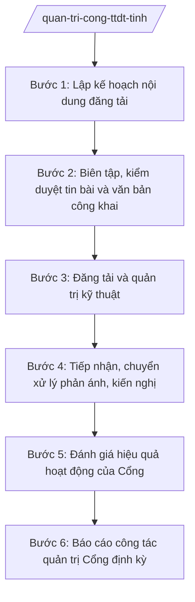

# Skill: Quản trị Cổng thông tin điện tử tỉnh

## 2. Khi nào dùng

- Lập kế hoạch đăng tải nội dung hằng tháng/quý trên Cổng thông tin điện tử tỉnh.
- Biên tập, kiểm duyệt tin bài về hoạt động chỉ đạo, điều hành của Tỉnh ủy, HĐND, UBND tỉnh.
- Công khai văn bản: văn bản QPPL của HĐND/UBND tỉnh, văn bản chỉ đạo, điều hành, danh mục TTHC, kết quả giải quyết KNTC, thông tin đấu thầu, quy hoạch...
- Tiếp nhận phản ánh, kiến nghị của cá nhân, tổ chức qua Cổng; chuyển cơ quan có thẩm quyền xử lý, theo dõi kết quả trả lời.
- Đánh giá hiệu quả hoạt động của Cổng (lượt truy cập, tin bài, phản ánh được xử lý).
- Báo cáo công tác quản trị Cổng thông tin điện tử tỉnh định kỳ.

## 3. Đầu vào (Input)

| Trường | Mô tả | Bắt buộc |
|--------|-------|----------|
| `ke_hoach_tuyen_truyen_cua_tinh` | Định hướng tuyên truyền, các sự kiện, nhiệm vụ trọng tâm cần đăng tải | Không |
| `tin_bai_tai_lieu_nguon` | Tin bài do các sở, ban, ngành, UBND xã gửi; tài liệu từ các cuộc họp, sự kiện | Có |
| `van_ban_can_cong_khai` | Văn bản QPPL, văn bản chỉ đạo, TTHC, thông tin phải công khai theo quy định | Có |
| `phan_anh_kien_nghi_qua_cong` | Phản ánh, kiến nghị của cá nhân, tổ chức gửi qua chuyên mục trên Cổng | Không |
| `so_lieu_van_hanh_cong` | Lượt truy cập, số tin bài đã đăng, số phản ánh đã xử lý | Không |
| `quy_che_quan_tri_cong` | Quy chế quản lý, vận hành Cổng thông tin điện tử tỉnh | Có |

## 4. Quy trình

**Bước 1. Lập kế hoạch nội dung đăng tải**

- Làm gì: Căn cứ kế hoạch tuyên truyền của tỉnh và nhiệm vụ trọng tâm (kỳ họp HĐND, phiên họp UBND, sự kiện lớn, văn bản mới ban hành cần công khai); lập kế hoạch nội dung tháng/quý: chuyên mục, số lượng tin bài, văn bản công khai, đơn vị cung cấp.
- Dùng input: `ke_hoach_tuyen_truyen_cua_tinh`, `quy_che_quan_tri_cong`.
- Vai trò: Chuyên viên Văn phòng UBND tỉnh lập kế hoạch AI hỗ trợ: rà soát nhiệm vụ trọng tâm cần tuyên truyền, lập lịch đăng tải, phân công đơn vị cung cấp tin; Trưởng phòng duyệt; Chánh Văn phòng phê duyệt ⏱ ~3 ngày làm việc (ước tính).
- Lưu ý nghiệp vụ: Kế hoạch phải bảo đảm các văn bản bắt buộc công khai được đăng kịp thời; phân công rõ đơn vị chịu trách nhiệm cung cấp tin bài từng lĩnh vực.
- → Kết quả bước: Kế hoạch nội dung Cổng thông tin điện tử tỉnh (tháng/quý).

**Bước 2. Biên tập, kiểm duyệt tin bài và văn bản công khai**

- Làm gì: Biên tập tin bài do các đơn vị gửi (ngôn ngữ, hình ảnh, tính chính xác); kiểm duyệt nội dung trước khi đăng: đúng sự thật, không lộ bí mật nhà nước, đúng quan điểm, đường lối; kiểm tra văn bản công khai đúng bản chính, còn hiệu lực.
- Dùng input: `tin_bai_tai_lieu_nguon`; `van_ban_can_cong_khai`.
- Vai trò: Biên tập viên kiểm duyệt AI hỗ trợ: rà soát lỗi chính tả, ngữ pháp, phát hiện nội dung nhạy cảm cần xin ý kiến, đối chiếu văn bản công khai với bản chính; Trưởng phòng duyệt đăng. ⏱ ~hằng ngày (ước tính).
- Lưu ý nghiệp vụ: Người duyệt đăng chịu trách nhiệm về nội dung; tin bài về chủ trương, chính sách phải đúng tinh thần văn bản gốc; tuyệt đối không đăng thông tin chưa kiểm chứng, thông tin mật.
- → Kết quả bước: Tin bài, văn bản đã biên tập, kiểm duyệt, sẵn sàng đăng tải.

**Bước 3. Đăng tải và quản trị kỹ thuật**

- Làm gì: Đăng tải tin bài, văn bản lên đúng chuyên mục của Cổng; cập nhật, gỡ bỏ văn bản hết hiệu lực; phối hợp với cơ quan chuyên môn về công nghệ thông tin bảo đảm Cổng hoạt động ổn định, an toàn thông tin; sao lưu dữ liệu định kỳ.
- Dùng input: Tin bài, văn bản đã kiểm duyệt (bước 2).
- Vai trò: Quản trị viên Cổng đăng tải AI hỗ trợ: kiểm tra liên kết hỏng, văn bản hết hiệu lực cần gỡ, nhắc lịch sao lưu; phối hợp Sở Khoa học và Công nghệ về an toàn thông tin mạng. ⏱ ~hằng ngày (ước tính).
- Lưu ý nghiệp vụ: Văn bản hết hiệu lực phải được gỡ hoặc đánh dấu rõ trạng thái; sự cố kỹ thuật, mất an toàn thông tin phải xử lý ngay và báo cáo theo quy định.
- → Kết quả bước: Nội dung đã đăng tải đúng chuyên mục; Cổng hoạt động ổn định, an toàn.

**Bước 4. Tiếp nhận, chuyển xử lý phản ánh, kiến nghị**

- Làm gì: Tiếp nhận phản ánh, kiến nghị của cá nhân, tổ chức qua chuyên mục trên Cổng; phân loại, chuyển đến cơ quan có thẩm quyền xử lý; theo dõi thời hạn trả lời; đăng tải công khai kết quả trả lời (trừ nội dung mật, riêng tư).
- Dùng input: `phan_anh_kien_nghi_qua_cong`.
- Vai trò: Chuyên viên tiếp nhận, phân loại AI hỗ trợ: phân loại theo lĩnh vực, gợi ý cơ quan có thẩm quyền, theo dõi thời hạn trả lời, nhắc đơn vị chậm trả lời; Trưởng phòng đôn đốc. ⏱ ~hằng ngày (ước tính).
- Lưu ý nghiệp vụ: Phải trả lời 100% phản ánh, kiến nghị đúng thời hạn; bảo vệ thông tin cá nhân của người phản ánh theo quy định.
- → Kết quả bước: Phản ánh, kiến nghị được chuyển xử lý và có kết quả trả lời công khai.

**Bước 5. Đánh giá hiệu quả hoạt động của Cổng**

- Làm gì: Tổng hợp số liệu: lượt truy cập, số tin bài đã đăng theo chuyên mục, số văn bản công khai, số phản ánh tiếp nhận/đã trả lời đúng hạn; khảo sát mức độ hài lòng của người dùng; đánh giá, rút kinh nghiệm.
- Dùng input: `so_lieu_van_hanh_cong`, kết quả xử lý phản ánh (bước 4).
- Vai trò: Chuyên viên tổng hợp AI hỗ trợ: tổng hợp số liệu tự động, phân tích xu hướng truy cập, so sánh với kỳ trước; Trưởng phòng đánh giá. ⏱ ~hằng tháng/quý (ước tính).
- Lưu ý nghiệp vụ: Đánh giá phải chỉ ra được điểm mạnh, điểm yếu cụ thể (chuyên mục ít người đọc, phản ánh chậm trả lời) để có giải pháp cải tiến.
- → Kết quả bước: Báo cáo đánh giá hiệu quả hoạt động của Cổng.

**Bước 6. Báo cáo công tác quản trị Cổng định kỳ**

- Làm gì: Soạn báo cáo công tác quản trị Cổng thông tin điện tử tỉnh (tháng, quý, năm): kết quả đăng tải, công khai văn bản, xử lý phản ánh, đánh giá hiệu quả, tồn tại và đề xuất; gửi lãnh đạo Văn phòng UBND tỉnh và cơ quan có liên quan.
- Dùng input: Kế hoạch nội dung, báo cáo đánh giá hiệu quả (bước 5).
- Vai trò: Chuyên viên soạn báo cáo AI hỗ trợ: tổng hợp số liệu, soạn dự thảo báo cáo; Trưởng phòng thẩm định; Chánh Văn phòng UBND tỉnh ký báo cáo. ⏱ ~định kỳ (ước tính).
- Lưu ý nghiệp vụ: Báo cáo trung thực, số liệu khớp với hệ thống quản trị Cổng; đề xuất phải cụ thể, khả thi.
- → Kết quả bước: Báo cáo công tác quản trị Cổng thông tin điện tử tỉnh định kỳ.

## Luồng quy trình (Workflow)

## 5. Đầu ra (Output)

- Kế hoạch nội dung Cổng thông tin điện tử tỉnh (tháng/quý).
- Tin bài đã biên tập, kiểm duyệt, đăng tải.
- Văn bản được công khai trên Cổng.
- Kết quả trả lời phản ánh, kiến nghị qua Cổng.
- Báo cáo đánh giá hiệu quả hoạt động của Cổng (sản phẩm chính).
- Báo cáo công tác quản trị Cổng định kỳ.

**Cấu trúc output chuẩn:**

**BÁO CÁO ĐÁNH GIÁ HIỆU QUẢ HOẠT ĐỘNG CỔNG THÔNG TIN ĐIỆN TỬ TỈNH A** — các phần bắt buộc theo đúng thứ tự, đúng thể thức văn bản hành chính theo NĐ 30/2020/NĐ-CP:

1. Quốc hiệu "CỘNG HÒA XÃ HỘI CHỦ NGHĨA VIỆT NAM", Tiêu ngữ "Độc lập – Tự do – Hạnh phúc".
2. Tên cơ quan ban hành: VĂN PHÒNG ỦY BAN NHÂN DÂN TỈNH A. Số, ký hiệu văn bản; địa danh và thời gian ban hành.
3. Tên loại và trích yếu: BÁO CÁO — Đánh giá hiệu quả hoạt động Cổng thông tin điện tử tỉnh A (quý ... năm ...).
4. Căn cứ (quy chế quản trị Cổng; kế hoạch nội dung; quy định về công khai thông tin...).
5. Kết quả thực hiện: số tin bài đã đăng theo chuyên mục; số văn bản công khai (QPPL, chỉ đạo, TTHC...); lượt truy cập; số phản ánh, kiến nghị tiếp nhận và tỷ lệ trả lời đúng hạn.
6. Đánh giá: ưu điểm; tồn tại, hạn chế và nguyên nhân.
7. Phương hướng, nhiệm vụ kỳ tới; kiến nghị, đề xuất.
8. Nơi nhận; ký, đóng dấu (Chánh Văn phòng UBND tỉnh).

## 6. Checklist nghiệm thu

1. Kế hoạch nội dung được phê duyệt, phân công rõ đơn vị cung cấp tin bài.
2. 100% tin bài trước khi đăng được biên tập, kiểm duyệt; không đăng thông tin chưa kiểm chứng, thông tin mật.
3. Văn bản bắt buộc công khai được đăng kịp thời, đúng bản chính; văn bản hết hiệu lực được gỡ/đánh dấu.
4. Cổng hoạt động ổn định; sự cố kỹ thuật, mất an toàn thông tin được xử lý, báo cáo kịp thời.
5. 100% phản ánh, kiến nghị qua Cổng được chuyển xử lý và trả lời đúng thời hạn; thông tin cá nhân người phản ánh được bảo vệ.
6. Báo cáo đánh giá hiệu quả có số liệu cụ thể, chỉ ra tồn tại và giải pháp cải tiến.
7. Báo cáo định kỳ đầy đủ, đúng hạn; thể thức văn bản đúng NĐ 30/2020/NĐ-CP.

## 7. Ví dụ mô phỏng

*Dữ liệu dưới đây là giả lập 100% phục vụ minh họa.*

**Input mẫu:**

| Trường | Giá trị mẫu |
|--------|-------------|
| Kế hoạch tuyên truyền của tỉnh | Quý IV/2027: tuyên truyền kỳ họp HĐND cuối năm, kết quả KT-XH năm 2027, kế hoạch năm 2028 |
| Tin bài, tài liệu nguồn | 120 tin bài do 10 sở và 5 UBND xã gửi trong quý |
| Văn bản cần công khai | 15 văn bản QPPL của HĐND/UBND tỉnh, 30 văn bản chỉ đạo, danh mục 50 TTHC sửa đổi |
| Phản ánh, kiến nghị qua Cổng | 80 phản ánh trong quý (60 về TTHC, 20 về hạ tầng, môi trường) |
| Số liệu vận hành Cổng | 500.000 lượt truy cập/quý; 350 tin bài đã đăng |
| Quy chế quản trị Cổng | Quy chế quản lý, vận hành Cổng thông tin điện tử tỉnh A (ban hành năm 2026) |

**Output mẫu (trích Báo cáo đánh giá quý IV/2027):**

**VĂN PHÒNG ỦY BAN NHÂN DÂN TỈNH A**

Số: 1234/BC-VPUBND
Tỉnh A, ngày 05 tháng 1 năm 2028

**BÁO CÁO**
**Đánh giá hiệu quả hoạt động Cổng thông tin điện tử tỉnh A quý IV/2027**

*Căn cứ Quy chế quản lý, vận hành Cổng thông tin điện tử tỉnh A;*

**I. KẾT QUẢ THỰC HIỆN**
1. Đăng tải 350 tin bài (đạt 117% kế hoạch); công khai 15 văn bản QPPL, 30 văn bản chỉ đạo, 50 TTHC sửa đổi.
2. 500.000 lượt truy cập (tăng 10% so với quý III).
3. Tiếp nhận 80 phản ánh, kiến nghị; đã trả lời 78 (đúng hạn 75), đang xử lý 2.

**II. ĐÁNH GIÁ**
- Ưu điểm: nội dung cập nhật kịp thời kỳ họp HĐND; tỷ lệ trả lời phản ánh đạt 97,5%.
- Tồn tại: 3 phản ánh quá hạn tại 2 sở; chuyên mục văn bản QPPL khó tra cứu.

**III. PHƯƠNG HƯỚNG QUÝ I/2028**
Nâng cấp chức năng tìm kiếm văn bản; đôn đốc 2 sở trả lời dứt điểm 3 phản ánh quá hạn...

*Nơi nhận:* ...
**CHÁNH VĂN PHÒNG**
(Ký, đóng dấu — bà Vũ Thị T)

## 8. Human gate (người kiểm duyệt)

- Biên tập viên biên tập tin bài → Trưởng phòng kiểm duyệt nội dung, duyệt đăng → Chánh Văn phòng UBND tỉnh chịu trách nhiệm chung về nội dung Cổng.
- Tin bài về chủ trương, chính sách lớn hoặc nội dung nhạy cảm phải xin ý kiến lãnh đạo UBND tỉnh trước khi đăng.

## 9. Giới hạn (guardrails)

- AI không quyết định đăng tải tin bài thay người kiểm duyệt; không tự đăng nội dung lên Cổng.
- AI không trả lời phản ánh, kiến nghị của cá nhân, tổ chức thay cơ quan có thẩm quyền.
- AI không để lộ bí mật nhà nước, thông tin cá nhân trong quá trình biên tập, đăng tải.
- AI không bịa đặt tin bài, số liệu; mọi nội dung đăng tải phải có nguồn rõ ràng, đã kiểm chứng.

## 10. Căn cứ & lưu ý

- NĐ 150/2025/NĐ-CP: Văn phòng UBND tỉnh là cơ quan chuyên môn thuộc UBND cấp tỉnh, tham mưu quản lý Cổng thông tin điện tử tỉnh.
- NĐ 118/2025/NĐ-CP: công khai TTHC, kết quả giải quyết TTHC trên Cổng thông tin điện tử (liên quan nội dung công khai).
- NĐ 30/2020/NĐ-CP: thể thức và kỹ thuật trình bày văn bản hành chính.
- Việc công khai thông tin, tiếp nhận và trả lời phản ánh, kiến nghị thực hiện theo quy định hiện hành của pháp luật (không gắn số hiệu cụ thể do chưa xác thực trong tài liệu).
