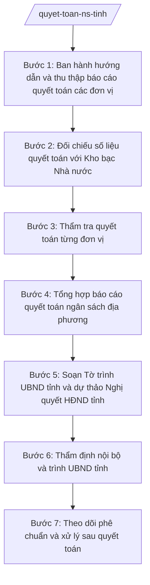

# Skill: Quyết toán ngân sách địa phương

## 2. Khi nào dùng

- Kết thúc năm ngân sách, cần tổng hợp báo cáo quyết toán của các sở, ban, ngành, đơn vị dự toán cấp I và UBND cấp xã;
- Cần đối chiếu số liệu quyết toán với Kho bạc Nhà nước trước khi trình;
- UBND tỉnh A cần Tờ trình và dự thảo Nghị quyết để trình HĐND tỉnh phê chuẩn quyết toán ngân sách địa phương tại kỳ họp giữa năm;
- Cần theo dõi, đôn đốc xử lý các kiến nghị sau phê chuẩn quyết toán (kết luận kiểm toán, thanh tra).

## 3. Đầu vào (Input)

| Trường | Mô tả | Bắt buộc |
|--------|-------|----------|
| `nam_quyet_toan` | Năm ngân sách cần quyết toán (năm N, đã kết thúc) | Có |
| `bao_cao_quyet_toan_don_vi` | Báo cáo quyết toán năm N của các sở, ban, ngành, đơn vị dự toán cấp I và UBND cấp xã | Có |
| `so_lieu_kho_bac` | Số liệu thu–chi thực hiện năm N do Kho bạc Nhà nước cung cấp (để đối chiếu) | Có |
| `du_toan_nam_n` | Dự toán năm N đã được HĐND tỉnh quyết nghị và các lần điều chỉnh, bổ sung trong năm | Có |
| `ket_luan_kiem_toan` | Kết luận kiểm toán, thanh tra liên quan đến ngân sách năm N (nếu có) | Không |
| `huong_dan_quyet_toan` | Văn bản hướng dẫn lập báo cáo quyết toán của Bộ Tài chính, Sở Tài chính tỉnh A | Có |

## 4. Quy trình

**Bước 1. Ban hành hướng dẫn và thu thập báo cáo quyết toán các đơn vị**
- Làm gì: Soạn văn bản hướng dẫn các đơn vị lập, gửi báo cáo quyết toán năm N đúng biểu mẫu, thời hạn; tiếp nhận, đăng ký đầy đủ báo cáo quyết toán các đơn vị, lập danh sách theo dõi tiến độ.
- Dùng input: `huong_dan_quyet_toan`, `nam_quyet_toan`.
- Vai trò: Chuyên viên Phòng Ngân sách soạn thảo, AI hỗ trợ dựng khung văn bản hướng dẫn và bảng theo dõi tiến độ nộp báo cáo; ⏱ ~2–3 ngày làm việc (ước tính).
- Lưu ý nghiệp vụ: Yêu cầu các đơn vị gửi kèm thuyết minh quyết toán và giải trình các khoản chênh lệch lớn so với dự toán; đôn đốc đơn vị nộp đúng hạn.
- → Kết quả bước: Văn bản hướng dẫn đã ban hành + danh sách theo dõi báo cáo quyết toán các đơn vị.

**Bước 2. Đối chiếu số liệu quyết toán với Kho bạc Nhà nước**
- Làm gì: Đối chiếu từng khoản thu–chi trong báo cáo quyết toán của các đơn vị với số liệu hạch toán của Kho bạc Nhà nước; lập bảng chênh lệch, yêu cầu đơn vị giải trình, điều chỉnh đến khi khớp.
- Dùng input: `bao_cao_quyet_toan_don_vi`, `so_lieu_kho_bac`.
- Vai trò: Chuyên viên Phòng Ngân sách đối chiếu, AI hỗ trợ so khớp số liệu hàng loạt, liệt kê các khoản chênh lệch cần giải trình; ⏱ ~3–5 ngày làm việc (ước tính).
- Lưu ý nghiệp vụ: Số liệu quyết toán phải khớp với số liệu Kho bạc; mọi chênh lệch chưa giải trình được thì chưa được tổng hợp vào báo cáo chung.
- → Kết quả bước: Bảng đối chiếu quyết toán – Kho bạc đã khớp, kèm giải trình các chênh lệch.

**Bước 3. Thẩm tra quyết toán từng đơn vị**
- Làm gì: Thẩm tra tính hợp pháp, hợp lệ của các khoản chi trong báo cáo quyết toán từng đơn vị: đúng chế độ, định mức, đúng mục đích, đúng dự toán được giao; phát hiện các khoản chi sai chế độ, chi vượt dự toán; lập biên bản thẩm tra.
- Dùng input: `bao_cao_quyet_toan_don_vi`, `du_toan_nam_n`, `ket_luan_kiem_toan`.
- Vai trò: Chuyên viên Phòng Ngân sách thẩm tra, AI hỗ trợ đối chiếu chi thực tế với dự toán được giao, cảnh báo các khoản vượt định mức, sai chế độ; ⏱ ~5–7 ngày làm việc (ước tính).
- Lưu ý nghiệp vụ: Các khoản chi sai chế độ phải được kiến nghị xử lý (thu hồi, giảm trừ); kết luận kiểm toán, thanh tra là căn cứ quan trọng khi thẩm tra.
- → Kết quả bước: Biên bản thẩm tra quyết toán từng đơn vị + kiến nghị xử lý các sai phạm (nếu có).

**Bước 4. Tổng hợp báo cáo quyết toán ngân sách địa phương**
- Làm gì: Tổng hợp số liệu quyết toán đã thẩm tra thành báo cáo quyết toán ngân sách địa phương năm N: tổng thu NSNN trên địa bàn, tổng thu–chi ngân sách địa phương theo từng cấp ngân sách, đánh giá kết quả thực hiện so với dự toán, thuyết minh các biến động lớn.
- Dùng input: Kết quả Bước 2, Bước 3.
- Vai trò: Chuyên viên Phòng Ngân sách tổng hợp, AI hỗ trợ lập các biểu quyết toán và soạn phần thuyết minh, tính toán tỷ lệ thực hiện/dự toán; ⏱ ~3–4 ngày làm việc (ước tính).
- Lưu ý nghiệp vụ: Số liệu tổng hợp phải khớp tuyệt đối với báo cáo quyết toán các đơn vị sau thẩm tra; thuyết minh phải làm rõ nguyên nhân các khoản chênh lệch lớn.
- → Kết quả bước: Dự thảo báo cáo quyết toán ngân sách địa phương năm N (bản nháp).

**Bước 5. Soạn Tờ trình UBND tỉnh và dự thảo Nghị quyết HĐND tỉnh**
- Làm gì: Soạn Tờ trình của UBND tỉnh trình HĐND tỉnh phê chuẩn quyết toán ngân sách địa phương năm N và dự thảo Nghị quyết HĐND tỉnh phê chuẩn quyết toán, kèm các biểu quyết toán và kiến nghị xử lý sau quyết toán.
- Dùng input: Kết quả Bước 4, `nam_quyet_toan`.
- Vai trò: Chuyên viên Phòng Ngân sách soạn thảo, AI hỗ trợ dựng khung văn bản đúng thể thức, rà soát căn cứ pháp lý, đối chiếu số liệu văn bản – biểu mẫu; ⏱ ~2–3 ngày làm việc (ước tính).
- Lưu ý nghiệp vụ: Tờ trình phải nêu rõ kết quả thẩm tra, các kiến nghị xử lý và trách nhiệm của các đơn vị; số liệu trong văn bản phải khớp tuyệt đối với biểu quyết toán.
- → Kết quả bước: Bản thảo Tờ trình UBND tỉnh + dự thảo Nghị quyết HĐND tỉnh + bộ biểu quyết toán.

**Bước 6. Thẩm định nội bộ và trình UBND tỉnh**
- Làm gì: Trưởng phòng Ngân sách và Phó Giám đốc Sở phụ trách rà soát toàn bộ hồ sơ quyết toán; Giám đốc Sở Tài chính (ông Hoàng Văn S) xem xét, ký Tờ trình của Sở trình UBND tỉnh; hoàn thiện hồ sơ theo ý kiến chỉ đạo.
- Dùng input: Toàn bộ kết quả Bước 5.
- Vai trò: Trưởng phòng, Phó Giám đốc, Giám đốc Sở kiểm tra và quyết định; AI hỗ trợ đối chiếu chéo số liệu và liệt kê điểm chưa khớp; ⏱ ~2–3 ngày làm việc (ước tính).
- Lưu ý nghiệp vụ: AI chỉ hỗ trợ kỹ thuật; quyết định nội dung báo cáo quyết toán thuộc thẩm quyền của lãnh đạo Sở và UBND tỉnh.
- → Kết quả bước: Tờ trình trình UBND tỉnh đã ký, sẵn sàng trình kỳ họp HĐND tỉnh.

**Bước 7. Theo dõi phê chuẩn và xử lý sau quyết toán**
- Làm gì: Theo dõi kỳ họp HĐND tỉnh; ghi nhận Nghị quyết phê chuẩn quyết toán (số hiệu, nội dung); đôn đốc các đơn vị thực hiện kiến nghị xử lý sau quyết toán (thu hồi, nộp ngân sách, chấn chỉnh); lưu hồ sơ quyết toán đầy đủ.
- Dùng input: Nghị quyết HĐND tỉnh phê chuẩn quyết toán (bản chính thức sau kỳ họp).
- Vai trò: Chuyên viên Phòng Ngân sách theo dõi, đôn đốc; AI hỗ trợ lập bảng theo dõi thực hiện kiến nghị theo đơn vị và thời hạn; ⏱ ~1–2 ngày làm việc (ước tính), theo dõi kéo dài đến khi xử lý xong.
- Lưu ý nghiệp vụ: Quyết toán chỉ hoàn tất khi các kiến nghị xử lý được thực hiện đầy đủ; phải báo cáo UBND tỉnh kết quả xử lý.
- → Kết quả bước: Nghị quyết phê chuẩn quyết toán đã ban hành + bảng theo dõi xử lý kiến nghị sau quyết toán.

## Luồng quy trình (Workflow)

## 5. Đầu ra (Output)

- Văn bản hướng dẫn các đơn vị lập báo cáo quyết toán năm N;
- Bảng đối chiếu quyết toán – Kho bạc Nhà nước;
- Biên bản thẩm tra quyết toán từng đơn vị + kiến nghị xử lý;
- Tờ trình của UBND tỉnh trình HĐND tỉnh phê chuẩn quyết toán ngân sách địa phương năm N (đã ký);
- Dự thảo Nghị quyết của HĐND tỉnh phê chuẩn quyết toán ngân sách địa phương năm N;
- Các biểu quyết toán ngân sách địa phương năm N kèm theo;
- Nghị quyết HĐND tỉnh phê chuẩn quyết toán (bản chính thức — do HĐND ban hành, Sở lưu hồ sơ).

**Cấu trúc output chuẩn (Tờ trình UBND tỉnh về phê chuẩn quyết toán):**
- Thể thức: tuân thủ Nghị định 30/2020/NĐ-CP về công tác văn thư.

1. Quốc hiệu "CỘNG HÒA XÃ HỘI CHỦ NGHĨA VIỆT NAM", Tiêu ngữ "Độc lập – Tự do – Hạnh phúc";
2. Tên cơ quan ban hành: ỦY BAN NHÂN DÂN TỈNH A; số, ký hiệu văn bản; địa danh và ngày, tháng, năm ban hành;
3. Tên loại và trích yếu nội dung: TỜ TRÌNH — Về việc đề nghị HĐND tỉnh phê chuẩn quyết toán ngân sách địa phương năm N;
4. Phần "Kính gửi": Hội đồng nhân dân tỉnh A;
5. Căn cứ ban hành (Luật Ngân sách nhà nước; văn bản hướng dẫn của Bộ Tài chính...);
6. Nội dung: kết quả thực hiện dự toán năm N (tổng thu NSNN trên địa bàn, tổng thu–chi ngân sách địa phương); kết quả thẩm tra quyết toán các đơn vị; kiến nghị xử lý sau quyết toán; đề nghị HĐND phê chuẩn;
7. Nơi nhận;
8. Thẩm quyền, chức vụ, họ tên người ký: TM. ỦY BAN NHÂN DÂN — CHỦ TỊCH — (chữ ký, họ tên), dấu của cơ quan.

**Cấu trúc output chuẩn (Nghị quyết HĐND tỉnh phê chuẩn quyết toán):**

1. Quốc hiệu "CỘNG HÒA XÃ HỘI CHỦ NGHĨA VIỆT NAM", Tiêu ngữ "Độc lập – Tự do – Hạnh phúc";
2. Tên cơ quan ban hành: HỘI ĐỒNG NHÂN DÂN TỈNH A; số, ký hiệu văn bản; địa danh và ngày, tháng, năm ban hành;
3. Tên loại và trích yếu: NGHỊ QUYẾT — Về việc phê chuẩn quyết toán ngân sách địa phương năm N;
4. Căn cứ ban hành (Luật Tổ chức chính quyền địa phương; Luật Ngân sách nhà nước; Tờ trình của UBND tỉnh...);
5. Nội dung quyết nghị theo điều, khoản: phê chuẩn tổng thu–chi quyết toán; giao UBND tỉnh tổ chức thực hiện các kiến nghị xử lý; hiệu lực thi hành;
6. Nơi nhận;
7. Thẩm quyền, chức vụ, họ tên người ký: TM. HỘI ĐỒNG NHÂN DÂN — CHỦ TỊCH — (chữ ký, họ tên), dấu của cơ quan;
8. Các biểu quyết toán kèm theo Nghị quyết.

## 6. Checklist nghiệm thu

- [ ] 100% đơn vị dự toán cấp I và UBND cấp xã đã nộp báo cáo quyết toán và được thẩm tra;
- [ ] Số liệu quyết toán đã đối chiếu khớp với Kho bạc Nhà nước, có giải trình mọi chênh lệch;
- [ ] Có đầy đủ: bảng đối chiếu, biên bản thẩm tra từng đơn vị, Tờ trình, dự thảo Nghị quyết + bộ biểu;
- [ ] Số liệu trong Tờ trình, dự thảo Nghị quyết và biểu mẫu khớp nhau tuyệt đối;
- [ ] Các khoản chi sai chế độ, vượt dự toán đã được kiến nghị xử lý cụ thể;
- [ ] Căn cứ pháp lý đầy đủ, đúng văn bản còn hiệu lực, không bịa số hiệu;
- [ ] Thể thức văn bản hành chính đúng quy định;
- [ ] Đã qua thẩm định nội bộ (Trưởng phòng, Phó Giám đốc, Giám đốc Sở) trước khi trình UBND tỉnh;
- [ ] Số liệu do đơn vị và Kho bạc cung cấp, AI không tự bịa thêm;
- [ ] Có bảng theo dõi thực hiện kiến nghị xử lý sau quyết toán.

## 7. Ví dụ mô phỏng

*Dữ liệu dưới đây là giả lập 100% phục vụ minh họa.*

### Input mẫu

| Trường | Giá trị giả lập |
|--------|-----------------|
| nam_quyet_toan | 2026 |
| bao_cao_quyet_toan_don_vi | 20 sở, ban, ngành và 30 UBND cấp xã đã nộp báo cáo quyết toán năm 2026 |
| so_lieu_kho_bac | Tổng thu NSNN trên địa bàn năm 2026: 10.000 tỷ đồng; tổng chi ngân sách địa phương: 9.800 tỷ đồng |
| du_toan_nam_n | Dự toán năm 2026 đã quyết nghị và điều chỉnh: tổng thu–chi 9.900 tỷ đồng |
| ket_luan_kiem_toan | Kết luận kiểm toán giả lập: 3 đơn vị chi sai chế độ, tổng số tiền 5 tỷ đồng |
| huong_dan_quyet_toan | Văn bản số 456/HD-STC ngày 01/02/2027 của Sở Tài chính tỉnh A |

### Output mẫu (Tờ trình — trích)

> **CỘNG HÒA XÃ HỘI CHỦ NGHĨA VIỆT NAM**
> **Độc lập – Tự do – Hạnh phúc**
>
> **ỦY BAN NHÂN DÂN TỈNH A**
> Số: 1234/TTr-UBND
> Tỉnh A, ngày 10 tháng 5 năm 2027
>
> **TỜ TRÌNH**
> **Về việc đề nghị HĐND tỉnh phê chuẩn quyết toán ngân sách địa phương năm 2026**
>
> Kính gửi: Hội đồng nhân dân tỉnh A.
>
> Căn cứ Luật Ngân sách nhà nước;
> UBND tỉnh A trình HĐND tỉnh phê chuẩn quyết toán ngân sách địa phương năm 2026 như sau:
>
> 1. Tổng thu ngân sách nhà nước trên địa bàn: 10.000 tỷ đồng (đạt 101% dự toán)...
> 2. Tổng thu ngân sách địa phương: 10.000 tỷ đồng; tổng chi ngân sách địa phương: 9.800 tỷ đồng...
> 3. Kiến nghị xử lý: thu hồi nộp ngân sách 5 tỷ đồng chi sai chế độ tại 3 đơn vị...
>
> UBND tỉnh A kính trình HĐND tỉnh xem xét, phê chuẩn./.
>
> ***Nơi nhận:*** ...
>
> **TM. ỦY BAN NHÂN DÂN**
> **CHỦ TỊCH**
> *(ký, đóng dấu)*
> **Phạm Văn P**

## 8. Human gate

1. Chuyên viên Phòng Ngân sách tổng hợp, đối chiếu, thẩm tra và soạn thảo hồ sơ (Bước 1–5);
2. Trưởng phòng Ngân sách và Phó Giám đốc Sở phụ trách thẩm định nội bộ (Bước 6);
3. Giám đốc Sở Tài chính xem xét, ký Tờ trình trình UBND tỉnh (Bước 6);
4. UBND tỉnh thảo luận, trình HĐND tỉnh; HĐND tỉnh phê chuẩn bằng Nghị quyết tại kỳ họp giữa năm (Bước 7) — quyết định cuối cùng thuộc thẩm quyền HĐND tỉnh.

## 9. Giới hạn

- AI KHÔNG ra quyết định về nội dung quyết toán hay kiến nghị xử lý thay người có thẩm quyền;
- AI KHÔNG tự ký, tự phát hành Tờ trình, Nghị quyết hay bất kỳ văn bản nào;
- AI KHÔNG bịa số liệu quyết toán, không tự điều chỉnh số liệu để "khớp" với Kho bạc;
- AI KHÔNG bịa căn cứ pháp lý, không trích dẫn văn bản đã hết hiệu lực;
- AI KHÔNG thay HĐND tỉnh phê chuẩn quyết toán — đây là thẩm quyền riêng của HĐND tỉnh.

## 10. Căn cứ & lưu ý

- Thông tư 57/2025/TT-BTC hướng dẫn chức năng, nhiệm vụ, quyền hạn của Sở Tài chính và lĩnh vực tài chính – kế hoạch của phòng chuyên môn thuộc UBND cấp xã;
- Luật Ngân sách nhà nước (chỉ nêu tên luật, không kèm số hiệu);
- Nghị định 150/2025/NĐ-CP về tổ chức cơ quan chuyên môn thuộc UBND cấp tỉnh, cấp xã;
- Nghị định 30/2020/NĐ-CP về công tác văn thư (chỉ dùng cho thể thức văn bản);
- Lưu ý: quyết toán ngân sách địa phương chỉ hoàn tất khi HĐND tỉnh ban hành Nghị quyết phê chuẩn và các kiến nghị xử lý sau quyết toán được thực hiện đầy đủ; cấp xã lập báo cáo quyết toán ngân sách xã theo hướng dẫn của Sở Tài chính tỉnh (xem skill `quyet-toan-ns-xa`).
