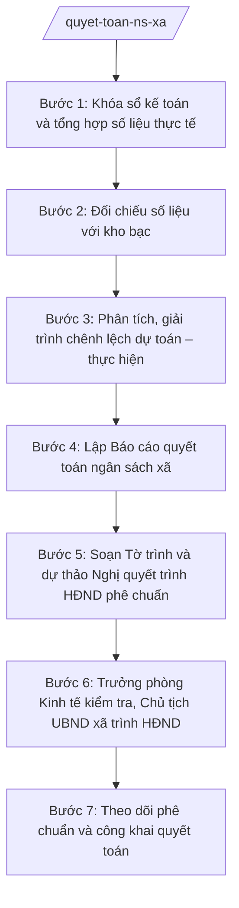

# Skill: Quyết toán ngân sách xã

## 2. Khi nào dùng

- Kết thúc năm ngân sách, cần lập báo cáo quyết toán ngân sách xã trình HĐND xã phê chuẩn;
- Cần đối chiếu số liệu thu–chi thực tế với sổ kế toán và số liệu kho bạc trước khi quyết toán;
- Cần giải trình các khoản chênh lệch lớn giữa dự toán được giao và số thực hiện;
- Cần soạn Tờ trình UBND xã và dự thảo Nghị quyết HĐND xã phê chuẩn quyết toán ngân sách năm N-1.

## 3. Đầu vào (Input)

| Trường | Mô tả | Bắt buộc |
|--------|-------|----------|
| `nam_quyet_toan` | Năm ngân sách cần quyết toán (năm N-1) | Có |
| `so_lieu_thu_thuc_te` | Số liệu thu ngân sách thực tế trong năm, chi tiết theo nguồn thu (từ sổ kế toán) | Có |
| `so_lieu_chi_thuc_te` | Số liệu chi ngân sách thực tế trong năm, chi tiết theo lĩnh vực/nhiệm vụ (từ sổ kế toán) | Có |
| `so_lieu_doi_chieu_kho_bac` | Số liệu đã đối chiếu với kho bạc (biên bản/xác nhận đối chiếu) | Có |
| `du_toan_duoc_giao` | Dự toán năm đã được HĐND xã quyết nghị (để so sánh, giải trình chênh lệch) | Có |
| `giai_trinh_chenh_lech` | Dự thảo giải trình các khoản chênh lệch chủ yếu giữa dự toán và thực hiện | Không |
| `ton_quy_cuoi_nam` | Số dư quỹ ngân sách xã cuối năm (nếu có) | Không |

## 4. Quy trình

**Bước 1. Khóa sổ kế toán và tổng hợp số liệu thực tế**
- Làm gì: Khóa sổ kế toán ngân sách xã năm N-1; tổng hợp toàn bộ số liệu thu–chi thực tế phát sinh trong năm, chi tiết theo từng nguồn thu, từng lĩnh vực chi theo mục lục ngân sách nhà nước.
- Dùng input: `so_lieu_thu_thuc_te`, `so_lieu_chi_thuc_te`, `nam_quyet_toan`.
- Vai trò: Công chức tài chính – kế toán xã thực hiện, AI hỗ trợ tổng hợp, phân loại số liệu thành bảng biểu; ⏱ ~2–3 ngày làm việc (ước tính).
- Lưu ý nghiệp vụ: Số liệu phải lấy nguyên trạng từ sổ kế toán đã khóa sổ; tuyệt đối không điều chỉnh số liệu để "làm đẹp" báo cáo.
- → Kết quả bước: Bảng tổng hợp thu–chi thực tế năm N-1 từ sổ kế toán.

**Bước 2. Đối chiếu số liệu với kho bạc**
- Làm gì: Đối chiếu số liệu thu–chi trên sổ kế toán của xã với số liệu tại kho bạc nơi giao dịch; lập biên bản đối chiếu, xử lý dứt điểm mọi chênh lệch (nếu có) trước khi lập báo cáo quyết toán.
- Dùng input: `so_lieu_doi_chieu_kho_bac`, kết quả Bước 1.
- Vai trò: Công chức tài chính – kế toán xã đối chiếu với kho bạc, AI hỗ trợ so sánh hai bộ số liệu và chỉ ra các điểm chênh lệch cần làm rõ; ⏱ ~1–2 ngày làm việc (ước tính).
- Lưu ý nghiệp vụ: Báo cáo quyết toán chỉ được lập trên số liệu đã khớp với kho bạc; chênh lệch chưa xử lý không được đưa vào quyết toán.
- → Kết quả bước: Biên bản đối chiếu với kho bạc; bộ số liệu thu–chi đã thống nhất.

**Bước 3. Phân tích, giải trình chênh lệch dự toán – thực hiện**
- Làm gì: So sánh số thực hiện với dự toán đã được HĐND xã quyết nghị; phân tích nguyên nhân các khoản chênh lệch lớn (vượt thu, hụt thu, tiết kiệm chi, chi vượt dự toán...); soạn phần thuyết minh, giải trình chênh lệch.
- Dùng input: `du_toan_duoc_giao`, `giai_trinh_chenh_lech`, kết quả Bước 2.
- Vai trò: Công chức tài chính – kế toán xã phân tích, AI hỗ trợ tính tỷ lệ chênh lệch, gợi ý khung giải trình theo từng nhóm nguyên nhân; ⏱ ~1–2 ngày làm việc (ước tính).
- Lưu ý nghiệp vụ: Mọi chênh lệch trọng yếu đều phải có giải trình cụ thể, có căn cứ; không được che giấu khoản chi vượt dự toán hoặc không đúng chế độ.
- → Kết quả bước: Bản phân tích, giải trình chênh lệch dự toán – thực hiện.

**Bước 4. Lập Báo cáo quyết toán ngân sách xã**
- Làm gì: Soạn Báo cáo quyết toán ngân sách xã năm N-1 gồm: đánh giá tình hình thực hiện dự toán, số liệu quyết toán thu–chi chi tiết, thuyết minh giải trình chênh lệch, tồn quỹ cuối năm và kiến nghị; kèm các biểu quyết toán theo quy định.
- Dùng input: Kết quả Bước 1–3; `ton_quy_cuoi_nam`.
- Vai trò: Công chức tài chính – kế toán xã soạn thảo, AI hỗ trợ dựng khung báo cáo, kiểm tra tính khớp số liệu giữa báo cáo và biểu mẫu; ⏱ ~2–3 ngày làm việc (ước tính).
- Lưu ý nghiệp vụ: Số liệu trong báo cáo và biểu quyết toán phải khớp tuyệt đối với số liệu đã đối chiếu kho bạc; báo cáo phải trung thực, đầy đủ.
- → Kết quả bước: Dự thảo Báo cáo quyết toán ngân sách xã năm N-1 kèm biểu quyết toán.

**Bước 5. Soạn Tờ trình và dự thảo Nghị quyết trình HĐND phê chuẩn**
- Làm gì: Soạn Tờ trình của UBND xã trình HĐND xã phê chuẩn quyết toán ngân sách năm N-1 và dự thảo Nghị quyết HĐND xã phê chuẩn quyết toán, kèm Báo cáo quyết toán và biểu số liệu.
- Dùng input: Kết quả Bước 4; `nam_quyet_toan`.
- Vai trò: Công chức tài chính – kế toán xã soạn thảo, AI hỗ trợ dựng văn bản đúng thể thức, rà soát căn cứ pháp lý; ⏱ ~1 ngày làm việc (ước tính).
- Lưu ý nghiệp vụ: Tờ trình phải nêu rõ tổng số thu, tổng số chi quyết toán và các nội dung đề nghị HĐND phê chuẩn; số liệu khớp với Báo cáo quyết toán.
- → Kết quả bước: Bản thảo Tờ trình UBND xã + dự thảo Nghị quyết HĐND xã phê chuẩn quyết toán.

**Bước 6. Trưởng phòng Kinh tế kiểm tra, Chủ tịch UBND xã trình HĐND**
- Làm gì: Trưởng phòng Kinh tế kiểm tra toàn bộ hồ sơ quyết toán (tính khớp số liệu sổ kế toán – kho bạc – báo cáo, tính đầy đủ của giải trình chênh lệch); Chủ tịch UBND xã xem xét, ký Tờ trình trình HĐND xã phê chuẩn tại kỳ họp.
- Dùng input: Toàn bộ kết quả Bước 4–5.
- Vai trò: Trưởng phòng Kinh tế kiểm tra, Chủ tịch UBND xã quyết định trình; AI hỗ trợ đối chiếu chéo số liệu và liệt kê điểm chưa khớp; ⏱ ~1–2 ngày làm việc (ước tính).
- Lưu ý nghiệp vụ: Đây là chốt kiểm soát cuối trước khi trình HĐND; quyết toán là văn bản có giá trị pháp lý xác nhận trách nhiệm quản lý ngân sách của UBND xã trong năm.
- → Kết quả bước: Hồ sơ quyết toán hoàn chỉnh, Tờ trình đã ký, sẵn sàng trình kỳ họp HĐND xã.

**Bước 7. Theo dõi phê chuẩn và công khai quyết toán**
- Làm gì: Theo dõi kết quả kỳ họp HĐND xã; sau khi Nghị quyết phê chuẩn quyết toán được ban hành, lưu hồ sơ và thực hiện công khai quyết toán ngân sách theo quy định.
- Dùng input: Nghị quyết HĐND xã phê chuẩn quyết toán (bản chính thức sau kỳ họp).
- Vai trò: Công chức tài chính – kế toán xã theo dõi, lưu hồ sơ và công khai, AI hỗ trợ trích xuất chỉ tiêu chính phục vụ công khai; ⏱ ~0 (ước tính),5–1 ngày làm việc.
- Lưu ý nghiệp vụ: Quyết toán đã được phê chuẩn phải được công khai theo quy định về công khai ngân sách; hồ sơ quyết toán lưu trữ đầy đủ phục vụ kiểm tra, kiểm toán.
- → Kết quả bước: Nghị quyết phê chuẩn quyết toán đã ban hành; hồ sơ quyết toán được lưu trữ và công khai.

## Luồng quy trình (Workflow)

## 5. Đầu ra (Output)

- Báo cáo quyết toán ngân sách xã năm N-1 (kèm biểu quyết toán thu–chi chi tiết);
- Tờ trình của UBND xã trình HĐND xã phê chuẩn quyết toán (đã ký);
- Dự thảo Nghị quyết của HĐND xã phê chuẩn quyết toán ngân sách xã năm N-1;
- Nghị quyết HĐND xã phê chuẩn quyết toán (bản chính thức sau kỳ họp — do HĐND ban hành, xã lưu hồ sơ).

### Cấu trúc output chuẩn (Báo cáo quyết toán ngân sách xã)

1. Quốc hiệu "CỘNG HÒA XÃ HỘI CHỦ NGHĨA VIỆT NAM" – Tiêu ngữ "Độc lập – Tự do – Hạnh phúc"; (đúng thể thức NĐ 30/2020/NĐ-CP)
2. Tên cơ quan ban hành: ỦY BAN NHÂN DÂN XÃ A; số, ký hiệu văn bản; địa danh và ngày, tháng, năm ban hành;
3. Tên loại và trích yếu: BÁO CÁO — Quyết toán ngân sách nhà nước xã A năm N-1;
4. Phần mở đầu: căn cứ lập báo cáo (Luật Ngân sách nhà nước; Nghị quyết HĐND xã về dự toán...);
5. Nội dung chính:
   - Đánh giá tình hình thực hiện dự toán ngân sách năm N-1;
   - Số liệu quyết toán thu ngân sách (chi tiết theo nguồn thu);
   - Số liệu quyết toán chi ngân sách (chi tiết theo lĩnh vực, nhiệm vụ);
   - Thuyết minh, giải trình chênh lệch giữa dự toán và thực hiện;
   - Tồn quỹ ngân sách cuối năm;
   - Kiến nghị;
6. Nơi nhận;
7. Thẩm quyền, chức vụ, họ tên người ký: TM. ỦY BAN NHÂN DÂN — CHỦ TỊCH — (chữ ký, họ tên), dấu của cơ quan;
8. Các biểu quyết toán thu–chi kèm theo.

### Cấu trúc output chuẩn (Tờ trình phê chuẩn quyết toán)

1. Quốc hiệu "CỘNG HÒA XÃ HỘI CHỦ NGHĨA VIỆT NAM" – Tiêu ngữ "Độc lập – Tự do – Hạnh phúc";
2. Tên cơ quan ban hành: ỦY BAN NHÂN DÂN XÃ A; số, ký hiệu văn bản; địa danh và ngày, tháng, năm ban hành;
3. Tên loại và trích yếu: TỜ TRÌNH — Về việc đề nghị HĐND xã phê chuẩn quyết toán ngân sách nhà nước xã A năm N-1;
4. Phần "Kính gửi": Hội đồng nhân dân xã A;
5. Căn cứ (Luật Ngân sách nhà nước; Nghị quyết HĐND xã về dự toán...);
6. Nội dung: tóm tắt kết quả thực hiện dự toán; tổng số thu, tổng số chi quyết toán; đề nghị HĐND phê chuẩn;
7. Nơi nhận;
8. Thẩm quyền, chức vụ, họ tên người ký: TM. ỦY BAN NHÂN DÂN — CHỦ TỊCH — (chữ ký, họ tên), dấu của cơ quan.

## 6. Checklist nghiệm thu

- [ ] Có đầy đủ 3 sản phẩm: Báo cáo quyết toán, Tờ trình, dự thảo Nghị quyết phê chuẩn;
- [ ] Số liệu quyết toán khớp với sổ kế toán đã khóa sổ và số liệu đã đối chiếu kho bạc;
- [ ] Số liệu trong Báo cáo, Tờ trình, dự thảo Nghị quyết và biểu mẫu khớp nhau tuyệt đối;
- [ ] Mọi chênh lệch trọng yếu giữa dự toán và thực hiện đều có giải trình cụ thể;
- [ ] Căn cứ pháp lý đầy đủ, đúng văn bản còn hiệu lực, không bịa số hiệu;
- [ ] Thể thức văn bản hành chính đúng quy định;
- [ ] Đã qua kiểm tra của Trưởng phòng Kinh tế và được Chủ tịch UBND xã xem xét trước khi trình;
- [ ] Quyết toán sau phê chuẩn được công khai và lưu hồ sơ đầy đủ.

## 7. Ví dụ mô phỏng

*Dữ liệu dưới đây là giả lập 100% phục vụ minh họa.*

### Input mẫu

| Trường | Giá trị giả lập |
|--------|-----------------|
| nam_quyet_toan | 2026 |
| so_lieu_thu_thuc_te | Tổng thu thực hiện: 10.200 triệu đồng (thu hưởng 100%: 4.200; thu bổ sung từ NS cấp trên: 6.000) |
| so_lieu_chi_thuc_te | Tổng chi thực hiện: 9.900 triệu đồng (chi thường xuyên: 7.100; chi đầu tư phát triển: 2.800) |
| so_lieu_doi_chieu_kho_bac | Biên bản đối chiếu ngày 10/01/2027: số liệu khớp 100% với kho bạc |
| du_toan_duoc_giao | Dự toán HĐND quyết nghị: tổng thu 10.000, tổng chi 10.000 triệu đồng |
| giai_trinh_chenh_lech | Thu vượt 200 triệu đồng do thu phí, lệ phí tăng; chi tiết kiệm 100 triệu đồng chi thường xuyên |
| ton_quy_cuoi_nam | Tồn quỹ cuối năm: 300 triệu đồng |

### Output mẫu (Báo cáo quyết toán — trích)

> **CỘNG HÒA XÃ HỘI CHỦ NGHĨA VIỆT NAM**
> **Độc lập – Tự do – Hạnh phúc**
>
> **ỦY BAN NHÂN DÂN XÃ A**
> Số: 45/BC-UBND
> Xã A, ngày 20 tháng 01 năm 2027
>
> **BÁO CÁO**
> **Quyết toán ngân sách nhà nước xã A năm 2026**
>
> Căn cứ Luật Ngân sách nhà nước;
> Căn cứ Nghị quyết của HĐND xã A về dự toán ngân sách nhà nước xã A năm 2026;
> UBND xã A báo cáo quyết toán ngân sách nhà nước xã A năm 2026 như sau:
>
> **I. Đánh giá tình hình thực hiện dự toán**
> Tổng thu thực hiện 10.200 triệu đồng, đạt 102% dự toán...
>
> **II. Số liệu quyết toán**
> 1. Thu ngân sách: 10.200 triệu đồng...
> 2. Chi ngân sách: 9.900 triệu đồng...
>
> **III. Giải trình chênh lệch**
> Thu vượt dự toán 200 triệu đồng do thu phí, lệ phí tăng...
>
> **IV. Tồn quỹ cuối năm:** 300 triệu đồng.
>
> ***Nơi nhận:*** ...
>
> **TM. ỦY BAN NHÂN DÂN**
> **CHỦ TỊCH**
> *(ký, đóng dấu)*
> **Nguyễn Văn A**

## 8. Human gate

1. Công chức tài chính – kế toán xã tổng hợp số liệu, đối chiếu kho bạc, soạn thảo hồ sơ (Bước 1–5);
2. Trưởng phòng Kinh tế kiểm tra tính khớp số liệu và đầy đủ của giải trình chênh lệch (Bước 6);
3. Chủ tịch UBND xã xem xét, ký Tờ trình trình HĐND xã (Bước 6);
4. HĐND xã thảo luận và phê chuẩn bằng Nghị quyết tại kỳ họp (Bước 7) — quyết định cuối cùng thuộc thẩm quyền HĐND xã.

## 9. Giới hạn

- AI KHÔNG ra quyết định về nội dung quyết toán thay người có thẩm quyền;
- AI KHÔNG tự ký, tự phát hành Báo cáo quyết toán, Tờ trình, Nghị quyết hay bất kỳ văn bản nào;
- AI KHÔNG bịa hoặc điều chỉnh số liệu thu–chi; số liệu quyết toán phải từ sổ kế toán và kho bạc;
- AI KHÔNG bịa căn cứ pháp lý, không trích dẫn văn bản đã hết hiệu lực;
- AI KHÔNG thay HĐND xã phê chuẩn quyết toán — đây là thẩm quyền riêng của HĐND xã.

## 10. Căn cứ & lưu ý

- Thông tư 57/2025/TT-BTC hướng dẫn chức năng, nhiệm vụ, quyền hạn của Sở Tài chính và lĩnh vực tài chính – kế hoạch của phòng chuyên môn thuộc UBND cấp xã;
- Luật Ngân sách nhà nước (chỉ nêu tên luật, không kèm số hiệu);
- Nghị định 30/2020/NĐ-CP về công tác văn thư (chỉ dùng cho thể thức văn bản);
- Lưu ý: báo cáo quyết toán phải lập trên số liệu đã khóa sổ kế toán và đã đối chiếu khớp với kho bạc; quyết toán chỉ có giá trị sau khi HĐND xã ban hành Nghị quyết phê chuẩn và phải được công khai theo quy định.
