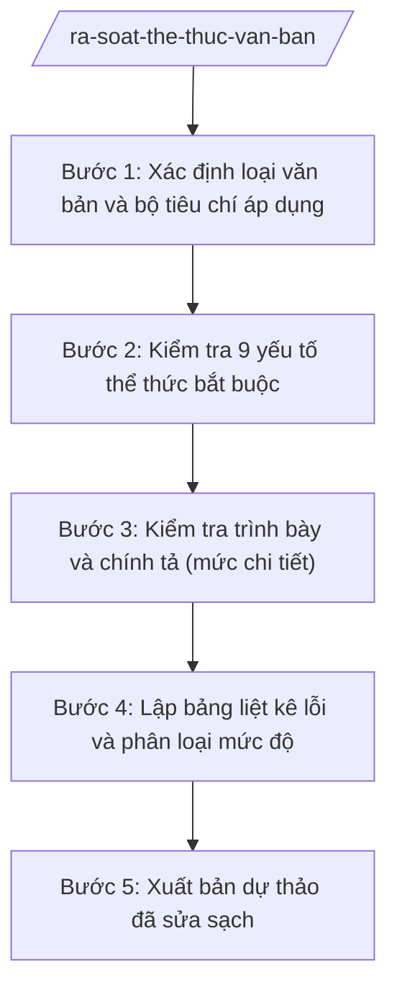

# Skill: Rà soát thể thức văn bản

## Khi nào dùng

- Kiểm tra dự thảo công văn, báo cáo, kế hoạch, thông báo trước khi trình lãnh đạo ký.
- Kiểm tra quyết định hành chính cá biệt (khen thưởng, xử phạt...) trước khi ban hành.
- Kiểm tra tờ trình, phiếu trình kèm văn bản trình ký.
- Rà soát lại văn bản đã ban hành khi phát hiện nghi vấn sai thể thức.
- Tập huấn, hướng dẫn công chức mới về thể thức văn bản hành chính.

## Đầu vào (Input)

| Trường | Mô tả | Bắt buộc |
|--------|-------|----------|
| `du_thao_van_ban` | Toàn văn dự thảo văn bản cần rà soát (dạng text hoặc file) | Có |
| `loai_van_ban` | Loại văn bản (công văn, báo cáo, kế hoạch, thông báo, quyết định, tờ trình...) | Có |
| `don_vi_soan_thao` | Tên đơn vị soạn thảo dự thảo (để đối chiếu ký hiệu, tên cơ quan) | Có |
| `nguoi_ky_du_kien` | Chức vụ người ký dự kiến (để kiểm tra thẩm quyền ký, ký hiệu KT./TL.) | Không |
| `van_ban_can_cu` | Các văn bản được trích dẫn trong dự thảo (để đối chiếu số, ký hiệu, ngày tháng) | Không |
| `muc_do_chat_che` | Mức rà soát: cơ bản (9 yếu tố bắt buộc) hoặc chi tiết (kèm chính tả, trình bày) | Không |

## Quy trình

**Bước 1. Xác định loại văn bản và bộ tiêu chí áp dụng**

- Làm gì: Xác định loại văn bản của dự thảo; chọn bộ tiêu chí rà soát (9 yếu tố bắt buộc theo NĐ 30/2020/NĐ-CP; thêm tiêu chí trình bày, chính tả nếu mức chi tiết).
- Dùng input: `loai_van_ban`, `muc_do_chat_che`, `don_vi_soan_thao`.
- Vai trò: Công chức Văn phòng xác định loại văn bản, AI hỗ trợ liệt kê bộ tiêu chí tương ứng (⏱ 5 phút).
- Lưu ý nghiệp vụ: Mỗi loại văn bản có ký hiệu loại riêng (CV, BC, KH, TB, QĐ, TTr...); văn bản quy phạm pháp luật cấp xã hiện không thuộc thẩm quyền ban hành — nếu phát hiện dự thảo có tính chất QPPL phải cảnh báo ngay.
- → Kết quả bước: Bộ tiêu chí rà soát phù hợp với loại văn bản.

**Bước 2. Kiểm tra 9 yếu tố thể thức bắt buộc**

- Làm gì: Đối chiếu dự thảo với từng yếu tố: (1) Quốc hiệu và tiêu ngữ; (2) Tên cơ quan, tổ chức ban hành; (3) Số, ký hiệu văn bản; (4) Địa danh và thời gian ban hành; (5) Tên loại và trích yếu nội dung; (6) Nội dung văn bản; (7) Chức vụ, họ tên và chữ ký của người có thẩm quyền; (8) Dấu, chữ ký số của cơ quan, tổ chức; (9) Nơi nhận.
- Dùng input: `du_thao_van_ban`, `van_ban_can_cu` (đối chiếu số, ký hiệu, ngày tháng của văn bản được trích dẫn).
- Vai trò: Công chức Văn phòng rà soát, AI hỗ trợ kiểm tra từng yếu tố và ghi nhận lỗi (vị trí, mô tả lỗi, căn cứ quy định) (⏱ 20 phút).
- Lưu ý nghiệp vụ: Kiểm tra số văn bản có trùng với sổ đăng ký văn bản đi không; tên cơ quan ban hành phải đúng tên gọi chính thức (vd: "ỦY BAN NHÂN DÂN XÃ A", không viết tắt tùy tiện); trích yếu phải phản ánh đúng nội dung.
- → Kết quả bước: Danh sách lỗi thể thức theo 9 yếu tố, mỗi lỗi có vị trí và căn cứ.

**Bước 3. Kiểm tra trình bày và chính tả (mức chi tiết)**

- Làm gì: Kiểm tra lỗi chính tả, dấu câu, cách trình bày (canh lề, cỡ chữ, in đậm/in nghiêng, đánh số mục, bảng biểu); kiểm tra tính nhất quán (tên đơn vị, chức danh, số liệu viết thống nhất toàn văn).
- Dùng input: `du_thao_van_ban`, `muc_do_chat_che`.
- Vai trò: Công chức Văn phòng rà soát, AI hỗ trợ phát hiện lỗi chính tả, dấu câu và điểm trình bày chưa thống nhất (⏱ 15 phút).
- Lưu ý nghiệp vụ: Số liệu, ngày tháng viết thống nhất một kiểu trong toàn văn; tên riêng, chức danh viết đúng, viết hoa đúng quy tắc.
- → Kết quả bước: Danh sách lỗi trình bày, chính tả bổ sung vào bảng lỗi.

**Bước 4. Lập bảng liệt kê lỗi và phân loại mức độ**

- Làm gì: Tổng hợp tất cả lỗi thành bảng: STT | Vị trí | Nội dung lỗi | Căn cứ quy định | Cách sửa | Mức độ (nghiêm trọng / cần sửa / nên sửa).
- Dùng input: Kết quả Bước 2 và Bước 3.
- Vai trò: Công chức Văn phòng lập bảng, AI hỗ trợ phân loại mức độ lỗi và đề xuất cách sửa cụ thể cho từng lỗi (⏱ 10 phút).
- Lưu ý nghiệp vụ: Lỗi nghiêm trọng (thiếu quốc hiệu, sai tên cơ quan, thiếu chữ ký người có thẩm quyền, sai số văn bản) bắt buộc phải sửa trước khi trình ký; lỗi trình bày nhỏ có thể sửa trực tiếp.
- → Kết quả bước: Bảng liệt kê lỗi hoàn chỉnh, phân loại mức độ rõ ràng.

**Bước 5. Xuất bản dự thảo đã sửa sạch**

- Làm gì: Áp dụng toàn bộ cách sửa vào dự thảo, cho ra bản dự thảo sạch (không còn lỗi nghiêm trọng và lỗi cần sửa); đính kèm bảng lỗi để người soạn đối chiếu.
- Dùng input: `du_thao_van_ban`, bảng lỗi từ Bước 4.
- Vai trò: Công chức Văn phòng áp dụng sửa, AI hỗ trợ xuất bản sạch và kiểm tra lại một lượt không còn lỗi đã liệt kê (⏱ 15 phút).
- Lưu ý nghiệp vụ: Chỉ sửa lỗi thể thức, trình bày — không tự ý thay đổi nội dung chuyên môn của dự thảo; nội dung chuyên môn do đơn vị soạn thảo chịu trách nhiệm.
- → Kết quả bước: Bản dự thảo đã sửa sạch + bảng liệt kê lỗi, sẵn sàng trình ký.

## Luồng quy trình (Workflow)

## 5. Đầu ra (Output)

- Bảng liệt kê lỗi thể thức (file .docx hoặc bảng): STT | Vị trí | Nội dung lỗi | Căn cứ quy định | Cách sửa | Mức độ.
- Bản dự thảo đã sửa sạch (file .docx), giữ nguyên nội dung chuyên môn.
- Phiếu kết quả rà soát (đạt / chưa đạt — số lỗi nghiêm trọng còn lại phải bằng 0 mới đạt).

### Cấu trúc output chuẩn

**A. Bảng liệt kê lỗi** — các cột bắt buộc theo đúng thứ tự (đối chiếu 9 yếu tố thể thức bắt buộc của NĐ 30/2020/NĐ-CP, gồm Quốc hiệu "CỘNG HÒA XÃ HỘI CHỦ NGHĨA VIỆT NAM" – Tiêu ngữ "Độc lập – Tự do – Hạnh phúc"):

| STT | Vị trí (dòng/mục) | Nội dung lỗi | Căn cứ quy định | Cách sửa | Mức độ |
|-----|-------------------|--------------|-----------------|----------|--------|

Mức độ: **Nghiêm trọng** (bắt buộc sửa trước khi trình ký: thiếu/sai 1 trong 9 yếu tố bắt buộc) | **Cần sửa** (sai chính tả, số liệu, tên gọi chưa thống nhất) | **Nên sửa** (trình bày chưa đẹp, diễn đạt chưa chuẩn).

**B. Bản dự thảo đã sửa sạch** — giữ nguyên bố cục văn bản gốc, áp dụng toàn bộ cách sửa; cuối bản sửa ghi chú: "Đã rà soát thể thức theo NĐ 30/2020/NĐ-CP ngày …; người rà soát: …".

**C. Phiếu kết quả rà soát**: tên văn bản, người rà soát, ngày rà soát, tổng số lỗi (theo mức độ), kết luận Đạt/Chưa đạt, chữ ký người rà soát.

**Phân phối**: bảng lỗi + bản sửa sạch + phiếu kết quả gửi đơn vị soạn thảo để sửa; Văn phòng lưu 01 bộ để theo dõi.

> **Checklist thể thức văn bản theo NĐ 30/2020/NĐ-CP** — đối chiếu trước khi trình ký:
> 1. Quốc hiệu và Tiêu ngữ.
> 2. Tên cơ quan, tổ chức ban hành văn bản.
> 3. Số, ký hiệu của văn bản.
> 4. Địa danh và thời gian ban hành văn bản.
> 5. Tên loại và trích yếu nội dung văn bản.
> 6. Nội dung văn bản.
> 7. Chức vụ, họ tên và chữ ký của người có thẩm quyền.
> 8. Dấu, chữ ký số của cơ quan, tổ chức.
> 9. Nơi nhận (kèm Phụ lục nếu có).

## 6. Checklist nghiệm thu

1. Đã kiểm tra đủ 9 yếu tố thể thức bắt buộc theo NĐ 30/2020/NĐ-CP, không bỏ sót yếu tố nào.
2. Bảng lỗi có đủ 6 cột theo Cấu trúc output chuẩn, mỗi lỗi có căn cứ quy định cụ thể.
3. Lỗi được phân loại mức độ đúng (nghiêm trọng / cần sửa / nên sửa).
4. Bản sửa sạch đã khắc phục 100% lỗi nghiêm trọng và lỗi cần sửa; không còn lỗi đã liệt kê.
5. Bản sửa sạch không thay đổi nội dung chuyên môn của dự thảo gốc.
6. Số văn bản được đối chiếu với sổ đăng ký văn bản đi (không trùng, đúng ký hiệu loại).
7. Tên cơ quan, chức danh người ký đúng tên gọi chính thức, đúng thẩm quyền.
8. Có phiếu kết quả rà soát với kết luận Đạt/Chưa đạt và chữ ký người rà soát.

## 7. Ví dụ mô phỏng

*Dữ liệu dưới đây là giả lập 100% phục vụ minh họa.*

**Input mẫu:**

- loai_van_ban: Báo cáo
- muc_do_chat_che: chi tiết
- du_thao_van_ban: (trích) "UBND XÃ A ... Số: 100/BC ... Xã A, ngày 30/9/2026 ... BÁO CÁO Tình hình KT-XH tháng 9 ... Thiếu quốc hiệu – tiêu ngữ ở đầu văn bản; số văn bản thiếu ký hiệu "-UBND"; nơi nhận chỉ ghi "Lưu VT" mà thiếu đơn vị nhận chính..."

**Output mẫu:**

**A. Bảng liệt kê lỗi**

| STT | Vị trí | Nội dung lỗi | Căn cứ quy định | Cách sửa | Mức độ |
|-----|--------|--------------|-----------------|----------|--------|
| 1 | Đầu văn bản | Thiếu quốc hiệu "CỘNG HÒA XÃ HỘI CHỦ NGHĨA VIỆT NAM" và tiêu ngữ "Độc lập – Tự do – Hạnh phúc" | NĐ 30/2020/NĐ-CP: quốc hiệu, tiêu ngữ là yếu tố bắt buộc | Bổ sung quốc hiệu – tiêu ngữ căn giữa đầu văn bản | Nghiêm trọng |
| 2 | Số, ký hiệu | Ghi "Số: 100/BC" thiếu ký hiệu cơ quan ban hành | NĐ 30/2020/NĐ-CP: số, ký hiệu gồm số thứ tự và ký hiệu văn bản | Sửa thành "Số: 100/BC-UBND" | Nghiêm trọng |
| 3 | Nơi nhận | Thiếu đơn vị nhận chính, chỉ ghi "Lưu: VT" | NĐ 30/2020/NĐ-CP: nơi nhận là yếu tố bắt buộc | Bổ sung "Nơi nhận: - UBND tỉnh A; - Lưu: VT." | Nghiêm trọng |
| 4 | Trích yếu | Viết tắt "KT-XH" trong trích yếu | Quy tắc trình bày: trích yếu không viết tắt | Sửa thành "kinh tế – xã hội" | Cần sửa |

**B. Bản dự thảo đã sửa sạch** (trích đầu văn bản):

> CỘNG HÒA XÃ HỘI CHỦ NGHĨA VIỆT NAM
> Độc lập – Tự do – Hạnh phúc
>
> ỦY BAN NHÂN DÂN
> XÃ A
>
> Số: 100/BC-UBND
>
> Xã A, ngày 30 tháng 9 năm 2026
>
> **BÁO CÁO**
> **Tình hình kinh tế – xã hội tháng 9 năm 2026**
>
> *(... nội dung giữ nguyên ...)*
>
> Nơi nhận:
> - UBND tỉnh A;
> - Lưu: VT.
>
> *Đã rà soát thể thức theo NĐ 30/2020/NĐ-CP ngày 30/9/2026; người rà soát: Nguyễn Văn G.*

**C. Phiếu kết quả rà soát**: Dự thảo Báo cáo tình hình KT-XH tháng 9/2026 — tổng 04 lỗi (03 nghiêm trọng, 01 cần sửa) — đã sửa sạch — Kết luận: **Đạt**.

## 8. Human gate

- Công chức Văn phòng rà soát, lập bảng lỗi và bản sửa sạch → Chánh Văn phòng kiểm tra lại các lỗi mức "nghiêm trọng" → đơn vị soạn thảo xác nhận nội dung chuyên môn không bị thay đổi → trình lãnh đạo ký.
- Văn bản đã ban hành phát hiện sai thể thức: báo cáo người đứng đầu cơ quan quyết định đính chính hoặc ban hành lại.

## 9. Giới hạn

- AI KHÔNG thay đổi nội dung chuyên môn của dự thảo khi sửa lỗi thể thức.
- AI KHÔNG tự kết luận văn bản "đạt" khi còn lỗi mức nghiêm trọng chưa sửa.
- AI KHÔNG bịa căn cứ quy định; mọi lỗi phải gắn đúng yếu tố thể thức của NĐ 30/2020/NĐ-CP.
- AI KHÔNG rà soát tính đúng đắn của nội dung chuyên môn, số liệu — đó là trách nhiệm của đơn vị soạn thảo.
- Nếu phát hiện dự thảo có tính chất văn bản quy phạm pháp luật (vượt thẩm quyền cấp xã): AI phải cảnh báo, không tiếp tục rà soát như văn bản hành chính thông thường.

## 10. Căn cứ & lưu ý

- NĐ 30/2020/NĐ-CP về công tác văn thư: quy định 9 yếu tố thể thức bắt buộc của văn bản hành chính — là checklist duy nhất của skill này.
- NĐ 150/2025/NĐ-CP (hiệu lực 16/6/2025): Văn phòng HĐND và UBND tham mưu lĩnh vực văn phòng — đầu mối rà soát thể thức văn bản của UBND xã.
- TT 06/2026/TT-BNV (hiệu lực 15/6/2026): sửa đổi TT 10/2025/TT-BNV — cập nhật nhiệm vụ lĩnh vực nội vụ cấp xã, trong đó có công tác văn thư, lưu trữ.
- Thẩm quyền ban hành văn bản của cấp xã: thực hiện theo quy định pháp luật về tổ chức chính quyền địa phương và phân cấp, phân quyền (chuỗi NĐ 120–152/2025/NĐ-CP) — không tự gắn số hiệu văn bản khi chưa xác thực.
