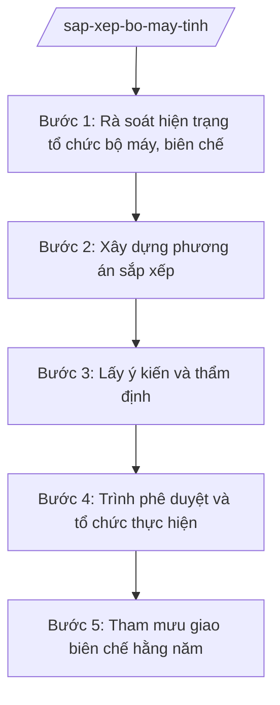

# Skill: Tham mưu sắp xếp tổ chức bộ máy, biên chế

## 2. Khi nào dùng
- Triển khai chủ trương sắp xếp, tinh gọn tổ chức bộ máy của Trung ương (sáp nhập sở, giảm đầu mối).
- UBND tỉnh giao Sở Nội vụ xây dựng đề án sắp xếp tổ chức bộ máy của tỉnh.
- Thẩm định đề án sắp xếp tổ chức bên trong của các sở, ban, ngành, đơn vị sự nghiệp.
- Tham mưu giao biên chế công chức, số lượng người làm việc hằng năm.

## 3. Đầu vào (Input)
| Trường | Mô tả | Bắt buộc |
|--------|-------|----------|
| `chu_truong` | Chủ trương, chỉ đạo của Trung ương/tỉnh về sắp xếp tổ chức bộ máy | Có |
| `hien_trang_bo_may` | Hiện trạng tổ chức bộ máy, biên chế các cơ quan, đơn vị | Có |
| `de_xuat_sap_xep` | Phương án sắp xếp đề xuất (sáp nhập, giải thể, thành lập mới) | Có |
| `dinh_muc_bien_che` | Định mức biên chế, khung số lượng theo quy định | Có |
| `y_kien_cac_ben` | Ý kiến của sở, ngành, đơn vị liên quan | Không |

## 4. Quy trình

**Bước 1. Rà soát hiện trạng tổ chức bộ máy, biên chế**
- Làm gì: Thu thập, rà soát hiện trạng: số đầu mối sở/ngành, phòng, chi cục, đơn vị sự nghiệp; biên chế thực có so với biên chế được giao; chồng chéo chức năng.
- Dùng input: `hien_trang_bo_may`, `dinh_muc_bien_che`.
- Vai trò: Chuyên viên Phòng Tổ chức bộ máy (Sở Nội vụ tỉnh A) rà soát; AI hỗ trợ lập bảng tổng hợp, phát hiện chồng chéo chức năng ⏱ ~3 ngày làm việc (ước tính)
- Lưu ý nghiệp vụ: Số liệu phải chính xác đến từng đầu mối, từng biên chế; đối chiếu với quyết định giao biên chế của cấp có thẩm quyền.
- → Kết quả bước: Báo cáo hiện trạng tổ chức bộ máy, biên chế.

**Bước 2. Xây dựng phương án sắp xếp**
- Làm gì: Xây dựng phương án: sáp nhập/giải thể/thành lập tổ chức; chuyển chức năng, nhiệm vụ; phương án bố trí cán bộ, xử lý dôi dư; lộ trình thực hiện.
- Dùng input: `chu_truong`, `de_xuat_sap_xep`, `y_kien_cac_ben`.
- Vai trò: Trưởng phòng Tổ chức bộ máy chủ trì; AI hỗ trợ soạn đề án theo khung, lập bảng chuyển đổi chức năng ⏱ ~5 ngày làm việc (ước tính)
- Lưu ý nghiệp vụ: Phương án phải bám chủ trương của Trung ương; bảo đảm không gián đoạn hoạt động, không bỏ sót chức năng, nhiệm vụ; có phương án xử lý cán bộ dôi dư đúng chính sách.
- → Kết quả bước: Dự thảo đề án sắp xếp tổ chức bộ máy.

**Bước 3. Lấy ý kiến và thẩm định**
- Làm gì: Gửi lấy ý kiến các sở, ngành, đơn vị liên quan; thẩm định đề án sắp xếp nội bộ của các sở, ngành (nếu được giao).
- Dùng input: Dự thảo đề án.
- Vai trò: Chuyên viên tổng hợp; AI hỗ trợ lập bảng tổng hợp ý kiến ⏱ ~7 ngày làm việc (ước tính)
- Lưu ý nghiệp vụ: Ý kiến không tiếp thu phải giải trình; đề án của sở, ngành phải phù hợp khung của tỉnh.
- → Kết quả bước: Đề án hoàn thiện kèm bảng tiếp thu ý kiến.

**Bước 4. Trình phê duyệt và tổ chức thực hiện**
- Làm gì: Trình UBND tỉnh (hoặc cấp có thẩm quyền) phê duyệt đề án; tham mưu quyết định thành lập, tổ chức lại, giải thể; hướng dẫn bàn giao.
- Dùng input: Đề án hoàn thiện.
- Vai trò: Giám đốc Sở Nội vụ ký tờ trình; Chủ tịch UBND tỉnh A quyết định; AI hỗ trợ soạn tờ trình, dự thảo quyết định ⏱ ~2 ngày làm việc (ước tính)
- Lưu ý nghiệp vụ: Đúng thẩm quyền quyết định thành lập/tổ chức lại/giải thể; bàn giao hồ sơ, tài sản, con dấu đầy đủ, đúng thủ tục.
- → Kết quả bước: Quyết định phê duyệt đề án và các quyết định tổ chức lại.

**Bước 5. Tham mưu giao biên chế hằng năm**
- Làm gì: Trên cơ sở đề án đã phê duyệt, tham mưu UBND tỉnh giao biên chế công chức, số lượng người làm việc cho các cơ quan, đơn vị năm tiếp theo.
- Dùng input: `dinh_muc_bien_che`, kết quả sắp xếp.
- Vai trò: Chuyên viên tính toán; Giám đốc Sở Nội vụ trình; AI hỗ trợ lập bảng phân bổ biên chế ⏱ ~3 ngày làm việc (ước tính)
- Lưu ý nghiệp vụ: Giao biên chế trong tổng số được cấp có thẩm quyền giao; gắn với vị trí việc làm đã phê duyệt.
- → Kết quả bước: Quyết định giao biên chế năm của UBND tỉnh.

## Luồng quy trình (Workflow)

## 5. Đầu ra (Output)
- Đề án sắp xếp tổ chức bộ máy.
- Tờ trình + quyết định phê duyệt đề án.
- Các quyết định thành lập/tổ chức lại/giải thể tổ chức.
- Quyết định giao biên chế công chức, số lượng người làm việc.

**Cấu trúc output chuẩn:**
Khung đề án sắp xếp tổ chức bộ máy:
1. Tờ trình: Quốc hiệu "CỘNG HÒA XÃ HỘI CHỦ NGHĨA VIỆT NAM", Tiêu ngữ "Độc lập – Tự do – Hạnh phúc"; tên cơ quan; số, ký hiệu; địa danh, ngày tháng năm (thể thức NĐ 30/2020/NĐ-CP).
2. Đề án: I. Sự cần thiết; II. Hiện trạng; III. Phương án sắp xếp (tổ chức, chức năng, nhân sự, tài sản); IV. Lộ trình; V. Kinh phí; VI. Tổ chức thực hiện.
3. Phụ lục: sơ đồ tổ chức trước/sau; bảng biên chế.
- Nơi nhận: liệt kê các cơ quan, đơn vị nhận để biết/thực hiện; kết thúc bằng "- Lưu: VT, [mã đơn vị]".

> **Checklist thể thức văn bản theo NĐ 30/2020/NĐ-CP** — đối chiếu trước khi trình ký:
> 1. Quốc hiệu và Tiêu ngữ.
> 2. Tên cơ quan, tổ chức ban hành văn bản.
> 3. Số, ký hiệu của văn bản.
> 4. Địa danh và thời gian ban hành văn bản.
> 5. Tên loại và trích yếu nội dung văn bản.
> 6. Nội dung văn bản.
> 7. Chức vụ, họ tên và chữ ký của người có thẩm quyền.
> 8. Dấu, chữ ký số của cơ quan, tổ chức.
> 9. Nơi nhận (kèm Phụ lục nếu có).

## 6. Checklist nghiệm thu
- [ ] Hiện trạng rà soát đầy đủ, số liệu chính xác.
- [ ] Phương án bám chủ trương Trung ương, không bỏ sót chức năng.
- [ ] Có phương án bố trí, xử lý cán bộ dôi dư đúng chính sách.
- [ ] Đã lấy ý kiến đầy đủ; tiếp thu/giải trình rõ ràng.
- [ ] Đúng thẩm quyền phê duyệt, thành lập/tổ chức lại/giải thể.
- [ ] Giao biên chế trong tổng số được giao, gắn vị trí việc làm.
- [ ] Đúng thể thức văn bản theo NĐ 30/2020/NĐ-CP.
- [ ] Đã qua kiểm tra của Trưởng phòng và ký duyệt của Giám đốc Sở.

## 7. Ví dụ mô phỏng
*Dữ liệu dưới đây là giả lập 100% phục vụ minh họa.*

**Input mẫu:**
- chu_truong: Thực hiện sắp xếp đơn vị sự nghiệp công lập theo chỉ đạo của tỉnh A
- hien_trang_bo_may: Tỉnh A có 45 đơn vị sự nghiệp công lập trực thuộc sở, ngành (giả lập)
- de_xuat_sap_xep: Sáp nhập 10 đơn vị trùng chức năng thành 4 đơn vị (giả lập)

**Output mẫu (trích đề án):**
> **ĐỀ ÁN**
> **Sắp xếp đơn vị sự nghiệp công lập trực thuộc sở, ngành tỉnh A**
>
> I. Sự cần thiết: ...
> II. Hiện trạng: 45 đơn vị ... (giả lập)
> III. Phương án: sáp nhập ... thành ...; giảm 6 đầu mối (giả lập)
> ...

## 8. Human gate
- Trưởng phòng Tổ chức bộ máy: kiểm tra hiện trạng và phương án (Bước 1–2).
- Giám đốc Sở Nội vụ: ký tờ trình đề án (Bước 4).
- Chủ tịch UBND tỉnh: quyết định phê duyệt đề án, giao biên chế.

## 9. Giới hạn
- AI không thay lãnh đạo quyết định phương án sắp xếp tổ chức.
- Không bịa số liệu biên chế, đầu mối; không đề xuất vượt tổng biên chế được giao.
- Không bỏ qua bước lấy ý kiến các bên liên quan.
- Không viện dẫn văn bản hết hiệu lực.

## 10. Căn cứ & lưu ý
- TT 10/2025/TT-BNV; TT 06/2026/TT-BNV (chức năng, nhiệm vụ Sở Nội vụ về tổ chức bộ máy).
- NĐ 25/2025/NĐ-CP (chức năng, nhiệm vụ của Bộ Nội vụ).
- NĐ 150/2025/NĐ-CP; NĐ 370/2025/NĐ-CP (tổ chức cơ quan chuyên môn).
